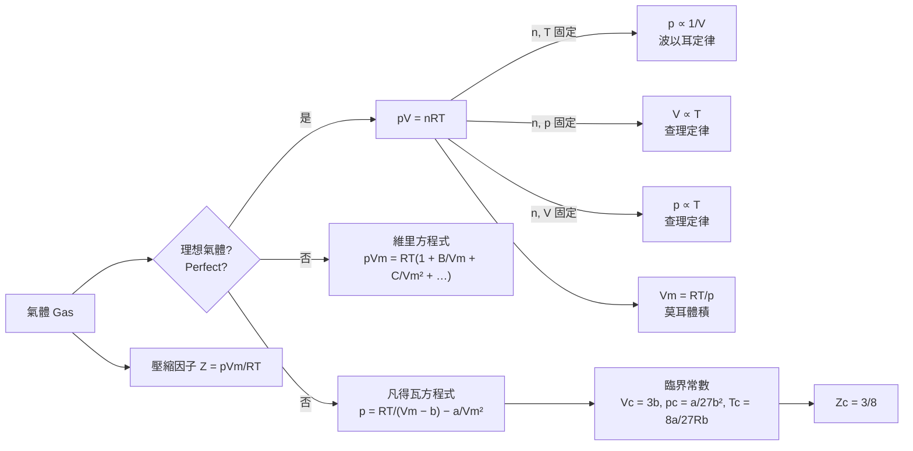

# Focus 1 氣體的性質（The Properties of Gases）
# 1A 理想氣體（The Perfect Gas）講義

> **範圍**：上課簡報 p.6–31；課本 Atkins' Physical Chemistry Topic 1A（p.4–10）及章末 Exercises / Problems（p.27–28）
> **標示說明**：未特別標示者以簡報為主；**📘 課本補充** 表示簡報未提、取自課本的內容；**⚠️** 表示勘誤或易錯處
> **考試形式**：問答（依簡報 p.2），因此本講義最後附「觀念問答練習」

---

## 學習重點

1. 能說明四個狀態變數（state variables）：壓力 $p$、體積 $V$、溫度 $T$、物質的量 $n$，及狀態方程式 $p=f(T,V,n)$ 的意義。
2. 理解力學平衡（mechanical equilibrium）與熱平衡（thermal equilibrium）的定義；知道氣壓計與真空計的量測原理。
3. 能由波以耳定律、查理定律、亞佛加厥定律**推導**理想氣體方程式 $pV=nRT$，並理解「極限定律（limiting law）」的意義。
4. 能判讀等溫線（isotherm）、等壓線（isobar）、等容線（isochore）與 $p$–$V$–$T$ 曲面。
5. 能區分分壓（partial pressure）的**定義**（適用所有氣體）與道耳頓分壓定律（Dalton's law，僅適用理想氣體）。

---

## 1A.1 狀態變數（Variables of State）

### 一、狀態與狀態方程式

物質樣品的**物理狀態（physical state）** 由其物理性質決定；兩個樣品若所有物理性質都相同，就稱它們「處於相同狀態」。描述氣體狀態所需的**狀態變數（variables of state）** 有四個：

| 符號 | 名稱 | SI 單位 |
|---|---|---|
| $p$ | 壓力（pressure） | Pa |
| $V$ | 體積（volume） | m³ |
| $T$ | 溫度（temperature） | K |
| $n$ | 物質的量（amount of substance） | mol |

實驗發現：四個變數中**只要指定三個，第四個就被決定**。描述這種關係的方程式稱為**狀態方程式（equation of state）**，一般形式為

$$
p = f(T, V, n) \qquad \text{（狀態方程式的一般形式，課本式 1A.3）}
$$

每種物質都有自己的狀態方程式，但只有少數特例能寫出明確形式，最重要的就是理想氣體方程式。

---

### 二、壓力（Pressure）

#### 1. 定義與單位

$$
p = \frac{F}{A}
$$

$F$ 為力（force），$A$ 為受力面積（area）。氣體的壓力來自**分子對器壁的碰撞**；碰撞次數極多，因此合力（及壓力）是穩定的。

SI 單位為**帕斯卡（pascal, Pa）**：

$$
1\ \text{Pa} = 1\ \text{N m}^{-2} = 1\ \text{kg m}^{-1}\,\text{s}^{-2}
$$

**常用壓力單位（課本表 1A.1）**

| 名稱 | 符號 | 換算 |
|---|---|---|
| 帕斯卡（pascal） | Pa | 1 Pa = 1 N m⁻² |
| 巴（bar） | bar | 1 bar = 10⁵ Pa（**精確值**） |
| 大氣壓（atmosphere） | atm | 1 atm = 101.325 kPa（**精確值**） |
| 托（torr） | Torr | 1 Torr = (101 325/760) Pa ≈ 133.32 Pa |
| 毫米汞柱（millimetres of mercury） | mmHg | 1 mmHg ≈ 133.322 Pa |
| 磅每平方英寸（pounds per square inch） | psi | 1 psi ≈ 6.894 757 kPa |

📘 **標準壓力（standard pressure）**：$p^\ominus = 1\ \text{bar}$（精確值）。它接近但**不等於** 1 atm。熱力學中的「標準狀態」都以 $p^\ominus$ 為準。

#### 2. 力學平衡（Mechanical Equilibrium）

（簡報 p.9／課本圖 1A.1）兩氣體以一道**可移動的隔板（movable wall）** 分開：

- 左側壓力較大時，隔板被推向右（低壓側）；左側壓力下降、右側上升。
- 直到兩側壓力相等，隔板不再移動，此時稱兩區達成**力學平衡**。

> **重點**：「壓力相等」是力學平衡的判斷依據，類似「溫度相等」是熱平衡的判斷依據。

#### 3. 壓力的量測

**(a) 氣壓計（barometer）**（簡報 p.10）

由托里切利（Torricelli）發明：將裝滿汞的玻璃管倒立於汞槽中，管頂形成真空，大氣壓支撐住一段汞柱。

**推導**：汞柱底部的壓力等於大氣壓。液柱造成的**流體靜壓（hydrostatic pressure）**：

$$
p = \frac{F}{A} = \frac{mg}{A} = \frac{\rho (Ah) g}{A} = \rho g h
$$

代入汞的密度 $\rho = 13.5951\ \text{g cm}^{-3}$、$g = 9.80665\ \text{m s}^{-2}$、$h = 0.760\ \text{m}$：

$$
p = (13\,595.1\ \text{kg m}^{-3})(9.80665\ \text{m s}^{-2})(0.760\ \text{m}) = 1.01325\times10^{5}\ \text{Pa} = 1\ \text{atm}
$$

> 為何用汞？因為汞的密度大，汞柱只需 76 cm。若改用水，需要 $h = 101325/(1000\times 9.80665) \approx 10.3\ \text{m}$。

**(b) BA 型熱陰極游離真空計（Bayard–Alpert ionization gauge）**（簡報 p.10–13）

用於高真空的壓力量測。構造與原理如下：

| 元件 | 電位（簡報 p.12） | 功能 |
|---|---|---|
| 燈絲（filament，熱陰極 hot cathode） | +30 V | 加熱後以**熱電子發射（thermionic emission）** 放出電子 |
| 柵極（陽極柵，anode grid） | +180 V | 吸引並加速電子；電子在柵極內外來回振盪，增加碰撞機會 |
| 離子收集極（ion collector） | 0 V（相對燈絲為負） | 位於柵極中央的細金屬線，收集氣體分子被**游離（ionization）** 後產生的正離子 |

**量測邏輯**：

$$
\text{電子撞擊氣體分子} \;\rightarrow\; \text{產生正離子} \;\rightarrow\; \text{離子電流 } i_c \propto \text{分子數密度 } \frac{N}{V} \propto p \quad (T\text{ 固定})
$$

一般寫成 $i_c = S\, i_e\, p$，其中 $i_e$ 為電子發射電流，$S$ 為**靈敏度係數（sensitivity factor）**。不同氣體的游離難易不同，所以 $S$ 與**氣體種類有關**（gas-type dependent）。

> **延伸觀念**（常見問答題）：
> - **為何收集極做成細線、放在中央？** 電子撞擊柵極會產生軟 X 射線（soft X-ray）。X 射線打到收集極會激發光電子，形成「假的」離子電流，使讀值有下限，稱為 **X 射線極限（X-ray limit）**。細線的截面積小，可減少此效應，讓量測下限延伸到約 $10^{-10}$ Torr。
> - **為何不能在高壓下使用？** 燈絲在高壓（尤其含氧）時容易燒毀；且分子太多時，離子電流與壓力不再呈線性。

**真空計比較表**（整理自簡報 p.13）

| 真空等級 | 真空計種類 | 量測範圍（Torr） | 與氣體種類有關？ | 量測原理 |
|---|---|---|---|---|
| 粗真空（rough vacuum） | 波登管／機械隔膜壓力計（Bourdon tube / mechanical diaphragm gauge） | 760 – 1 | 否 | 機械力造成的形變 |
| 粗～中真空 | 電容式隔膜真空計（capacitance diaphragm gauge, CDG） | 10³ – 10⁻⁵（單一感測器約涵蓋 4 個數量級） | 否 | 隔膜形變改變電容 |
| 中真空（medium vacuum） | 皮拉尼真空計（Pirani gauge） | 10 – 10⁻³ | 是 | 氣體熱傳導（thermal conductivity） |
| 中真空 | 熱電偶真空計（thermocouple gauge） | 1 – 10⁻³ | 是 | 氣體熱傳導 |
| 高真空（high vacuum） | 冷陰極真空計（cold cathode gauge；潘寧 Penning／反磁控管 inverted magnetron） | 10⁻² – 10⁻⁹ | 是 | 氣體游離 |
| 高真空 | **熱陰極 BA 型游離真空計** | **10⁻³ – 10⁻¹⁰** | 是 | 氣體游離 |
| 超高真空（ultra-high vacuum, UHV） | 萃取式真空計（extractor gauge） | 10⁻⁴ – 10⁻¹² | 是 | 氣體游離（改良路徑以降低 X 射線極限） |

> **規律**：靠「力」量測的（機械式、電容式）與氣體種類**無關**；靠「熱傳導」或「游離」量測的，都與氣體種類**有關**。

📘 **課本補充**：
- **電容式壓力計（capacitance manometer）**：一片固定電極與一片可形變的隔膜構成電容器，壓力改變使隔膜偏移、電容改變。
- **半導體壓力感測器**：某些半導體的性質隨壓力改變，可作為**換能器（transducer）**，例如手機內的固態壓力計。

**體積（volume）** $V$：氣體佔據空間的大小，SI 單位為 m³。

---

### 三、溫度（Temperature）

#### 1. 溫度的意義

（簡報 p.14）溫度是決定**能量以熱（heat）的形式流動方向**的性質。兩物體透過**能導熱的剛性壁**接觸時，能量從高溫物體流向低溫物體。

| 名詞 | 定義 |
|---|---|
| **透熱壁（diathermic wall）** | 允許熱通過的邊界；兩側溫度不同時，會發生狀態變化 |
| **絕熱壁（adiabatic wall）** | 即使兩側溫度不同，也不發生任何變化的邊界（熱絕緣，thermally insulating） |

#### 2. 熱平衡與熱力學第零定律

（簡報 p.15）**熱平衡（thermal equilibrium）**：兩物體 A、B 經由透熱壁接觸時，若兩者都**不發生狀態變化**，就稱 A 與 B 達成熱平衡。

簡報圖中 A、B、C 三個方塊所表達的，就是**熱力學第零定律（zeroth law of thermodynamics）**：

$$
\text{若 A 與 B 熱平衡，且 B 與 C 熱平衡} \;\Longrightarrow\; \text{A 與 C 也熱平衡}
$$

> **意義**：第零定律是溫度計的理論基礎。B 就是溫度計：只要 B 分別與 A、C 熱平衡且讀數相同，就能斷定 A、C 的溫度相同，而不必讓 A 與 C 直接接觸。

#### 3. 溫標（Temperature Scales）

- **熱力學溫度（thermodynamic temperature）** $T$：絕對溫標，最低點為 $T = 0$，單位為**克耳文（kelvin, K）**，此溫標稱為**克氏溫標（Kelvin scale）**。
- **攝氏溫標（Celsius scale）**：攝氏溫度記為 $\theta$（theta），單位 °C。

$$
T/\text{K} = \theta/^\circ\text{C} + 273.15 \qquad \text{（攝氏溫標的定義，273.15 為精確值，式 1A.1）}
$$

此式說明攝氏溫標是**用克氏溫標來定義**的，而且溫差 1 °C = 溫差 1 K。

> ⚠️ **易錯**：
> - 單位寫 **K**，不是「°K」。
> - 最低溫寫成 **$T = 0$**，不寫「$T = 0$ K」（絕對溫標的零點與單位大小無關，就像 $p=0$ 不必寫成 0 Pa）。但攝氏溫標**不是**絕對溫標，所以要寫 **0 °C**。

📘 **課本補充：2019 年 SI 單位重新定義**
- 2019 年以前，克氏溫標以**水的三相點（triple point of water）** 定為精確的 273.16 K。
- 現在改以**波茲曼常數（Boltzmann constant）** $k = 1.380\,649\times10^{-23}\ \text{J K}^{-1}$（精確值）來定義。

---

### 四、📘 物質的量（Amount of Substance）

- **物質的量** $n$：樣品中指定實體（原子、分子或化學式單位）的數量，單位為**莫耳（mole, mol）**。
- 2019 年起：1 mol 精確含有 $6.022\,140\,76\times10^{23}$ 個實體，因此**亞佛加厥常數（Avogadro constant）** 為
  $$N_A = 6.022\,140\,76\times10^{23}\ \text{mol}^{-1} \quad \text{（精確值，是有單位的常數，不是純數）}$$
- **莫耳質量（molar mass）** $M$：每莫耳的質量，SI 單位為 kg mol⁻¹，常用 g mol⁻¹。

$$
n = \frac{m}{M} \qquad (\text{式 1A.2}), \qquad N = n N_A
$$

> ⚠️ 簡報 p.6 寫「number of moles」。課本特別指出這種說法不正確，應說「amount in moles」（以莫耳表示的物質的量）。考試寫英文時請注意。

### 五、📘 示量性質與示強性質（Extensive and Intensive Properties）

| 類別 | 定義 | 例子 |
|---|---|---|
| **示量性質（extensive property）**（又稱廣延性質） | 將樣品分割後，各部分數值**相加等於原值** | 質量、體積、物質的量 |
| **示強性質（intensive property）**（又稱內含性質） | 將樣品分割後，各部分**數值不變** | 溫度、壓力、密度 |

- **莫耳性質（molar property）**：$X_\text{m} = X/n$。兩個示量性質相除得到示強性質，所以**所有莫耳性質都是示強性質**，例如莫耳體積 $V_\text{m} = V/n$。
- **質量密度（mass density）** $\rho = m/V$ 也是示強性質。

---

### 📘 課本例題 1A.1：狀態變數的換算（Specifying the variables of state）

**題目**：將 0.560 mg 的氮氣（nitrogen）釋放到某容器中，在 25.2 °C 下測得壓力為 10.4 Torr。將壓力以 Pa、溫度以 K 表示，並計算 N₂ 的物質的量與分子數。

**詳解**：

1. 壓力：
   $$p = (10.4\ \text{Torr})\times(133.32\ \text{Pa Torr}^{-1}) = 1.39\times10^{3}\ \text{Pa}$$
2. 溫度：
   $$T/\text{K} = 25.2 + 273.15 = 298.35 \;\Rightarrow\; T = 298\ \text{K}$$
3. 物質的量：
   $$n = \frac{m}{M} = \frac{0.560\times10^{-3}\ \text{g}}{28.02\ \text{g mol}^{-1}} = 2.00\times10^{-5}\ \text{mol}$$
4. 分子數：
   $$N = nN_A = (2.00\times10^{-5}\ \text{mol})(6.022\times10^{23}\ \text{mol}^{-1}) = 1.20\times10^{19}$$

> ⚠️ **課本勘誤**：課本此題寫「N₂ 的莫耳質量取 14.01 g mol⁻¹」，那是 **N 原子**的莫耳質量。N₂ 應為 **28.02 g mol⁻¹**。課本因此算出 $n = 4.00\times10^{-5}$ mol、$N = 2.41\times10^{19}$，都**多了一倍**。上方是更正後的答案。

**自我測驗（Self-test 1A.1）**：將壓力換成 bar 與 atm。
答：$1.39\times10^{-2}$ bar；$1.37\times10^{-2}$ atm（$10.4/760 = 0.01368$）。

---

## 1A.2 狀態方程式（Equations of State）

### 一、三大經驗定律（簡報 p.17、p.22）

| 定律 | 數學形式 | 固定條件 |
|---|---|---|
| **波以耳定律（Boyle's law）** | $pV = \text{常數}$ | $n, T$ 固定 |
| **查理定律（Charles's law）** | $V = \text{常數}\times T$ | $n, p$ 固定 |
| （查理定律的另一形式，台灣高中又稱給呂薩克定律，Gay-Lussac's law） | $p = \text{常數}\times T$ | $n, V$ 固定 |
| **亞佛加厥定律（Avogadro's principle）** | $V = \text{常數}\times n$ | $p, T$ 固定 |

**亞佛加厥定律的敘述**：同溫同壓下，相同體積的氣體含有相同數目的分子。

> 📘 為什麼課本稱它為 **principle（原理）** 而不是 law？因為它**假設了物質由分子組成**。嚴格來說，「定律（law）」只是觀察結果的總結，與任何模型無關。

### 二、極限定律（Limiting Law）

波以耳定律與查理定律只在 **$p \to 0$ 的極限下才嚴格成立**，這類定律稱為**極限定律**：只在某個極限條件下嚴格成立的定律。

**簡報 p.17 的示範**：假設某物質的體積可寫為

$$
V = aT + bp + cp^2
$$

當 $p \to 0$ 時，$bp \to 0$、$cp^2 \to 0$，因此

$$
V \to aT \quad \text{（即查理定律）}
$$

這說明：真實氣體的行為含有與壓力相關的修正項，壓力越低，修正項越小，越接近理想定律。

> 在一般壓力（$p \approx 1$ bar）下，這些定律仍相當可靠，所以化學中廣泛使用。

### 三、圖形表示（簡報 p.18–21）

| 圖 | 座標 | 曲線名稱 | 形狀 | 外插結果 |
|---|---|---|---|---|
| 圖 1A.2 | $p$ 對 $V$ | **等溫線（isotherm）** | **雙曲線（hyperbola）**，$pV=$ 常數 | 溫度越高，曲線離原點越遠 |
| 圖 1A.3 | $p$ 對 $1/V$ | 等溫線 | **直線**，斜率 $=nRT$ | 外插至 $p=0$、$1/V=0$；溫度越高斜率越大 |
| 圖 1A.4 | $V$ 對 $T$ | **等壓線（isobar）** | 直線，斜率 $=nR/p$ | 外插至 $V=0$、$T=0$（即 $\theta=-273.15$ °C）；**壓力越小斜率越大** |
| 圖 1A.5 | $p$ 對 $T$ | **等容線（isochore）** | 直線，斜率 $=nR/V$ | 外插至 $p=0$、$T=0$；**體積越小斜率越大** |

> **觀念**：為什麼圖中靠近原點的部分畫成虛線並標「外插（extrapolation）」？因為真實氣體在低溫下會液化，無法實際量到 $T \to 0$。絕對零度正是由這些直線**外插**得到的（見習題 P1A.4）。

### 四、推導：理想氣體方程式（Perfect Gas Law）

**目標**：由三大經驗定律組合出 $pV = nRT$。

**步驟 1：先固定 $n$，處理 $p, V, T$ 三者。** 讓一定量的氣體從狀態 1 $(p_1, V_1, T_1)$ 變到狀態 2 $(p_2, V_2, T_2)$，分兩段進行：

- **(i) 等溫過程**（$T_1$ 固定）：壓力由 $p_1$ 變為 $p_2$，體積變為中間值 $V'$。由波以耳定律：
  $$p_1 V_1 = p_2 V' \;\Rightarrow\; V' = \frac{p_1 V_1}{p_2}$$
- **(ii) 等壓過程**（$p_2$ 固定）：溫度由 $T_1$ 變為 $T_2$，體積由 $V'$ 變為 $V_2$。由查理定律：
  $$\frac{V'}{T_1} = \frac{V_2}{T_2}$$
- **(iii) 代入消去 $V'$**：
  $$\frac{p_1V_1}{p_2 T_1} = \frac{V_2}{T_2} \;\Rightarrow\; \frac{p_1V_1}{T_1} = \frac{p_2V_2}{T_2}$$

因此，對固定的 $n$，$\dfrac{pV}{T}$ 為常數。

**步驟 2：加入 $n$。** 由亞佛加厥定律，在 $p, T$ 固定時 $V \propto n$，所以這個常數必定正比於 $n$：

$$
\frac{pV}{T} = \text{常數}\times n \;\Rightarrow\; pV = \text{常數}\times nT
$$

**步驟 3：** 實驗發現此比例常數**對所有氣體都相同**，記為 $R$，稱為**（莫耳）氣體常數（molar gas constant）**：

$$
\boxed{\,pV = nRT\,} \qquad \text{理想氣體方程式（perfect gas law，式 1A.4）}
$$

**檢查**：此式在 $n,T$ 固定時回到波以耳定律；在 $n,p$ 或 $n,V$ 固定時回到查理定律；在 $p,T$ 固定時回到亞佛加厥定律。

> - **理想氣體（perfect gas）**：在**所有條件下**都遵守 $pV=nRT$ 的氣體。
> - **真實氣體（real gas）**：$pV=nRT$ 只是近似，壓力越低越準；在 $p\to0$ 的極限下精確成立。

📘 **perfect gas 與 ideal gas 的差異**：台灣中文兩者都譯為「理想氣體」，但課本刻意區分：
- **ideal system（理想系統）**：分子間的作用力**全部相同**。
- **perfect system（完美系統）**：分子間的作用力不僅全部相同，而且**為零**。

本講義的「理想氣體」均指 perfect gas。到第 5 章「理想溶液（ideal solution）」時，這個區分會很重要：理想溶液中分子間作用力不為零，只是 A–A、B–B、A–B 作用力相同。

#### 推導延伸：常用變形

**(1) 組合氣體定律（combined gas law，式 1A.5）**：由 $pV/nT = R$ 為常數，得

$$
\frac{p_1V_1}{n_1T_1} = \frac{p_2V_2}{n_2T_2}
$$

**(2) 密度與莫耳質量**：將 $n = m/M$ 代入 $pV = nRT$：

$$
pV = \frac{m}{M}RT \;\Rightarrow\; \boxed{\,\rho = \frac{m}{V} = \frac{pM}{RT}\,} \quad\text{或}\quad M = \frac{\rho RT}{p}
$$

這是由氣體密度求分子量的基本公式（見習題 E1A.5、E1A.19、P1A.5）。

**(3) 分子觀點**：令 $N$ 為分子數，$R = N_A k$，則

$$
pV = nRT = \frac{N}{N_A}(N_A k)T = NkT
$$

### 五、氣體常數 $R$ 的數值（簡報 p.22／課本表 1A.2）

| $R$ | 單位 |
|---|---|
| 8.314 47 | J K⁻¹ mol⁻¹ |
| 8.205 74 × 10⁻² | dm³ atm K⁻¹ mol⁻¹ |
| 8.314 47 × 10⁻² | dm³ bar K⁻¹ mol⁻¹ |
| 8.314 47 | Pa m³ K⁻¹ mol⁻¹ |
| 62.364 | dm³ Torr K⁻¹ mol⁻¹ |
| 1.987 21 | cal K⁻¹ mol⁻¹ |

- 現行定義：$R = N_A k$。由於 2019 年後 $N_A$ 與 $k$ 都是精確值，$R = 8.314\,462\,618\ldots\ \text{J K}^{-1}\text{mol}^{-1}$ 也是精確值。課本取 **8.3145 J K⁻¹ mol⁻¹**。
- **單位換算推導**：$1\ \text{dm}^3\,\text{atm} = (10^{-3}\ \text{m}^3)(101\,325\ \text{Pa}) = 101.325\ \text{J}$，所以
  $$R = \frac{8.3145\ \text{J K}^{-1}\text{mol}^{-1}}{101.325\ \text{J (dm}^3\text{ atm)}^{-1}} = 0.082\,057\ \text{dm}^3\,\text{atm K}^{-1}\,\text{mol}^{-1}$$
- 📘 若 $p, V, n, T$ 都用 SI 單位，$R$ 的單位是 N m K⁻¹ mol⁻¹；又因 1 J = 1 N m，所以寫成 J K⁻¹ mol⁻¹。

📘 **標準條件下的莫耳體積（molar volume）** $V_\text{m} = RT/p$：

| 條件 | 定義 | $V_\text{m}$ |
|---|---|---|
| **SATP**（標準環境溫度與壓力，standard ambient temperature and pressure） | 298.15 K、1 bar | $\dfrac{(8.3145)(298.15)}{10^5}\ \text{m}^3 = 24.789\ \text{dm}^3\,\text{mol}^{-1}$ |
| **STP**（標準溫度與壓力，standard temperature and pressure，舊定義） | 0 °C、1 atm | $\dfrac{(8.3145)(273.15)}{101\,325}\ \text{m}^3 = 22.414\ \text{dm}^3\,\text{mol}^{-1}$ |

> ⚠️ 高中常背的「22.4 L」是 **STP**（0 °C、1 atm）下的值，不是 SATP，不要混用。

### 六、📘 定律的分子層次解釋

- **波以耳定律**：體積壓縮為一半時，單位時間內撞擊器壁的分子數加倍，平均力加倍，所以壓力加倍，$pV$ 不變。低壓下分子間距離很大、彼此獨立運動，所以**與氣體種類無關**。
- **查理定律**：溫度升高時，分子平均速率增加，撞擊器壁更頻繁且更有力，所以壓力增大。定量推導見 1B 的氣體動力論（kinetic model）。

### 七、$p$–$V$–$T$ 曲面（簡報 p.23–25）

**1. 理想氣體的 $p$–$V$–$T$ 曲面**（圖 1A.6、1A.7）

固定 $n$ 時，$p = nRT/V$ 在三維空間中是一個**曲面**。曲面上的點代表氣體**唯一可能存在的狀態**；不在曲面上的點不可能存在。

用平面切這個曲面：

| 切法 | 得到的曲線 | 關係 |
|---|---|---|
| 固定 $T$ 切 | 等溫線（isotherm） | $pV = $ 常數 |
| 固定 $p$ 切 | 等壓線（isobar） | $V \propto T$ |
| 固定 $V$ 切 | 等容線（isochore） | $p \propto T$ |

**2. 單成分系統（以水為例）的 $p$–$V$–$T$ 曲面**（簡報 p.25）

真實物質的曲面複雜得多，包含：

- **單相區**：固相（solid）、液相（liquid）、氣相（gas）。
- **兩相共存區**：固–液（solid–liquid）、液–氣（liquid–gas）、固–氣（solid–gas）。在共存區內，等溫線是**水平線**：壓力固定，體積隨兩相比例改變。
- **三相線（triple line）**：三相共存。投影到 $p$–$T$ 圖上會縮成一個點，就是**三相點（triple point）**。
- **臨界點（critical point）**：液–氣共存區的頂點。溫度高於臨界溫度時，不論加多大壓力都無法液化。

**投影**：
- 投影到 **$p$–$T$ 平面**（簡報左側黃色座標）：得到**相圖（phase diagram）**，共存區縮成曲線。
- 投影到 **$p$–$V$ 平面**（簡報右側藍色座標）：可看到液–氣共存的鐘形區域，與 1C 的 CO₂ 等溫線直接相關。

> **小提醒**：真實的水凝固時體積**膨脹**，所以水的固–液界線在 $p$–$T$ 圖上**斜率為負**。簡報這張圖屬示意性質，形狀較接近一般「凝固時收縮」的物質。相關內容在 Focus 4 會再詳細討論。

---

### 📗 簡報例題 1A.1（＝課本 Example 1A.2）：應用理想氣體方程式

**題目**：In an industrial process, nitrogen is heated to 500 K in a vessel of constant volume. If it enters the vessel at 100 atm and 300 K, what pressure would it exert at the working temperature if it behaved as a perfect gas?

（某工業製程中，氮氣在**定容**容器內被加熱到 500 K。若進入容器時為 100 atm、300 K，假設它是理想氣體，在工作溫度下的壓力為何？）

**解題思路**：溫度上升，壓力應該變大。$pV/nT = R$ 為常數，因此使用組合氣體定律。

**詳解**：

$$
\frac{p_1V_1}{n_1T_1} = \frac{p_2V_2}{n_2T_2}
$$

定容（$V_1 = V_2$）且物質的量不變（$n_1 = n_2$），消去後得

$$
\frac{p_1}{T_1} = \frac{p_2}{T_2} \;\Rightarrow\; p_2 = \frac{T_2}{T_1}\times p_1 = \frac{500\ \text{K}}{300\ \text{K}}\times 100\ \text{atm} = \boxed{167\ \text{atm}}
$$

> **補充**：在 100 atm 以上，N₂ 已明顯偏離理想行為，所以 167 atm 只是近似值。如何修正這種偏差是 1C 真實氣體的主題。

**自我測驗（Self-test 1A.2）**：同一樣品需要多高的溫度，壓力才會達到 300 atm？

$$
T_2 = T_1\times\frac{p_2}{p_1} = 300\ \text{K}\times\frac{300}{100} = 900\ \text{K}
$$

---

### 八、混合氣體（Mixtures of Gases）（簡報 p.28–29）

#### 1. 莫耳分率（mole fraction）

$$
x_J = \frac{n_J}{n}, \qquad n = n_A + n_B + \cdots \qquad \text{（定義，式 1A.7）}
$$

- 沒有 J 時 $x_J = 0$；只有 J 時 $x_J = 1$。
- 必然有 $x_A + x_B + \cdots = 1$。

#### 2. 分壓（partial pressure）——定義

$$
\boxed{\,p_J = x_J\, p\,} \qquad \text{（定義，式 1A.6；適用於所有氣體，包括真實氣體）}
$$

**推論**：各分壓之和等於總壓：

$$
p_A + p_B + \cdots = (x_A + x_B + \cdots)\,p = p \qquad (\text{式 1A.8，真實氣體與理想氣體皆成立})
$$

#### 3. 道耳頓分壓定律（Dalton's law）

> 混合氣體的總壓等於各成分**單獨佔據整個容器時**所產生的壓力之和。

**推導（理想氣體時 $p_J = x_J p$ 的物理意義）**：
若每個成分都是理想氣體，成分 J 單獨佔據容器（體積 $V$、溫度 $T$）時的壓力為

$$
p_J^{*} = \frac{n_J RT}{V}
$$

總壓為

$$
p = \frac{nRT}{V} = \frac{(n_A + n_B + \cdots)RT}{V} = p_A^{*} + p_B^{*} + \cdots
$$

兩式相除：

$$
\frac{p_J^{*}}{p} = \frac{n_J}{n} = x_J \;\Rightarrow\; p_J^{*} = x_J p = p_J
$$

所以**只有在理想氣體時**，「定義的分壓 $x_Jp$」才等於「單獨佔據容器時的壓力」，後者正是「分壓」一詞的原始意義。

> **為什麼道耳頓定律是極限定律？**（課本討論題 D1A.2）
> 真實氣體中，不同分子之間有交互作用（吸引與排斥），A 分子在有 B 分子存在時的行為，與單獨存在時不同。所以「各成分單獨存在時的壓力之和」不一定等於總壓。只有在 $p \to 0$、分子相距很遠、交互作用可忽略時，道耳頓定律才嚴格成立。也因為如此，**分壓不以道耳頓定律定義，而以 $p_J = x_J p$ 定義**。

---

### 📗 簡報例題 1.2（＝課本 Example 1A.3）：計算分壓

**題目**：The mass percentage composition of dry air at sea level is approximately N₂: 75.5; O₂: 23.2; Ar: 1.3. What is the partial pressure of each component when the total pressure is 1.20 atm?

（海平面乾燥空氣的質量百分組成約為 N₂ 75.5%、O₂ 23.2%、Ar 1.3%。總壓為 1.20 atm 時，各成分的分壓為何？）

**解題思路**：先求莫耳分率，再乘以總壓。莫耳分率與樣品總質量無關，所以**取 100 g 樣品**最方便，質量百分比直接變成克數。

**詳解**：

$$
n(\text{N}_2) = \frac{75.5\ \text{g}}{28.02\ \text{g mol}^{-1}} = 2.69\ \text{mol}, \quad
n(\text{O}_2) = \frac{23.2\ \text{g}}{32.00\ \text{g mol}^{-1}} = 0.725\ \text{mol}, \quad
n(\text{Ar}) = \frac{1.3\ \text{g}}{39.95\ \text{g mol}^{-1}} = 0.033\ \text{mol}
$$

總量 $n = 3.45$ mol。

| | N₂ | O₂ | Ar |
|---|---|---|---|
| 莫耳分率 $x_J = n_J/n$ | 0.780 | 0.210 | 0.0096 |
| 分壓 $p_J = x_J \times 1.20$ atm | **0.936 atm** | **0.252 atm** | **0.012 atm** |

**自我測驗（Self-test 1A.3）**：若考慮二氧化碳，質量百分比為 N₂ 75.52、O₂ 23.15、Ar 1.28、CO₂ 0.046，總壓 0.900 atm 時各分壓為何？
答：N₂ 0.703、O₂ 0.189、Ar 0.0084、CO₂ 0.000 27 atm。

---

### 九、概念地圖：從理想氣體到真實氣體（簡報 p.16）

> 圖中「否」的分支（壓縮因子、維里方程式、凡得瓦方程式、臨界常數）是 **1C 真實氣體**的內容，此處先建立整體架構。

---

## 精選章末習題（含詳解）

> 選題標準：需要多步推理、外插或推導，或能連結重要觀念。數值均已用程式驗算。

---

### 習題 1｜E1A.5 硫蒸氣的分子式

**題目**：At 500 °C and 93.2 kPa, the mass density of sulfur vapour is 3.710 kg m⁻³. What is the molecular formula of sulfur under these conditions?

（在 500 °C、93.2 kPa 下，硫蒸氣的質量密度為 3.710 kg m⁻³。此條件下硫的分子式為何？）

**解題思路**：由密度求莫耳質量，用 $M = \rho RT/p$，再除以 S 的原子量。

**詳解**：

$$
M = \frac{\rho RT}{p} = \frac{(3.710\ \text{kg m}^{-3})(8.3145\ \text{J K}^{-1}\text{mol}^{-1})(773.15\ \text{K})}{93.2\times10^{3}\ \text{Pa}} = 0.2559\ \text{kg mol}^{-1} = 255.9\ \text{g mol}^{-1}
$$

（單位檢查：$\dfrac{\text{kg m}^{-3}\cdot\text{J mol}^{-1}}{\text{Pa}} = \dfrac{\text{kg m}^{-3}\cdot\text{N m mol}^{-1}}{\text{N m}^{-2}} = \text{kg mol}^{-1}$ ✓）

每個分子的 S 原子數：

$$
\frac{255.9}{32.06} = 7.98 \approx 8
$$

**答：S₈**

> ⚠️ **易錯**：溫度要換成 K（$500 + 273.15 = 773.15$ K），壓力用 Pa；別把 °C 直接代入。

---

### 習題 2｜E1A.19 由空氣密度推算組成

**題目**：Given that the mass density of air at 0.987 bar and 27 °C is 1.146 kg m⁻³, calculate the mole fraction and partial pressure of nitrogen and oxygen assuming that (i) air consists only of these two gases, (ii) air also contains 1.0 mole per cent Ar.

（已知空氣在 0.987 bar、27 °C 下的質量密度為 1.146 kg m⁻³。計算氮氣與氧氣的莫耳分率及分壓，假設：(i) 空氣只含這兩種氣體；(ii) 空氣另含 1.0 mol% 的 Ar。）

**解題思路**：由密度求出混合氣體的**平均莫耳質量（mean molar mass）** $\bar{M}$。平均莫耳質量等於各成分莫耳質量的**莫耳分率加權平均**：$\bar{M} = \sum_J x_J M_J$。

**詳解**：

**Step 1：平均莫耳質量**

$$
\bar{M} = \frac{\rho RT}{p} = \frac{(1.146)(8.3145)(300.15)}{0.987\times10^{5}}\ \text{kg mol}^{-1} = 28.98\ \text{g mol}^{-1}
$$

**(i) 只有 N₂ 與 O₂**：令 $x = x_{\text{N}_2}$，則 $x_{\text{O}_2} = 1 - x$：

$$
28.02\,x + 32.00\,(1-x) = 28.98 \;\Rightarrow\; x = \frac{32.00 - 28.98}{32.00 - 28.02} = 0.760
$$

| | 莫耳分率 | 分壓 $= x_J \times 0.987$ bar |
|---|---|---|
| N₂ | 0.760 | **0.750 bar** |
| O₂ | 0.240 | **0.237 bar** |

**(ii) 另含 1.0 mol% Ar**：$x_{\text{N}_2} + x_{\text{O}_2} = 0.990$：

$$
28.02\,x + 32.00\,(0.990 - x) + 39.95\,(0.010) = 28.98
$$

$$
31.68 - 3.98\,x + 0.3995 = 28.98 \;\Rightarrow\; x = 0.780
$$

| | 莫耳分率 | 分壓 |
|---|---|---|
| N₂ | 0.780 | **0.770 bar** |
| O₂ | 0.210 | **0.208 bar** |
| Ar | 0.010 | **0.0099 bar** |

> **觀念延伸**：(ii) 的結果（78% N₂、21% O₂）與真實空氣幾乎一致，說明 1% 的 Ar 雖少，但因為 Ar 很重（39.95），對平均莫耳質量的影響不能忽略。另外，本題的答案**對 $\bar{M}$ 非常敏感**：$x$ 的分母只有 $32.00 - 28.02 = 3.98$，$\bar{M}$ 只要差 0.04，$x$ 就差 1%。因此密度法要有很高的量測精度。

---

### 習題 3｜P1A.2 海王星人的溫標

**題目**：Recent communication with the inhabitants of Neptune has revealed that they have a Celsius-type temperature scale, but based on the melting point (0 °N) and boiling point (100 °N) of their most common substance, hydrogen. Further communications have revealed that the Neptunians know about perfect gas behaviour and they find that in the limit of zero pressure, the value of $pV$ is 28 dm³ atm at 0 °N and 40 dm³ atm at 100 °N. What is the value of the absolute zero of temperature on their temperature scale?

（海王星人有一種類似攝氏的溫標，以氫的熔點為 0 °N、沸點為 100 °N。他們發現在壓力趨近零的極限下，$pV$ 在 0 °N 時為 28 dm³ atm，在 100 °N 時為 40 dm³ atm。他們溫標上的絕對零度是多少？）

**解題思路**：在 $p \to 0$ 的極限下，氣體遵守理想氣體方程式，$pV = nRT \propto T$。溫標之間是線性關係，所以 $pV$ 是 $\theta_N$ 的**線性函數**。絕對零度就是 $pV = 0$ 的位置。

**詳解**：

令 $pV = a + b\,\theta_N$：

- $\theta_N = 0$：$a = 28$ dm³ atm
- $\theta_N = 100$：$28 + 100b = 40 \Rightarrow b = 0.12$ dm³ atm (°N)⁻¹

令 $pV = 0$：

$$
0 = 28 + 0.12\,\theta_N \;\Rightarrow\; \theta_N = -\frac{28}{0.12} = \boxed{-233\ ^\circ\text{N}}
$$

> **合理性檢查**：在克氏溫標中，$T_\text{熔}/T_\text{沸} = (pV)_\text{熔}/(pV)_\text{沸} = 28/40 = 0.70$。真實的 H₂ 熔點 14.0 K、沸點 20.3 K，比值 0.69，非常吻合。
> **本題觀念**：這正是**理想氣體溫度計（perfect gas thermometer）** 的原理。只要利用 $p \to 0$ 時 $pV \propto T$，任何溫標都能找到絕對零度，而且結果與所用氣體無關。

---

### 習題 4｜P1A.4 由膨脹係數外插求絕對零度

**題目**：Charles's law is sometimes expressed in the form $V = V_0(1 + \alpha\theta)$, where $\theta$ is the Celsius temperature, $\alpha$ is a constant, and $V_0$ is the volume of the sample at 0 °C. The following values for $\alpha$ have been reported for nitrogen at 0 °C:

| p/Torr | 749.7 | 599.6 | 333.1 | 98.6 |
|---|---|---|---|---|
| 10³α/°C⁻¹ | 3.6717 | 3.6697 | 3.6665 | 3.6643 |

For these data estimate the absolute zero of temperature on the Celsius scale.

（查理定律有時寫成 $V = V_0(1+\alpha\theta)$，其中 $\theta$ 為攝氏溫度、$\alpha$ 為常數、$V_0$ 為 0 °C 時的體積。上表為氮氣在 0 °C 時不同壓力下的 $\alpha$。由這些數據估計絕對零度是攝氏幾度。）

**解題思路**：
1. 絕對零度是體積為零的溫度：$V = 0 \Rightarrow 1 + \alpha\theta = 0 \Rightarrow \theta_0 = -1/\alpha$。
2. 但 $\alpha$ **隨壓力改變**，因為 N₂ 不是理想氣體。查理定律是極限定律，所以要把 $\alpha$ **外插到 $p \to 0$**，取得理想氣體的 $\alpha_0$。

**詳解**：

以 $10^3\alpha$ 對 $p$ 作圖，四點近似直線。線性回歸得

$$
10^3\alpha/^\circ\text{C}^{-1} = 3.6630 + 1.139\times10^{-5}\,(p/\text{Torr})
$$

截距（$p \to 0$）：

$$
\alpha_0 = 3.6630\times10^{-3}\ ^\circ\text{C}^{-1}
$$

$$
\theta_0 = -\frac{1}{\alpha_0} = -\frac{1}{3.6630\times10^{-3}\ ^\circ\text{C}^{-1}} = \boxed{-273.0\ ^\circ\text{C}}
$$

與公認值 −273.15 °C 非常接近。

> **觀念**：
> - 若直接用 749.7 Torr 的 $\alpha$，會得到 $-1/3.6717\times10^{-3} = -272.4$ °C，誤差較大。**「外插至零壓」是物理化學處理極限定律的標準手法**，1C、5 章都會再出現。
> - 對理想氣體，$V = V_0 T/T_0$，比較係數可得 $\alpha = 1/T_0 = 1/273.15\ \text{K} = 3.661\times10^{-3}\ ^\circ\text{C}^{-1}$。

---

### 習題 5｜P1A.5 由密度數據求莫耳質量（外插法）

**題目**：Deduce the relation between the pressure and mass density, $\rho$, of a perfect gas of molar mass $M$. Confirm graphically, using the following data on methoxymethane (dimethyl ether) at 25 °C, that perfect behaviour is reached at low pressures and find the molar mass of the gas.

| p/kPa | 12.223 | 25.20 | 36.97 | 60.37 | 85.23 | 101.3 |
|---|---|---|---|---|---|---|
| ρ/(kg m⁻³) | 0.225 | 0.456 | 0.664 | 1.062 | 1.468 | 1.734 |

（推導理想氣體的壓力與質量密度的關係。利用甲氧基甲烷〔即二甲醚〕在 25 °C 的數據，以圖形確認低壓時趨近理想行為，並求出其莫耳質量。）

**解題思路**：$\rho = pM/RT \Rightarrow p/\rho = RT/M$。理想氣體的 $p/\rho$ 應為**常數**；真實氣體的 $p/\rho$ 會隨 $p$ 變化。因此作 $p/\rho$ 對 $p$ 的圖，外插到 $p \to 0$ 求截距。

**詳解**：

**Step 1：推導**

$$
pV = \frac{m}{M}RT \;\Rightarrow\; \frac{p}{\rho} = \frac{RT}{M}
$$

**Step 2：計算 $p/\rho$**

| p/kPa | 12.223 | 25.20 | 36.97 | 60.37 | 85.23 | 101.3 |
|---|---|---|---|---|---|---|
| (p/ρ)/(10⁴ m² s⁻²) | 5.432 | 5.526 | 5.568 | 5.685 | 5.806 | 5.842 |

$p/\rho$ 隨 $p$ 改變，表示並非理想氣體；但變化近似線性。

**Step 3：線性回歸、外插至 $p = 0$**

$$
(p/\rho)_{p\to0} = 5.396\times10^{4}\ \text{m}^2\,\text{s}^{-2}\ (=\text{J kg}^{-1})
$$

$$
M = \frac{RT}{(p/\rho)_{p\to0}} = \frac{(8.3145)(298.15)}{5.396\times10^{4}}\ \text{kg mol}^{-1} = \boxed{45.9\ \text{g mol}^{-1}}
$$

與 CH₃OCH₃ 的理論值 46.07 g mol⁻¹ 相符。

> **觀念**：此法稱為**極限密度法（limiting density method）**，是精確測定氣體分子量的經典方法。若直接用 101.3 kPa 的數據，會得到 $M = 42.4$ g mol⁻¹，誤差約 8%。

---

### 習題 6｜P1A.8 反應前後的分壓

**題目**：A vessel of volume 22.4 dm³ contains 2.0 mol H₂(g) and 1.0 mol N₂(g) at 273.15 K initially. All the H₂ then reacts with sufficient N₂ to form NH₃. Calculate the partial pressures of the gases in the final mixture and the total pressure.

（22.4 dm³ 的容器在 273.15 K 時含 2.0 mol H₂ 與 1.0 mol N₂。所有 H₂ 與足量 N₂ 反應生成 NH₃。計算最終混合氣體中各氣體的分壓與總壓。）

**解題思路**：用化學計量求反應後各物質的量。定溫定容下 $p_J = n_J RT/V$，可先算出「每莫耳氣體對應的壓力」$RT/V$。

**詳解**：

**Step 1：$RT/V$**

$$
\frac{RT}{V} = \frac{(0.082057\ \text{dm}^3\,\text{atm K}^{-1}\text{mol}^{-1})(273.15\ \text{K})}{22.4\ \text{dm}^3} = 1.00\ \text{atm mol}^{-1}
$$

**Step 2：化學計量（ICE 表）**

$$
\text{N}_2 + 3\,\text{H}_2 \rightarrow 2\,\text{NH}_3
$$

| | N₂ | H₂ | NH₃ |
|---|---|---|---|
| 初始/mol | 1.0 | 2.0 | 0 |
| 變化/mol | −2/3 | −2.0 | +4/3 |
| 最終/mol | 0.33 | 0 | 1.33 |

**Step 3：分壓與總壓**

| | N₂ | H₂ | NH₃ | 總壓 |
|---|---|---|---|---|
| 分壓 | **0.33 atm** | **0** | **1.33 atm** | **1.67 atm** |

> **檢查**：反應前總壓為 3.0 atm，反應後降為 1.67 atm。原因是每 4 mol 氣體只生成 2 mol 氣體，氣體總莫耳數減少。

---

### 習題 7｜P1A.11 推導氣壓公式（barometric formula）

**題目**：In a commonly used model of the atmosphere, the atmospheric pressure varies with altitude, $h$, according to the barometric formula: $p = p_0 e^{-h/H}$ where $p_0$ is the pressure at sea level and $H$ is a constant approximately equal to 8 km. More specifically, $H = RT/Mg$, where $M$ is the average molar mass of air and $T$ is the temperature at the altitude $h$. Derive this relation by showing that the change in pressure $dp$ for an infinitesimal change in altitude $dh$ where the mass density is $\rho$ is $dp = -\rho g\,dh$. Remember that $\rho$ depends on the pressure. Evaluate (a) the pressure difference between the top and bottom of a laboratory vessel of height 15 cm, and (b) the external atmospheric pressure at a typical cruising altitude of an aircraft (11 km) when the pressure at ground level is 1.0 atm.

（大氣壓力隨高度 $h$ 的變化可用氣壓公式 $p = p_0 e^{-h/H}$ 描述，其中 $H = RT/Mg \approx 8$ km。請先證明 $dp = -\rho g\,dh$ 來推導此式，注意 $\rho$ 與壓力有關。並計算：(a) 高 15 cm 的實驗容器上下的壓力差；(b) 地面為 1.0 atm 時，飛機巡航高度 11 km 處的大氣壓。）

**詳解**：

**Step 1：證明 $dp = -\rho g\,dh$**

考慮截面積 $A$、厚度 $dh$ 的薄層空氣。此薄層受力平衡：底面受向上的壓力 $p(h)A$，頂面受向下的壓力 $p(h+dh)A$，再加上自身重量 $(\rho A\,dh)g$ 向下：

$$
p(h)A = p(h+dh)A + \rho A g\,dh
$$

$$
\Rightarrow\; dp = p(h+dh) - p(h) = -\rho g\,dh
$$

（負號表示高度越高，壓力越小。這就是氣壓計 $p=\rho gh$ 的微分形式。）

**Step 2：代入理想氣體的密度**

氣體可壓縮，$\rho$ 不是常數。由 $\rho = pM/RT$：

$$
dp = -\frac{pMg}{RT}\,dh \;\Rightarrow\; \frac{dp}{p} = -\frac{Mg}{RT}\,dh
$$

**Step 3：積分**（假設 $T$、$g$、$M$ 不隨高度改變）

$$
\int_{p_0}^{p}\frac{dp}{p} = -\frac{Mg}{RT}\int_0^h dh \;\Rightarrow\; \ln\frac{p}{p_0} = -\frac{Mgh}{RT}
$$

$$
\boxed{\,p = p_0\,e^{-h/H}, \qquad H = \frac{RT}{Mg}\,}
$$

（$H$ 稱為**標高（scale height）**：每上升 $H$，壓力降為原來的 $1/e$。以 $M = 28.96$ g mol⁻¹、$T = 298$ K 計算，$H = 8.7$ km。）

**(a) 15 cm 容器上下的壓力差**

$h \ll H$，可用泰勒展開 $e^{-x} \approx 1 - x$：

$$
\Delta p = p_0\left(1 - e^{-h/H}\right) \approx p_0\frac{h}{H} = (1.013\times10^5\ \text{Pa})\times\frac{0.15\ \text{m}}{8000\ \text{m}} = \boxed{1.9\ \text{Pa}}
$$

約為 $2\times10^{-5}$ atm，在一般實驗中可忽略。

**(b) 11 km 高空的大氣壓**

$$
p = (1.0\ \text{atm})\,e^{-11/8} = \boxed{0.25\ \text{atm}}
$$

> **觀念延伸**：
> - 實際 11 km 處的大氣壓約 0.22 atm，比計算值低。原因是模型假設**溫度不變**，但高空溫度約 −57 °C（216 K），$H$ 較小，壓力下降得更快。
> - 氣壓公式其實是**波茲曼分布（Boltzmann distribution）** 的特例：$p/p_0 = N/N_0 = e^{-mgh/kT}$，指數中是位能 $mgh$ 與熱能 $kT$ 的比值，即題目所說「重力位能與熱運動的競爭」。1B 會再用到這個分布。

---

### 習題 8｜P1A.14 大氣組成隨高度的變化

**題目**：At sea level the composition of the atmosphere is approximately 80 per cent nitrogen and 20 per cent oxygen by mass. At what height above the surface of the Earth would the atmosphere become 90 per cent nitrogen and 10 per cent oxygen by mass? Assume that the temperature of the atmosphere is constant at 25 °C. What is the pressure of the atmosphere at that height? *Hint*: Use a barometric formula for each partial pressure.

（海平面大氣的質量組成約為 80% 氮、20% 氧。在地面上方多高處，大氣會變成 90% 氮、10% 氧（質量比）？假設溫度固定為 25 °C。該高度的大氣壓為何？提示：對每個分壓分別使用氣壓公式。）

**解題思路**：每種氣體各自遵守氣壓公式，但**標高 $H_J = RT/M_Jg$ 不同**：O₂ 較重，$H$ 較小，隨高度衰減得較快，所以高空的氮比例會增加。

**詳解**：

**Step 1：分別寫出氣壓公式**

$$
p_J(h) = p_J(0)\,\exp\!\left(-\frac{M_J g h}{RT}\right)
$$

**Step 2：質量比與分壓的關係**

同一體積中，$m_J = n_J M_J \propto p_J M_J$，所以

$$
\frac{w_{\text{N}_2}}{w_{\text{O}_2}}(h) = \frac{p_{\text{N}_2}(h)\,M_{\text{N}_2}}{p_{\text{O}_2}(h)\,M_{\text{O}_2}} = \frac{w_{\text{N}_2}}{w_{\text{O}_2}}(0)\times\exp\!\left[\frac{(M_{\text{O}_2} - M_{\text{N}_2})\,g h}{RT}\right]
$$

**Step 3：代入質量比**（海平面 80/20 = 4；目標 90/10 = 9）

$$
9 = 4\exp\!\left[\frac{(M_{\text{O}_2} - M_{\text{N}_2})\,g h}{RT}\right]
\;\Rightarrow\;
h = \frac{RT\,\ln(9/4)}{(M_{\text{O}_2} - M_{\text{N}_2})\,g}
$$

$$
h = \frac{(8.3145)(298.15)\ln 2.25}{(3.98\times10^{-3}\ \text{kg mol}^{-1})(9.81\ \text{m s}^{-2})} = \frac{2010\ \text{J mol}^{-1}}{0.03904\ \text{kg m s}^{-2}\,\text{mol}^{-1}} = \boxed{5.15\times10^{4}\ \text{m} \approx 51\ \text{km}}
$$

**Step 4：該高度的總壓**（取 $p_0 = 1$ atm）

海平面的莫耳分率（取 100 g）：

$$
n_{\text{N}_2} = \frac{80}{28.02} = 2.855\ \text{mol}, \quad n_{\text{O}_2} = \frac{20}{32.00} = 0.625\ \text{mol}
$$

$$
x_{\text{N}_2} = 0.820, \quad x_{\text{O}_2} = 0.180
$$

指數項：

$$
\frac{M_{\text{N}_2} g h}{RT} = \frac{(0.02802)(9.81)(51\,488)}{2479} = 5.709, \qquad
\frac{M_{\text{O}_2} g h}{RT} = 6.520
$$

$$
p_{\text{N}_2} = 0.820\,e^{-5.709} = 2.72\times10^{-3}\ \text{atm}, \qquad
p_{\text{O}_2} = 0.180\,e^{-6.520} = 2.65\times10^{-4}\ \text{atm}
$$

$$
p = p_{\text{N}_2} + p_{\text{O}_2} = \boxed{3.0\times10^{-3}\ \text{atm}}\ (\approx 0.30\ \text{kPa})
$$

**驗算**：$\dfrac{(2.72\times10^{-3})(28.02)}{(2.65\times10^{-4})(32.00)} = 9.0$ ✓

> **觀念延伸**：真實大氣在約 100 km 以下因**亂流混合（turbulent mixing）** 而組成均勻（稱為均質層，homosphere），所以 51 km 處實際上仍是約 78% N₂。本題的「重力分離」只在約 100 km 以上的非均質層（heterosphere）才明顯。這提醒我們：模型的結果必須檢查其假設是否成立。

---

## 觀念問答練習（配合問答題形式）

**Q1.（D1A.1）說明理想氣體方程式如何由波以耳定律、查理定律與亞佛加厥定律組合而成。**
> 波以耳定律（$n,T$ 固定）給出 $pV$ 為常數；查理定律（$n,p$ 固定）給出 $V \propto T$。讓氣體依序經等溫、等壓兩段變化，消去中間體積可得 $pV/T$ 為常數（$n$ 固定）。再由亞佛加厥定律（$p,T$ 固定時 $V \propto n$）知此常數正比於 $n$，因此 $pV = \text{常數}\times nT$。實驗發現比例常數對所有氣體相同，記為 $R$，得 $pV = nRT$。

**Q2. 什麼是極限定律？為什麼波以耳定律是極限定律？**
> 極限定律是只在某個極限條件下嚴格成立的定律。真實氣體分子有體積、分子間有作用力，因此 $pV$ 會隨壓力略微改變。只有在 $p \to 0$ 時，分子相距極遠，這些效應可忽略，$pV$ 才嚴格為常數。

**Q3.（D1A.2）解釋「分壓」，並說明為何道耳頓定律是極限定律。**
> 分壓定義為 $p_J = x_J p$，對所有氣體皆適用，且各分壓之和必等於總壓。道耳頓定律則說「總壓等於各成分單獨佔據容器時的壓力之和」，這只有在分子間無交互作用（理想氣體，$p \to 0$）時成立；真實混合物中不同分子互相吸引或排斥，各成分的行為受其他成分影響，所以是極限定律。

**Q4. perfect gas 與 ideal gas 有何不同？**
> ideal system 中所有分子間作用力**相同**；perfect system 中作用力不但相同，而且**為零**。理想氣體（perfect gas）屬於後者。

**Q5. 為什麼 BA 型真空計的讀值與氣體種類有關，而電容式隔膜真空計無關？**
> BA 型真空計量的是氣體分子**被電子游離後的離子電流**，不同氣體的游離截面（難易度）不同，同樣壓力下產生的離子電流不同。電容式隔膜真空計量的是**壓力造成的機械形變**，只與力有關，與分子種類無關。

**Q6. 寫溫度時，為什麼寫「$T = 0$」而非「0 K」，卻要寫「0 °C」？**
> 熱力學溫標是絕對溫標，零點就是最低溫，與單位大小無關（如同 $p = 0$）。攝氏溫標不是絕對溫標，0 °C 只是人為選定的參考點（$T = 273.15$ K），必須寫出單位。

**Q7. 實驗上如何利用氣體決定絕對零度？**
> 量測定壓下體積對溫度（或定容下壓力對溫度）的直線關係，外插到 $V=0$（或 $p=0$）。由於真實氣體的斜率與壓力有關，需先將係數外插到 $p \to 0$，才能得到與氣體種類無關的結果 −273.15 °C（見習題 P1A.4）。

---

## 簡報勘誤與注意事項

| 位置 | 原文 | 說明／更正 |
|---|---|---|
| 簡報 p.6 | volumn | 應為 **volume** |
| 簡報 p.6 | number of moles | 課本建議用 **amount in moles**（以莫耳表示的物質的量） |
| 簡報 p.12 與 p.13 | BA 真空計範圍：p.12 寫「2×10⁻³ to 1×10⁻¹⁰ Torr」；p.13 寫「2×10⁻¹⁰ to 1×10⁻³ Torr」 | 兩頁上下限數字不一致；p.13 表格為 10⁻³ – 10⁻¹⁰ Torr。記**約 10⁻³ ～ 10⁻¹⁰ Torr** 即可 |
| 簡報 p.17 | 波以耳、查理、亞佛加厥定律標為式 1A.3a–d | 課本中式 1A.3 是**狀態方程式的一般形式** $p=f(T,V,n)$，三大定律在課本中沒有編號 |
| 簡報 p.22 | $R = 8.314\,47$ J K⁻¹ mol⁻¹ | 為舊版 CODATA 值；現行精確值為 8.314 462 618… J K⁻¹ mol⁻¹（課本取 8.3145） |
| 簡報 p.27 | 500k、300k | 克耳文符號應為大寫 **K** |
| 簡報 p.29 | Dolton's law (1A.6) | 拼字應為 **Dalton's law**；且式 1A.6 是**分壓的定義** $p_J = x_J p$，不是道耳頓定律 |
| 簡報例題編號 | Example 1A.1、Example 1.2 | 分別對應課本的 **Example 1A.2**、**Example 1A.3** |
| 課本 Example 1A.1 | N₂ 莫耳質量取 14.01 g mol⁻¹ | 應為 **28.02 g mol⁻¹**；正確答案 $n = 2.00\times10^{-5}$ mol、$N = 1.20\times10^{19}$ |

---

## 本節公式總整理

| 名稱 | 公式 | 適用條件／說明 | 編號 |
|---|---|---|---|
| 壓力 | $p = F/A$ | 定義 | — |
| 流體靜壓 | $p = \rho g h$ | 液柱（不可壓縮流體） | — |
| 攝氏與克氏 | $T/\text{K} = \theta/^\circ\text{C} + 273.15$ | 273.15 為精確值 | 1A.1 |
| 物質的量 | $n = m/M$，$N = nN_A$ | — | 1A.2 |
| 狀態方程式一般形式 | $p = f(T,V,n)$ | — | 1A.3 |
| 理想氣體方程式 | $pV = nRT = NkT$ | 真實氣體在 $p\to0$ 時成立 | 1A.4 |
| 組合氣體定律 | $\dfrac{p_1V_1}{n_1T_1} = \dfrac{p_2V_2}{n_2T_2}$ | 理想氣體 | 1A.5 |
| 氣體密度 | $\rho = \dfrac{pM}{RT}$，$M = \dfrac{\rho RT}{p}$ | 理想氣體 | — |
| 分壓 | $p_J = x_J p$ | 定義，**所有氣體** | 1A.6 |
| 莫耳分率 | $x_J = n_J/n$ | 定義 | 1A.7 |
| 分壓總和 | $\sum_J p_J = p$ | 所有氣體 | 1A.8 |
| 道耳頓定律 | $p = \sum_J p_J^{*}$，$p_J^{*} = n_JRT/V$ | **僅理想氣體** | — |
| 平均莫耳質量 | $\bar{M} = \sum_J x_J M_J$ | 混合物 | — |
| 氣體常數 | $R = N_A k = 8.3145\ \text{J K}^{-1}\text{mol}^{-1}$ | — | — |
| 莫耳體積 | SATP: 24.789 dm³ mol⁻¹；STP: 22.414 dm³ mol⁻¹ | 理想氣體 | — |
| 氣壓公式 | $p = p_0 e^{-h/H}$，$H = RT/Mg$ | 等溫大氣（習題 P1A.11） | — |

---

## 專有名詞中英對照表

| 中文 | 英文 |
|---|---|
| 狀態變數 | variables of state |
| 狀態方程式 | equation of state |
| 物理狀態 | physical state |
| 壓力 | pressure |
| 帕斯卡 | pascal (Pa) |
| 巴 | bar |
| 大氣壓 | atmosphere (atm) |
| 托 | torr (Torr) |
| 毫米汞柱 | millimetres of mercury (mmHg) |
| 標準壓力 | standard pressure |
| 力學平衡 | mechanical equilibrium |
| 氣壓計 | barometer |
| 壓力計 | pressure gauge / manometer |
| 電容式壓力計 | capacitance manometer |
| 流體靜壓 | hydrostatic pressure |
| BA 型熱陰極游離真空計 | Bayard–Alpert (hot cathode) ionization gauge |
| 熱電子發射 | thermionic emission |
| 燈絲 | filament |
| 柵極 | grid |
| 離子收集極 | ion collector |
| 游離 | ionization |
| 靈敏度係數 | sensitivity factor |
| X 射線極限 | X-ray limit |
| 皮拉尼真空計 | Pirani gauge |
| 熱電偶真空計 | thermocouple gauge |
| 冷陰極真空計 | cold cathode gauge |
| 潘寧真空計 | Penning gauge |
| 電容式隔膜真空計 | capacitance diaphragm gauge |
| 波登管壓力計 | Bourdon tube gauge |
| 萃取式真空計 | extractor gauge |
| 熱傳導 | thermal conductivity |
| 換能器 | transducer |
| 粗真空／中真空／高真空／超高真空 | rough / medium / high / ultra-high vacuum |
| 溫度 | temperature |
| 熱力學溫度 | thermodynamic temperature |
| 克氏溫標（絕對溫標） | Kelvin scale |
| 克耳文 | kelvin (K) |
| 攝氏溫標 | Celsius scale |
| 透熱壁 | diathermic wall |
| 絕熱壁 | adiabatic wall |
| 熱平衡 | thermal equilibrium |
| 熱力學第零定律 | zeroth law of thermodynamics |
| 三相點 | triple point |
| 波茲曼常數 | Boltzmann constant |
| 物質的量 | amount of substance |
| 莫耳 | mole (mol) |
| 亞佛加厥常數 | Avogadro constant |
| 莫耳質量 | molar mass |
| 示量性質（廣延性質） | extensive property |
| 示強性質（內含性質） | intensive property |
| 莫耳性質 | molar property |
| 質量密度 | mass density |
| 波以耳定律 | Boyle's law |
| 查理定律 | Charles's law |
| 給呂薩克定律 | Gay-Lussac's law |
| 亞佛加厥定律 | Avogadro's principle |
| 極限定律 | limiting law |
| 等溫線 | isotherm |
| 等壓線 | isobar |
| 等容線 | isochore |
| 雙曲線 | hyperbola |
| 外插 | extrapolation |
| 理想氣體 | perfect gas（亦作 ideal gas） |
| 真實氣體 | real gas |
| 理想氣體方程式 | perfect gas law / perfect gas equation of state |
| （莫耳）氣體常數 | (molar) gas constant |
| 組合氣體定律 | combined gas law |
| 莫耳體積 | molar volume |
| 標準環境溫度與壓力 | standard ambient temperature and pressure (SATP) |
| 標準溫度與壓力 | standard temperature and pressure (STP) |
| $p$–$V$–$T$ 曲面 | $p$–$V$–$T$ surface |
| 相圖 | phase diagram |
| 三相線 | triple line |
| 臨界點 | critical point |
| 混合氣體 | mixture of gases |
| 分壓 | partial pressure |
| 莫耳分率 | mole fraction |
| 道耳頓分壓定律 | Dalton's law |
| 平均莫耳質量 | mean molar mass |
| 壓縮因子 | compression factor |
| 維里方程式 | virial equation |
| 凡得瓦方程式 | van der Waals equation |
| 臨界常數 | critical constants |
| 氣壓公式 | barometric formula |
| 標高 | scale height |
| 波茲曼分布 | Boltzmann distribution |
| 理想氣體溫度計 | perfect gas thermometer |
| 極限密度法 | limiting density method |
| 亂流混合 | turbulent mixing |
| 均質層／非均質層 | homosphere / heterosphere |

---

## 本節自我檢核

- [ ] 能說出四個狀態變數及其 SI 單位
- [ ] 能區分力學平衡與熱平衡，並陳述熱力學第零定律
- [ ] 能說明 BA 型真空計的原理與其量測範圍的限制
- [ ] 能正確換算 Torr、atm、bar、Pa，以及 °C 與 K
- [ ] 能區分示量性質與示強性質
- [ ] 能**推導** $pV = nRT$，並解釋「極限定律」
- [ ] 能判讀等溫線、等壓線、等容線及 $p$–$V$–$T$ 曲面
- [ ] 能用 $M = \rho RT/p$ 求分子量
- [ ] 能區分分壓的定義（所有氣體）與道耳頓定律（僅理想氣體）
- [ ] 理解「外插至 $p \to 0$」的意義與用途
