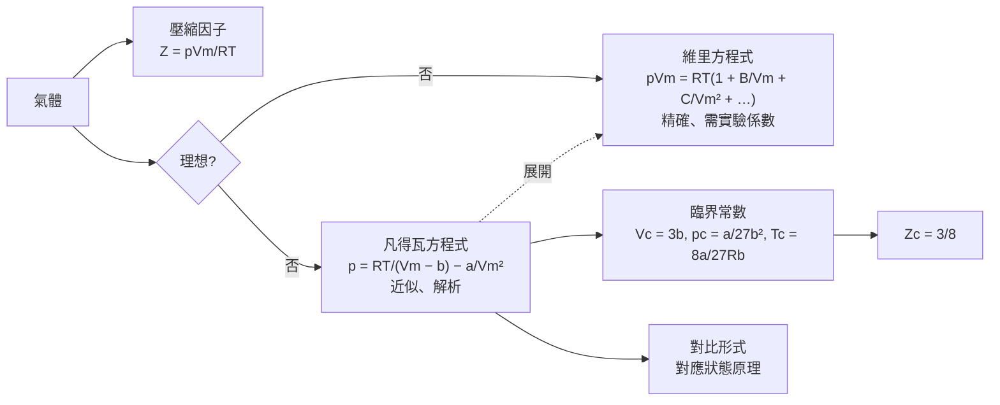

# Focus 1 氣體的性質（The Properties of Gases）
# 1C 真實氣體（Real Gases）

> **範圍**：上課簡報 p.63–91；課本 Atkins' Physical Chemistry Topic 1C（p.18–26）及章末 Exercises / Problems（p.30–31）
> **標示說明**：未特別標示者以簡報為主；**📘 課本補充** 表示簡報未提、取自課本的內容；**⚠️** 表示勘誤或易錯處
> **本節核心推導**：由一階、二階導數為零求凡得瓦氣體的臨界常數，以及 $Z_c = 3/8$。另附「三重根法」作為第二種解法。

---

## 學習重點

1. 能用分子間位能曲線解釋真實氣體為何偏離理想行為：**排斥力幫助膨脹，吸引力幫助壓縮**。
2. 能描述 CO₂ 實驗等溫線上的凝結過程（A→F），並定義蒸氣壓、臨界溫度、超臨界流體。
3. 能用壓縮因子 $Z$ 判斷吸引力或排斥力主導，並理解維里方程式與波以耳溫度。
4. 能說明凡得瓦方程式中 $a$、$b$ 的物理來源，並推導 $b \approx 4V_\text{molecule}N_A$。
5. 能解凡得瓦三次方程式求莫耳體積，說明凡得瓦環與馬克士威作圖法。
6. 能**推導**臨界常數 $V_c = 3b$、$p_c = a/27b^2$、$T_c = 8a/27Rb$ 與 $Z_c = 3/8$。
7. 📘 理解對比變數與對應狀態原理。

---

## 1C.1 偏離理想行為（Deviations from Perfect Behaviour）

### 一、分子間作用力與位能曲線（簡報 p.63）

真實氣體偏離理想氣體方程式，是因為**分子之間有交互作用**。只有在 $p \to 0$ 時才嚴格遵守 $pV = nRT$。偏差在**高壓、低溫**，尤其是**接近凝結**時最明顯。

**分子間位能（potential energy）對分子間距（separation）的曲線**：

| 區域 | 主導的力 | 作用範圍 | 對氣體的影響 |
|---|---|---|---|
| 極近距離（約一個分子直徑，曲線左側粉紅區） | **排斥力（repulsive force）主導** | **短程（short-range）**，只在分子幾乎接觸時有效 | **幫助膨脹**，使氣體**較難壓縮** |
| 中等距離（數個分子直徑，位能井附近） | **吸引力（attractive force）主導** | 範圍比排斥力長 | **幫助壓縮**，使氣體**較易壓縮** |
| 遠距離（許多個分子直徑，右側） | 幾乎無作用 | — | 行為接近理想氣體 |

> 📘 **課本的重點句**：*Repulsive forces between molecules assist expansion and attractive forces assist compression.*
> - 排斥力越大，氣體越難壓縮：同溫下要把體積壓縮同樣多，需要比理想氣體**更大**的壓力。
> - 吸引力使氣體較易壓縮：只需**較小**的壓力。
> - **溫度夠低時**，分子動能不足以克服交互作用能，分子會互相「捕獲」，最終**凝結（condensation）**。

**三種壓力區間的對應**：

- **低壓**：分子相距很遠，交互作用可忽略，接近理想氣體。
- **中等壓力**：平均間距只有數個分子直徑，**吸引力的位能貢獻**大於排斥力，淨效果使位能降低，氣體比理想氣體**更易壓縮**。
- **高壓**：平均間距很小，**排斥力主導**，氣體比理想氣體**更難壓縮**。

---

### 二、CO₂ 的實驗等溫線與凝結（簡報 p.64）

（課本圖 1C.2）在 **20 °C** 下，把 A 點的 CO₂ 用活塞**等溫壓縮**：

| 過程 | 現象 | 說明 |
|---|---|---|
| **A 附近** | 壓力隨體積減小而上升 | 大致符合波以耳定律 |
| **到 B** | 開始明顯偏離波以耳定律 | 分子間作用力變得重要 |
| **C 點**（約 60 atm） | 活塞**突然可以推進而壓力不再上升** | 出現液體，與氣體之間有清楚的界面 |
| **C → D → E**（水平線） | 液體量**逐漸增加**，壓力**維持不變** | 氣體以凝結回應壓縮，活塞不受額外阻力 |
| **E 點** | 樣品**全部變成液體**，活塞貼在液面上 | — |
| **E → F** | 即使體積只減少一點點，壓力也**急遽上升** | **液體遠比氣體難壓縮** |

> **蒸氣壓（vapour pressure）**：沿 CDE 線、液體與蒸氣**平衡共存（coexist in equilibrium）** 時的壓力，就是該溫度下液體的蒸氣壓。

另外，實驗等溫線在**小莫耳體積**（圖的左側）偏離理想氣體最多；在**大莫耳體積**（右側）則與理想氣體等溫線幾乎重合。

---

### 三、壓縮因子（Compression Factor, Z）（簡報 p.65–67）

#### 1. 定義

$$
Z = \frac{V_\text{m}}{V_\text{m}^\circ} \qquad \text{（定義，式 1C.1）}
$$

即**實際測得的莫耳體積** $V_\text{m} = V/n$ 與**同溫同壓下理想氣體的莫耳體積** $V_\text{m}^\circ$ 之比（簡報 p.65 註解：「蒸氣實際體積與同量蒸氣在相同溫度壓力下理論體積之比」）。

因為 $V_\text{m}^\circ = RT/p$，所以

$$
Z = \frac{pV_\text{m}}{RT} \quad\Longleftrightarrow\quad \boxed{\,pV_\text{m} = RTZ\,} \qquad (\text{式 1C.2})
$$

- **理想氣體：$Z = 1$（在所有條件下）**，所以 $Z$ 偏離 1 的程度就是偏離理想行為的量度。

#### 2. $Z$ 隨壓力的變化（簡報 p.66；課本圖 1C.3，0 °C）

| 壓力 | $Z$ | 主導作用 | 解釋 |
|---|---|---|---|
| 極低壓 | $Z \approx 1$ | — | 接近理想 |
| 中等壓力 | **$Z < 1$**（大多數氣體） | **吸引力主導** | 吸引力把分子拉近，實際莫耳體積**小於**理想值 |
| 高壓 | **$Z > 1$**（所有氣體） | **排斥力主導** | 排斥力把分子推開，實際莫耳體積**大於**理想值 |

> ⚠️ **注意 H₂**：圖中 H₂ 在 0 °C 時 **$Z$ 一直大於 1**，沒有 $Z < 1$ 的區域。因為 H₂ 分子間吸引力極弱，0 °C 已高於它的**波以耳溫度**（見下方），排斥效應一直占優勢。所以簡報「中等壓力時 $Z < 1$」是指**大多數**氣體，不是所有氣體。
> 另外，NH₃ 這類分子間作用力強（有氫鍵）的氣體，在低壓區 $Z$ 就下降得很快（簡報 p.66 小圖）。

### 📗 簡報 Brief illustration 1C.1：計算壓縮因子

**題目**：The molar volume of a perfect gas at 500 K and 100 bar is $V_\text{m}^\circ = 0.416\ \text{dm}^3\,\text{mol}^{-1}$. The molar volume of carbon dioxide under the same conditions is $V_\text{m} = 0.366\ \text{dm}^3\,\text{mol}^{-1}$. What is the compression factor at 500 K?

（500 K、100 bar 下理想氣體的莫耳體積為 0.416 dm³ mol⁻¹，同條件下 CO₂ 的莫耳體積為 0.366 dm³ mol⁻¹。500 K 時的壓縮因子為何？）

**詳解**：

$$
Z = \frac{V_\text{m}}{V_\text{m}^\circ} = \frac{0.366\ \text{dm}^3\,\text{mol}^{-1}}{0.416\ \text{dm}^3\,\text{mol}^{-1}} = \boxed{0.880}
$$

$Z < 1$，表示此條件下**吸引力主導**排斥力。

（驗算：$V_\text{m}^\circ = RT/p = (0.083145)(500)/100 = 0.416\ \text{dm}^3\,\text{mol}^{-1}$ ✓）

---

### 四、維里係數（Virial Coefficients）（簡報 p.68）

#### 1. 維里方程式（Virial Equation of State）

在大莫耳體積、高溫下，真實氣體與理想氣體的等溫線差異很小。這暗示 $pV_\text{m} = RT$ 只是一個**級數展開的第一項**。

**以壓力展開**：

$$
pV_\text{m} = RT\left(1 + B'p + C'p^2 + \cdots\right) \qquad (\text{式 1C.3a})
$$

**以 $1/V_\text{m}$ 展開**（應用上較方便）：

$$
\boxed{\,pV_\text{m} = RT\left(1 + \frac{B}{V_\text{m}} + \frac{C}{V_\text{m}^2} + \cdots\right)\,} \qquad (\text{式 1C.3b})
$$

- 括號內就是**壓縮因子 $Z$**。
- $B, C, \ldots$ 稱為**第二、第三……維里係數（second, third, … virial coefficients）**；第一維里係數為 1。
- **維里係數隨溫度改變**。
- 物理意義：**$B$（或 $B'$）反映兩分子之間的交互作用，$C$（或 $C'$）反映三分子之間的交互作用**（簡報 p.68）。
- 通常 $C/V_\text{m}^2 \ll B/V_\text{m}$，所以第三項以後較不重要。
- 📘 名稱 *virial* 來自拉丁文的「力（force）」。

**📘 課本表 1C.1 第二維里係數** $B/(\text{cm}^3\,\text{mol}^{-1})$

| 氣體 | 273 K | 600 K |
|---|---|---|
| Ar | −21.7 | 11.9 |
| CO₂ | −14.2（見註） | −12.4 |
| N₂ | −10.5 | 21.7 |
| Xe | −153.7 | −19.6 |

> **判讀**：$B < 0$ 表示吸引力主導（$Z < 1$），$B > 0$ 表示排斥力主導（$Z > 1$）。溫度升高時 $B$ 增加（變得較正），因為分子動能變大，吸引力的影響相對減弱。
> （註：課本表 1C.1 的 CO₂ 在 273 K 印為 −14.2 cm³ mol⁻¹，但課本習題 E1C.2 使用 −149.7 cm³ mol⁻¹。CO₂ 的吸引力比 N₂ 強得多，$B$ 應比 N₂ 的 −10.5 更負，所以 −14.2 疑為漏印一位數，約 −150 才合理。）

#### 2. 低壓極限的斜率與波以耳溫度（Boyle Temperature）

**重要觀念**：真實氣體的**狀態方程式**在 $p \to 0$ 時與理想氣體一致，但**並非所有性質**都一致。

例如 $Z$ 對 $p$ 的斜率：理想氣體 $Z \equiv 1$，所以 $dZ/dp = 0$。但對真實氣體，由式 1C.3a：

$$
\frac{dZ}{dp} = B' + 2pC' + \cdots \;\to\; B' \quad (p \to 0) \qquad (\text{式 1C.4a})
$$

$B'$ 不一定為零，所以斜率**不一定趨近於 0**（簡報 p.68：*The properties of real gas do not always coincide with the perfect gas values at low p*）。同理：

$$
\frac{dZ}{d(1/V_\text{m})} \;\to\; B \quad (V_\text{m} \to \infty) \qquad (\text{式 1C.4b})
$$

📘 **波以耳溫度（Boyle temperature）** $T_\text{B}$：使 $B = 0$（亦即 $B' = 0$）的溫度。

- 在 $T_\text{B}$ 時，$Z \to 1$ 且**斜率為零**，真實氣體在 $p \to 0$ 時的性質**真正**與理想氣體一致。
- 此時 $B'p$ 項為零，$C'p^2$ 以後的項又很小，所以 $pV_\text{m} \approx RT$ 在**更寬的壓力範圍**內成立。
- 例：He 的 $T_\text{B} = 22.64$ K；空氣的 $T_\text{B} = 346.8$ K。

| 溫度 | 低壓時 $Z$ 的斜率 | 意義 |
|---|---|---|
| $T < T_\text{B}$ | 負（$B < 0$） | 吸引力主導 |
| $T = T_\text{B}$ | 零 | 在較寬的範圍內接近理想 |
| $T > T_\text{B}$ | 正（$B > 0$） | 排斥力主導 |

### 📘 課本 Brief illustration 1C.2：用維里方程式計算壓力

**題目**：100 K 時，0.104 mol O₂(g) 裝在 0.225 dm³ 的容器中，用維里方程式（取到 $B$ 項）計算壓力。已知 O₂ 在 100 K 的 $B = -197.5\ \text{cm}^3\,\text{mol}^{-1}$。

**詳解**：

$$
V_\text{m} = \frac{V}{n} = \frac{0.225\ \text{dm}^3}{0.104\ \text{mol}} = 2.16\ \text{dm}^3\,\text{mol}^{-1} = 2.16\times10^{-3}\ \text{m}^3\,\text{mol}^{-1}
$$

$$
p = \frac{RT}{V_\text{m}}\left(1 + \frac{B}{V_\text{m}}\right) = \frac{(8.3145)(100)}{2.16\times10^{-3}}\left(1 - \frac{1.975\times10^{-4}}{2.16\times10^{-3}}\right) = 3.50\times10^5\ \text{Pa} = 350\ \text{kPa}
$$

（單位：$1\ \text{Pa} = 1\ \text{J m}^{-3}$。）

理想氣體方程式會得到 385 kPa，**高了約 10%**。因為此時 $B/V_\text{m} \approx -0.09$，相對於 1 不可忽略。

---

### 五、臨界常數（Critical Constants）（簡報 p.64、p.69）

（課本圖 1C.5：CO₂ 等溫線）

- 低溫（如 20 °C）時，加壓最終會凝結（水平線 CE）。
- 高溫（如 50 °C）時，**無論加多大壓力都不會凝結**。

**臨界溫度（critical temperature）** $T_c$：**能發生凝結的最高溫度**。CO₂ 的 $T_c = 31.04$ °C（圖中較粗的等溫線，稱為**臨界等溫線，critical isotherm**）。

**接近臨界點的變化**：

- 溫度升高時，水平段兩端（如 C 點與 E 點）的體積逐漸**靠近**；這些端點的軌跡就是圖中的虛線（鐘形曲線）。
- 在 $T_c$ 時兩端**合併成一點**，不再出現分隔兩相的界面，這個點就是**臨界點（critical point）**（圖中 \* 號）。
- 臨界點的壓力與莫耳體積分別為**臨界壓力（critical pressure）** $p_c$ 與**臨界莫耳體積（critical molar volume）** $V_c$。
- $p_c$、$V_c$、$T_c$ 合稱**臨界常數（critical constants）**。

**超臨界流體（supercritical fluid）**：

- 在 $T_c$ 以上，樣品只有**單一相**並充滿整個容器。依定義這是氣體，**液相無法在 $T_c$ 以上形成**。
- 但這個相的密度可能遠高於一般氣體，所以改稱**超臨界流體**。
- 例：O₂ 的 $T_c = 155$ K。在 155 K 以上，**只靠加壓無法得到液態氧**，必須先降溫到 155 K 以下再等溫壓縮。

**📘 課本表 1C.2 臨界常數**（簡報 p.90）

| 氣體 | $p_c$/atm | $V_c$/(cm³ mol⁻¹) | $T_c$/K | $Z_c$ | $T_\text{B}$/K |
|---|---|---|---|---|---|
| Ar | 48.0 | 75.3 | 150.7 | 0.292 | 411.5 |
| CO₂ | 72.9 | 94.0 | 304.2 | 0.274 | 714.8 |
| He | 2.26 | 57.8 | 5.2 | 0.305 | 22.64 |
| O₂ | 50.14 | 78.0 | 154.8 | 0.308 | 405.9 |

#### 單成分系統的 $p$–$V$–$T$ 曲面（簡報 p.69）

這張圖把 1A 的 $p$–$V$–$T$ 曲面與本節的等溫線連起來：

- 曲面上包含**固相、液相、氣相（vapor/gas）**，以及**固–液、液–氣、固–氣**兩相共存區與**三相線（triple line）**。
- **投影到 $p$–$T$ 平面**（左側黃色座標）得到**相圖（phase diagram）**：液–氣共存區縮成**蒸氣壓曲線**，終點就是**臨界點**；三相線縮成**三相點**。
- **投影到 $p$–$V$ 平面**（右側藍色座標）就是 CO₂ 等溫線圖：鐘形的「液–氣（Liquid–Vapor）」共存區，頂點是臨界點，$T_c$ 等溫線恰好通過頂點。
- 圖中把溫度低於 $T_c$ 的氣相稱為「vapor（蒸氣）」，高於 $T_c$ 的稱為「gas（氣體）」。**蒸氣可以只靠加壓液化，氣體則不行。**

> 這張圖的固–液區位於較小體積處，代表凝固時**體積收縮**的一般物質，與 1A 簡報 p.25 的水的曲面不同。

---

## 1C.2 凡得瓦方程式（The van der Waals Equation）

### 一、建構方程式（Formulation of the Equation）（簡報 p.71–77）

📘 維里方程式要代入具體的係數值才能得出結論。凡得瓦方程式（J.D. van der Waals，1873）是一個**近似但具解析形式**的狀態方程式，可以讓我們對所有氣體得到**整體性的了解**。它是**模型建構（model building）** 的典範：從分子交互作用的理解出發，推導出數學方程式。

**與理想氣體模型的對比**（簡報 p.71）：

| (a) 理想化模型 | (b) 較真實的模型 |
|---|---|
| 分子無限小 | 分子有**體積**，使可自由運動的空間**變小** |
| 分子只對器壁施力，彼此間無作用 | 分子之間有**吸引力**，使**壓力降低** |

#### 1. 排斥力修正：排除體積（Excluded Volume）（簡報 p.72–74）

**假設**：排斥作用使分子表現得像**小但不可穿透的球體（small but impenetrable spheres）**，也就是硬球。

分子能自由運動的空間不再是 $V$，而是較小的 $V - nb$，其中 $nb$ 約等於分子本身占據的總體積。所以

$$
p = \frac{nRT}{V} \;\longrightarrow\; p = \frac{nRT}{V - nb}
$$

**推導 $b$ 與分子大小的關係**：

**Step 1**：半徑 $r$ 的硬球，體積為 $V_\text{molecule} = \frac{4}{3}\pi r^3$。

**Step 2**：兩個硬球中心的**最近距離是 $2r$**。所以對一對分子而言，以一個分子中心為球心、半徑 $2r$ 的球內，另一個分子的中心不能進入。這個「排除體積」為

$$
V_\text{excluded, pair} = \frac{4}{3}\pi(2r)^3 = 8\times\frac{4}{3}\pi r^3 = 8V_\text{molecule}
$$

**Step 3**：這個體積由**兩個分子共享**，所以**每個分子**排除的體積為一半：

$$
V_\text{excluded, per molecule} = 4V_\text{molecule}
$$

**Step 4**：$N$ 個分子總共排除 $nb = N\times4V_\text{molecule}$。因為 $N = nN_A$：

$$
\boxed{\,b \approx 4V_\text{molecule}N_A\,}
$$

> ⚠️ **注意**：
> - $b$ 是**每莫耳**的排除體積，是分子真實體積的 **4 倍**（不是 1 倍，也不是 8 倍）。
> - 簡報 p.74 寫「$V_\text{molecule} = \frac{4}{3}\pi(2r)^3 \Rightarrow 8V_\text{molecule}$」，等號左邊應為「**一對分子的排除體積**」而非 $V_\text{molecule}$；並且結論 $b \approx 4V_\text{molecule}$ 漏了**乘以 $N_A$**。
> - **由 $b$ 反推分子半徑**：$r = \left(\dfrac{3b}{16\pi N_A}\right)^{1/3}$（見習題 1）。

#### 2. 吸引力修正：壓力降低（簡報 p.75–76）

壓力取決於兩件事：**分子撞擊器壁的頻率**與**每次撞擊的力量**。

- 吸引力使兩者**都降低**。例如即將撞壁的分子被內部的分子往回拉。
- 每一項降低的程度都**正比於莫耳濃度（molar concentration）** $n/V$，也就是周圍參與吸引的分子有多少。
- 兩項相乘，所以**壓力降低量正比於濃度的平方**：

$$
\Delta p = -a\left(\frac{n}{V}\right)^2
$$

$a$ 是每種氣體特有的正常數。

#### 3. 凡得瓦方程式

結合兩項修正：

$$
\boxed{\,p = \frac{nRT}{V - nb} - a\frac{n^2}{V^2}\,} \qquad (\text{式 1C.5a})
$$

以莫耳體積 $V_\text{m} = V/n$ 表示：

$$
\boxed{\,p = \frac{RT}{V_\text{m} - b} - \frac{a}{V_\text{m}^2}\,} \qquad (\text{式 1C.5b})
$$

常見的另一種寫法：$\left(p + \dfrac{a}{V_\text{m}^2}\right)(V_\text{m} - b) = RT$

**凡得瓦係數（van der Waals coefficients）**（簡報 p.77）：

| 係數 | 代表 | 單位 |
|---|---|---|
| $a$ | **吸引作用的強度（strength of attractive interactions）** | atm dm⁶ mol⁻² 或 Pa m⁶ mol⁻² |
| $b$ | **排斥作用（repulsive interactions）**，即分子的有效大小 | dm³ mol⁻¹ 或 m³ mol⁻¹ |

- 📘 $a$、$b$ 視為**與溫度無關**的常數。
- 它們雖然不是嚴格定義的分子性質，但與反映分子間作用力強度的物理量**相關**，例如**臨界溫度、蒸氣壓、汽化焓（enthalpy of vaporization）**。$a$ 越大，分子間吸引力越強，越容易液化。

**課本表 1C.3 凡得瓦係數**（簡報 p.79）

| 氣體 | $a$/(atm dm⁶ mol⁻²) | $b$/(10⁻² dm³ mol⁻¹) |
|---|---|---|
| Ar | 1.337 | 3.20 |
| CO₂ | 3.610 | 4.29 |
| He | 0.0341 | 2.38 |
| Xe | 4.137 | 5.16 |

> **判讀**：He 的 $a$ 極小，因為它是最難極化的原子，分子間吸引力最弱，所以最難液化（$T_c = 5.2$ K）。Xe 的 $a$ 很大，因為它是大而易極化的原子，**倫敦分散力（London dispersion force）** 強。

> 📘 **單位換算**：$1\ \text{atm dm}^6\,\text{mol}^{-2} = (101\,325\ \text{Pa})(10^{-3}\ \text{m}^3)^2\,\text{mol}^{-2} = 0.101\,325\ \text{Pa m}^6\,\text{mol}^{-2}$

### 📘 課本 Brief illustration 1C.3：何時可忽略修正項？

苯（benzene）的 $a = 18.57\ \text{atm dm}^6\,\text{mol}^{-2}$、$b = 0.1193\ \text{dm}^3\,\text{mol}^{-1}$，正常沸點 353 K。在 400 K、1.0 atm 時，視為理想氣體得 $V_\text{m} = RT/p = 33\ \text{dm}^3\,\text{mol}^{-1}$。

- $V_\text{m} = 33 \gg b = 0.12$，所以**排斥力的影響可忽略**。
- 吸引項：$a/V_\text{m}^2 = 18.57/33^2 = 0.017\ \text{atm}$，只占 1.0 atm 的 **1.7%**。

結論：此條件下吸引力只造成輕微偏差。

---

### 📗 簡報例題 1C.1：用凡得瓦方程式估計莫耳體積（簡報 p.78–81）

**題目**：Estimate the molar volume of CO₂ at 500 K and 100 atm by treating it as a van der Waals gas.

（將 CO₂ 視為凡得瓦氣體，估計它在 500 K、100 atm 下的莫耳體積。）

**解題思路**：凡得瓦方程式是 $V_\text{m}$ 的**三次方程式（cubic equation）**，要先整理成多項式再求根。

**詳解**：

**Step 1：整理成三次方程式**。兩邊同乘 $(V_\text{m} - b)V_\text{m}^2$：

$$
(V_\text{m} - b)V_\text{m}^2\,p = RTV_\text{m}^2 - (V_\text{m} - b)a
$$

除以 $p$，依 $V_\text{m}$ 的次方整理：

$$
\boxed{\,V_\text{m}^3 - \left(b + \frac{RT}{p}\right)V_\text{m}^2 + \frac{a}{p}V_\text{m} - \frac{ab}{p} = 0\,}
$$

**Step 2：代入數據**。$a = 3.610\ \text{dm}^6\,\text{atm mol}^{-2}$、$b = 4.29\times10^{-2}\ \text{dm}^3\,\text{mol}^{-1}$，且

$$
\frac{RT}{p} = \frac{(0.082057)(500)}{100} = 0.410\ \text{dm}^3\,\text{mol}^{-1}
$$

| 係數 | 數值 |
|---|---|
| $b + RT/p$ | 0.453 dm³ mol⁻¹ |
| $a/p$ | $3.61\times10^{-2}$ (dm³ mol⁻¹)² |
| $ab/p$ | $1.55\times10^{-3}$ (dm³ mol⁻¹)³ |

令 $x = V_\text{m}/(\text{dm}^3\,\text{mol}^{-1})$：

$$
x^3 - 0.453x^2 + (3.61\times10^{-2})x - (1.55\times10^{-3}) = 0
$$

**Step 3：求根**。用繪圖或數學軟體求解。此方程式只有一個實根，另兩根為共軛複數（$0.0435 \pm 0.0483i$），所以合理的根為

$$
x = 0.366 \;\Rightarrow\; \boxed{V_\text{m} = 0.366\ \text{dm}^3\,\text{mol}^{-1}}
$$

同條件下理想氣體為 0.410 dm³ mol⁻¹，凡得瓦氣體約小 11%（$Z = 0.89$），反映吸引力的影響。

> **為什麼有時有三個實根？** 當 $T < T_c$ 時，在某些壓力下凡得瓦方程式有三個實根：最小的對應**液體**，最大的對應**氣體**，中間的落在凡得瓦環中不穩定的部分，沒有物理意義。本題 500 K 遠高於 CO₂ 的 $T_c$（304 K），所以只有一個實根。
> 📘 三次方程式雖有公式解但很複雜，通常用數學軟體或繪圖計算機求解。

**📘 自我測驗（Self-test 1C.1）**：假設 Ar 為凡得瓦氣體，求 100 °C、100 atm 下的莫耳體積。

> $RT/p = (0.082057)(373.15)/100 = 0.3062$；$a = 1.337$、$b = 0.0320$。
> 解 $x^3 - 0.3382x^2 + 0.01337x - 4.278\times10^{-4} = 0$，得 **$V_\text{m} = 0.298\ \text{dm}^3\,\text{mol}^{-1}$**。

> ⚠️ **易混淆**：Brief illustration 1C.1 用的是 **100 bar**（$V_\text{m}^\circ = 0.416$），例題 1C.1 用的是 **100 atm**（$RT/p = 0.410$）。兩題剛好都出現 0.366 這個數字，但條件不同，不要混用。

---

### 二、凡得瓦方程式的特徵（The Features of the Equation）（簡報 p.82–89）

📘 單一簡單的方程式不可能是所有物質的真實狀態方程式。精確的工作仍須用**維里方程式**、查表取得各溫度的係數並做數值分析。凡得瓦方程式的優點在於它是**解析式（analytical）**，能推出關於真實氣體的**一般性結論**。

#### 特徵 1：高溫、大莫耳體積時回到理想氣體等溫線（簡報 p.82）

- 溫度高時，$RT$ 很大，第一項遠大於第二項 $a/V_\text{m}^2$。
- 莫耳體積大時（$V_\text{m} \gg b$），$V_\text{m} - b \approx V_\text{m}$。

兩者同時成立時：

$$
p = \frac{RT}{V_\text{m} - b} - \frac{a}{V_\text{m}^2} \;\longrightarrow\; p = \frac{RT}{V_\text{m}}
$$

#### 特徵 2：吸引與排斥效應達平衡時，液體與氣體共存（簡報 p.83）

**凡得瓦環（van der Waals loops）** 出現在方程式兩項**大小相近**時：

- **第一項** $RT/(V_\text{m} - b)$：來自分子的**動能與排斥作用**，傾向使壓力增大。
- **第二項** $a/V_\text{m}^2$：代表**吸引作用**，傾向使壓力降低。

**凡得瓦等溫線的形狀**（簡報 p.85；課本圖 1C.8，以對比變數作圖）：

- $T < T_c$ 時，計算出的等溫線會**振盪**，依序出現一個**極小值**再一個**極大值**。
- $T \to T_c$ 時，極大與極小**逐漸靠近**；在 $T = T_c$ 時**重合**，曲線在臨界點出現**水平反曲點（flat inflexion）**（簡報 p.86 圖 2）。
- $T > T_c$ 時，等溫線單調遞減，不再振盪。

**📘 為什麼凡得瓦環不真實？馬克士威作圖法（Maxwell Construction）**

- 凡得瓦環中有一段 $dp/dV_\text{m} > 0$，表示「**加壓反而使體積變大**」。這在力學上**不穩定**，實際上不會發生。
- 所以實際的等溫線把環**換成一條水平線**。水平線的位置要讓環在水平線**上方與下方圍出的面積相等**，這稱為**馬克士威作圖法**。
- 這條水平線對應的壓力，就是該溫度下的**蒸氣壓**，與 CO₂ 實驗等溫線的 CDE 段相對應。
- 📘 課本表 1C.3 中的 $a$、$b$，就是把計算出的等溫線**擬合（fitting）** 到實驗等溫線而得到的。

#### 特徵 3：臨界常數與凡得瓦係數的關係（簡報 p.84–89）

**數學依據**：水平反曲點的條件是**一階與二階導數同時為零**（簡報 p.87）。

---

### 三、推導：凡得瓦氣體的臨界常數（簡報 p.88；課本習題 P1C.12）

#### 方法一：導數法

**Step 1：寫出兩個條件**（固定 $T = T_c$，對 $V_\text{m}$ 微分）

$$
\frac{dp}{dV_\text{m}} = -\frac{RT}{(V_\text{m} - b)^2} + \frac{2a}{V_\text{m}^3} = 0 \qquad \cdots (1)
$$

$$
\frac{d^2p}{dV_\text{m}^2} = \frac{2RT}{(V_\text{m} - b)^3} - \frac{6a}{V_\text{m}^4} = 0 \qquad \cdots (2)
$$

**Step 2：改寫**

$$
(1) \Rightarrow \frac{RT}{(V_\text{m} - b)^2} = \frac{2a}{V_\text{m}^3}, \qquad
(2) \Rightarrow \frac{2RT}{(V_\text{m} - b)^3} = \frac{6a}{V_\text{m}^4}
$$

**Step 3：兩式相除**，(2) ÷ (1) 可消去 $RT$ 與 $a$：

$$
\frac{2}{V_\text{m} - b} = \frac{3}{V_\text{m}} \;\Rightarrow\; 2V_\text{m} = 3V_\text{m} - 3b \;\Rightarrow\; \boxed{V_c = 3b}
$$

**Step 4：代回 (1) 求 $T_c$**

$$
\frac{RT_c}{(2b)^2} = \frac{2a}{(3b)^3} \;\Rightarrow\; RT_c = \frac{2a\cdot4b^2}{27b^3} = \frac{8a}{27b} \;\Rightarrow\; \boxed{T_c = \frac{8a}{27Rb}}
$$

**Step 5：代入凡得瓦方程式求 $p_c$**

$$
p_c = \frac{RT_c}{V_c - b} - \frac{a}{V_c^2} = \frac{8a/27b}{2b} - \frac{a}{9b^2} = \frac{4a}{27b^2} - \frac{3a}{27b^2} = \boxed{\frac{a}{27b^2}}
$$

**結果（式 1C.6）**：

$$
\boxed{\,V_c = 3b, \qquad p_c = \frac{a}{27b^2}, \qquad T_c = \frac{8a}{27Rb}\,}
$$

#### 方法二：三重根法（另一種漂亮的解法）

在臨界點，凡得瓦三次方程式的三個根**重合**於 $V_c$（液體根與氣體根合而為一），所以

$$
V_\text{m}^3 - \left(b + \frac{RT_c}{p_c}\right)V_\text{m}^2 + \frac{a}{p_c}V_\text{m} - \frac{ab}{p_c} = (V_\text{m} - V_c)^3 = V_\text{m}^3 - 3V_cV_\text{m}^2 + 3V_c^2V_\text{m} - V_c^3
$$

比較各項係數：

$$
3V_c = b + \frac{RT_c}{p_c}, \qquad 3V_c^2 = \frac{a}{p_c}, \qquad V_c^3 = \frac{ab}{p_c}
$$

- 後兩式相除：$\dfrac{V_c^3}{3V_c^2} = b \Rightarrow V_c = 3b$
- 代入第二式：$p_c = \dfrac{a}{3(3b)^2} = \dfrac{a}{27b^2}$
- 代入第一式：$\dfrac{RT_c}{p_c} = 9b - b = 8b \Rightarrow T_c = \dfrac{8bp_c}{R} = \dfrac{8a}{27Rb}$

結果與方法一相同 ✓

#### 臨界壓縮因子（Critical Compression Factor）（簡報 p.89–90）

$$
Z_c = \frac{p_cV_c}{RT_c} = \frac{(a/27b^2)(3b)}{R\cdot\dfrac{8a}{27Rb}} = \frac{a/9b}{8a/27b} = \boxed{\frac{3}{8} = 0.375} \qquad (\text{式 1C.7})
$$

**意義**：

1. $Z_c$ **與 $a$、$b$ 無關**，所以凡得瓦方程式預測**所有氣體的 $Z_c$ 都等於 3/8**。
2. 這提供另一種**由臨界常數決定 $a$ 與 $b$** 的方法，例如 $b = V_c/3$、$a = 3p_cV_c^2$。
3. 也可用來**檢驗**凡得瓦方程式：實驗值（表 1C.2）$Z_c$ 約 **0.27–0.31**，略小於 0.375，但**大致為常數（約 0.3）**，所以凡得瓦方程式在定性上正確、定量上略有偏差。

> ⚠️ **由臨界常數求 $a$、$b$ 時的陷阱**：三個臨界常數只需要兩個就能決定 $a$、$b$，但**選不同的兩個會得到不同答案**，因為實際 $Z_c \neq 3/8$。見習題 1。

#### 📘 凡得瓦氣體的波以耳溫度

把凡得瓦方程式展開成維里形式（見習題 3）可得 $B = b - \dfrac{a}{RT}$。令 $B = 0$：

$$
T_\text{B} = \frac{a}{Rb} = \frac{27}{8}T_c = 3.375\,T_c
$$

實驗值：Ar 的 $T_\text{B}/T_c = 2.73$，CO₂ 為 2.35，O₂ 為 2.62。凡得瓦方程式**高估**了此比值，再次說明它是定性模型。

---

### 四、📘 對應狀態原理（The Principle of Corresponding States）

#### 1. 對比變數（Reduced Variables）

以臨界常數為「尺度」，定義**無因次（dimensionless）** 的對比變數：

$$
V_\text{r} = \frac{V_\text{m}}{V_c}, \qquad p_\text{r} = \frac{p}{p_c}, \qquad T_\text{r} = \frac{T}{T_c} \qquad (\text{式 1C.8})
$$

**對應狀態原理**：真實氣體在**相同的對比體積與對比溫度**下，會產生**相同的對比壓力**。

- 課本圖 1C.9：把 N₂、CH₄、C₃H₈、C₂H₄ 的 $Z$ 對 $p_\text{r}$ 作圖，相同 $T_\text{r}$ 的數據**落在同一條曲線上**。相較之下，圖 1C.3 未使用對比變數，各氣體的曲線各不相同。
- 此原理只是**近似**：對**球形分子**最準；對**非球形或極性分子**可能明顯失準。

#### 2. 推導：凡得瓦方程式的對比形式

將 $p = p_\text{r}p_c$、$V_\text{m} = V_\text{r}V_c$、$T = T_\text{r}T_c$ 代入式 1C.5b：

$$
p_\text{r}p_c = \frac{RT_\text{r}T_c}{V_\text{r}V_c - b} - \frac{a}{V_\text{r}^2V_c^2}
$$

再代入式 1C.6 的 $p_c$、$V_c$、$T_c$：

$$
\frac{ap_\text{r}}{27b^2} = \frac{8aT_\text{r}/27b}{3bV_\text{r} - b} - \frac{a}{9b^2V_\text{r}^2}
$$

兩邊乘以 $27b^2/a$：

$$
\boxed{\,p_\text{r} = \frac{8T_\text{r}}{3V_\text{r} - 1} - \frac{3}{V_\text{r}^2}\,} \qquad (\text{式 1C.9})
$$

**$a$ 與 $b$ 完全消失了！** 所以以對比變數作圖時，所有凡得瓦氣體的等溫線都相同（簡報 p.85 的圖其實就是這樣畫的），這正是對應狀態原理的內容。

> **但不要過度解讀**：任何含**兩個參數**（分別扮演 $a$、$b$ 角色）的狀態方程式都能化成對比形式。真實氣體近似遵守此原理，只代表吸引與排斥效應**各自可用一個參數**大致描述。此原理的真正價值是讓我們把許多氣體的性質**整合在一張圖上**。

### 📘 課本 Brief illustration 1C.4：對應狀態

**題目**：Ar 在 23 atm、200 K。CO₂ 要在什麼壓力與溫度下才與之處於對應狀態？

**詳解**：

$$
p_\text{r} = \frac{23\ \text{atm}}{48.0\ \text{atm}} = 0.48, \qquad T_\text{r} = \frac{200\ \text{K}}{150.7\ \text{K}} = 1.33
$$

$$
p(\text{CO}_2) = 0.48\times72.9\ \text{atm} = \boxed{35\ \text{atm}}, \qquad T(\text{CO}_2) = 1.33\times304.2\ \text{K} = \boxed{405\ \text{K}}
$$

### 📘 其他狀態方程式（課本表 1C.4）

| 方程式 | 形式 | 對比形式 | $p_c$ | $V_c$ | $T_c$ |
|---|---|---|---|---|---|
| 理想氣體 | $p = \dfrac{nRT}{V}$ | — | — | — | — |
| **凡得瓦** | $p = \dfrac{nRT}{V - nb} - \dfrac{n^2a}{V^2}$ | $p_\text{r} = \dfrac{8T_\text{r}}{3V_\text{r} - 1} - \dfrac{3}{V_\text{r}^2}$ | $\dfrac{a}{27b^2}$ | $3b$ | $\dfrac{8a}{27bR}$ |
| **貝特洛（Berthelot）** | $p = \dfrac{nRT}{V - nb} - \dfrac{n^2a}{TV^2}$ | $p_\text{r} = \dfrac{8T_\text{r}}{3V_\text{r} - 1} - \dfrac{3}{T_\text{r}V_\text{r}^2}$ | $\dfrac{1}{12}\left(\dfrac{2aR}{3b^3}\right)^{1/2}$ | $3b$ | $\dfrac{2}{3}\left(\dfrac{2a}{3bR}\right)^{1/2}$ |
| **狄特里奇（Dieterici）** | $p = \dfrac{nRT\,e^{-na/RTV}}{V - nb}$ | $p_\text{r} = \dfrac{T_\text{r}\,e^{2(1 - 1/T_\text{r}V_\text{r})}}{2V_\text{r} - 1}$ | $\dfrac{a}{4e^2b^2}$ | $2b$ | $\dfrac{a}{4bR}$ |
| 維里 | $p = \dfrac{nRT}{V}\left(1 + \dfrac{nB(T)}{V} + \dfrac{n^2C(T)}{V^2} + \cdots\right)$ | — | — | — | — |

> **設計理念**（課本討論題 D1C.3）：
> - **貝特洛方程式**把吸引項除以 $T$，表示高溫時分子動能大，吸引力的效應**減弱**，較符合實際。
> - **狄特里奇方程式**用指數因子描述吸引力：分子要脫離周圍分子的吸引才能撞到器壁，機率由波茲曼因子 $e^{-\text{能量}/RT}$ 決定。它預測 $Z_c = 2/e^2 = 0.271$，比凡得瓦的 0.375 更接近實驗值。

---

### 概念地圖（簡報 p.70、p.91）

1C 涵蓋簡報概念地圖中「Perfect? → No」的整個分支：

---

## 精選章末習題（含詳解）

> 數值均已用程式驗算。

---

### 習題 1｜E1C.13 由臨界常數求凡得瓦係數與分子半徑

**題目**：The critical constants of methane are $p_c = 45.6$ atm, $V_c = 98.7$ cm³ mol⁻¹, and $T_c = 190.6$ K. Calculate the van der Waals parameters of the gas and estimate the radius of the molecules.

（甲烷的臨界常數為 $p_c = 45.6$ atm、$V_c = 98.7$ cm³ mol⁻¹、$T_c = 190.6$ K。計算其凡得瓦係數，並估計分子半徑。）

**解題思路**：三個臨界常數、兩個未知數（$a$、$b$），是**超定（overdetermined）** 系統。最直接的做法是用 $V_c$ 與 $p_c$。

**詳解**：

**Step 1：由 $V_c$ 求 $b$**

$$
b = \frac{V_c}{3} = \frac{98.7\ \text{cm}^3\,\text{mol}^{-1}}{3} = \boxed{32.9\ \text{cm}^3\,\text{mol}^{-1}} = 0.0329\ \text{dm}^3\,\text{mol}^{-1}
$$

**Step 2：由 $p_c$ 求 $a$**

$$
p_c = \frac{a}{27b^2} \;\Rightarrow\; a = 27b^2p_c = 3V_c^2p_c = 3(0.0987\ \text{dm}^3\,\text{mol}^{-1})^2(45.6\ \text{atm}) = \boxed{1.33\ \text{dm}^6\,\text{atm mol}^{-2}}
$$

**Step 3：估計分子半徑**

由 $b = 4V_\text{molecule}N_A$：

$$
V_\text{molecule} = \frac{b}{4N_A} = \frac{3.29\times10^{-5}\ \text{m}^3\,\text{mol}^{-1}}{4(6.022\times10^{23}\ \text{mol}^{-1})} = 1.37\times10^{-29}\ \text{m}^3
$$

$$
r = \left(\frac{3V_\text{molecule}}{4\pi}\right)^{1/3} = \left(\frac{3b}{16\pi N_A}\right)^{1/3} = \boxed{1.48\times10^{-10}\ \text{m} = 0.148\ \text{nm}}
$$

**Step 4：檢查一致性**

用求得的 $a$、$b$ 預測 $T_c$：

$$
T_c^\text{pred} = \frac{8a}{27Rb} = \frac{8(1.33)}{27(0.082057)(0.0329)} = 146\ \text{K}
$$

實驗值為 190.6 K，**不一致**。原因是甲烷的實際 $Z_c = \dfrac{p_cV_c}{RT_c} = \dfrac{(45.6)(0.0987)}{(0.082057)(190.6)} = 0.288 \neq 0.375$。

> **觀念**：若改用 $p_c$ 與 $T_c$（$b = RT_c/8p_c$、$a = 27R^2T_c^2/64p_c$），會得到 $b = 0.0429\ \text{dm}^3\,\text{mol}^{-1}$、$a = 2.26\ \text{dm}^6\,\text{atm mol}^{-2}$，與上面不同。**選哪兩個臨界常數會影響結果**，這正說明凡得瓦方程式只是近似。實務上常用 $p_c$、$T_c$，因為 $V_c$ 最難精確測量。

---

### 習題 2｜E1C.11 鋼瓶中的氧氣（逐次近似法）

**題目**：Cylinders of compressed gas are typically filled to a pressure of 200 bar. For oxygen, what would be the molar volume at this pressure and 25 °C based on (i) the perfect gas equation, (ii) the van der Waals equation? For oxygen, $a = 1.364$ dm⁶ atm mol⁻², $b = 3.19\times10^{-2}$ dm³ mol⁻¹.

（壓縮氣體鋼瓶通常充填至 200 bar。在此壓力與 25 °C 下，氧氣的莫耳體積依 (i) 理想氣體方程式、(ii) 凡得瓦方程式各為何？）

**詳解**：

**單位**：$p = 200\ \text{bar} = 200\times10^5/101\,325 = 197.4\ \text{atm}$；$T = 298.15$ K。

**(i) 理想氣體**

$$
V_\text{m} = \frac{RT}{p} = \frac{(0.082057)(298.15)}{197.4} = \boxed{0.124\ \text{dm}^3\,\text{mol}^{-1}}
$$

**(ii) 凡得瓦方程式：逐次近似法（successive approximation）**

把凡得瓦方程式改寫成可迭代的形式：

$$
V_\text{m} = b + \frac{RT}{p + a/V_\text{m}^2}
$$

以理想氣體值 $V_\text{m}^{(0)} = 0.1239$ 為起點，代入右邊算出新的 $V_\text{m}$，重複至收斂：

| 迭代 | $V_\text{m}$/(dm³ mol⁻¹) |
|---|---|
| 0 | 0.1239 |
| 1 | 0.1174 |
| 2 | 0.1145 |
| 3 | 0.1130 |
| 4 | 0.1123 |
| 5 | 0.1120 |
| 6 | 0.1118 |
| ⋮ | ⋮ |
| 收斂 | **0.1116** |

**驗證**：直接解三次方程式 $x^3 - 0.1558x^2 + 6.910\times10^{-3}x - 2.204\times10^{-4} = 0$，唯一實根 $x = 0.1116$ ✓

$$
\boxed{V_\text{m} = 0.112\ \text{dm}^3\,\text{mol}^{-1}}, \qquad Z = \frac{pV_\text{m}}{RT} = 0.90
$$

> **觀念**：
> - 凡得瓦方程式給出的莫耳體積比理想值小約 10%，表示 25 °C、200 bar 下 O₂ 以**吸引力為主**（$Z < 1$）。
> - 換句話說，同一個鋼瓶實際能裝的氧氣比理想氣體方程式預測的**多約 11%**。
> - 逐次近似法收斂較慢，但每一步都有物理意義：先用前一次的體積估計吸引力修正 $a/V_\text{m}^2$，再算新的體積。

---

### 習題 3｜P1C.11 凡得瓦方程式的維里展開

**題目**：Express the van der Waals equation of state as a virial expansion in powers of $1/V_\text{m}$ and obtain expressions for $B$ and $C$ in terms of the parameters $a$ and $b$. The expansion you will need is $(1-x)^{-1} = 1 + x + x^2 + \cdots$. Measurements on argon gave $B = -21.7$ cm³ mol⁻¹ and $C = 1200$ cm⁶ mol⁻² for the virial coefficients at 273 K. What are the values of $a$ and $b$ in the corresponding van der Waals equation of state?

（將凡得瓦方程式展開成 $1/V_\text{m}$ 的維里級數，以 $a$、$b$ 表示 $B$ 與 $C$。已知 273 K 時氬的 $B = -21.7$ cm³ mol⁻¹、$C = 1200$ cm⁶ mol⁻²，求對應的凡得瓦係數。）

**詳解**：

**Step 1：改寫成 $Z$ 的形式**

$$
Z = \frac{pV_\text{m}}{RT} = \frac{V_\text{m}}{V_\text{m} - b} - \frac{a}{RTV_\text{m}} = \frac{1}{1 - b/V_\text{m}} - \frac{a}{RTV_\text{m}}
$$

**Step 2：用級數展開**（令 $x = b/V_\text{m}$，大莫耳體積時 $x \ll 1$）

$$
\frac{1}{1 - b/V_\text{m}} = 1 + \frac{b}{V_\text{m}} + \frac{b^2}{V_\text{m}^2} + \cdots
$$

$$
Z = 1 + \left(b - \frac{a}{RT}\right)\frac{1}{V_\text{m}} + \frac{b^2}{V_\text{m}^2} + \cdots
$$

**Step 3：與式 1C.3b 比較係數**

$$
\boxed{\,B = b - \frac{a}{RT}, \qquad C = b^2\,}
$$

**物理意義**：
- $B$ 由兩項競爭決定：$b$（排斥，使 $B$ 變正）與 $-a/RT$（吸引，使 $B$ 變負）。
- 低溫時吸引項主導，$B < 0$；高溫時 $a/RT$ 變小，$B > 0$。
- 令 $B = 0$ 得**波以耳溫度** $T_\text{B} = a/Rb$。

**Step 4：代入氬的數據**

$$
b = \sqrt{C} = \sqrt{1200}\ \text{cm}^3\,\text{mol}^{-1} = \boxed{34.6\ \text{cm}^3\,\text{mol}^{-1}}
$$

$$
a = RT(b - B) = (8.3145)(273)(34.6 + 21.7)\times10^{-6}\ \text{Pa m}^6\,\text{mol}^{-2} = 0.128\ \text{Pa m}^6\,\text{mol}^{-2} = \boxed{1.26\ \text{atm dm}^6\,\text{mol}^{-2}}
$$

> **比較**：課本表 1C.3 的氬：$a = 1.337$、$b = 32.0\ \text{cm}^3\,\text{mol}^{-1}$。由維里係數推得的值與之吻合（誤差約 6–8%）。由此 $a$、$b$ 預測 $T_\text{B} = a/Rb = 444$ K，實驗值為 411.5 K。

---

### 習題 4｜P1C.13 自訂狀態方程式的臨界行為

**題目**：A scientist proposed the following equation of state:
$$p = \frac{RT}{V_\text{m}} - \frac{B}{V_\text{m}^2} + \frac{C}{V_\text{m}^3}$$
Show that the equation leads to critical behaviour. Find the critical constants of the gas in terms of $B$ and $C$ and an expression for the critical compression factor.

（某科學家提出上述狀態方程式。證明此方程式會產生臨界行為，以 $B$、$C$ 表示臨界常數，並求臨界壓縮因子。）

**解題思路**：「有臨界行為」就是存在一點使 $dp/dV_\text{m} = 0$ 且 $d^2p/dV_\text{m}^2 = 0$，並且解出來的臨界常數都為正值。

**詳解**：

**Step 1：兩個條件**

$$
\frac{dp}{dV_\text{m}} = -\frac{RT}{V_\text{m}^2} + \frac{2B}{V_\text{m}^3} - \frac{3C}{V_\text{m}^4} = 0
\;\xrightarrow{\times V_\text{m}^4}\;
-RTV_\text{m}^2 + 2BV_\text{m} - 3C = 0 \qquad \cdots (1)
$$

$$
\frac{d^2p}{dV_\text{m}^2} = \frac{2RT}{V_\text{m}^3} - \frac{6B}{V_\text{m}^4} + \frac{12C}{V_\text{m}^5} = 0
\;\xrightarrow{\times V_\text{m}^5/2}\;
RTV_\text{m}^2 - 3BV_\text{m} + 6C = 0 \qquad \cdots (2)
$$

**Step 2：(1) + (2)** 消去 $RT$：

$$
-BV_\text{m} + 3C = 0 \;\Rightarrow\; \boxed{V_c = \frac{3C}{B}}
$$

**Step 3：代回 (1)**

$$
RT_cV_c^2 = 2BV_c - 3C = 6C - 3C = 3C \;\Rightarrow\; RT_c = \frac{3C}{V_c^2} = \frac{3C\,B^2}{9C^2} \;\Rightarrow\; \boxed{T_c = \frac{B^2}{3RC}}
$$

**Step 4：代入狀態方程式求 $p_c$**

$$
p_c = \frac{RT_c}{V_c} - \frac{B}{V_c^2} + \frac{C}{V_c^3} = \frac{B^2}{3C}\cdot\frac{B}{3C} - \frac{B\cdot B^2}{9C^2} + \frac{C\cdot B^3}{27C^3} = \frac{B^3}{9C^2} - \frac{B^3}{9C^2} + \frac{B^3}{27C^2} = \boxed{\frac{B^3}{27C^2}}
$$

**Step 5：臨界壓縮因子**

$$
Z_c = \frac{p_cV_c}{RT_c} = \frac{\dfrac{B^3}{27C^2}\cdot\dfrac{3C}{B}}{\dfrac{B^2}{3C}} = \frac{B^2/9C}{B^2/3C} = \boxed{\frac{1}{3}}
$$

> **結論**：只要 $B > 0$、$C > 0$，三個臨界常數都為正，所以此方程式**確實有臨界行為**。
> - $-B/V_\text{m}^2$ 項扮演**吸引**的角色（使壓力降低）；$+C/V_\text{m}^3$ 項扮演**排斥**的角色。
> - 預測的 $Z_c = 1/3 = 0.333$，比凡得瓦的 0.375 更接近實驗值（約 0.3）。
> - 與 Q&A 第 6 題（P1C.18）對照：**沒有吸引項的方程式不會有臨界行為**。

---

### 習題 5｜P1C.14 兩種維里係數的關係

**題目**：Equations 1C.3a and 1C.3b are expansions in $p$ and $1/V_\text{m}$, respectively. Find the relation between $B$, $C$ and $B'$, $C'$.

（式 1C.3a 與 1C.3b 分別是以 $p$ 與 $1/V_\text{m}$ 展開的維里方程式。求 $B$、$C$ 與 $B'$、$C'$ 的關係。）

**詳解**：

兩式都等於 $Z$：

$$
Z = 1 + B'p + C'p^2 + \cdots = 1 + \frac{B}{V_\text{m}} + \frac{C}{V_\text{m}^2} + \cdots
$$

**Step 1：把 $p$ 用 $V_\text{m}$ 表示**。由 $p = \dfrac{RTZ}{V_\text{m}}$，並用 $Z \approx 1 + \dfrac{B}{V_\text{m}}$（保留到需要的階數）：

$$
p = \frac{RT}{V_\text{m}}\left(1 + \frac{B}{V_\text{m}} + \cdots\right)
$$

**Step 2：代入左式**，保留到 $1/V_\text{m}^2$：

$$
B'p = \frac{B'RT}{V_\text{m}} + \frac{B'RTB}{V_\text{m}^2} + \cdots, \qquad C'p^2 = \frac{C'(RT)^2}{V_\text{m}^2} + \cdots
$$

$$
Z = 1 + \frac{B'RT}{V_\text{m}} + \frac{B'BRT + C'(RT)^2}{V_\text{m}^2} + \cdots
$$

**Step 3：比較係數**

- $1/V_\text{m}$ 項：$B = B'RT$
- $1/V_\text{m}^2$ 項：$C = B'BRT + C'(RT)^2 = B^2 + C'(RT)^2$

$$
\boxed{\,B' = \frac{B}{RT}, \qquad C' = \frac{C - B^2}{(RT)^2}\,}
$$

> **觀念**：
> - $B'$ 與 $B$ **同號**，所以兩種展開對「吸引或排斥主導」的判斷一致；$B = 0$ 與 $B' = 0$ 發生在同一個溫度 $T_\text{B}$。
> - $C'$ 不只取決於 $C$，還與 $B^2$ 有關：兩種展開的高階係數**不是簡單的比例關係**。

---

### 習題 6｜P1C.10 ＋ P1C.24 凡得瓦氣體何時 $Z < 1$？$Z$ 的最小值？

**題目**：
- **P1C.10**：For a van der Waals gas with given values of $a$ and $b$, identify the conditions for which $Z < 1$ and $Z > 1$.
- **P1C.24**：Is there a set of conditions at which the compression factor of a van der Waals gas passes through a minimum? If so, how does the location and value of the minimum value of $Z$ depend on the coefficients $a$ and $b$?

（P1C.10：對給定 $a$、$b$ 的凡得瓦氣體，找出 $Z < 1$ 與 $Z > 1$ 的條件。P1C.24：凡得瓦氣體的壓縮因子是否會出現極小值？若有，其位置與數值如何取決於 $a$、$b$？）

**詳解**：

$$
Z = \frac{V_\text{m}}{V_\text{m} - b} - \frac{a}{RTV_\text{m}}
$$

**Part 1：$Z$ 與 1 的比較（P1C.10）**

$$
Z - 1 = \frac{b}{V_\text{m} - b} - \frac{a}{RTV_\text{m}}
$$

$Z > 1$ 的條件是 $\dfrac{b}{V_\text{m} - b} > \dfrac{a}{RTV_\text{m}}$。由於 $V_\text{m} > b$，交叉相乘得

$$
RTbV_\text{m} > a(V_\text{m} - b) \;\Longleftrightarrow\; V_\text{m}(a - RTb) < ab
$$

| 溫度 | 結論 |
|---|---|
| $T > T_\text{B} = a/Rb$（即 $a < RTb$） | 左邊為負，**恆成立**，所以在所有莫耳體積下 **$Z > 1$** |
| $T < T_\text{B}$（即 $a > RTb$） | $Z > 1$ 當 $V_\text{m} < \dfrac{ab}{a - RTb}$（**高壓**）；$Z < 1$ 當 $V_\text{m} > \dfrac{ab}{a - RTb}$（**低壓**） |

這與實驗觀察一致：**高於波以耳溫度時排斥力一直占優勢；低於波以耳溫度時，低壓區吸引力主導，高壓區排斥力主導**。

**Part 2：$Z$ 的極小值（P1C.24）**

固定 $T$，對 $V_\text{m}$ 微分：

$$
\frac{dZ}{dV_\text{m}} = -\frac{b}{(V_\text{m} - b)^2} + \frac{a}{RTV_\text{m}^2} = 0
\;\Rightarrow\; RTb\,V_\text{m}^2 = a(V_\text{m} - b)^2
$$

兩邊開根號（取正根）。令 $s \equiv \left(\dfrac{RTb}{a}\right)^{1/2} = \left(\dfrac{T}{T_\text{B}}\right)^{1/2}$：

$$
sV_\text{m} = V_\text{m} - b \;\Rightarrow\; \boxed{V_\text{m,min} = \frac{b}{1 - s}}
$$

此解為正值的條件是 **$s < 1$，即 $T < T_\text{B}$**。

**$Z$ 的最小值**：由 $V_\text{m} - b = \dfrac{bs}{1 - s}$，得 $\dfrac{V_\text{m}}{V_\text{m} - b} = \dfrac{1}{s}$；又 $\dfrac{a}{RTV_\text{m}} = \dfrac{a(1 - s)}{RTb} = \dfrac{1 - s}{s^2}$：

$$
Z_\text{min} = \frac{1}{s} - \frac{1 - s}{s^2} = \boxed{\frac{2s - 1}{s^2}}
$$

**對應的壓力**：利用 $RT = as^2/b$，

$$
p_\text{min} = \frac{RT}{V_\text{m} - b} - \frac{a}{V_\text{m}^2} = \frac{as(1 - s)}{b^2} - \frac{a(1 - s)^2}{b^2} = \boxed{\frac{a}{b^2}(1 - s)(2s - 1)}
$$

**結論**：

- **$T < T_\text{B}$ 時才有極小值**（高於 $T_\text{B}$ 時 $Z$ 隨壓力單調遞增）。這與圖 1C.3、1C.4 中 CH₄、C₂H₄ 的 $Z$ 曲線先下降再上升一致。
- 極小值的大小**只取決於 $T/T_\text{B}$**；位置 $V_\text{m}$ 正比於 $b$，壓力正比於 $a/b^2$。
- $T \to T_\text{B}$（$s \to 1$）時，$Z_\text{min} \to 1$、$V_\text{m} \to \infty$、$p \to 0$：極小值消失於零壓處，與波以耳溫度的定義一致。
- 溫度越低，$Z_\text{min}$ 越小。當 $s < 1/2$（$T < T_\text{B}/4$）時公式會給出 $Z < 0$（$p < 0$），這已落入凡得瓦環中沒有物理意義的區域。

**數值例**：CO₂（$a = 3.610$、$b = 0.0429$）在 400 K（$T_\text{B} = a/Rb = 1025$ K）：

$$
s = \left(\frac{400}{1025}\right)^{1/2} = 0.625, \quad V_\text{m,min} = \frac{0.0429}{0.375} = 0.114\ \text{dm}^3\,\text{mol}^{-1}, \quad Z_\text{min} = \frac{2(0.625) - 1}{0.625^2} = 0.64, \quad p_\text{min} = 183\ \text{atm}
$$

（已用數值方法驗證。）

---

## 觀念問答練習（配合問答題形式）

**Q1.（D1C.1）說明壓縮因子如何隨壓力與溫度變化，以及它如何反映分子間作用力。**
> $Z = pV_\text{m}/RT$。極低壓時 $Z \to 1$；中等壓力時多數氣體 $Z < 1$，表示吸引力使莫耳體積小於理想值；高壓時 $Z > 1$，表示排斥力主導。溫度升高時吸引力的相對影響減弱，$Z < 1$ 的區域縮小；高於波以耳溫度時，$Z$ 在所有壓力下都大於 1。$Z$ 在低壓時的斜率等於 $B'$，其正負直接反映哪種作用力主導。

**Q2.（D1C.2）臨界常數有何意義？**
> 臨界溫度是能只靠加壓使氣體液化的最高溫度；在臨界點，液相與氣相的密度相同、界面消失。臨界常數反映分子間作用力的強弱（$T_c$ 越高，吸引力越強），可用來決定凡得瓦係數（$V_c = 3b$ 等），也是對比變數的尺度。高於 $T_c$ 時物質是超臨界流體。

**Q3.（D1C.3）說明凡得瓦方程式如何建構。**
> 從理想氣體方程式出發做兩項修正。(1) 排斥：分子視為硬球，可運動的空間由 $V$ 減為 $V - nb$，$b \approx 4V_\text{molecule}N_A$。(2) 吸引：吸引力同時降低撞壁頻率與撞擊力量，兩者各正比於 $n/V$，所以壓力降低 $a(n/V)^2$。合併得 $p = nRT/(V - nb) - an^2/V^2$。

**Q4.（D1C.4）凡得瓦方程式如何解釋臨界行為？**
> $T < T_c$ 時，凡得瓦等溫線出現極大與極小（凡得瓦環），以馬克士威作圖法的水平線取代後，就對應液–氣共存。溫度升高時極值靠近，在 $T_c$ 合併為水平反曲點，此時 $dp/dV_\text{m} = d^2p/dV_\text{m}^2 = 0$，由此得 $V_c = 3b$、$p_c = a/27b^2$、$T_c = 8a/27Rb$。$T > T_c$ 時等溫線單調遞減，不再有兩相共存。

**Q5. 為什麼 $b$ 是分子體積的 4 倍？**
> 兩硬球中心的最近距離為 $2r$，所以一對分子互相排除半徑 $2r$ 的球，體積 $\frac{4}{3}\pi(2r)^3 = 8V_\text{molecule}$。此體積由兩個分子共享，所以每個分子排除 $4V_\text{molecule}$，每莫耳為 $b = 4V_\text{molecule}N_A$。

**Q6.（P1C.18）若某氣體遵守 $pV_\text{m} = RT(1 + b/V_\text{m})$（氣體 A）或 $p(V_\text{m} - b) = RT$（氣體 B），能否被液化？有沒有臨界溫度？**
> 都不能，也都沒有臨界溫度。兩式只含排斥項，沒有吸引項：$p$ 對 $V_\text{m}$ 單調遞減（$dp/dV_\text{m} < 0$ 恆成立），不會出現極值或反曲點，也就沒有兩相共存。液化需要分子間吸引力把分子「抓住」。（氣體 B 的 $Z = V_\text{m}/(V_\text{m} - b)$ 恆大於 1，例如 $V_\text{m} = 10b$ 時 $Z = 10/9 = 1.11$。）

**Q7.（P1C.17）在什麼條件下只靠加壓就能得到液態氮？**
> 溫度必須**低於 N₂ 的臨界溫度** $T_c = 126.3$ K（約 −147 °C）。高於此溫度，無論壓力多大都只會得到超臨界流體。

**Q8. 凡得瓦方程式預測 $Z_c = 3/8$，實驗值約 0.3，這說明什麼？**
> 說明凡得瓦方程式只是定性正確的近似模型：它正確預測 $Z_c$ 近似為所有氣體共有的常數（對應狀態原理），但數值偏高。原因是硬球排斥與 $a/V_\text{m}^2$ 吸引的形式過於簡化，在高密度的臨界區尤其不準。

**Q9. 什麼是波以耳溫度？凡得瓦氣體的波以耳溫度為何？**
> 第二維里係數 $B = 0$ 的溫度。此時 $Z$ 在低壓區斜率為零，真實氣體在較寬的壓力範圍內表現得像理想氣體。由 $B = b - a/RT = 0$ 得 $T_\text{B} = a/Rb = \frac{27}{8}T_c$。

**Q10. 為什麼凡得瓦環不符合物理事實？如何處理？**
> 環中有一段 $dp/dV_\text{m} > 0$，代表加壓反而使體積增大，這在力學上不穩定。處理方式是馬克士威作圖法：以水平線取代環，並使線上下兩側圍出的面積相等。該水平線的壓力就是該溫度下的蒸氣壓。

---

## 簡報勘誤與注意事項

| 位置 | 原文 | 說明／更正 |
|---|---|---|
| 簡報 p.66 | At intermediate pressure Z<1 | 適用於**大多數**氣體。H₂ 在 0 °C 時 $Z$ 恆大於 1（溫度已高於其波以耳溫度） |
| **簡報 p.68 與 p.72–90** | 維里係數標為「less precise」；凡得瓦方程式標為「more precise」 | 與課本說法**相反**。課本指出精確的工作必須使用維里方程式（係數來自實驗）；凡得瓦方程式是「**範圍較廣但較不精確**（broader, if less precise）」的近似模型，優點是解析性。簡報標題的用意建議在課堂上確認 |
| 簡報 p.72–76 | 副標題皆為「repulsive interactions are taken into account」 | p.75–76 討論的是**吸引作用**（$a$ 項），副標題不適用 |
| **簡報 p.74** | $V_\text{molecule} = \frac{4}{3}\pi(2r)^3 \Rightarrow 8V_\text{molecule}$；So $b \approx 4V_\text{molecule}$ | 等號左邊應為「**一對分子的排除體積**」。$b$ 是每莫耳的量，應為 $b \approx 4V_\text{molecule}N_A$，簡報**漏了 $N_A$** |
| 簡報 p.78 | Collection your thoughts；multiply both sides by by | 應為 Collect your thoughts；多了一個 by |
| 簡報 p.69–70、p.91 | 標題「1.1 The states of gases」 | 舊版課本的章節編號，對應新版 1A–1C |
| 簡報 p.90 | Table 1.5；副標題「(a) Formulation of the equation」 | 新版課本為 **Table 1C.2**；內容屬於「(b) 方程式的特徵：臨界常數」 |
| 課本表 1C.1 | CO₂ 在 273 K 的 $B = -14.2$ cm³ mol⁻¹ | 疑為漏印一位數，應約 −150（課本 E1C.2 使用 −149.7） |
| 課本 BI 1C.1 vs Example 1C.1 | 兩題都出現 $V_\text{m} = 0.366$ | 前者為 **100 bar**（實驗值），後者為 **100 atm**（凡得瓦估計值），條件不同 |

---

## 本節公式總整理

| 名稱 | 公式 | 說明 | 編號 |
|---|---|---|---|
| 壓縮因子 | $Z = V_\text{m}/V_\text{m}^\circ = pV_\text{m}/RT$ | 理想氣體 $Z = 1$ | 1C.1, 1C.2 |
| 維里方程式（$p$ 展開） | $pV_\text{m} = RT(1 + B'p + C'p^2 + \cdots)$ | — | 1C.3a |
| 維里方程式（$1/V_\text{m}$ 展開） | $pV_\text{m} = RT\left(1 + \dfrac{B}{V_\text{m}} + \dfrac{C}{V_\text{m}^2} + \cdots\right)$ | $B, C$ 隨 $T$ 改變 | 1C.3b |
| 低壓斜率 | $\dfrac{dZ}{dp} \to B'$（$p \to 0$）；$\dfrac{dZ}{d(1/V_\text{m})} \to B$ | — | 1C.4a/b |
| 兩種維里係數的關係 | $B' = \dfrac{B}{RT}$，$C' = \dfrac{C - B^2}{(RT)^2}$ | 習題 P1C.14 | — |
| 波以耳溫度 | $B(T_\text{B}) = 0$ | — | — |
| **凡得瓦方程式** | $p = \dfrac{nRT}{V - nb} - a\dfrac{n^2}{V^2} = \dfrac{RT}{V_\text{m} - b} - \dfrac{a}{V_\text{m}^2}$ | $a$：吸引；$b$：排斥 | 1C.5a/b |
| 凡得瓦三次式 | $V_\text{m}^3 - \left(b + \dfrac{RT}{p}\right)V_\text{m}^2 + \dfrac{a}{p}V_\text{m} - \dfrac{ab}{p} = 0$ | 求莫耳體積 | — |
| 逐次近似 | $V_\text{m} = b + \dfrac{RT}{p + a/V_\text{m}^2}$ | 習題 E1C.11 | — |
| 排除體積 | $b \approx 4V_\text{molecule}N_A$；$r = \left(\dfrac{3b}{16\pi N_A}\right)^{1/3}$ | 硬球 | — |
| **臨界常數** | $V_c = 3b$，$p_c = \dfrac{a}{27b^2}$，$T_c = \dfrac{8a}{27Rb}$ | 凡得瓦氣體 | 1C.6 |
| 由臨界常數反求 | $b = V_c/3$，$a = 3p_cV_c^2$；或 $b = \dfrac{RT_c}{8p_c}$，$a = \dfrac{27R^2T_c^2}{64p_c}$ | 兩組結果不同 | — |
| 臨界壓縮因子 | $Z_c = \dfrac{p_cV_c}{RT_c} = \dfrac{3}{8}$ | 實驗值約 0.3 | 1C.7 |
| 凡得瓦維里係數 | $B = b - \dfrac{a}{RT}$，$C = b^2$ | 習題 P1C.11 | — |
| 凡得瓦波以耳溫度 | $T_\text{B} = \dfrac{a}{Rb} = \dfrac{27}{8}T_c$ | — | — |
| 對比變數 | $V_\text{r} = V_\text{m}/V_c$，$p_\text{r} = p/p_c$，$T_\text{r} = T/T_c$ | — | 1C.8 |
| 凡得瓦對比形式 | $p_\text{r} = \dfrac{8T_\text{r}}{3V_\text{r} - 1} - \dfrac{3}{V_\text{r}^2}$ | 與 $a$、$b$ 無關 | 1C.9 |
| 凡得瓦 $Z$ 的極小值 | $Z_\text{min} = \dfrac{2s - 1}{s^2}$，$s = (T/T_\text{B})^{1/2}$，只在 $T < T_\text{B}$ 時存在 | 習題 P1C.24 | — |

**單位換算**：$1\ \text{atm dm}^6\,\text{mol}^{-2} = 0.101\,325\ \text{Pa m}^6\,\text{mol}^{-2}$；$R = 0.082057\ \text{dm}^3\,\text{atm K}^{-1}\,\text{mol}^{-1}$

---

## 專有名詞中英對照表

| 中文 | 英文 |
|---|---|
| 真實氣體 | real gas |
| 偏離理想行為 | deviations from perfect behaviour |
| 分子間作用力 | intermolecular forces |
| 排斥力 | repulsive force |
| 吸引力 | attractive force |
| 短程作用 | short-range interaction |
| 位能 | potential energy |
| 分子間距 | (internuclear) separation |
| 凝結 | condensation |
| 液化 | liquefaction |
| 活塞 | piston |
| 等溫線 | isotherm |
| 蒸氣壓 | vapour pressure |
| 蒸氣 | vapour |
| 平衡共存 | coexist in equilibrium |
| 壓縮因子 | compression factor |
| 莫耳體積 | molar volume |
| 維里方程式 | virial equation of state |
| 維里係數 | virial coefficient |
| 第二維里係數 | second virial coefficient |
| 波以耳溫度 | Boyle temperature |
| 臨界溫度 | critical temperature |
| 臨界壓力 | critical pressure |
| 臨界莫耳體積 | critical molar volume |
| 臨界常數 | critical constants |
| 臨界點 | critical point |
| 臨界等溫線 | critical isotherm |
| 臨界壓縮因子 | critical compression factor |
| 超臨界流體 | supercritical fluid |
| 相圖 | phase diagram |
| 三相線 | triple line |
| 凡得瓦方程式 | van der Waals equation (of state) |
| 凡得瓦係數 | van der Waals coefficients |
| 模型建構 | model building |
| 硬球 | hard sphere |
| 不可穿透的球體 | impenetrable sphere |
| 排除體積 | excluded volume |
| 莫耳濃度 | molar concentration |
| 倫敦分散力 | London dispersion force |
| 汽化焓 | enthalpy of vaporization |
| 三次方程式 | cubic equation |
| 逐次近似法 | successive approximation |
| 凡得瓦環 | van der Waals loops |
| 馬克士威作圖法 | Maxwell construction |
| 反曲點 | inflexion (inflection) point |
| 擬合 | fitting |
| 解析式 | analytical expression |
| 超定系統 | overdetermined system |
| 對比變數 | reduced variables |
| 對比壓力／對比體積／對比溫度 | reduced pressure / volume / temperature |
| 對應狀態原理 | principle of corresponding states |
| 無因次 | dimensionless |
| 極性分子 | polar molecule |
| 貝特洛方程式 | Berthelot equation |
| 狄特里奇方程式 | Dieterici equation |
| 級數展開 | series expansion |

---

## 本節自我檢核

- [ ] 能用位能曲線說明排斥力與吸引力的作用範圍，以及它們對壓縮性的影響
- [ ] 能描述 CO₂ 20 °C 等溫線 A→F 各段的物理意義，並定義蒸氣壓
- [ ] 能用 $Z$ 判斷吸引力或排斥力主導，知道 H₂ 的例外
- [ ] 能寫出兩種維里方程式，並說明 $B$ 的正負與波以耳溫度的意義
- [ ] 能定義臨界溫度與超臨界流體，知道只靠加壓液化的條件
- [ ] 能說明凡得瓦方程式兩個修正項的物理來源，推導 $b \approx 4V_\text{molecule}N_A$
- [ ] 能把凡得瓦方程式整理成三次方程式並求解（含逐次近似法）
- [ ] 能說明凡得瓦方程式的三個特徵，以及凡得瓦環與馬克士威作圖法
- [ ] 能用**兩種方法**推導臨界常數，並算出 $Z_c = 3/8$
- [ ] 能由臨界常數求 $a$、$b$ 與分子半徑，並理解結果的不一致性
- [ ] 能推導凡得瓦方程式的維里形式 $B = b - a/RT$、$C = b^2$
- [ ] 能推導凡得瓦方程式的對比形式，並說明對應狀態原理的意義與限制
