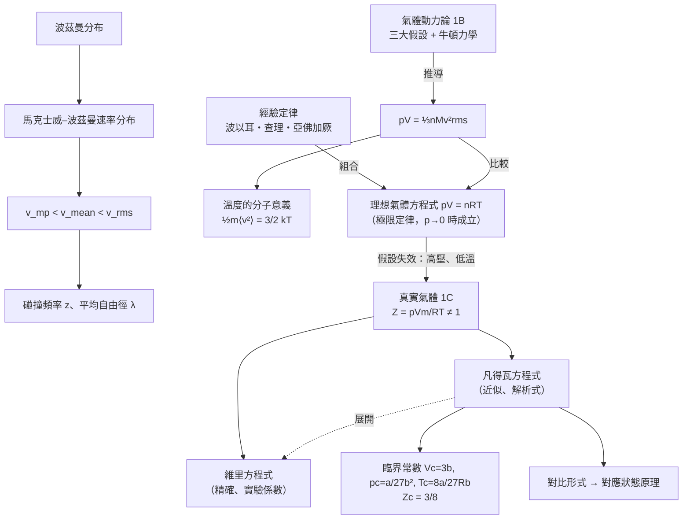

# Focus 1 氣體的性質（The Properties of Gases）
# 總整理與公式表

> **用途**：考前複習用。詳細觀念、推導與例題請回到 1A、1B、1C 三份講義。
> **符號說明**：⭐ = 必會推導；⚠️ = 易錯；(1A.4) = 課本式號

---

## 一、單元主線：一張圖看懂 Focus 1

**一句話串起三節**：

- **1A**：實驗歸納出 $pV = nRT$，它只在 $p \to 0$ 時嚴格成立。
- **1B**：用「質點＋彈性碰撞」的分子模型**從頭推出** $pV = nRT$，並告訴我們分子跑多快、多久撞一次。
- **1C**：當 1B 的假設失效（分子有體積、彼此吸引）時，用 $Z$、維里方程式、凡得瓦方程式描述偏差，並解釋液化與臨界現象。

**動力論假設與凡得瓦修正的對應**（跨節觀念，常考）：

| 1B 的假設 | 何時失效 | 1C 的對應修正 |
|---|---|---|
| 分子大小可忽略（質點） | 高壓，$\lambda$ 接近分子直徑 | 排除體積 $b$：$V \to V - nb$ |
| 分子只透過彈性碰撞作用（無長程作用力） | 低溫、中高壓 | 吸引項 $a$：$p \to p - a(n/V)^2$ |
| 遵守古典力學 | 極輕分子＋極低溫 | （本章不處理） |

---

## 二、公式總表

### 1A 理想氣體

| 名稱 | 公式 | 適用條件／備註 | 式號 |
|---|---|---|---|
| 壓力 | $p = F/A$ | 定義 | — |
| 流體靜壓 | $p = \rho gh$ | 液柱（不可壓縮） | — |
| 溫標 | $T/\text{K} = \theta/^\circ\text{C} + 273.15$ | 273.15 為精確值 | 1A.1 |
| 物質的量 | $n = m/M$，$N = nN_A$ | — | 1A.2 |
| 狀態方程式一般形式 | $p = f(T,V,n)$ | — | 1A.3 |
| ⭐ 理想氣體方程式 | $pV = nRT = NkT$ | 真實氣體在 $p \to 0$ 時成立 | 1A.4 |
| 組合氣體定律 | $\dfrac{p_1V_1}{n_1T_1} = \dfrac{p_2V_2}{n_2T_2}$ | 理想氣體 | 1A.5 |
| 氣體密度 | $\rho = \dfrac{pM}{RT}$，$M = \dfrac{\rho RT}{p}$ | 理想氣體；精確測定需外插至 $p \to 0$ | — |
| 分壓 | $p_J = x_Jp$ | **定義，所有氣體** | 1A.6 |
| 莫耳分率 | $x_J = n_J/n$，$\sum x_J = 1$ | 定義 | 1A.7 |
| 分壓總和 | $\sum p_J = p$ | 所有氣體 | 1A.8 |
| 道耳頓定律 | $p = \sum p_J^*$，$p_J^* = n_JRT/V$ | **僅理想氣體** | — |
| 平均莫耳質量 | $\bar{M} = \sum x_JM_J$ | — | — |
| ⭐ 氣壓公式 | $p = p_0e^{-h/H}$，$H = RT/Mg$ | 由 $dp = -\rho g\,dh$ 推導（P1A.11） | — |

### 1B 氣體動力論

| 名稱 | 公式 | 適用條件／備註 | 式號 |
|---|---|---|---|
| 方均根速率（定義） | $v_\text{rms} = \langle v^2\rangle^{1/2}$ | — | 1B.1 |
| ⭐ 動力論壓力 | $pV = \frac{1}{3}nMv_\text{rms}^2 = \frac{2}{3}E_\text{k}$ | 動量變化推導 | 1B.2 |
| 平均移動動能 | $\frac{1}{2}m\langle v^2\rangle = \frac{3}{2}kT$；每莫耳 $\frac{3}{2}RT$ | 與 $M$ 無關 | — |
| 能量均分 | 每個移動方向 $\frac{1}{2}kT$ | — | — |
| 一維速度分布 | $f(v_x) = \left(\dfrac{m}{2\pi kT}\right)^{1/2}e^{-mv_x^2/2kT}$ | 峰在 $v_x = 0$ | 1B.3 |
| ⭐ 馬克士威–波茲曼分布 | $f(v) = 4\pi\left(\dfrac{M}{2\pi RT}\right)^{3/2}v^2e^{-Mv^2/2RT}$ | ⚠️ $M$ 配 $R$，$m$ 配 $k$ | 1B.5 |
| 平均值 | $\langle v^n\rangle = \int_0^\infty v^nf(v)\,dv$ | — | 1B.6 |
| 區間分率 | $F = \int_{v_1}^{v_2}f(v)\,dv \approx f(v_\text{中點})\Delta v$ | 窄區間 | — |
| 方均根速率 | $v_\text{rms} = (3RT/M)^{1/2}$ | — | 1B.8 |
| 平均速率 | $v_\text{mean} = (8RT/\pi M)^{1/2}$ | — | 1B.9 |
| ⭐ 最可能速率 | $v_\text{mp} = (2RT/M)^{1/2}$ | $df/dv = 0$ | 1B.10 |
| 速率比 | $v_\text{mp} : v_\text{mean} : v_\text{rms} = 1 : 1.128 : 1.225$ | — | — |
| 平均相對速率 | $v_\text{rel} = 2^{1/2}v_\text{mean}$（同種）；$(8kT/\pi\mu)^{1/2}$（異種） | $\mu = m_\text{A}m_\text{B}/(m_\text{A} + m_\text{B})$ | 1B.11 |
| 碰撞截面 | $\sigma = \pi d^2$ | ⚠️ 不是 $\pi r^2$ | — |
| 數目密度 | $\mathcal{N} = N/V = p/kT$ | 理想氣體 | — |
| ⭐ 碰撞頻率 | $z = \sigma v_\text{rel}\mathcal{N} = \sigma v_\text{rel}p/kT$ | ⚠️ 用 $v_\text{rel}$ | 1B.12 |
| ⭐ 平均自由徑 | $\lambda = v_\text{rel}/z = kT/\sigma p = 1/\sigma\mathcal{N}$ | 定容下與 $T$ 無關 | 1B.13/14 |
| 高於 $x_0v_\text{mp}$ 的分率 | $\text{erfc}(x_0) + \dfrac{2x_0}{\sqrt{\pi}}e^{-x_0^2}$ | P1B.4 | — |
| 脫離速度 | $v_e = (2gR)^{1/2}$ | P1B.7 | — |

**高斯積分表**（$a > 0$）

| $\int_{-\infty}^{\infty}e^{-ax^2}dx$ | $\int_0^\infty xe^{-ax^2}dx$ | $\int_0^\infty x^2e^{-ax^2}dx$ | $\int_0^\infty x^3e^{-ax^2}dx$ | $\int_0^\infty x^4e^{-ax^2}dx$ |
|---|---|---|---|---|
| $(\pi/a)^{1/2}$ | $\dfrac{1}{2a}$ | $\dfrac{1}{4}\left(\dfrac{\pi}{a^3}\right)^{1/2}$ | $\dfrac{1}{2a^2}$ | $\dfrac{3}{8}\left(\dfrac{\pi}{a^5}\right)^{1/2}$ |

### 1C 真實氣體

| 名稱 | 公式 | 適用條件／備註 | 式號 |
|---|---|---|---|
| 壓縮因子 | $Z = V_\text{m}/V_\text{m}^\circ = pV_\text{m}/RT$ | 理想氣體 $Z = 1$ | 1C.1/2 |
| 維里方程式 | $pV_\text{m} = RT(1 + B'p + C'p^2 + \cdots)$ | — | 1C.3a |
| 維里方程式 | $pV_\text{m} = RT\left(1 + \dfrac{B}{V_\text{m}} + \dfrac{C}{V_\text{m}^2} + \cdots\right)$ | $B, C$ 隨 $T$ 變 | 1C.3b |
| 低壓斜率 | $dZ/dp \to B'$；$dZ/d(1/V_\text{m}) \to B$ | 不一定為零 | 1C.4 |
| 係數關係 | $B' = B/RT$，$C' = (C - B^2)/(RT)^2$ | P1C.14 | — |
| 波以耳溫度 | $B(T_\text{B}) = 0$ | — | — |
| ⭐ 凡得瓦方程式 | $p = \dfrac{nRT}{V - nb} - a\dfrac{n^2}{V^2} = \dfrac{RT}{V_\text{m} - b} - \dfrac{a}{V_\text{m}^2}$ | $a$ 吸引、$b$ 排斥 | 1C.5 |
| 三次式 | $V_\text{m}^3 - \left(b + \dfrac{RT}{p}\right)V_\text{m}^2 + \dfrac{a}{p}V_\text{m} - \dfrac{ab}{p} = 0$ | 求 $V_\text{m}$ | — |
| ⭐ 排除體積 | $b \approx 4V_\text{molecule}N_A$；$r = (3b/16\pi N_A)^{1/3}$ | 硬球 | — |
| ⭐ 臨界常數 | $V_c = 3b$，$p_c = \dfrac{a}{27b^2}$，$T_c = \dfrac{8a}{27Rb}$ | $dp/dV = d^2p/dV^2 = 0$ | 1C.6 |
| ⭐ 臨界壓縮因子 | $Z_c = 3/8 = 0.375$ | 實驗值約 0.3 | 1C.7 |
| ⭐ 凡得瓦→維里 | $B = b - \dfrac{a}{RT}$，$C = b^2$ | P1C.11 | — |
| 凡得瓦波以耳溫度 | $T_\text{B} = \dfrac{a}{Rb} = \dfrac{27}{8}T_c$ | — | — |
| 對比變數 | $X_\text{r} = X/X_c$（$X = p, V_\text{m}, T$） | — | 1C.8 |
| ⭐ 凡得瓦對比式 | $p_\text{r} = \dfrac{8T_\text{r}}{3V_\text{r} - 1} - \dfrac{3}{V_\text{r}^2}$ | 與 $a, b$ 無關 | 1C.9 |
| $Z$ 的極小值 | $Z_\text{min} = \dfrac{2s - 1}{s^2}$，$s = (T/T_\text{B})^{1/2}$ | 只在 $T < T_\text{B}$ 存在（P1C.24） | — |

---

## 三、⭐ 必會推導清單（骨架版）

> 考試可能要求「推導」或「說明推導過程」。以下列出每個推導的**關鍵步驟**，自己能從頭寫出來才算熟練。

### 1A

**① 由三大定律組合出 $pV = nRT$**
等溫（波以耳）$p_1V_1 = p_2V'$ → 等壓（查理）$V'/T_1 = V_2/T_2$ → 消去 $V'$：$pV/T$ 為常數 → 亞佛加厥：常數 $\propto n$ → $pV = nRT$

**② 氣壓公式**
薄層受力平衡 $dp = -\rho g\,dh$ → 代入 $\rho = pM/RT$ → $dp/p = -(Mg/RT)\,dh$ → 積分得 $p = p_0e^{-h/H}$

**③ 道耳頓定律（理想氣體時 $p_J^* = x_Jp$）**
$p_J^* = n_JRT/V$，$p = nRT/V$ → 相除得 $p_J^*/p = x_J$

### 1B

**④ 動力論壓力（5 步）**
(1) 每次碰撞動量變化 $2mv_x$ → (2) $\Delta t$ 內撞壁數 $\frac{1}{2}\cdot\frac{nN_A}{V}\cdot Av_x\Delta t$ → (3) 力 = 動量變化率 $nMAv_x^2/V$ → (4) 壓力 $= nMv_x^2/V$ → (5) 取平均並用等向性 $\langle v_x^2\rangle = \frac{1}{3}\langle v^2\rangle$ → $pV = \frac{1}{3}nMv_\text{rms}^2$

**⑤ 馬克士威–波茲曼分布（5 步）**
(1) 波茲曼 $f \propto e^{-\varepsilon/kT}$，$\varepsilon = \frac{1}{2}m(v_x^2 + v_y^2 + v_z^2)$ → 分解為三個方向 → (2) 歸一化 $\int f(v_x)dv_x = 1$ 用高斯積分得 $K_x = (m/2\pi kT)^{1/2}$ → (3) 三維機率只與 $v$ 有關 → (4) 速度空間球殼體積 $4\pi v^2dv$ → (5) $m/k = M/R$

**⑥ 三種速率**
$v_\text{rms}$：$\langle v^2\rangle$ 用 $\int x^4e^{-ax^2}$；$v_\text{mean}$：$\langle v\rangle$ 用 $\int x^3e^{-ax^2}$；$v_\text{mp}$：$\frac{d}{dv}(v^2e^{-av^2}) = 0 \Rightarrow v^2 = 1/a$

**⑦ 碰撞頻率與平均自由徑**
凍結其他分子 → 碰撞管體積 $\sigma v_\text{rel}\Delta t$ → 管內分子數 $\mathcal{N}\sigma v_\text{rel}\Delta t$ → $z = \sigma v_\text{rel}\mathcal{N}$ → $\mathcal{N} = p/kT$ → $\lambda = v_\text{rel}/z = kT/\sigma p$

### 1C

**⑧ 排除體積 $b \approx 4V_\text{molecule}N_A$**
兩硬球中心最近距離 $2r$ → 一對排除 $\frac{4}{3}\pi(2r)^3 = 8V_\text{molecule}$ → 每個分子分一半 $4V_\text{molecule}$ → 乘以 $N_A$

**⑨ 凡得瓦方程式的建構**
排斥：$V \to V - nb$；吸引：撞壁頻率與力量各 $\propto n/V$ → 壓力降低 $a(n/V)^2$

**⑩ 臨界常數（兩種方法）**
- **導數法**：(2)÷(1) 得 $\frac{2}{V - b} = \frac{3}{V} \Rightarrow V_c = 3b$ → 代回 (1) 得 $T_c$ → 代入方程式得 $p_c$
- **三重根法**：三次式 $= (V_\text{m} - V_c)^3$，比較係數 $3V_c = b + RT_c/p_c$、$3V_c^2 = a/p_c$、$V_c^3 = ab/p_c$

**⑪ 凡得瓦→維里**
$Z = \frac{1}{1 - b/V_\text{m}} - \frac{a}{RTV_\text{m}}$ → 展開 $(1 - x)^{-1} = 1 + x + x^2 + \cdots$ → $B = b - a/RT$，$C = b^2$

**⑫ 對比形式**
代入 $p = p_\text{r}p_c$ 等，再代入式 1C.6 的臨界常數 → 兩邊乘 $27b^2/a$ → $a$、$b$ 消失

---

## 四、重要比較表

### 1. 三種溫度：$T_c$、$T_\text{B}$、溫度對 $Z$ 的影響

| 溫度 | 定義 | 物理意義 | 凡得瓦預測 |
|---|---|---|---|
| 臨界溫度 $T_c$ | 能發生凝結的最高溫度 | 高於 $T_c$：只靠加壓無法液化，為超臨界流體 | $\dfrac{8a}{27Rb}$ |
| 波以耳溫度 $T_\text{B}$ | $B = 0$ 的溫度 | 低壓時 $Z$ 斜率為零，在較寬範圍內接近理想 | $\dfrac{a}{Rb} = 3.375\,T_c$ |

| 條件 | $Z$ 的行為 |
|---|---|
| $T > T_\text{B}$ | 所有壓力下 $Z > 1$（排斥主導），如 0 °C 的 H₂ |
| $T < T_\text{B}$ | 低壓 $Z < 1$（吸引主導）→ 出現極小值 → 高壓 $Z > 1$（排斥主導） |
| 任何溫度、$p \to 0$ | $Z \to 1$，但斜率 $= B'$ 不一定為零 |

### 2. 三種速率

| | $v_\text{mp}$ | $v_\text{mean}$ | $v_\text{rms}$ |
|---|---|---|---|
| 公式 | $(2RT/M)^{1/2}$ | $(8RT/\pi M)^{1/2}$ | $(3RT/M)^{1/2}$ |
| 相對大小 | 1 | 1.128 | 1.225 |
| 怎麼求 | $df/dv = 0$ | $\langle v\rangle$ | $\langle v^2\rangle^{1/2}$ |
| 用途 | 最多分子的速率 | $z$、$\lambda$、擴散 | 壓力、動能 |
| N₂，25 °C | 421 m s⁻¹ | 475 m s⁻¹ | 515 m s⁻¹ |

### 3. 維里方程式 vs. 凡得瓦方程式

| | 維里方程式 | 凡得瓦方程式 |
|---|---|---|
| 性質 | 經驗式（級數展開） | 模型式（由分子圖像建構） |
| 參數 | $B(T), C(T), \ldots$，**隨溫度變**，需實驗測定 | $a, b$，**視為常數** |
| 精確度 | **精確**（取足夠項數時） | **近似**，但為解析式，可得一般性結論 |
| 臨界行為 | 需代入具體係數 | 直接得到 $V_c, p_c, T_c, Z_c$ |
| 關係 | 凡得瓦展開後：$B = b - a/RT$，$C = b^2$ | — |

> ⚠️ 簡報標題把兩者標為「less precise / more precise」，與課本說法**相反**。考試前建議向老師確認。

### 4. 吸引力 vs. 排斥力

| | 吸引力 | 排斥力 |
|---|---|---|
| 作用範圍 | 較長（數個分子直徑） | 短程（幾乎接觸時） |
| 何時主導 | 中等壓力 | 高壓 |
| 對壓縮性 | 較易壓縮 | 較難壓縮 |
| $Z$ | $Z < 1$ | $Z > 1$ |
| 維里係數 | $B < 0$ | $B > 0$ |
| 凡得瓦參數 | $a$ | $b$ |

### 5. $f(v_x)$ vs. $f(v)$

| | 一維 $f(v_x)$ | 三維 $f(v)$ |
|---|---|---|
| 範圍 | $-\infty < v_x < \infty$ | $0 \le v < \infty$ |
| 形狀 | 對稱高斯曲線 | 右偏，有長尾巴 |
| 最大值 | $v_x = 0$ | $v_\text{mp} > 0$ |
| 原因 | — | 多了球殼因子 $4\pi v^2$ |

---

## 五、常數與單位換算

| 常數 | 數值 |
|---|---|
| 氣體常數 $R$ | 8.3145 J K⁻¹ mol⁻¹ ＝ 0.082057 dm³ atm K⁻¹ mol⁻¹ ＝ 0.083145 dm³ bar K⁻¹ mol⁻¹ ＝ 62.364 dm³ Torr K⁻¹ mol⁻¹ |
| 波茲曼常數 $k$ | $1.380\,649\times10^{-23}$ J K⁻¹（精確） |
| 亞佛加厥常數 $N_A$ | $6.022\,140\,76\times10^{23}$ mol⁻¹（精確） |
| $R = N_Ak$ | — |
| 重力加速度 $g$ | 9.81 m s⁻² |

| 換算 | 數值 |
|---|---|
| 1 atm | 101 325 Pa ＝ 760 Torr（精確） |
| 1 bar | $10^5$ Pa（精確），也是標準壓力 $p^\ominus$ |
| 1 Torr | 133.322 Pa |
| 1 J | 1 kg m² s⁻² ＝ 1 N m ＝ 1 Pa m³ |
| 1 dm³ atm | 101.325 J |
| 1 atm dm⁶ mol⁻² | 0.101 325 Pa m⁶ mol⁻² |
| 1 nm² | $10^{-18}$ m² |
| SATP（298.15 K、1 bar） | $V_\text{m}$ = 24.789 dm³ mol⁻¹ |
| STP（273.15 K、1 atm） | $V_\text{m}$ = 22.414 dm³ mol⁻¹ |

---

## 六、⚠️ 易錯清單（彙整）

1. **溫度要換成 K**：所有 $pV = nRT$、$v_\text{rms}$ 等計算都用克氏溫度。
2. **莫耳質量用 kg mol⁻¹**：算速率時若用 g mol⁻¹，答案會差 $\sqrt{1000} \approx 31.6$ 倍。
3. **$M$ 配 $R$，$m$ 配 $k$**：$M/RT$ 與 $m/kT$ 等價，但不能混用（簡報 p.51 的錯誤）。
4. **$\sigma = \pi d^2$，不是 $\pi r^2$**；$d$ 是碰撞直徑，同種分子 $d = 2r$。
5. **碰撞頻率用 $v_\text{rel}$**，不是 $v_\text{mean}$。
6. **$b$ 是分子體積的 4 倍**（每莫耳要再乘 $N_A$）。
7. **分壓 $p_J = x_Jp$ 是定義，適用所有氣體**；道耳頓定律「單獨佔據容器時的壓力」只適用理想氣體。
8. **STP 與 SATP 不同**：22.414 vs 24.789 dm³ mol⁻¹。
9. **寫 $T = 0$，不寫 0 K**；單位寫 K，不寫 °K。
10. **速率（speed）≠ 速度（velocity）**：平均速度向量為零，平均速率不為零。
11. **$\lambda$ 在定容下與溫度無關**：$\lambda = 1/\sigma\mathcal{N}$。
12. **H₂ 在 0 °C 時 $Z$ 恆大於 1**：「中等壓力 $Z < 1$」不是所有氣體都成立。
13. **由臨界常數求 $a$、$b$**：用 $(V_c, p_c)$ 或 $(p_c, T_c)$ 會得到不同結果，因為實際 $Z_c \neq 3/8$。
14. **極限定律要外插至 $p \to 0$**：求絕對零度、莫耳質量時，直接用高壓數據會有誤差。
15. **凡得瓦三次式**：$T < T_c$ 時可能有三個實根，最小為液體、最大為氣體、中間無物理意義。

---

## 七、勘誤彙整

### 簡報

| 頁 | 原文 | 更正 | 重要性 |
|---|---|---|---|
| p.6 | volumn；number of moles | volume；amount (in moles) | 低 |
| p.12–13 | BA 真空計範圍兩頁上下限不一致 | 約 $10^{-3}$–$10^{-10}$ Torr | 低 |
| p.17 | 三大定律標為式 1A.3a–d | 課本式 1A.3 是 $p = f(T,V,n)$ | 低 |
| p.22 | $R = 8.314\,47$ | 現行值 8.314 462 618…（課本取 8.3145） | 低 |
| p.27 | 500k、300k | K（大寫） | 低 |
| p.29 | Dolton's law (1A.6) | **Dalton's law**；式 1A.6 是分壓定義 | 中 |
| p.36 | n is the mole of molecules | amount of molecules | 低 |
| **p.51** | $\left[\dfrac{M}{2\pi kT}\right]^{3/2}$ | **$\left(\dfrac{M}{2\pi RT}\right)^{3/2}$** | **高** |
| p.55–56 | RMS velocity = average speed in any given direction | $v_\text{rms} = \langle v^2\rangle^{1/2}$；都是速率而非速度 | 中 |
| p.56 | Figure 1B.7 | 課本為 Figure 1B.6 | 低 |
| p.60 | Avogadro's number | Avogadro's **constant** | 低 |
| **p.61** | $\lambda = KT/\sigma p$ | **$kT$**（小寫） | **高** |
| p.66 | intermediate pressure Z<1 | 大多數氣體；H₂ 例外 | 中 |
| **p.68、72–90** | 維里「less precise」、凡得瓦「more precise」 | **與課本相反**，建議確認 | **高** |
| p.72–76 | 副標題皆為 repulsive interactions | p.75–76 講的是吸引作用 | 低 |
| **p.74** | $V_\text{molecule} = \frac{4}{3}\pi(2r)^3$；$b \approx 4V_\text{molecule}$ | 左邊應為「一對分子的排除體積」；**$b \approx 4V_\text{molecule}N_A$** | **高** |
| p.78 | Collection your thoughts；by by | Collect；多一個 by | 低 |
| p.90 | Table 1.5；(a) Formulation | 課本 Table 1C.2；屬於 (b) 特徵 | 低 |

### 課本

| 位置 | 問題 | 更正 |
|---|---|---|
| Example 1A.1 | N₂ 莫耳質量取 14.01 g mol⁻¹ | **28.02**；$n = 2.00\times10^{-5}$ mol、$N = 1.20\times10^{19}$ |
| p.17 | 平均自由徑「約 1000 個分子直徑」 | 計算約 260 倍，數量級 $10^2$–$10^3$ |
| 表 1C.1 | CO₂ 在 273 K 的 $B = -14.2$ | 疑為漏印一位數，約 −150（E1C.2 用 −149.7） |
| BI 1C.1 vs Ex 1C.1 | 都出現 0.366 | 前者 100 bar（實驗值），後者 100 atm（凡得瓦估計值） |

---

## 八、跨節綜合題（含詳解）

> 這幾題把 1A、1B、1C 的觀念串在一起，適合最後衝刺。數值已用程式驗算。

### 綜合題 1｜高壓下動力論假設還成立嗎？（1B × 1C）

**題目**：N₂ 在 25 °C 下（$\sigma = 0.43$ nm²；凡得瓦係數 $a = 1.352$ dm⁶ atm mol⁻²、$b = 0.0387$ dm³ mol⁻¹）。分別在 1 atm 與 100 atm 時：(a) 用凡得瓦方程式求 $V_\text{m}$ 與 $Z$；(b) 以 (a) 的 $V_\text{m}$ 計算平均自由徑，並與碰撞直徑比較；(c) 討論動力論的假設 2 是否成立。

**詳解**：

**(a)** 解凡得瓦三次式：

| $p$ | 理想 $V_\text{m}$ | 凡得瓦 $V_\text{m}$ | $Z$ |
|---|---|---|---|
| 1 atm | 24.47 dm³ mol⁻¹ | 24.45 dm³ mol⁻¹ | 0.999 |
| 100 atm | 0.2447 dm³ mol⁻¹ | 0.2354 dm³ mol⁻¹ | 0.962 |

**(b)** $\lambda = \dfrac{1}{\sigma\mathcal{N}}$，$\mathcal{N} = \dfrac{N_A}{V_\text{m}}$。碰撞直徑 $d = (\sigma/\pi)^{1/2} = 0.37$ nm。

| $p$ | $\mathcal{N}$/m⁻³ | $\lambda$ | $\lambda/d$ |
|---|---|---|---|
| 1 atm | $2.46\times10^{25}$ | **94 nm** | ≈ 255 |
| 100 atm | $2.56\times10^{27}$ | **0.91 nm** | ≈ 2.5 |

**(c)** 1 atm 時 $\lambda \gg d$，分子可視為質點，假設 2 成立，$Z \approx 1$。100 atm 時 $\lambda$ 只有分子直徑的 2.5 倍，**分子本身的大小不再可忽略**，假設 2 失效。這正是凡得瓦方程式需要 $b$ 項的原因，而 $Z$ 也已明顯偏離 1。

> **重點**：1B 的 $\lambda/d$ 是判斷「理想氣體近似是否可用」的分子層次指標，1C 的 $Z$ 是巨觀層次的指標，兩者相互呼應。

---

### 綜合題 2｜課本 I1.3：由碰撞截面估計凡得瓦 $b$（1B × 1C）

**題目**：Methane molecules, CH₄, may be considered as spherical, with a collision cross-section of $\sigma = 0.46$ nm². Estimate the value of the van der Waals parameter $b$ by calculating the molar volume excluded by methane molecules.

（甲烷分子可視為球形，碰撞截面 $\sigma = 0.46$ nm²。計算甲烷分子所排除的莫耳體積，以估計凡得瓦參數 $b$。）

**詳解**：

**Step 1：碰撞直徑**（1B）

$$
d = \left(\frac{\sigma}{\pi}\right)^{1/2} = \left(\frac{0.46\ \text{nm}^2}{\pi}\right)^{1/2} = 0.383\ \text{nm}
$$

**Step 2：分子體積**（同種分子 $d = 2r$）

$$
V_\text{molecule} = \frac{4}{3}\pi\left(\frac{d}{2}\right)^3 = \frac{\pi}{6}d^3 = 2.93\times10^{-29}\ \text{m}^3
$$

**Step 3：排除體積**（1C）

$$
b = 4V_\text{molecule}N_A = 4(2.93\times10^{-29})(6.022\times10^{23})\ \text{m}^3\,\text{mol}^{-1} = \boxed{7.07\times10^{-5}\ \text{m}^3\,\text{mol}^{-1} = 70.7\ \text{cm}^3\,\text{mol}^{-1}}
$$

> **比較與討論**：
> - 由臨界常數得到的 $b$：用 $V_c$ 得 32.9，用 $p_c$、$T_c$ 得 42.9 cm³ mol⁻¹（1C 習題 1）。碰撞截面法約**高估 1.6–2 倍**。
> - 原因：$\sigma$ 是由**輸送性質**（如黏度）量得的「有效碰撞大小」，包含了分子外圍較軟的排斥區；凡得瓦的 $b$ 則是把所有偏差塞進單一參數的擬合值。**不同方法定義的「分子大小」不同**，但數量級一致（10⁻¹ nm、數十 cm³ mol⁻¹）。
> - 反向檢查（Ar）：由表 1C.3 的 $b = 32.0$ cm³ mol⁻¹ 反推 $r = 0.147$ nm，$\sigma = \pi(2r)^2 = 0.27$ nm²；課本 E1B.5 給的 Ar $\sigma = 0.36$ nm²，同樣數量級一致。

---

### 綜合題 3｜課本 I1.2：大氣的動能密度（1A × 1B）

**題目**：The principal components of the atmosphere of the Earth are diatomic molecules, which can rotate as well as translate. Given that the translational kinetic energy density of the atmosphere is 0.15 J cm⁻³, what is the total kinetic energy density, including rotation?

（地球大氣的主要成分是雙原子分子，除了移動之外還能轉動。已知大氣的移動動能密度為 0.15 J cm⁻³，包含轉動在內的總動能密度為何？）

**詳解**：

**Step 1：能量均分**（1B）

- 移動：3 個方向，每個 $\frac{1}{2}kT$，共 $\frac{3}{2}kT$。
- 轉動：**線形分子**可繞兩個垂直於鍵軸的軸轉動，共 2 個轉動自由度，貢獻 $2\times\frac{1}{2}kT = kT$。（繞鍵軸的轉動慣量極小，不計入。）

$$
\frac{E_\text{total}}{E_\text{trans}} = \frac{\frac{3}{2}kT + kT}{\frac{3}{2}kT} = \frac{5}{3}
$$

**Step 2：計算**

$$
\frac{E_\text{total}}{V} = \frac{5}{3}\times0.15\ \text{J cm}^{-3} = \boxed{0.25\ \text{J cm}^{-3}}
$$

> **合理性檢查**（1A × 1B）：由 $pV = \frac{2}{3}E_\text{trans}$，
> $$p = \frac{2}{3}\times0.15\ \text{J cm}^{-3} = 0.10\ \text{J cm}^{-3} = 1.0\times10^5\ \text{Pa} \approx 1\ \text{bar}$$
> 正好是地表大氣壓！這說明「壓力就是單位體積的移動動能乘以 2/3」，是 $pV = \frac{1}{3}nMv_\text{rms}^2$ 的另一種解讀。

---

### 綜合題 4｜溫度在三節中扮演的角色（觀念問答）

**題目**：請分別從 1A、1B、1C 的觀點說明「溫度」的意義與作用。

**參考答案**：

- **1A（巨觀）**：溫度決定兩物體接觸時**熱流的方向**；熱平衡與第零定律使溫度可以被測量。理想氣體方程式中，溫度與 $pV$ 成正比，理想氣體溫度計（外插至 $p \to 0$）提供與物質無關的絕對溫標。
- **1B（分子）**：溫度是**分子平均移動動能的量度**，$\frac{1}{2}m\langle v^2\rangle = \frac{3}{2}kT$。溫度決定馬克士威–波茲曼分布的寬度與峰值位置（只透過 $T/M$）。
- **1C（交互作用）**：溫度決定**分子動能與分子間作用能的相對大小**。高溫時動能大，吸引力相對不重要，$Z$ 偏向大於 1（高於 $T_\text{B}$ 時恆大於 1）；低溫時吸引力足以「捕獲」分子，才可能凝結，但必須低於 $T_c$。

---

## 九、考前十分鐘快問快答

| # | 問題 | 答案 |
|---|---|---|
| 1 | 理想氣體方程式何時精確成立？ | $p \to 0$（極限定律） |
| 2 | 分壓的定義？道耳頓定律何時成立？ | $p_J = x_Jp$（所有氣體）；道耳頓定律僅理想氣體 |
| 3 | 同溫下 H₂ 與 O₂ 何者平均動能大？ | 相同，$\frac{3}{2}kT$ |
| 4 | $v_\text{mp}, v_\text{mean}, v_\text{rms}$ 大小順序？ | $v_\text{mp} < v_\text{mean} < v_\text{rms}$（1 : 1.128 : 1.225） |
| 5 | 升溫時馬克士威–波茲曼分布如何變化？ | 峰右移、變寬變矮，面積仍為 1 |
| 6 | 壓力加倍，$\lambda$ 與 $z$ 如何變？ | $\lambda$ 減半，$z$ 加倍 |
| 7 | 定容升溫，$\lambda$ 如何變？ | 不變 |
| 8 | $Z < 1$ 代表什麼？ | 吸引力主導，比理想氣體易壓縮 |
| 9 | 什麼是波以耳溫度？ | $B = 0$ 的溫度；凡得瓦氣體 $T_\text{B} = a/Rb$ |
| 10 | 什麼條件下只靠加壓能液化？ | $T < T_c$ |
| 11 | 凡得瓦 $a$、$b$ 分別代表？ | $a$：吸引強度；$b$：排除體積（排斥） |
| 12 | 凡得瓦臨界常數？ | $V_c = 3b$，$p_c = a/27b^2$，$T_c = 8a/27Rb$ |
| 13 | 凡得瓦 $Z_c$？實驗值？ | 3/8 = 0.375；約 0.3 |
| 14 | 凡得瓦環為何不真實？如何處理？ | $dp/dV > 0$ 力學不穩定；馬克士威等面積作圖法 |
| 15 | 對應狀態原理的內容？何時失準？ | 相同 $V_\text{r}$、$T_\text{r}$ 給相同 $p_\text{r}$；非球形或極性分子失準 |

---

## 十、Focus 1 總檢核

- [ ] 能說出四個狀態變數、單位換算、STP 與 SATP
- [ ] ⭐ 推導 $pV = nRT$（由三大定律）與氣壓公式
- [ ] 區分分壓定義與道耳頓定律
- [ ] ⭐ 推導 $pV = \frac{1}{3}nMv_\text{rms}^2$ 並說明溫度的分子意義
- [ ] ⭐ 推導馬克士威–波茲曼分布與三種速率
- [ ] ⭐ 推導 $z$ 與 $\lambda$，避開 $\pi r^2$ 與 $v_\text{mean}$ 的陷阱
- [ ] 用位能曲線與 $Z$ 解釋真實氣體偏差
- [ ] 描述 CO₂ 等溫線、蒸氣壓、臨界點、超臨界流體
- [ ] 寫出維里方程式，說明 $B$ 的意義與波以耳溫度
- [ ] ⭐ 建構凡得瓦方程式、推導 $b \approx 4V_\text{molecule}N_A$
- [ ] ⭐ 用兩種方法推導臨界常數與 $Z_c = 3/8$
- [ ] ⭐ 凡得瓦→維里展開、對比形式
- [ ] 能把動力論的假設與凡得瓦的修正對應起來
