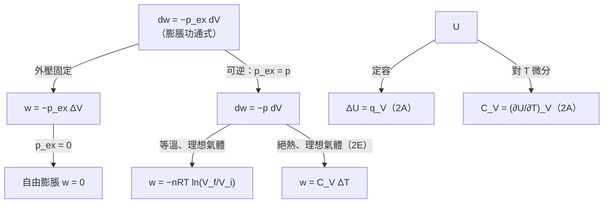

# Focus 2 熱力學第一定律（The First Law）
# 2A 內能（Internal Energy）講義

> **範圍**：上課簡報 p.6–52；課本 Atkins' Physical Chemistry Topic 2A（p.34–44），以及章末 Exercises／Problems（p.69–70）
> **標示說明**：
> - 未特別標示的內容以簡報為主
> - **📘 課本補充**：簡報沒有、取自課本的內容
> - **⭐**：必會推導
> - **⚠️**：勘誤或易錯處
> **符號慣例**：本講義的 $w$、$q$ 一律指「**對系統**作的功、**傳給系統**的熱」，與課本相同

---

## 學習重點

1. 能區分開放系統、封閉系統、孤立系統，以及透熱與絕熱邊界。
2. 能從**巨觀**（操作型定義）與**分子**（有序／無序運動）兩個角度說明功與熱的差別。
3. 理解內能是**狀態函數**，能用**能量均分定理**估計理想氣體的莫耳內能。
4. 能寫出第一定律 $\Delta U = q + w$，並正確使用正負號慣例。
5. 能**推導**膨脹功的通式 $w = -\int p_\text{ex}\,dV$，並算出定外壓、自由膨脹、等溫可逆膨脹三種情況的功。
6. 能用 $p$–$V$ 圖說明為什麼**可逆過程作的功最大**。
7. 能說明定容下 $\Delta U = q_V$，以及彈卡計與卡計常數的原理。
8. 能定義定容熱容量 $C_V$，並使用偏微分的基本關係（含歐拉連鎖關係）。

---

## 本章導覽：第一定律在算什麼？（簡報 p.6、p.23）

本章的主角是兩個狀態函數：**內能（internal energy）$U$** 和**焓（enthalpy）$H$**。我們要回答兩類問題：

- **算功**：系統膨脹或壓縮時，與外界交換了多少功？（2A）
- **算熱**：定容時熱量等於 $\Delta U$（2A），定壓時熱量等於 $\Delta H$（2B）。

簡報 p.23 的路線圖（road map）中，**2A 負責左邊紅框「算功」的部分**：

---

## 2A.1 功、熱與能量（Work, Heat, and Energy）

### 一、系統與外界（簡報 p.8–9）

熱力學把宇宙分成兩部分：

- **系統（system）**：我們感興趣的部分，例如反應容器、引擎、電化學電池（electrochemical cell）、生物細胞。
- **外界（surroundings）**：系統以外的區域。**量測都在外界進行**。

系統的類型由**邊界（boundary）**的性質決定：

| 系統 | 能交換物質？ | 能交換能量？ | 例子 |
|---|---|---|---|
| **開放系統（open system）** | ✓ | ✓ | 打開的燒杯、生物細胞 |
| **封閉系統（closed system）** | ✗ | ✓ | 加了活塞的汽缸 |
| **孤立系統（isolated system）** | ✗ | ✗ | 理想的保溫瓶 |

> 孤立系統是「與外界**既無力學接觸、也無熱接觸**」的封閉系統。

### 二、操作型定義（Operational Definitions）（簡報 p.10–12）

#### 1. 功（work）

**功是為了對抗反向的力而產生運動。**

簡報 p.10 的向量寫法：物體移動 $d\boldsymbol{s}$ 時，**對該物體**作的功為

$$
dw_\text{body} = -\boldsymbol{F}\cdot d\boldsymbol{s}, \qquad \boldsymbol{F}\cdot d\boldsymbol{s} = F_x\,dx + F_y\,dy + F_z\,dz
$$

其中 $\boldsymbol{F}$ 是作用在物體上的**反向力**（例如重力）。系統因作功而失去的能量是它的負值，所以**對系統**作的功為

$$
dw = \boldsymbol{F}\cdot d\boldsymbol{s}
$$

一維運動時 $dw = F_x\,dx$。因為力與運動反向，$F_x < 0$，即 $F_x = -|F|$，所以 $dw = -|F|\,dx < 0$：系統推動物體時，自己的能量減少。

> **舉例**：系統把重物往上推 $dz$。重力向下，$F_z = -mg$，所以 $dw = -mg\,dz < 0$，系統失去能量；重物得到等量的位能 $mg\,dz$。

**功的例子**（簡報 p.11）：

- 把重物往上舉，對抗重力。
- 氣體膨脹推動活塞，活塞的運動原則上可以舉起重物。
- 化學反應驅動電流通過電阻。同樣的電流若通過馬達，就能舉起重物，所以也是作功。

> 📘 **判斷原則**：一個過程只要**原則上能用來舉起外界某處的重物**，它就是在作功。

#### 2. 能量（energy）

**能量是系統作功的能力（capacity to do work）。**

- 對一個原本孤立的系統作功（壓縮氣體、把彈簧上緊），系統的作功能力增加，**能量增加**。
- 系統對外作功（活塞外推、彈簧放鬆），系統的**能量減少**。

📘 **系統能量增加多少，外界就減少多少**，反之亦然。

📘 **功不是一種能量，而是一種傳遞能量的方式。** 熱也一樣。

#### 3. 熱（heat）

**因為系統與外界有溫度差而造成的能量傳遞，稱為熱。**

| 名詞 | 定義 | 例子 |
|---|---|---|
| **透熱（diathermic）邊界** | 允許能量以熱的形式通過 | 金屬容器 |
| **絕熱（adiabatic）邊界** | 即使有溫度差，也不允許熱通過 | 保溫瓶、杜瓦瓶 |
| **放熱過程（exothermic process）** | 以熱的形式釋放能量到外界 | **所有燃燒（combustion）**，如 CH₄(g) + 2 O₂(g) → CO₂(g) + 2 H₂O(l) |
| **吸熱過程（endothermic process）** | 從外界以熱的形式吸收能量 | 水的汽化（vaporization） |

📘 **容器種類決定最終溫度**（課本圖 2A.2）

| | 絕熱容器（adiabatic） | 透熱容器（diathermic） |
|---|---|---|
| **吸熱過程** | 系統**溫度下降** | 熱從外界流入，溫度回到外界溫度 |
| **放熱過程** | 系統**溫度上升**（永久的） | 熱流到外界，溫度回到外界溫度 |

> 若外界遠大於系統（例如恆溫槽），透熱容器中的過程就是**等溫（isothermal）**的。這是 2A.3(d) 等溫膨脹的實作方式。

### 三、功與熱的分子解釋（簡報 p.13）

| | 熱（heating） | 功（work） |
|---|---|---|
| 利用外界的什麼運動 | **無序**、隨機的分子運動，即**熱運動（thermal motion）** | **有序**的運動，例如重物的原子一起向上或向下 |
| 簡報圖 | 圖 2A.3：能量以熱傳到外界，激發外界原子的隨機運動 | 圖 2A.4：系統作功，激發外界的有序運動 |

📘 **重點：熱與功的區別是看「外界」，不是看系統。**

例如在絕熱容器中壓縮氣體：活塞的原子**有序地**下降（這是功），但氣體分子被加速後，經過碰撞方向很快變得混亂。雖然最後在系統內激發的是熱運動，**因為外界用的是有序運動，所以仍然叫作功**。

---

## 2A.2 內能的定義（The Definition of Internal Energy）

### 一、內能 $U$（簡報 p.14）

**內能是系統組成粒子（原子、離子、分子）的動能與位能的總和。**

簡報 p.14 的補充：系統的總能量包括三部分：

1. 系統整體運動的動能
2. 系統在外力場中的位能
3. 系統內部的能量，也就是**內能**

化學熱力學研究的系統一般沒有整體運動。在沒有特殊外力場、又忽略地球重力場時，**系統的全部能量就是內能**。

📘 例如：內能**不包括**系統隨地球繞太陽公轉的動能。

**內能的變化**：

$$
\Delta U = U_f - U_i \qquad (2A.1)
$$

📘 熱力學的通用慣例：$\Delta X = X_f - X_i$（末減初）。

#### 內能是狀態函數（state function）

**狀態函數**的值**只取決於系統目前的狀態，與這個狀態是怎麼達到的無關**。

- $U$ 是溫度、壓力、物質的量等狀態變數的函數。改變其中任何一個（例如壓力），都可能改變 $U$。
- 📘 $U$ 是**示量性質（extensive property）**，單位 J（1 J = 1 kg m² s⁻²）。
- 📘 **莫耳內能（molar internal energy）** $U_\text{m} = U/n$ 是**示強性質（intensive property）**，常用單位 kJ mol⁻¹。

### 二、內能的分子解釋（簡報 p.15–17）

#### 1. 運動自由度與能階

分子有多種**運動自由度（motional degrees of freedom）**：

- **移動（translation）**：在空間中移動
- **轉動（rotation）**
- **振動（vibration）**

📘 內能還包括分子間交互作用的**位能**。溫度升高時，分子會佔據這些運動模式中更高的能量狀態，因此內能增加。

**能量量子化**（簡報 p.16）：被限制在某空間中的分子、原子或次原子粒子，能量只能取某些不連續的值，稱為**量子化（quantized）**。這些允許的能量稱為**能階（energy levels）**。

| 運動 | 典型能階間距 | 與室溫 $kT/hc \approx 207\ \text{cm}^{-1}$ 比較 | 室溫下 |
|---|---|---|---|
| 移動 | 極小，可視為**連續（continuum）** | 遠小於 | 完全激發，可用古典力學 |
| 轉動 | 約 1 cm⁻¹ | 遠小於 | 完全激發，可用古典力學 |
| 振動 | 10² – 10³ cm⁻¹ | 相近或更大 | **大多未激發** |
| 電子 | 約 10⁴ cm⁻¹ | 遠大於 | 不激發 |

> 室溫下 $kT/hc$ 的計算：$\dfrac{(1.381\times10^{-23})(298)}{(6.626\times10^{-34})(2.998\times10^{10}\ \text{cm s}^{-1})} = 207\ \text{cm}^{-1}$。

**能量單位換算表**（簡報 p.16）

| 由 ＼ 到 | eV | cm⁻¹ | kcal mol⁻¹ | kJ mol⁻¹ |
|---|---|---|---|---|
| 1 eV | 1 | 8065.73 | 23.0609 | 96.485 |
| 1 cm⁻¹ | 1.239 81 × 10⁻⁴ | 1 | 0.002 859 11 | 0.011 963 |
| 1 kcal mol⁻¹ | 0.043 363 4 | 349.757 | 1 | 4.184 |
| 1 kJ mol⁻¹ | 0.010 364 10 | 83.593 | 0.239 001 | 1 |

（kJ mol⁻¹ 那一欄是由表中數值換算補上的。）

#### 2. 能量均分定理（Equipartition Theorem）

古典力學的**能量均分定理**：能量中**每一個平方項（quadratic contribution）**的平均值都是 $\frac{1}{2}kT$。

此定理可以預測每種運動模式對**無交互作用分子**（即理想氣體）總能量的貢獻，前提是**量子效應可以忽略**。

📗 **簡報 Brief illustration 2A.1：單原子氣體的移動能**

原子可以在三個方向移動，移動動能有三個平方項：

$$
E_\text{trans} = \tfrac{1}{2}mv_x^2 + \tfrac{1}{2}mv_y^2 + \tfrac{1}{2}mv_z^2
$$

每項平均 $\frac{1}{2}kT$，所以

$$
\langle E_\text{trans}\rangle = 3\times\tfrac{1}{2}kT = \tfrac{3}{2}kT
$$

乘以 $N_A$（$kN_A = R$）得到莫耳移動能：

$$
E_\text{trans,m} = \tfrac{3}{2}kT\times N_A = \tfrac{3}{2}RT
$$

25 °C 時 $RT = 2.48$ kJ mol⁻¹，所以移動對理想氣體莫耳內能的貢獻是 **3.72 kJ mol⁻¹**。

**常見分子在室溫的能量均分結果**（只計移動與轉動）

| 分子類型 | 移動 | 轉動 | $U_\text{m} - U_\text{m}(0)$ | $C_{V,\text{m}}$ |
|---|---|---|---|---|
| 單原子（He、Ar） | $\frac{3}{2}RT$ | 0 | $\frac{3}{2}RT$ | $\frac{3}{2}R = 12.47$ J K⁻¹ mol⁻¹ |
| 線形分子（N₂、CO₂、I₂） | $\frac{3}{2}RT$ | $RT$（2 個轉動軸） | $\frac{5}{2}RT$ | $\frac{5}{2}R = 20.79$ J K⁻¹ mol⁻¹ |
| 非線形分子（H₂O、CH₄） | $\frac{3}{2}RT$ | $\frac{3}{2}RT$（3 個轉動軸） | $3RT$ | $3R = 24.94$ J K⁻¹ mol⁻¹ |

> - 每個轉動自由度的動能是 $\frac{1}{2}I\omega^2$，是一個平方項，貢獻 $\frac{1}{2}kT$。線形分子繞鍵軸的轉動慣量 $I \approx 0$，所以只有 2 個轉動自由度。
> - 若振動完全激發，每個振動模式有動能、位能兩個平方項，貢獻 $kT$。但室溫下多數振動未激發（見上表），所以通常不計。
> - $U_\text{m}(0)$ 是 $T = 0$ 時的莫耳內能。

📘 **理想氣體的內能與體積無關。** 理想氣體的分子之間沒有交互作用，分子間距離不影響能量，所以 $U$ 只與溫度有關。這個結論在 2D 會用焦耳實驗驗證，並用來說明「理想氣體等溫過程 $\Delta U = 0$」。

### 三、熱力學第一定律（The First Law）（簡報 p.18–21）

#### 1. 文字敘述

實驗發現：封閉系統的內能可以藉由**對系統作功**或**加熱**來改變，而且系統「分不出」能量是用哪一種方式傳入的。

> **熱與功是改變封閉系統內能的兩種等價方式。**

簡報的比喻：**系統像一家銀行**，接受兩種貨幣（功或熱）的存款，但都以內能的形式儲存。

若系統是**孤立的**（不與外界交換物質或能量），內能不會改變：

> **第一定律（First Law of thermodynamics）：孤立系統的內能恆定。**

本質上就是**能量守恆定律（law of conservation of energy）**：能量不能被創造或消滅，只能從一種形式轉換成另一種形式。

📘 **實驗證據**：從來沒有人造出**永動機（perpetual motion machine）**，也就是不消耗燃料或其他能源就能作功的機器。

#### 2. 數學敘述

令 $w$ 為**對系統**作的功、$q$ 為**傳給系統**的熱，則

$$
\boxed{\,\Delta U = q + w\,} \qquad \text{第一定律的數學敘述 (2A.2)}
$$

微小變化時：

$$
dU = dq + dw \qquad (2A.3)
$$

**正負號慣例**：課本稱為「**取得慣例（acquisitive convention）**」，從**系統的觀點**看能量流動。

| | $> 0$ | $< 0$ |
|---|---|---|
| $q$ | 系統**吸熱** | 系統**放熱** |
| $w$ | 外界**對系統作功**（如壓縮） | 系統**對外作功**（如膨脹） |

> ⚠️ **易錯：不同領域的慣例不同。**
> - 化學（本課程）：$\Delta U = q + w$，$w$ 是**對系統**作的功。
> - 許多工程教科書與台灣高中物理：$\Delta U = Q - W$，$W$ 是**系統對外**作的功。
> - 兩者的 $w$ 與 $W$ 差一個負號。寫考卷時要用本課程的慣例。

📘 **寫出 $\Delta U$ 時一定要帶正負號**，即使是正值也要寫成 $+85$ J，才能清楚表示能量流向。

📗 **簡報 Brief illustration 2A.2**

**(a) 電動馬達**：每秒產生 15 kJ 的機械功，並以熱的形式損失 2 kJ 到外界。馬達每秒的 $\Delta U$ 為何？

馬達對外作功，所以 $w = -15$ kJ；馬達放熱，所以 $q = -2$ kJ。

$$
\Delta U = q + w = (-2\ \text{kJ}) + (-15\ \text{kJ}) = \boxed{-17\ \text{kJ}}
$$

**(b) 上緊彈簧**：對彈簧作功 100 J，但有 15 J 以熱的形式散失到外界。

$$
\Delta U = q + w = (-15\ \text{J}) + (+100\ \text{J}) = \boxed{+85\ \text{J}}
$$

#### 3. 系統與外界的能量平衡（簡報 p.21）

系統的內能減少多少，外界的內能就增加多少。例如把某氣體當作系統、包圍它的氣體當作外界：系統冷卻時，由第一定律，外界溫度必然上升。

經驗證明：**封閉系統在沒有化學反應或相變時，所有能量變化都可以歸類為熱、功或兩者的組合。** 因此封閉系統的內能只會被進出邊界的熱或功改變。

---

## 2A.3 膨脹功（Expansion Work）

📘 **膨脹功（expansion work）**是因體積改變而產生的功，例如氣體膨脹推開大氣。「膨脹功」也包括**壓縮**（體積減少，$\Delta V < 0$）。

### 一、⭐ 功的一般式（The General Expression for Work）（簡報 p.22）

**目標**：由功的定義推導 $w = -\int p_\text{ex}\,dV$。

**Step 1：功的定義**

系統把物體沿 $+z$ 方向移動 $dz$，對抗大小為 $|F|$ 的反向力時，

$$
dw = -|F|\,dz \qquad \text{功的定義 (2A.4)}
$$

**負號的意義**：系統推動物體對抗反向力，而且沒有其他變化（例如沒有熱流入）時，作功的系統**內能減少**。$dz > 0$ 時 $dw < 0$。

**Step 2：用活塞把力換成壓力**

考慮一個**無質量、無摩擦、剛性、完全密合**的活塞，面積為 $A$，外壓為 $p_\text{ex}$。外界作用在活塞外側的力為

$$
|F| = p_\text{ex}A
$$

代入 Step 1：

$$
dw = -p_\text{ex}A\,dz
$$

**Step 3：$A\,dz$ 就是體積變化**

活塞移動 $dz$ 時掃過的體積 $dV = A\,dz$，所以

$$
\boxed{\,dw = -p_\text{ex}\,dV\,} \qquad \text{膨脹功 (2A.5a)}
$$

**Step 4：積分**

體積由 $V_i$ 變到 $V_f$：

$$
\boxed{\,w = -\int_{V_i}^{V_f} p_\text{ex}\,dV\,} \qquad (2A.5b)
$$

> **⚠️ 重點：決定功大小的是「外壓 $p_\text{ex}$」，不是系統內部的壓力。**
>
> 📘 把外壓想像成壓在活塞上的重物：
> - **膨脹**：重物被舉起，外界能量增加，這些能量來自系統，$w < 0$。
> - **壓縮**：重物下降，外界能量減少，這些能量進入系統，$w > 0$。

### 二、非膨脹功（Non-expansion Work）（簡報 p.24）

除了膨脹功之外的其他功稱為**非膨脹功（non-expansion work）**或**額外功（additional work）**。

**表 2A.1 各種功（Varieties of work）**

| 功的類型 | $dw$ | 說明 | 單位 |
|---|---|---|---|
| 膨脹（expansion） | $-p_\text{ex}\,dV$ | $p_\text{ex}$：外壓；$dV$：體積變化 | Pa；m³ |
| 表面擴張（surface expansion） | $\gamma\,d\sigma$ | $\gamma$：**表面張力（surface tension）**；$d\sigma$：面積變化 | N m⁻¹；m² |
| 伸長（extension） | $f\,dl$ | $f$：張力（tension）；$dl$：長度變化 | N；m |
| 電功（electrical） | $\phi\,dQ$ | $\phi$：電位（electric potential）；$dQ$：電荷變化 | V；C |
| 電功（electrical） | $Q\,d\phi$ | $d\phi$：電位差（potential difference）；$Q$：轉移的電荷 | C；V |

> - 一般形式：$dw = -|F|\,dz$，其中 $|F|$ 是「**廣義力（generalized force）**」、$dz$ 是「**廣義位移（generalized displacement）**」。
> - 📘 每一種功都是**一個示強因子**（外壓、表面張力、張力、電位）乘以**一個示量因子的變化**（體積、面積、長度、電荷）。
> - 1 N m = 1 J，1 V C = 1 J。

### 三、對抗定外壓的膨脹（Expansion against Constant Pressure）（簡報 p.25–27）

#### 1. 推導

若外壓在整個膨脹過程中**固定**，$p_\text{ex}$ 可以移到積分外面：

$$
w = -\int_{V_i}^{V_f}p_\text{ex}\,dV = -p_\text{ex}\int_{V_i}^{V_f}dV = -p_\text{ex}(V_f - V_i)
$$

$$
\boxed{\,w = -p_\text{ex}\Delta V\,} \qquad \text{定外壓膨脹功 (2A.6)}
$$

**化學上的例子**：化學反應在**可膨脹的容器**中產生氣體，例如活塞上方是大氣。

**圖形意義**：$|w|$ 等於 $p$–$V$ 圖上 $p = p_\text{ex}$ 水平線下、$V_i$ 到 $V_f$ 之間的**長方形面積**。

📘 這種 $p$–$V$ 圖稱為**示功圖（indicator diagram）**，最早由瓦特（James Watt）用來分析蒸汽機。

#### 2. 自由膨脹（Free Expansion）

**對抗零外力的膨脹稱為自由膨脹**，也就是 $p_\text{ex} = 0$。由式 2A.6：

$$
\boxed{\,w = 0\,} \qquad \text{自由膨脹的功 (2A.7)}
$$

**系統自由膨脹時不作功。** 氣體向真空膨脹就是自由膨脹。

> **簡報 p.26 的補充圖**：簡報在這裡放了 1C 的 CO₂ 等溫線，用意是說明「**定壓下體積改變**」也出現在相變中。20 °C 的 CO₂ 從 C 壓縮到 E 時，氣體逐漸凝結成液體，**壓力維持不變**（等溫線是水平線），體積卻持續減少。這一段的功就是 $w = -p\Delta V$，對應示功圖上的長方形面積。

#### 📗 簡報 Example 2A.1：鐵與鹽酸反應的功

**題目**：Calculate the work done when 50 g of iron reacts with hydrochloric acid to produce FeCl₂(aq) and hydrogen in (a) a closed vessel of fixed volume, (b) an open beaker at 25 °C.

（50 g 的鐵與鹽酸反應，生成 FeCl₂(aq) 與氫氣。計算在下列條件下的功：(a) 體積固定的密閉容器；(b) 25 °C 的開口燒杯。）

**解題思路**：
- (a) 體積不變，不可能有膨脹功。
- (b) 產生的 H₂ 要推開大氣，這是對抗定外壓的膨脹。

**詳解**：

**(a)** 體積固定，$\Delta V = 0$，所以 $\boxed{w = 0}$。

**(b)**

反應式：

$$
\text{Fe(s)} + 2\,\text{HCl(aq)} \rightarrow \text{FeCl}_2\text{(aq)} + \text{H}_2\text{(g)}
$$

每莫耳 Fe 產生 1 mol H₂，所以

$$
n(\text{H}_2) = n(\text{Fe}) = \frac{50\ \text{g}}{55.85\ \text{g mol}^{-1}} = 0.895\ \text{mol}
$$

最終體積遠大於初始體積，初始體積可忽略：

$$
\Delta V = V_f - V_i \approx V_f = \frac{nRT}{p_\text{ex}}
$$

代入式 2A.6：

$$
w = -p_\text{ex}\Delta V \approx -p_\text{ex}\times\frac{nRT}{p_\text{ex}} = -nRT
$$

$$
w \approx -(0.895\ \text{mol})(8.3145\ \text{J K}^{-1}\text{mol}^{-1})(298\ \text{K}) = \boxed{-2.2\ \text{kJ}}
$$

> **觀念**：
> - 結果與外壓大小**無關**。外壓越大，氣體體積越小，兩者乘積 $p_\text{ex}\Delta V = nRT$ 不變。
> - $w < 0$ 表示系統（反應混合物）對外作了 2.2 kJ 的功，把大氣推開。

📘 **課本 Brief illustration 2A.3**：同樣的反應在 100 kPa 下產生 2.00 dm³ 氫氣，

$$
w = -p_\text{ex}\Delta V = -(1.00\times10^5\ \text{Pa})(2.00\times10^{-3}\ \text{m}^3) = -200\ \text{Pa m}^3 = -200\ \text{J}
$$

（1 Pa m³ = 1 J）

### 四、可逆膨脹（Reversible Expansion）（簡報 p.28）

#### 1. 可逆的定義

**可逆變化（reversible change）**：只要把某個變數作**無限小（infinitesimal）的改變**，就能使方向反轉的變化。

「無限小」是關鍵字，它比日常用語的「可逆」嚴格得多。

📘 **兩個例子**

| 平衡 | 情境 | 為什麼可逆 |
|---|---|---|
| **熱平衡（thermal equilibrium）** | A、B 同溫並以透熱壁接觸 | A 的溫度升高一點點，熱由 A 流向 B；降低一點點，熱由 B 流向 A |
| **力學平衡（mechanical equilibrium）** | 活塞外壓等於氣體壓力，$p_\text{ex} = p$ | 外壓減少一點點，氣體膨脹；增加一點點，氣體壓縮 |

📘 **可逆與平衡密切相關：處於平衡的系統隨時可以進行可逆變化。**

> 反例：若外壓**明顯大於**氣體壓力，外壓減少一點點仍然大於氣體壓力，壓縮方向不會改變，所以這種壓縮是**不可逆的（irreversible）**。

#### 2. 可逆膨脹功

要讓膨脹可逆，**每一階段**都必須使 $p_\text{ex} = p$。實際做法：逐漸拿掉活塞上的砝碼，使向下的力隨時等於氣體向上的力。

代入式 2A.5a：

$$
\boxed{\,dw = -p\,dV\,} \qquad \text{可逆膨脹功 (2A.8a)，}p\text{ 是系統的壓力}
$$

$$
w = -\int_{V_i}^{V_f}p\,dV \qquad (2A.8b)
$$

> 📘 式中出現的是**系統的壓力** $p$，但這只是因為我們刻意讓 $p_\text{ex} = p$，並不違反「功由外壓決定」的原則。
>
> 只要知道系統的**狀態方程式（equation of state）**，就能把 $p$ 寫成 $V$ 的函數來積分。這是第一定律與 Focus 1 氣體性質的連結點。

### 五、⭐ 理想氣體的等溫可逆膨脹（Isothermal Reversible Expansion of a Perfect Gas）（簡報 p.29–31）

**條件**：
- **等溫（isothermal）**：讓系統與外界（例如**恆溫槽**，constant-temperature bath）保持熱接觸。
- **可逆**：$p_\text{ex} = p$。
- **理想氣體**：$pV = nRT$。

**推導**：

**Step 1**：由狀態方程式寫出每一階段的壓力

$$
p = \frac{nRT}{V}
$$

**Step 2**：代入式 2A.8b。$n$、$R$、$T$ 都是常數，可移到積分外：

$$
w = -\int_{V_i}^{V_f}\frac{nRT}{V}\,dV = -nRT\int_{V_i}^{V_f}\frac{dV}{V}
$$

**Step 3**：積分（$\int dx/x = \ln x$）

$$
\boxed{\,w = -nRT\ln\frac{V_f}{V_i}\,} \qquad \text{理想氣體等溫可逆膨脹功 (2A.9)}
$$

**結果解讀**：

1. **膨脹時** $V_f > V_i$，$\ln(V_f/V_i) > 0$，所以 $w < 0$：系統對外作功，這部分對內能的貢獻為負。
2. **但內能其實不變**（簡報 p.29 的「謹慎用語」）：理想氣體的 $U$ 只與溫度有關，等溫時 $\Delta U = 0$。所以一定有**等量的熱流入**補償：$q = -w = nRT\ln(V_f/V_i)$。
3. 📘 **溫度越高，作的功越多**：溫度高時氣體壓力大，需要較大的外壓才能維持可逆，所以作的功也較大。

> 💡 等溫時也可以用壓力表示：$V_f/V_i = p_i/p_f$，所以 $w = -nRT\ln(p_i/p_f)$。

#### 📗 簡報 Brief illustration 2A.3（＝課本 BI 2A.4）

**題目**：1.00 mol 的 Ar 視為理想氣體，在 20.0 °C 下由 10.0 dm³ 等溫可逆膨脹到 30.0 dm³。功為何？

$$
w = -(1.00\ \text{mol})(8.3145\ \text{J K}^{-1}\text{mol}^{-1})(293.2\ \text{K})\ln\frac{30.0\ \text{dm}^3}{10.0\ \text{dm}^3} = \boxed{-2.68\ \text{kJ}}
$$

### 六、⭐ 可逆過程作最大功（簡報 p.31）

**簡報圖 2A.7**：同樣從 $(p_i, V_i)$ 膨脹到 $(p_f, V_f)$，比較兩條路徑。

| 路徑 | 外壓 | $|w|$ 在 $p$–$V$ 圖上的意義 |
|---|---|---|
| 可逆等溫膨脹 | 每一刻都等於 $p = nRT/V$ | 等溫線 $p = nRT/V$ 下方的**曲邊面積** |
| 不可逆膨脹 | 一開始就降到最終壓力 $p_f$ 並保持不變 | 高度為 $p_f$ 的**長方形面積** |

曲線一直在 $p_f$ 之上，所以**可逆過程的面積較大，作的功較多**。

**原因**：可逆過程中，每一階段的外壓都與內壓相等，**系統的「推力」完全沒有浪費**。若 $p_\text{ex} < p$，就有部分推力被浪費。

**為什麼不能更多？** 只要在任何階段把外壓再提高一點點，氣體就會被**壓縮**而不是膨脹。

📘 **一般結論：在指定的初態與末態之間，以可逆方式進行時，系統能作出的功最大。這對任何種類的功都成立。**

#### 📘 課本 Exercise E2A.1：三種膨脹的比較

**題目**：1.00 mol Ar 在 20 °C 由 10.0 dm³ 等溫膨脹到 30.0 dm³，分別以 (i) 可逆、(ii) 對抗等於最終壓力的定外壓、(iii) 自由膨脹的方式進行。計算各過程的 $w$。

**詳解**：

**(i) 可逆**：同上題，$w = -2.68$ kJ。

**(ii) 定外壓**：外壓等於最終壓力

$$
p_\text{ex} = p_f = \frac{nRT}{V_f} = \frac{(1.00)(8.3145)(293.15)}{30.0\times10^{-3}}\ \text{Pa} = 8.12\times10^4\ \text{Pa}
$$

$$
w = -p_\text{ex}\Delta V = -(8.12\times10^4\ \text{Pa})(20.0\times10^{-3}\ \text{m}^3) = -1.62\ \text{kJ}
$$

**(iii) 自由膨脹**：$w = 0$。

| 過程 | $w$ | $\Delta U$ | $q = -w$ |
|---|---|---|---|
| 可逆 | **−2.68 kJ** | 0 | +2.68 kJ |
| 定外壓（$p_\text{ex} = p_f$） | **−1.62 kJ** | 0 | +1.62 kJ |
| 自由膨脹 | **0** | 0 | 0 |

> **觀念**：
> - 三個過程的**初態與末態完全相同**，所以 $\Delta U$ 都相同（理想氣體等溫，$\Delta U = 0$）。
> - 但 $w$ 和 $q$ 各不相同。這說明 $U$ 是**狀態函數**，$w$ 和 $q$ 是**路徑函數（path function）**，2D 會正式討論。
> - 大小順序：$|w_\text{可逆}| > |w_\text{定外壓}| > |w_\text{自由}|$，符合「可逆作最大功」。

---

## 2A.4 熱量交換（Heat Transactions）

### 一、⭐ 定容下 $\Delta U = q_V$（簡報 p.32–33）

**Step 1：把功分成兩類**

一般情況下，內能的變化為

$$
dU = dq + dw_\text{exp} + dw_\text{add} \qquad (2A.10)
$$

- $dw_\text{exp}$：膨脹功
- $dw_\text{add}$：**額外功（additional work）**，也就是膨脹功以外的功，例如推動電子通過電路的電功

**Step 2：加上限制條件**

- **定容**：體積不變，不可能有膨脹功，$dw_\text{exp} = 0$。
- **沒有其他種類的功**：例如系統不是接著馬達的電化學電池，則 $dw_\text{add} = 0$。

在這兩個條件下：

$$
\boxed{\,dU = dq\,} \qquad \text{定容下傳遞的熱 (2A.11a)}
$$

通常寫成 $dU = dq_V$，下標 $V$ 表示定容。

**Step 3：積分**

沿定容路徑由狀態 $i$ 變到 $f$：

$$
\underbrace{\int_i^f dU}_{U_f - U_i} = \underbrace{\int_i^f dq_V}_{q_V}
$$

$$
\boxed{\,\Delta U = q_V\,} \qquad (2A.11b)
$$

> ⚠️ **為什麼右邊寫 $q_V$，不寫 $\Delta q_V$？**
> 因為 $q$ **不是狀態函數**，「末狀態的熱 − 初狀態的熱」沒有意義。一個系統「擁有」內能，但不「擁有」熱。

**意義**：**在定容下量測傳給系統的熱，就等於量測系統的內能變化。** 這就是彈卡計的原理。

### 二、卡計法（Calorimetry）（簡報 p.35–39）

- **卡計法（calorimetry）**：研究物理或化學過程中以熱的形式傳遞的能量。
- **卡計（calorimeter）**：量測以熱傳遞之能量的裝置。

#### 1. 絕熱彈卡計（Adiabatic Bomb Calorimeter）

**構造**（簡報圖 2A.8）：

| 部分 | 功能 |
|---|---|
| **彈（bomb）** | 中央的堅固容器，能承受高壓。反應（例如在高壓氧氣中燃燒樣品）在這裡**定容**進行 |
| 攪拌水浴 | 包圍彈，吸收或提供反應的熱。整個裝置稱為卡計 |
| 外層水浴 | 溫度隨時調整到與卡計相同，使卡計與外界**沒有淨熱流**，達成**絕熱** |
| 點火導線、溫度計 | 引發反應、量測溫度變化 |

**原理**：卡計的溫度變化 $\Delta T$ 與反應放出或吸收的熱成正比：

$$
\boxed{\,q = C\Delta T\,} \qquad (2A.12)
$$

$C$ 稱為**卡計常數（calorimeter constant）**。量 $\Delta T$ 得到 $q_V$，再由 $\Delta U = q_V$ 求出 $\Delta U$。

#### 2. 卡計常數的校正

**方法一：電熱法**

讓定電流 $I$ 在電位差 $\Delta\phi$ 下流過加熱器，經過時間 $t$，提供的熱為

$$
\boxed{\,q = It\Delta\phi\,} \qquad (2A.13)
$$

**方法二**（📘 課本補充）：燃燒已知質量、放熱量已知的標準物質，常用**苯甲酸（benzoic acid）**。

📘 **電學工具箱（The chemist's toolkit 2A.1）**

| 物理量 | 符號 | 單位與關係 |
|---|---|---|
| 電荷（electric charge） | $Q$ | 庫侖（coulomb, C）；**基本電荷（fundamental charge）** $e \approx 1.6\times10^{-19}$ C |
| 電流（electric current） | $I$ | 安培（ampere, A），1 A = 1 C s⁻¹；1 A 約為每秒 $6\times10^{18}$ 個電子（約 $10^{-5}$ mol e⁻） |
| 電位差（potential difference） | $\Delta\phi$ | 伏特（volt, V），1 V = 1 J C⁻¹ |
| 功率（power） | $P$ | $P = I\Delta\phi$ |
| 能量 | $E$ | $E = Pt = It\Delta\phi$ |

**單位檢查**：1 A V s = 1 (C s⁻¹) V s = 1 C V = 1 J。

這些能量可以用來作功（驅動馬達），也可以變成熱（通過加熱器）。後者 $q = It\Delta\phi$。

#### 📗 簡報 Brief illustration 2A.4（＝課本 BI 2A.5）：求卡計常數

**題目**：12 V 電源以 10.0 A 的電流通電 300 s，卡計溫度上升 5.5 K。求卡計常數。

**詳解**：

$$
q = It\Delta\phi = (10.0\ \text{A})(300\ \text{s})(12\ \text{V}) = 3.6\times10^4\ \text{A V s} = 36\ \text{kJ}
$$

$$
C = \frac{q}{\Delta T} = \frac{36\ \text{kJ}}{5.5\ \text{K}} = \boxed{6.5\ \text{kJ K}^{-1}}
$$

### 三、熱容量（Heat Capacity）（簡報 p.40–52）

#### 1. 定容熱容量的定義

系統溫度升高時內能增加。在**定容**下把 $U$ 對 $T$ 作圖（簡報圖 2A.9），曲線上任一點的**切線斜率**就是該溫度的**熱容量（heat capacity）**。

$$
\boxed{\,C_V = \left(\frac{\partial U}{\partial T}\right)_V\,} \qquad \text{定容熱容量（heat capacity at constant volume）(2A.14)}
$$

> 簡報圖 2A.9 中 B 點的斜率大於 A 點，表示熱容量**隨溫度改變**。
>
> 簡報圖 2A.10：$U$ 是 $T$ 與 $V$ 的函數，可畫成一個曲面。在某一固定體積下沿溫度軸切一刀，得到的曲線斜率就是 $(\partial U/\partial T)_V$。

#### 2. 數學工具：偏微分（Partial Derivatives）（簡報 p.41–45）

**偏微分（partial derivative）** $(\partial f/\partial x)_y$：多變數函數 $f(x,y)$ 在**其他變數固定**時，對某一個變數的斜率。下標表示**哪個變數固定**。

**全微分（differential）**：$x$、$y$ 分別改變 $dx$、$dy$ 時，

$$
df = \left(\frac{\partial f}{\partial x}\right)_y dx + \left(\frac{\partial f}{\partial y}\right)_x dy
$$

**二階偏微分與順序無關**：

$$
\left(\frac{\partial}{\partial y}\left(\frac{\partial f}{\partial x}\right)_y\right)_x = \left(\frac{\partial}{\partial x}\left(\frac{\partial f}{\partial y}\right)_x\right)_y
$$

📗 **簡報範例**：$f(x,y) = ax^3y + by^2$

$$
\left(\frac{\partial f}{\partial x}\right)_y = 3ax^2y, \qquad \left(\frac{\partial f}{\partial y}\right)_x = ax^3 + 2by
$$

$$
df = 3ax^2y\,dx + (ax^3 + 2by)\,dy
$$

驗證二階偏微分與順序無關：

$$
\left(\frac{\partial(3ax^2y)}{\partial y}\right)_x = 3ax^2, \qquad \left(\frac{\partial(ax^3 + 2by)}{\partial x}\right)_y = 3ax^2 \quad ✓
$$

**三個重要關係**：設 $x$、$y$ 都依賴另一個變數 $z$（例如 $x, y, z$ 對應 $p, V, T$）。

**關係 1**：在 $z$ 固定下改變 $x$

$$
\left(\frac{\partial f}{\partial x}\right)_z = \left(\frac{\partial f}{\partial x}\right)_y + \left(\frac{\partial f}{\partial y}\right)_x\left(\frac{\partial y}{\partial x}\right)_z
$$

> **推導**：把 $df$ 的式子除以 $dx$，並限制 $z$ 固定。此時 $dy$ 不是獨立的，而是 $dy = (\partial y/\partial x)_z\,dx$。

**關係 2**：倒數關係

$$
\left(\frac{\partial y}{\partial x}\right)_z = \frac{1}{(\partial x/\partial y)_z}
$$

**關係 3**：

$$
\left(\frac{\partial x}{\partial y}\right)_z = -\left(\frac{\partial x}{\partial z}\right)_y\left(\frac{\partial z}{\partial y}\right)_x
$$

> **推導**：把 $x$ 看成 $y$、$z$ 的函數，$dx = (\partial x/\partial y)_z dy + (\partial x/\partial z)_y dz$。令 $x$ 固定（$dx = 0$），兩邊除以 $dy$，得 $0 = (\partial x/\partial y)_z + (\partial x/\partial z)_y(\partial z/\partial y)_x$，移項即得。

**⭐ 歐拉連鎖關係（Euler chain relation）**：關係 3 兩邊乘以 $(\partial y/\partial x)_z$，再用關係 2：

$$
\boxed{\,\left(\frac{\partial y}{\partial x}\right)_z\left(\frac{\partial x}{\partial z}\right)_y\left(\frac{\partial z}{\partial y}\right)_x = -1\,}
$$

> 💡 **用理想氣體驗證**（$x, y, z \to p, V, T$）：
> $$\left(\frac{\partial V}{\partial p}\right)_T\left(\frac{\partial p}{\partial T}\right)_V\left(\frac{\partial T}{\partial V}\right)_p = \left(-\frac{nRT}{p^2}\right)\left(\frac{nR}{V}\right)\left(\frac{p}{nR}\right) = -\frac{nRT}{pV} = -1 \quad ✓$$
> 結果是 −1，不是直覺上的 +1。這個關係在 2D 推導 $C_p - C_V$ 時會用到。

#### 📗 簡報 Brief illustration 2A.5（＝課本 BI 2A.6）：單原子理想氣體的 $C_{V,\text{m}}$

由 BI 2A.1，單原子理想氣體的莫耳內能只有移動能：

$$
U_\text{m}(T) = U_\text{m}(0) + \tfrac{3}{2}RT
$$

代入式 2A.14：

$$
C_{V,\text{m}} = \left(\frac{\partial U_\text{m}}{\partial T}\right)_V = \frac{\partial}{\partial T}\left(U_\text{m}(0) + \tfrac{3}{2}RT\right) = \tfrac{3}{2}R = \boxed{12.47\ \text{J K}^{-1}\,\text{mol}^{-1}}
$$

#### 3. 三種熱容量（簡報 p.48）

| 名稱 | 符號與定義 | 性質 | 例子 |
|---|---|---|---|
| 熱容量 | $C_V$ | **示量性質**：100 g 水的熱容量是 1 g 水的 100 倍 | — |
| **莫耳熱容量（molar heat capacity）** | $C_{V,\text{m}} = C_V/n$ | 示強性質 | 單原子理想氣體 $\frac{3}{2}R$ |
| **比熱容量（specific heat capacity）**，俗稱比熱 | $C_{V,\text{s}} = C_V/m$ | 示強性質 | 室溫的水約 4.2 J K⁻¹ g⁻¹ |

📘 熱容量一般**隨溫度改變**，在低溫時變小。但在室溫附近的小溫度範圍內變化很小，近似計算時可視為常數。

#### 4. ⭐ 用熱容量計算 $\Delta U$（簡報 p.49–51）

由式 2A.14，定容下溫度改變 $dT$，內能改變

$$
\boxed{\,dU = C_V\,dT\,} \qquad \text{定容加熱的內能變化 (2A.15a)}
$$

若 $C_V$ 在該溫度範圍內與溫度無關，積分得

$$
\Delta U = \int_{T_1}^{T_2}C_V\,dT = C_V\int_{T_1}^{T_2}dT = C_V(T_2 - T_1)
$$

$$
\boxed{\,\Delta U = C_V\Delta T\,} \qquad \text{（定容）(2A.15b)}
$$

再由 $\Delta U = q_V$：

$$
\boxed{\,q_V = C_V\Delta T\,} \qquad (2A.16)
$$

**實驗意義**：在定容下提供已知的熱 $q_V$（例如電熱），量出溫升 $\Delta T$，兩者相除就得到 $C_V$。**熱容量大**表示提供同樣的熱，溫度只上升一點點。

> **本節三個式子串起來**：$\Delta U = q_V = C_V\Delta T$（定容、無額外功）

> ⚠️ **理想氣體的特例**：理想氣體的 $U$ 只與 $T$ 有關，所以 **$\Delta U = C_V\Delta T$ 對理想氣體的任何過程都成立**，不限定容。這個性質在 2D、2E 會一再使用。

#### 📗 簡報 Brief illustration 2A.6（＝課本 BI 2A.7）：由電熱求熱容量

**題目**：在定容的絕熱容器中，以 55 W 的電熱器加熱氣體 120 s，氣體溫度上升 5.0 °C（相當於 5.0 K）。求氣體的熱容量。

**詳解**：

$$
q_V = (55\ \text{W})(120\ \text{s}) = 6.6\times10^3\ \text{J} = 6.6\ \text{kJ} \qquad (1\ \text{J} = 1\ \text{W s})
$$

$$
C_V = \frac{q_V}{\Delta T} = \frac{6.6\ \text{kJ}}{5.0\ \text{K}} = \boxed{1.3\ \text{kJ K}^{-1}}
$$

---

## 精選章末習題（含詳解）

> **選題標準**：需要多步推理、推導，或能連結重要觀念。共 10 題，由基礎到進階排列。數值均已用程式驗算。
> **常數**：$R = 8.3145$ J K⁻¹ mol⁻¹ ＝ 0.082 057 dm³ atm K⁻¹ mol⁻¹；1 atm = 101 325 Pa；$k = 1.381\times10^{-23}$ J K⁻¹

---

### 習題 1｜E2A.3 三種等溫膨脹的 $q$、$w$、$\Delta U$（基礎）

**題目**：A sample consisting of 2.00 mol He is expanded isothermally at 0 °C from 5.0 dm³ to 20.0 dm³ (i) reversibly, (ii) against a constant external pressure equal to the final pressure of the gas, and (iii) freely (against zero external pressure). For the three processes calculate $q$, $w$, and $\Delta U$.

（2.00 mol 的 He 在 0 °C 下由 5.0 dm³ 等溫膨脹到 20.0 dm³，分別以 (i) 可逆、(ii) 對抗等於最終壓力的定外壓、(iii) 自由膨脹的方式進行。計算三個過程的 $q$、$w$、$\Delta U$。）

**解題思路**：
1. He 視為理想氣體，等溫時 $\Delta U = 0$，三個過程都一樣。
2. 由第一定律 $q = -w$，所以只要算 $w$。

**詳解**：

**(i) 可逆**

$$
w = -nRT\ln\frac{V_f}{V_i} = -(2.00)(8.3145)(273.15)\ln\frac{20.0}{5.0}\ \text{J} = -6.30\ \text{kJ}
$$

**(ii) 定外壓**

$$
p_\text{ex} = p_f = \frac{nRT}{V_f} = \frac{(2.00)(8.3145)(273.15)}{20.0\times10^{-3}}\ \text{Pa} = 2.27\times10^5\ \text{Pa}
$$

$$
w = -p_\text{ex}\Delta V = -(2.27\times10^5\ \text{Pa})(15.0\times10^{-3}\ \text{m}^3) = -3.41\ \text{kJ}
$$

**(iii) 自由膨脹**：$p_\text{ex} = 0$，$w = 0$。

| 過程 | $\Delta U$ | $w$ | $q$ |
|---|---|---|---|
| (i) 可逆 | **0** | **−6.30 kJ** | **+6.30 kJ** |
| (ii) 定外壓 | **0** | **−3.41 kJ** | **+3.41 kJ** |
| (iii) 自由 | **0** | **0** | **0** |

> 💡 **快速檢查 (ii)**：$p_f\Delta V = nRT\cdot\dfrac{V_f - V_i}{V_f} = nRT\left(1 - \dfrac{V_i}{V_f}\right) = nRT\times\dfrac{3}{4}$，所以 $|w_\text{(ii)}|/|w_\text{(i)}| = \dfrac{0.75}{\ln 4} = 0.54$。

---

### 習題 2｜E2A.12 不可逆與可逆膨脹的比較

**題目**：A sample of argon of mass 6.56 g occupies 18.5 dm³ at 305 K. (i) Calculate the work done when the gas expands isothermally against a constant external pressure of 7.7 kPa until its volume has increased by 2.5 dm³. (ii) Calculate the work that would be done if the same expansion occurred reversibly.

（6.56 g 的氬在 305 K 時佔 18.5 dm³。(i) 氣體在等溫下對抗 7.7 kPa 的定外壓膨脹，直到體積增加 2.5 dm³，計算功。(ii) 若同樣的膨脹以可逆方式進行，功為何？）

**詳解**：

**(i) 定外壓**：只需要外壓與體積變化，與氣體的量無關。

$$
w = -p_\text{ex}\Delta V = -(7.7\times10^3\ \text{Pa})(2.5\times10^{-3}\ \text{m}^3) = \boxed{-19\ \text{J}}
$$

**(ii) 可逆**：需要物質的量。

$$
n = \frac{6.56\ \text{g}}{39.95\ \text{g mol}^{-1}} = 0.164\ \text{mol}
$$

$$
w = -nRT\ln\frac{V_f}{V_i} = -(0.164)(8.3145)(305)\ln\frac{21.0}{18.5}\ \text{J} = \boxed{-52.8\ \text{J}}
$$

> **觀念**：
> - 可逆功約為不可逆功的 2.7 倍，符合「可逆作最大功」。
> - **合理性檢查**：氣體初壓 $p_i = nRT/V_i = 22.5$ kPa，末壓 $p_f = 19.8$ kPa。外壓 7.7 kPa 遠低於氣體壓力，所以大部分的「推力」被浪費了。
> - 若外壓提高到 $p_f = 19.8$ kPa（不可逆過程能用的最大定外壓），$|w| = 49.6$ J，就很接近可逆值。

---

### 習題 3｜E2A.5 + P2A.1 用能量均分定理估計莫耳內能

**題目**：
- E2A.5：Use the equipartition theorem to estimate the molar internal energy of (i) I₂, (ii) CH₄, (iii) C₆H₆ in the gas phase at 25 °C.
- P2A.1：Calculate the molar internal energy of carbon dioxide at 25 °C, taking into account its translational and rotational degrees of freedom.

（用能量均分定理估計 25 °C 下氣態 (i) I₂、(ii) CH₄、(iii) C₆H₆ 的莫耳內能。另計算 CO₂ 在 25 °C 的莫耳內能，考慮移動與轉動自由度。）

**解題思路**：
1. 判斷分子是**線形**還是**非線形**，決定轉動自由度是 2 還是 3。
2. 每個移動或轉動自由度貢獻 $\frac{1}{2}RT$。
3. 結果是相對於 $T = 0$ 的值，即 $U_\text{m} - U_\text{m}(0)$。

**詳解**：$RT = (8.3145)(298.15)$ J mol⁻¹ $= 2.479$ kJ mol⁻¹

| 分子 | 形狀 | 移動 | 轉動 | $U_\text{m} - U_\text{m}(0)$ | 數值 |
|---|---|---|---|---|---|
| I₂ | 線形 | $\frac{3}{2}RT$ | $\frac{2}{2}RT$ | $\frac{5}{2}RT$ | **6.20 kJ mol⁻¹** |
| CO₂ | 線形（O=C=O） | $\frac{3}{2}RT$ | $\frac{2}{2}RT$ | $\frac{5}{2}RT$ | **6.20 kJ mol⁻¹** |
| CH₄ | 非線形（正四面體） | $\frac{3}{2}RT$ | $\frac{3}{2}RT$ | $3RT$ | **7.44 kJ mol⁻¹** |
| C₆H₆ | 非線形（平面六邊形） | $\frac{3}{2}RT$ | $\frac{3}{2}RT$ | $3RT$ | **7.44 kJ mol⁻¹** |

> **觀念延伸**：
> - **為什麼不計振動？** 振動能階間距約 10²–10³ cm⁻¹，室溫 $kT/hc \approx 207$ cm⁻¹，大部分振動模式沒有被激發，古典的能量均分定理不適用。
> - **例外是 I₂**：I₂ 的振動波數只有約 214 cm⁻¹，與 $kT/hc$ 相當，室溫下振動已經**部分激發**。若完全激發，再加 $RT$（動能 $\frac{1}{2}kT$ + 位能 $\frac{1}{2}kT$），得 $\frac{7}{2}RT = 8.68$ kJ mol⁻¹。真實值介於兩者之間。
> - 苯是平面分子但**不是線形**，有三個轉動軸，所以是 $3RT$。不要把「平面」和「線形」搞混。

---

### 習題 4｜P2A.8 CaCO₃ 分解的功

**題目**：A sample consisting of 1.0 mol CaCO₃(s) was heated to 800 °C, at which temperature the solid decomposed to CaO and CO₂. The heating was carried out in a container fitted with a piston that was initially resting on the solid. Calculate the work done during complete decomposition at 1.0 atm. What work would be done if instead of having a piston the container was open to the atmosphere?

（1.0 mol 的 CaCO₃(s) 加熱到 800 °C，在此溫度分解為 CaO 與 CO₂。加熱在裝有活塞的容器中進行，活塞一開始直接壓在固體上。計算在 1.0 atm 下完全分解所作的功。若容器沒有活塞、直接向大氣開口，功又是多少？）

**解題思路**：
1. 反應 CaCO₃(s) → CaO(s) + CO₂(g)，產生 1.0 mol CO₂。
2. 活塞一開始壓在固體上，所以初始氣體體積為零，這是對抗定外壓的膨脹。
3. 固體體積的變化很小，先忽略，最後再檢查。

**詳解**：

**Step 1：有活塞**

$$
\Delta V \approx V(\text{CO}_2) = \frac{nRT}{p_\text{ex}}
$$

$$
w = -p_\text{ex}\Delta V = -nRT = -(1.0\ \text{mol})(8.3145\ \text{J K}^{-1}\text{mol}^{-1})(1073\ \text{K}) = \boxed{-8.9\ \text{kJ}}
$$

**Step 2：檢查固體體積變化**（用密度 CaCO₃ 2.71 g cm⁻³、CaO 3.34 g cm⁻³）

$$
\Delta V_\text{solid} = \frac{56.08}{3.34} - \frac{100.09}{2.71} = 16.8 - 36.9 = -20.1\ \text{cm}^3
$$

這部分貢獻 $-p_\text{ex}\Delta V_\text{solid} = +2.0$ J，與 −8.9 kJ 相比可以忽略。CO₂ 在 1073 K、1 atm 下的體積約 88 dm³，是固體體積變化的 4000 倍以上。

**Step 3：直接開口**

CO₂ 仍然要推開大氣才能佔據空間，對抗的仍是 1.0 atm 的外壓，所以功**一樣是 −8.9 kJ**。

> **觀念**：活塞只是讓「推開大氣」這件事看得見。不管有沒有活塞，只要產生的氣體要佔據原本屬於大氣的空間，就要對大氣作功 $p_\text{ex}\Delta V$。這和 Example 2A.1 開口燒杯的情況相同。

---

### 習題 5｜P2A.3 非線性彈性體的伸長功

**題目**：An elastomer is a polymer that can stretch and contract. In a perfect elastomer the force opposing extension is proportional to the displacement $x$ from the resting state of the elastomer, so $|F| = k_\text{f}x$, where $k_\text{f}$ is a constant. But suppose that the restoring force weakens as the elastomer is stretched, and $k_\text{f}(x) = a - bx^{1/2}$. Evaluate the work done on extending the polymer from $x = 0$ to a final displacement $x = l$.

（**彈性體（elastomer）**是能伸縮的**聚合物（polymer）**。理想彈性體中，阻止伸長的力與偏離平衡的位移 $x$ 成正比：$|F| = k_\text{f}x$。假設恢復力隨伸長而減弱，$k_\text{f}(x) = a - bx^{1/2}$。計算把聚合物從 $x = 0$ 拉到 $x = l$ 所作的功。）

**解題思路**：
1. 這是**伸長功（extension work）**，屬於表 2A.1 的非膨脹功。
2. 我們拉聚合物，所以題目要的是「**對聚合物作的功**」，即 $w = \int|F|\,dx$（對系統作功為正）。

**詳解**：

**Step 1：寫出恢復力**

$$
|F| = k_\text{f}(x)\cdot x = (a - bx^{1/2})x = ax - bx^{3/2}
$$

**Step 2：積分**

$$
w = \int_0^l |F|\,dx = \int_0^l\left(ax - bx^{3/2}\right)dx = \left[\frac{a}{2}x^2 - \frac{2b}{5}x^{5/2}\right]_0^l
$$

$$
\boxed{\,w = \frac{1}{2}al^2 - \frac{2}{5}bl^{5/2}\,}
$$

> **檢查**：
> - $b = 0$ 時回到理想彈性體（虎克定律，Hooke's law）$w = \frac{1}{2}al^2$，就是熟悉的彈簧位能 $\frac{1}{2}kx^2$。✓
> - 第二項為負：恢復力變弱，所以拉長所需的功比理想彈性體少。✓
> - **符號**：$w > 0$ 表示外界對聚合物作功，聚合物的內能增加。

---

### 習題 6｜P2A.4 + P2A.5 DNA 的一維自由連接鏈模型

**題目**：An approximate model of a DNA molecule is the 'one-dimensional freely jointed chain', in which a rigid unit of length $l$ can make an angle of only 0° or 180° with an adjacent unit. In this case, the restoring force of a chain extended by $x = nl$ is given by

$$
F = \frac{kT}{2l}\ln\left(\frac{1 + \nu}{1 - \nu}\right), \qquad \nu = \frac{n}{N}
$$

where $k$ is Boltzmann's constant, $N$ is the total number of units, and $l = 45$ nm for DNA.
(a) What is the magnitude of the force that must be applied to extend a DNA molecule with $N = 200$ by 90 nm (take $T = 298$ K)?
(b) Show that for small extensions of the chain, when $\nu \ll 1$, the restoring force is given by $F \approx \dfrac{\nu kT}{l} = \dfrac{nkT}{Nl}$. Is this different from Hooke's law?
(c) Keeping in mind that $x = nl$ and $dx = l\,dn = Nl\,d\nu$, write an expression for the work of extending a DNA molecule.

（DNA 的近似模型是「**一維自由連接鏈（one-dimensional freely jointed chain）**」：長度 $l$ 的剛性單元與相鄰單元只能夾 0° 或 180°。鏈伸長 $x = nl$ 時的恢復力如上式，其中 $N$ 是單元總數，DNA 的 $l = 45$ nm。(a) 將 $N = 200$ 的 DNA 拉長 90 nm 需要多大的力（取 298 K）？(b) 證明小伸長時 $F \approx \nu kT/l$，這與虎克定律不同嗎？(c) 寫出拉長 DNA 所需的功。）

**詳解**：

**(a) 代入數值**

$$
n = \frac{x}{l} = \frac{90\ \text{nm}}{45\ \text{nm}} = 2, \qquad \nu = \frac{n}{N} = \frac{2}{200} = 0.010
$$

$$
F = \frac{(1.381\times10^{-23}\ \text{J K}^{-1})(298\ \text{K})}{2(45\times10^{-9}\ \text{m})}\ln\frac{1.010}{0.990} = \boxed{9.1\times10^{-16}\ \text{N}}
$$

約 1 fN（飛牛頓，femtonewton）。

**(b) 小伸長近似**

用泰勒展開 $\ln(1 + \nu) \approx \nu$、$\ln(1 - \nu) \approx -\nu$：

$$
\ln\frac{1 + \nu}{1 - \nu} = \ln(1 + \nu) - \ln(1 - \nu) \approx \nu - (-\nu) = 2\nu
$$

$$
F \approx \frac{kT}{2l}(2\nu) = \frac{\nu kT}{l} = \frac{nkT}{Nl}
$$

用 $n = x/l$ 改寫：

$$
F \approx \frac{kT}{Nl^2}\,x \equiv k_\text{f}\,x, \qquad k_\text{f} = \frac{kT}{Nl^2}
$$

**與虎克定律比較**：

- **形式相同**：力與伸長量 $x$ 成正比，所以小伸長時 DNA 遵守虎克定律。
- **但物理意義不同**：彈力常數 $k_\text{f} = kT/Nl^2$ **與溫度成正比**，溫度越高越「硬」。金屬彈簧的彈力來自原子間鍵結的位能，而 DNA 的恢復力來自鏈的**構形數目**（伸直的構形比捲曲的少），這種彈簧稱為**熵彈簧（entropic spring）**，第 3 章會解釋。
- **大伸長時偏離**：$\nu \to 1$ 時 $\ln\frac{1+\nu}{1-\nu} \to \infty$，鏈不可能拉長超過全長 $Nl$，力會急遽增加。

**(c) 伸長功**

對 DNA 作的功（拉長所需的功）：

$$
w = \int_0^x F\,dx = \int_0^\nu\frac{kT}{2l}\ln\frac{1 + \nu'}{1 - \nu'}\,(Nl\,d\nu') = \frac{NkT}{2}\int_0^\nu\left[\ln(1 + \nu') - \ln(1 - \nu')\right]d\nu'
$$

用 $\int\ln(1 + u)\,du = (1 + u)\ln(1 + u) - u$ 與 $\int\ln(1 - u)\,du = -(1 - u)\ln(1 - u) - u$：

$$
\boxed{\,w = \frac{NkT}{2}\left[(1 + \nu)\ln(1 + \nu) + (1 - \nu)\ln(1 - \nu)\right]\,}
$$

（題目建議用數學軟體，但其實可以解析積分。）

> **檢查**：小伸長時展開到 $\nu^2$：$(1 + \nu)\ln(1 + \nu) + (1 - \nu)\ln(1 - \nu) \approx \nu^2$，所以
> $$w \approx \frac{NkT}{2}\nu^2 = \frac{1}{2}\cdot\frac{kT}{Nl^2}x^2 = \frac{1}{2}k_\text{f}x^2$$
> 回到彈簧的位能公式 ✓。代入 (a) 的數值：$w = 4.1\times10^{-23}$ J $= 0.010\,kT$。

---

### 習題 7｜P2A.6 吸引力主導的氣體的等溫可逆功

**題目**：Suppose that attractions are the dominant interactions between gas molecules, and the equation of state is $p = nRT/V - n^2a/V^2$. Derive an expression for the work of reversible, isothermal expansion of such a gas. Compared with a perfect gas, is more or less work done on the surroundings when it expands?

（假設氣體分子間以吸引力為主，狀態方程式為 $p = nRT/V - n^2a/V^2$。推導此氣體等溫可逆膨脹的功。與理想氣體相比，膨脹時對外界作的功較多還是較少？）

**解題思路**：可逆時 $p_\text{ex} = p$，把狀態方程式代入式 2A.8b 積分。這就是凡得瓦方程式中 $b = 0$ 的情形。

**詳解**：

**Step 1：代入**

$$
w = -\int_{V_i}^{V_f}p\,dV = -\int_{V_i}^{V_f}\left(\frac{nRT}{V} - \frac{n^2a}{V^2}\right)dV
$$

**Step 2：逐項積分**

$$
\int_{V_i}^{V_f}\frac{nRT}{V}\,dV = nRT\ln\frac{V_f}{V_i}, \qquad
\int_{V_i}^{V_f}\frac{n^2a}{V^2}\,dV = n^2a\left[-\frac{1}{V}\right]_{V_i}^{V_f} = n^2a\left(\frac{1}{V_i} - \frac{1}{V_f}\right)
$$

$$
\boxed{\,w = -nRT\ln\frac{V_f}{V_i} + n^2a\left(\frac{1}{V_i} - \frac{1}{V_f}\right)\,}
$$

**Step 3：與理想氣體比較**

膨脹時 $V_f > V_i$，所以 $\dfrac{1}{V_i} - \dfrac{1}{V_f} > 0$，第二項**為正**，使 $w$ 比理想氣體的 $-nRT\ln(V_f/V_i)$ **較不負**。

**結論：對外界作的功比理想氣體少。**

> **物理解釋**：分子互相吸引，使氣體對器壁的壓力比理想氣體**小**（$p$ 少了 $n^2a/V^2$），每一階段推活塞的力都較小，所以作的功較少。
>
> **另一個角度**：膨脹時分子要互相拉開，有一部分能量用來克服分子間的吸引力，不能拿來對外作功。

---

### 習題 8｜P2A.7 凡得瓦氣體的等溫可逆功與示功圖

**題目**：Calculate the work done during the isothermal reversible expansion of a van der Waals gas (Topic 1C). Plot on the same graph the indicator diagrams (graphs of pressure against volume) for the isothermal reversible expansion of (a) a perfect gas, (b) a van der Waals gas in which $a = 0$ and $b = 5.11\times10^{-2}$ dm³ mol⁻¹, and (c) $a = 4.2$ dm⁶ atm mol⁻² and $b = 0$. The values selected exaggerate the imperfections but give rise to significant effects on the indicator diagrams. Take $V_i = 1.0$ dm³, $V_f = 2.0$ dm³, $n = 1.0$ mol, and $T = 298$ K.

（計算凡得瓦氣體等溫可逆膨脹的功。在同一張圖上畫出下列三者等溫可逆膨脹的示功圖：(a) 理想氣體；(b) $a = 0$、$b = 5.11\times10^{-2}$ dm³ mol⁻¹ 的凡得瓦氣體；(c) $a = 4.2$ dm⁶ atm mol⁻²、$b = 0$ 的凡得瓦氣體。這些數值刻意誇大了非理想性。取 $V_i = 1.0$ dm³、$V_f = 2.0$ dm³、$n = 1.0$ mol、$T = 298$ K。）

**詳解**：

**Step 1：推導通式**

凡得瓦方程式：

$$
p = \frac{nRT}{V - nb} - \frac{n^2a}{V^2}
$$

$$
w = -\int_{V_i}^{V_f}\left(\frac{nRT}{V - nb} - \frac{n^2a}{V^2}\right)dV
$$

第一項令 $u = V - nb$，$du = dV$：

$$
\int_{V_i}^{V_f}\frac{nRT}{V - nb}\,dV = nRT\ln\frac{V_f - nb}{V_i - nb}
$$

$$
\boxed{\,w = -nRT\ln\frac{V_f - nb}{V_i - nb} + n^2a\left(\frac{1}{V_i} - \frac{1}{V_f}\right)\,}
$$

（$b = 0$ 時回到習題 7；$a = b = 0$ 時回到式 2A.9 ✓）

**Step 2：計算三種情況**

用 $RT = (0.082\,057)(298) = 24.45$ dm³ atm mol⁻¹ 計算各點壓力：

| 氣體 | $p(1.0\ \text{dm}^3)$/atm | $p(1.5\ \text{dm}^3)$/atm | $p(2.0\ \text{dm}^3)$/atm | $w$ |
|---|---|---|---|---|
| (a) 理想氣體 | 24.45 | 16.30 | 12.23 | **−1.72 kJ** |
| (b) 只有排斥（$b$） | 25.77 | 16.88 | 12.55 | **−1.78 kJ** |
| (c) 只有吸引（$a$） | 20.25 | 14.44 | 11.18 | **−1.50 kJ** |

各情況的計算（SI 單位：$a = 4.2\times0.101\,325$ Pa m⁶ mol⁻² $= 0.4256$ Pa m⁶ mol⁻²）：

$$
\text{(a)}\quad w = -(8.3145)(298)\ln 2 = -1717\ \text{J}
$$

$$
\text{(b)}\quad w = -(8.3145)(298)\ln\frac{2.0 - 0.0511}{1.0 - 0.0511} = -1783\ \text{J}
$$

$$
\text{(c)}\quad w = -1717\ \text{J} + (0.4256)\left(\frac{1}{1.0\times10^{-3}} - \frac{1}{2.0\times10^{-3}}\right)\ \text{J} = -1717 + 213 = -1505\ \text{J}
$$

**Step 3：示功圖**

三條曲線都是從左上往右下遞減的等溫線，$|w|$ 等於曲線下方的面積：

- **(b) 在最上方**：排斥使氣體「可用空間」變小（$V \to V - nb$），壓力較高，面積最大。
- **(a) 在中間**。
- **(c) 在最下方**：吸引使壓力降低，面積最小。

> **結論**：
> - **排斥力**使氣體對外作**更多**功；**吸引力**使氣體對外作**更少**功。
> - 這與 1C 的壓縮因子相呼應：排斥主導時 $Z > 1$（壓力比理想氣體大），吸引主導時 $Z < 1$（壓力比理想氣體小）。

---

### 習題 9｜P2A.9 維里氣體的等溫可逆功

**題目**：Calculate the work done during the isothermal reversible expansion of a gas that satisfies the virial equation of state (eqn 1C.3b) written with the first three terms. Evaluate (a) the work for 1.0 mol Ar at 273 K (for data, see Table 1C.1) and (b) the same amount of a perfect gas. Let the expansion be from 500 cm³ to 1000 cm³ in each case.

（推導遵守**維里方程式（virial equation）**、只取前三項的氣體等溫可逆膨脹的功。計算 (a) 1.0 mol Ar 在 273 K 的功（Ar 在 273 K：$B = -21.7$ cm³ mol⁻¹、$C = 1200$ cm⁶ mol⁻²，取自課本表 1C.1）；(b) 同量理想氣體的功。兩者都由 500 cm³ 膨脹到 1000 cm³。）

**詳解**：

**Step 1：寫出狀態方程式**（$n = 1$ mol，$V = V_\text{m}$）

$$
p = \frac{RT}{V_\text{m}}\left(1 + \frac{B}{V_\text{m}} + \frac{C}{V_\text{m}^2}\right) = \frac{RT}{V_\text{m}} + \frac{RTB}{V_\text{m}^2} + \frac{RTC}{V_\text{m}^3}
$$

**Step 2：積分**

$$
w = -\int_{V_i}^{V_f}p\,dV_\text{m} = -RT\left[\ln\frac{V_f}{V_i} + B\left(\frac{1}{V_i} - \frac{1}{V_f}\right) + \frac{C}{2}\left(\frac{1}{V_i^2} - \frac{1}{V_f^2}\right)\right]
$$

（用 $\int V^{-2}dV = -V^{-1}$、$\int V^{-3}dV = -\frac{1}{2}V^{-2}$）

$$
\boxed{\,w = -nRT\left[\ln\frac{V_f}{V_i} + nB\left(\frac{1}{V_i} - \frac{1}{V_f}\right) + \frac{n^2C}{2}\left(\frac{1}{V_i^2} - \frac{1}{V_f^2}\right)\right]\,}
$$

（一般 $n$ 時，把 $V_\text{m} = V/n$ 代回即得。）

**Step 3：代入數值**（$RT = 2269.9$ J mol⁻¹）

$$
\frac{1}{V_i} - \frac{1}{V_f} = \frac{1}{500} - \frac{1}{1000} = 1.000\times10^{-3}\ \text{cm}^{-3}
$$

$$
\frac{1}{V_i^2} - \frac{1}{V_f^2} = 4.0\times10^{-6} - 1.0\times10^{-6} = 3.0\times10^{-6}\ \text{cm}^{-6}
$$

| 項 | 計算 | 數值 |
|---|---|---|
| 理想項 | $\ln 2$ | 0.6931 |
| $B$ 項 | $(-21.7)(1.000\times10^{-3})$ | −0.0217 |
| $C$ 項 | $\frac{1200}{2}(3.0\times10^{-6})$ | +0.0018 |
| 合計 | | 0.6732 |

$$
\text{(a)}\quad w = -(2269.9\ \text{J})(0.6732) = \boxed{-1.53\ \text{kJ}}
$$

$$
\text{(b)}\quad w = -(2269.9\ \text{J})(0.6931) = \boxed{-1.57\ \text{kJ}}
$$

> **觀念**：
> - 273 K 時 Ar 的 $B < 0$，表示**吸引力主導**（溫度低於 Ar 的波以耳溫度 411.5 K），所以 Ar 作的功比理想氣體**少**約 3%，與習題 7 的結論一致。
> - $C$ 項（排斥）的貢獻很小，約只有 $B$ 項的 8%。
> - **交叉驗證**：用 Ar 的凡得瓦常數（$a = 1.337$ dm⁶ atm mol⁻²、$b = 0.0320$ dm³ mol⁻¹）代入習題 8 的公式，得 $w = -1.51$ kJ，與維里結果相近。

---

### 習題 10｜P2A.10 對比變數下的功：沿臨界等溫線膨脹（進階）

**題目**：Express the work of an isothermal reversible expansion of a van der Waals gas in reduced variables (Topic 1C) and find a definition of reduced work that makes the overall expression independent of the identity of the gas. Calculate the work of isothermal reversible expansion along the critical isotherm from $V_c$ to $xV_c$.

（把凡得瓦氣體等溫可逆膨脹的功以**對比變數（reduced variables）**表示，並定義一個「對比功」，使整個式子與氣體種類無關。計算沿**臨界等溫線（critical isotherm）**由 $V_c$ 膨脹到 $xV_c$ 的功。）

**解題思路**：
1. 1C 已推出凡得瓦方程式的對比形式：$p_\text{r} = \dfrac{8T_\text{r}}{3V_\text{r} - 1} - \dfrac{3}{V_\text{r}^2}$，其中**不含 $a$、$b$**。
2. 把 $w = -\int p\,dV$ 中的 $p$、$V$ 都換成對比變數，看看前面會跑出什麼常數，就用它來定義對比功。

**詳解**：

**Step 1：換成對比變數**

$$
p = p_cp_\text{r}, \qquad V = nV_\text{m} = nV_cV_\text{r}, \qquad dV = nV_c\,dV_\text{r}
$$

（$V_c$ 是臨界**莫耳**體積）

$$
w = -\int p\,dV = -\int(p_cp_\text{r})(nV_c\,dV_\text{r}) = -np_cV_c\int p_\text{r}\,dV_\text{r}
$$

**Step 2：定義對比功（reduced work）**

$$
\boxed{\,w_\text{r} \equiv \frac{w}{np_cV_c} = -\int_{V_{\text{r},i}}^{V_{\text{r},f}}p_\text{r}\,dV_\text{r}\,}
$$

右邊只含對比變數，所以 $w_\text{r}$ **與氣體種類無關**，這就是對應狀態原理在功上的版本。

> 對凡得瓦氣體，$p_cV_c = \dfrac{a}{27b^2}\cdot3b = \dfrac{a}{9b} = \dfrac{3}{8}RT_c$，所以也可以寫成 $w_\text{r} = \dfrac{8w}{3nRT_c}$。

**Step 3：代入對比狀態方程式並積分**

$$
w_\text{r} = -\int_{V_{\text{r},i}}^{V_{\text{r},f}}\left(\frac{8T_\text{r}}{3V_\text{r} - 1} - \frac{3}{V_\text{r}^2}\right)dV_\text{r}
$$

分兩項積分。第一項：

$$
-\int_{V_{\text{r},i}}^{V_{\text{r},f}}\frac{8T_\text{r}}{3V_\text{r} - 1}\,dV_\text{r} = -\frac{8T_\text{r}}{3}\ln\frac{3V_{\text{r},f} - 1}{3V_{\text{r},i} - 1}
$$

第二項（⚠️ 注意兩個負號相乘變正）：

$$
-\int_{V_{\text{r},i}}^{V_{\text{r},f}}\left(-\frac{3}{V_\text{r}^2}\right)dV_\text{r} = \left[-\frac{3}{V_\text{r}}\right]_{V_{\text{r},i}}^{V_{\text{r},f}} = 3\left(\frac{1}{V_{\text{r},i}} - \frac{1}{V_{\text{r},f}}\right)
$$

合併得

$$
\boxed{\,w_\text{r} = -\frac{8T_\text{r}}{3}\ln\frac{3V_{\text{r},f} - 1}{3V_{\text{r},i} - 1} + 3\left(\frac{1}{V_{\text{r},i}} - \frac{1}{V_{\text{r},f}}\right)\,}
$$

（第二項為正，代表吸引力使作的功變少，與習題 7 一致。）

**Step 4：沿臨界等溫線，$V_c \to xV_c$**

臨界等溫線 $T_\text{r} = 1$；$V_{\text{r},i} = 1$、$V_{\text{r},f} = x$：

$$
\boxed{\,w_\text{r} = -\frac{8}{3}\ln\frac{3x - 1}{2} + 3\left(1 - \frac{1}{x}\right)\,}
$$

**數值範例**：

| $x$ | 2 | 3 | 10 |
|---|---|---|---|
| $w_\text{r}$ | −0.943 | −1.697 | −4.431 |

（已用數值積分驗證。）

> **觀念**：
> - 對比功讓我們可以用**一條通用曲線**描述所有凡得瓦氣體的等溫可逆功，換氣體只要乘上各自的 $np_cV_c$。
> - **以 CO₂ 為例**（$p_c = 72.85$ atm、$V_c = 94.0$ cm³ mol⁻¹）：1 mol CO₂ 沿臨界等溫線由 $V_c$ 膨脹到 $2V_c$，
> $$w = w_\text{r}\cdot np_cV_c = (-0.943)(72.85\times101\,325\ \text{Pa})(94.0\times10^{-6}\ \text{m}^3) = -654\ \text{J}$$

---

## 觀念問答練習

**Q1.（D2A.1）說明物理化學中「系統」與「狀態」的各種用法並加以區分。**
> **系統**是我們感興趣的那部分宇宙，依邊界性質分為開放（可交換物質與能量）、封閉（只交換能量）、孤立（都不交換）。**狀態**指系統由狀態變數（$p$、$V$、$T$、$n$ 等）描述的物理狀況；狀態函數（如 $U$）只取決於目前的狀態。另外「狀態」也用在物質的物理狀態（固、液、氣）以及標準狀態（standard state，2C）。

**Q2.（D2A.2）從熱力學與分子兩個角度區分熱與功。**
> **熱力學**：熱是因溫度差而傳遞的能量；功是為了對抗反向力而產生運動，原則上能用來舉起外界的重物。**分子**：熱是利用外界分子**無序**的熱運動來傳遞能量；功是利用外界**有序**的運動（如重物原子一起移動）。從能階的角度，加熱使外界或系統的分子以隨機方式佔據更高的能階；作功則是透過有序運動改變能量。判斷是熱還是功，看的是**外界**的運動方式。

**Q3.（D2A.3）舉出幾種額外功。**
> 表面擴張功 $\gamma\,d\sigma$（如吹肥皂泡）、伸長功 $f\,dl$（如拉長橡皮筋或 DNA）、電功 $\phi\,dQ$（如電池推動電流）。它們都是一個示強因子乘以一個示量因子的變化。

**Q4.（D2A.4）區分可逆與不可逆膨脹。**
> 可逆膨脹每一刻都讓外壓等於系統壓力（力學平衡），只要外壓有無限小的改變就能讓方向反轉，此時作的功最大，$w = -\int p\,dV$。不可逆膨脹的外壓明顯小於系統壓力，外壓的小改變不會讓過程反向，部分推力被浪費，作的功較少。

**Q5.（D2A.5）如何讓氣體等溫膨脹？**
> 讓氣體與一個熱容量遠大於它的恆溫槽保持熱接觸（透熱壁）。氣體膨脹作功時內能有減少的趨勢，熱就從恆溫槽流入補償，使溫度維持不變。理想氣體等溫時 $\Delta U = 0$，所以 $q = -w$。

**Q6. 為什麼 $\Delta U = q_V$ 而不寫成 $\Delta U = \Delta q_V$？**
> 因為 $q$ 不是狀態函數，系統不「擁有」熱，「末狀態的熱 − 初狀態的熱」沒有意義。$q$ 是沿著某條路徑傳遞的能量總量。

**Q7. 理想氣體等溫可逆膨脹時 $w < 0$，內能是否減少？**
> 不會。理想氣體的內能只與溫度有關，等溫時 $\Delta U = 0$。系統對外作的功由等量的熱流入補償，$q = -w = nRT\ln(V_f/V_i)$。

**Q8. 為什麼氣體反應在開口燒杯中作的功 $w \approx -nRT$ 與大氣壓力無關？**
> 外壓越大，生成氣體佔的體積 $nRT/p_\text{ex}$ 越小，兩者相乘 $p_\text{ex}\Delta V = nRT$ 保持不變。

**Q9. 為什麼可逆過程作的功最大？**
> 可逆時外壓每一刻都等於系統壓力，是系統還能推動的最大外壓；若外壓再大一點點，氣體就會被壓縮。在 $p$–$V$ 圖上，可逆路徑下方的面積包含任何不可逆路徑（外壓較低）的面積，所以功最大。

**Q10. 能量均分定理為什麼通常不計振動？**
> 能量均分定理是古典結果，只適用於能階間距遠小於 $kT$ 的運動。室溫下 $kT/hc \approx 207$ cm⁻¹，移動與轉動的能階間距遠小於此值；振動間距約 10²–10³ cm⁻¹，多數振動沒有被激發，所以不能直接套用。

---

## 簡報勘誤與注意事項

| 位置 | 原文 | 說明／更正 | 重要性 |
|---|---|---|---|
| 簡報 p.13 | When a system dose work | 應為 **does** | 低 |
| 簡報 p.19–20、p.27 | KJ | 應為 **kJ**（小寫 k） | 低 |
| **簡報 p.23、p.34 路線圖** | 絕熱、理想氣體：$w = -C_V\Delta T$ | 對系統作的功應為 **$w = C_V\Delta T$**（絕熱時 $q = 0$，$w = \Delta U = C_V\Delta T$；簡報 p.145 與課本式 2E.1 皆為正號） | **高** |
| 簡報 p.23、p.34 路線圖 | $w = -RT\ln(V_f/V_i)$ | 這是**每莫耳**的值；一般式為 $-nRT\ln(V_f/V_i)$ | 中 |
| 簡報 p.26 | 在「自由膨脹」頁放入 1C 的 CO₂ 等溫線 | 與自由膨脹無直接關係；用意是說明凝結段（C→E）**壓力固定、體積改變**，對應 $w = -p\Delta V$ 的長方形面積 | 低 |
| 簡報 p.27 | Example 2A.1（50 g Fe 與 HCl） | 為舊版課本例題；新版對應的是 BI 2A.3（產生 2.00 dm³ H₂，$w = -200$ J） | 低 |
| 簡報 p.30、39、47、52 | Brief illustration 2A.3、2A.4、2A.5、2A.6 | 新版課本編號分別為 **BI 2A.4、2A.5、2A.6、2A.7**（課本 BI 2A.3 是 Fe + HCl 那題） | 低 |
| 簡報 p.38、41 | The chemist's toolkit 8、9 | 新版課本為 **Toolkit 2A.1**（電學）、**Toolkit 2A.2**（偏微分） | 低 |
| **簡報 p.44** | $\left(\dfrac{\partial(3ax^2y)}{\partial y}\right)_x = 3ax^3$ | 應為 **$3ax^2$**（同頁下一式也是 $3ax^2$，兩者相等才證明順序無關） | **高** |
| **簡報 p.44** | 關係 1：$\left(\dfrac{\partial f}{\partial x}\right)_z = \left(\dfrac{\partial f}{\partial x}\right)_y + \left(\dfrac{\partial f}{\partial y}\right)_x\left(\dfrac{\partial f}{\partial x}\right)_z$ | 最後一個因子應為 **$\left(\dfrac{\partial y}{\partial x}\right)_z$**；簡報 p.45 已更正 | **高** |
| 簡報 p.10 | (so $F_x = -\lvert F_x\rvert$ , if it opposed the motion. | 少右括號，不影響內容 | 低 |

---

## 本節公式總整理

| 名稱 | 公式 | 適用條件／說明 | 編號 |
|---|---|---|---|
| 內能變化 | $\Delta U = U_f - U_i$ | $U$ 是狀態函數 | 2A.1 |
| 能量均分 | 每個平方項 $\frac{1}{2}kT$ | 古典極限；移動、轉動適用 | — |
| 單原子理想氣體 | $U_\text{m} = U_\text{m}(0) + \frac{3}{2}RT$，$C_{V,\text{m}} = \frac{3}{2}R$ | 只有移動 | — |
| 線形／非線形分子 | $U_\text{m} - U_\text{m}(0) = \frac{5}{2}RT$ ／ $3RT$ | 移動＋轉動，不計振動 | — |
| ⭐ 第一定律 | $\Delta U = q + w$ | 封閉系統；$q$、$w$ 以「進入系統」為正 | 2A.2 |
| 微分形式 | $dU = dq + dw$ | — | 2A.3 |
| 功的定義 | $dw = -\lvert F\rvert\,dz$ | — | 2A.4 |
| ⭐ 膨脹功 | $dw = -p_\text{ex}\,dV$ | 包括壓縮 | 2A.5a |
| 膨脹功（積分） | $w = -\int_{V_i}^{V_f}p_\text{ex}\,dV$ | — | 2A.5b |
| 定外壓 | $w = -p_\text{ex}\Delta V$ | $p_\text{ex}$ 固定 | 2A.6 |
| 自由膨脹 | $w = 0$ | $p_\text{ex} = 0$ | 2A.7 |
| 可逆膨脹 | $dw = -p\,dV$，$w = -\int p\,dV$ | $p_\text{ex} = p$ | 2A.8a,b |
| ⭐ 等溫可逆（理想氣體） | $w = -nRT\ln\dfrac{V_f}{V_i} = -nRT\ln\dfrac{p_i}{p_f}$ | 理想氣體、等溫、可逆 | 2A.9 |
| 等溫可逆（凡得瓦） | $w = -nRT\ln\dfrac{V_f - nb}{V_i - nb} + n^2a\left(\dfrac{1}{V_i} - \dfrac{1}{V_f}\right)$ | 習題 8 | — |
| 等溫可逆（維里） | $w = -nRT\left[\ln\dfrac{V_f}{V_i} + nB\left(\dfrac{1}{V_i} - \dfrac{1}{V_f}\right) + \dfrac{n^2C}{2}\left(\dfrac{1}{V_i^2} - \dfrac{1}{V_f^2}\right)\right]$ | 習題 9 | — |
| 內能（分成兩類功） | $dU = dq + dw_\text{exp} + dw_\text{add}$ | — | 2A.10 |
| ⭐ 定容熱 | $dU = dq_V$；$\Delta U = q_V$ | 定容、無額外功 | 2A.11a,b |
| 卡計 | $q = C\Delta T$ | $C$：卡計常數 | 2A.12 |
| 電熱 | $q = It\Delta\phi$ | 1 A V s = 1 J | 2A.13 |
| ⭐ 定容熱容量 | $C_V = (\partial U/\partial T)_V$ | 定義 | 2A.14 |
| 莫耳／比熱容量 | $C_{V,\text{m}} = C_V/n$；$C_{V,\text{s}} = C_V/m$ | 示強性質 | — |
| 內能與溫度 | $dU = C_V\,dT$；$\Delta U = C_V\Delta T$ | 定容；理想氣體任何過程皆可 | 2A.15a,b |
| 定容熱與溫度 | $q_V = C_V\Delta T$ | 定容 | 2A.16 |
| 歐拉連鎖關係 | $\left(\dfrac{\partial y}{\partial x}\right)_z\left(\dfrac{\partial x}{\partial z}\right)_y\left(\dfrac{\partial z}{\partial y}\right)_x = -1$ | — | — |

---

## 專有名詞中英對照表

| 中文 | 英文 |
|---|---|
| 熱力學第一定律 | First Law of thermodynamics |
| 能量守恆定律 | law of conservation of energy |
| 系統 | system |
| 外界 | surroundings |
| 邊界 | boundary |
| 開放系統 | open system |
| 封閉系統 | closed system |
| 孤立系統 | isolated system |
| 功 | work |
| 熱 | heat |
| 能量 | energy |
| 操作型定義 | operational definition |
| 純量積（內積） | scalar product |
| 透熱的 | diathermic |
| 絕熱的 | adiabatic |
| 放熱過程 | exothermic process |
| 吸熱過程 | endothermic process |
| 燃燒 | combustion |
| 汽化 | vaporization |
| 等溫的 | isothermal |
| 熱運動 | thermal motion |
| 內能 | internal energy |
| 莫耳內能 | molar internal energy |
| 狀態函數 | state function |
| 路徑函數 | path function |
| 示量性質 | extensive property |
| 示強性質 | intensive property |
| 運動自由度 | motional degrees of freedom |
| 移動 | translation |
| 轉動 | rotation |
| 振動 | vibration |
| 量子化 | quantized |
| 能階 | energy levels |
| 連續 | continuum |
| 能量均分定理 | equipartition theorem |
| 平方項 | quadratic contribution |
| 轉動慣量 | moment of inertia |
| 永動機 | perpetual motion machine |
| 取得慣例 | acquisitive convention |
| 膨脹功 | expansion work |
| 非膨脹功／額外功 | non-expansion work / additional work |
| 活塞 | piston |
| 外壓 | external pressure |
| 表面擴張 | surface expansion |
| 表面張力 | surface tension |
| 伸長 | extension |
| 張力 | tension |
| 電功 | electrical work |
| 電位 | electric potential |
| 電位差 | potential difference |
| 廣義力 | generalized force |
| 廣義位移 | generalized displacement |
| 示功圖 | indicator diagram |
| 自由膨脹 | free expansion |
| 可逆變化 | reversible change |
| 不可逆的 | irreversible |
| 無限小的 | infinitesimal |
| 熱平衡 | thermal equilibrium |
| 力學平衡 | mechanical equilibrium |
| 恆溫槽 | constant-temperature bath |
| 等溫可逆膨脹 | isothermal reversible expansion |
| 等溫線 | isotherm |
| 熱量交換 | heat transactions |
| 卡計法 | calorimetry |
| 卡計（熱量計） | calorimeter |
| 絕熱彈卡計 | adiabatic bomb calorimeter |
| 卡計常數 | calorimeter constant |
| 苯甲酸 | benzoic acid |
| 電荷 | electric charge |
| 庫侖 | coulomb (C) |
| 基本電荷 | fundamental charge |
| 電流 | electric current |
| 安培 | ampere (A) |
| 伏特 | volt (V) |
| 功率 | power |
| 熱容量 | heat capacity |
| 定容熱容量 | heat capacity at constant volume |
| 莫耳熱容量 | molar heat capacity |
| 比熱容量（比熱） | specific heat capacity (specific heat) |
| 偏微分 | partial derivative |
| 全微分 | differential |
| 歐拉連鎖關係 | Euler chain relation |
| 彈性體 | elastomer |
| 聚合物 | polymer |
| 虎克定律 | Hooke's law |
| 一維自由連接鏈 | one-dimensional freely jointed chain |
| 熵彈簧 | entropic spring |
| 泰勒展開 | Taylor expansion |
| 凡得瓦方程式 | van der Waals equation |
| 維里方程式 | virial equation |
| 對比變數 | reduced variables |
| 對比功 | reduced work |
| 臨界等溫線 | critical isotherm |
| 對應狀態原理 | principle of corresponding states |

---

## 本節自我檢核

- [ ] 能區分開放、封閉、孤立系統，以及透熱與絕熱邊界
- [ ] 能從巨觀與分子兩個角度說明熱與功的差別，並知道判斷依據在「外界」
- [ ] 能用能量均分定理寫出單原子、線形、非線形分子的 $U_\text{m}$ 與 $C_{V,\text{m}}$，並解釋為何不計振動
- [ ] 能寫出 $\Delta U = q + w$，並正確判斷 $q$、$w$ 的正負號
- [ ] 能**推導** $w = -\int p_\text{ex}\,dV$
- [ ] 能計算定外壓、自由膨脹、等溫可逆膨脹三種情況的 $w$、$q$、$\Delta U$
- [ ] 能**推導** $w = -nRT\ln(V_f/V_i)$，並用 $p$–$V$ 圖說明可逆過程作最大功
- [ ] 能把狀態方程式（凡得瓦、維里）代入 $-\int p\,dV$ 求功，並解釋吸引力與排斥力的影響
- [ ] 能**推導** $\Delta U = q_V$，並說明彈卡計與卡計常數的校正方法
- [ ] 能定義 $C_V$，區分熱容量、莫耳熱容量、比熱容量
- [ ] 能使用偏微分的三個關係與歐拉連鎖關係
