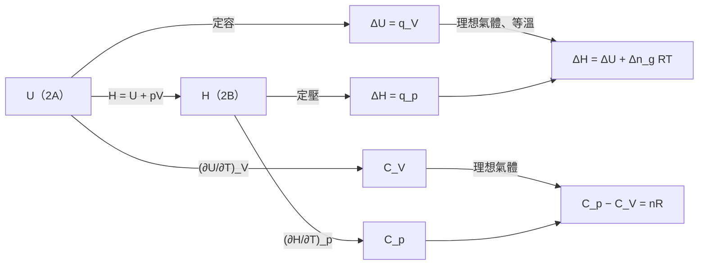

# Focus 2 熱力學第一定律（The First Law）
# 2B 焓（Enthalpy）講義

> **範圍**：上課簡報 p.53–72；課本 Atkins' Physical Chemistry Topic 2B（p.45–49），以及章末 Exercises／Problems（p.70）
> **標示說明**：
> - 未特別標示的內容以簡報為主
> - **📘 課本補充**：簡報沒有、取自課本的內容
> - **⭐**：必會推導
> - **⚠️**：勘誤或易錯處
> **符號慣例**：同 2A，$q$、$w$ 以「進入系統」為正

---

## 學習重點

1. 能說明為什麼定壓下 $\Delta U \neq q$，並了解引入焓的動機。
2. 能寫出焓的定義 $H = U + pV$，並說明它為什麼是狀態函數。
3. 能用 4 個步驟**推導** $\Delta H = q_p$，並指出推導用到的所有條件。
4. 能計算 $\Delta H$ 與 $\Delta U$ 的差值：凝相用 $p\Delta V$，有氣體參與時用 $\Delta n_g RT$。
5. 能定義定壓熱容量 $C_p$，並用經驗式 $C_{p,\text{m}} = a + bT + c/T^2$ 計算 $\Delta H$。
6. 能從物理意義與數學兩方面說明為什麼 $C_p > C_V$，並**推導**理想氣體的 $C_p - C_V = nR$。

---

## 本節在路線圖中的位置（簡報 p.53）

簡報 p.53 的紅框標出 2B 負責的部分：**從 $U$ 定義出 $H = U + pV$，並以熱容量 $C_V$、$C_p$ 描述它們隨溫度的變化**。

---

## 2B.1 焓的定義（The Definition of Enthalpy）

### 一、為什麼需要焓？（簡報 p.54）

2A 證明了**定容**時 $\Delta U = q_V$。但化學實驗大多在**開放於大氣的容器**中進行，也就是**定壓**、體積可以自由改變。

**系統可以自由改變體積時，內能的變化不等於以熱傳遞的能量。**

簡報圖 2B.1：在定壓下加熱系統，

- 一部分熱用來增加內能；
- 另一部分熱讓系統膨脹，以**膨脹功**的形式**還給外界**。

所以 $dU < dq$，即 $\Delta U < q$。

> **目標**：在定壓下，以熱傳給系統的能量等於另一個熱力學性質的變化，這個性質就是**焓（enthalpy）**。

### 二、焓的定義（簡報 p.55）

$$
\boxed{\,H = U + pV\,} \qquad \text{焓的定義 (2B.1)}
$$

- $p$ 是**系統**的壓力，$V$ 是**系統**的體積。
- 讀音：enthalpy [enˋθælpi]，中文「焓」。

**焓是狀態函數**：$U$、$p$、$V$ 都是狀態函數，由它們組合而成的 $H$ 也是狀態函數。所以任意兩個狀態之間的 $\Delta H$ 與路徑無關。

> 📘 $H$ 與 $U$ 一樣是**示量性質**；莫耳焓 $H_\text{m} = H/n$ 是示強性質。

### 三、⭐ 焓變化與熱傳遞（Enthalpy Change and Heat Transfer）（簡報 p.56–58）

**目標**：證明定壓、無額外功時 $\Delta H = q_p$。

> 📘 課本提示：熱力學推導的典型做法是「**先逐一代入定義，再加上適當的限制條件**」。

**Step 1：寫出 $H + dH$**

系統狀態發生無限小的變化：$U \to U + dU$、$p \to p + dp$、$V \to V + dV$。由定義：

$$
H + dH = (U + dU) + (p + dp)(V + dV)
$$

展開：

$$
H + dH = U + dU + pV + p\,dV + V\,dp + dp\,dV
$$

- $dp\,dV$ 是兩個無限小量的乘積，**可以忽略**（二階無限小）。
- $U + pV = H$，兩邊消去 $H$：

$$
dH = dU + p\,dV + V\,dp
$$

**Step 2：代入內能的定義**

由第一定律 $dU = dq + dw$：

$$
dH = dq + dw + p\,dV + V\,dp
$$

**Step 3：加上限制條件**

**條件 ①：只有膨脹功，且系統與外界處於力學平衡。** 此時 $p_\text{ex} = p$，所以 $dw = -p\,dV$：

$$
dH = dq \underbrace{- p\,dV + p\,dV}_{\text{抵消}} + V\,dp = dq + V\,dp
$$

**條件 ②：定壓。** $dp = 0$：

$$
\boxed{\,dH = dq_p\,} \qquad \text{定壓下傳遞的熱，無限小變化 (2B.2a)}
$$

**Step 4：積分**

沿定壓路徑由狀態 $i$ 變到 $f$：

$$
\underbrace{\int_i^f dH}_{H_f - H_i} = \underbrace{\int_i^f dq}_{q_p}
$$

$$
\boxed{\,\Delta H = q_p\,} \qquad \text{定壓下傳遞的熱，可量測的變化 (2B.2b)}
$$

> **結論**：**沒有額外功（非膨脹功）、系統與外界處於力學平衡時，焓的變化等於定壓下以熱傳給系統的能量。**
>
> ⚠️ **易錯**：
> - 右邊寫 $q_p$，不寫 $\Delta q$，因為 $q$ 不是狀態函數，$q_f - q_i$ 沒有意義（與 2A 的 $\Delta U = q_V$ 同理）。
> - 推導用到三個條件，**缺一不可**：只有膨脹功、力學平衡（$p_\text{ex} = p$）、定壓。

#### 2A 與 2B 對照

| | 定容（2A） | 定壓（2B） |
|---|---|---|
| 狀態函數 | $U$ | $H = U + pV$ |
| 熱的意義 | $\Delta U = q_V$ | $\Delta H = q_p$ |
| 條件 | 定容、無額外功 | 定壓、只有膨脹功、力學平衡 |
| 熱容量 | $C_V = (\partial U/\partial T)_V$ | $C_p = (\partial H/\partial T)_p$ |
| 卡計 | 彈卡計（bomb calorimeter） | 定壓卡計、火焰卡計、DSC |

#### 📗 簡報 Brief illustration 2B.1：由電熱求汽化焓

**題目**：Water is heated to boiling under a pressure of 1.0 atm. When an electric current of 0.50 A from a 12 V supply is passed for 300 s through a resistance in thermal contact with it, it is found that 0.798 g of water is vaporized. Calculate the enthalpy changes at the boiling point (373.15 K).

（水在 1.0 atm 下加熱到沸騰。以 12 V 電源、0.50 A 電流通過與水熱接觸的電阻 300 s，發現有 0.798 g 水汽化。計算沸點 373.15 K 時的焓變化。）

**解題思路**：在 1.0 atm 下沸騰，是**定壓**過程，所以 $\Delta H = q_p$，而 $q_p$ 就是電熱器提供的能量。

**詳解**：

**Step 1：總焓變化**

$$
\Delta H = q_p = It\Delta\phi = (0.50\ \text{A})(300\ \text{s})(12\ \text{V}) = 1800\ \text{J} \qquad (1\ \text{A V s} = 1\ \text{J})
$$

**Step 2：換成每莫耳**

$$
n(\text{H}_2\text{O}) = \frac{0.798\ \text{g}}{18.02\ \text{g mol}^{-1}} = 0.0443\ \text{mol}
$$

$$
\Delta H_\text{m} = \frac{+1800\ \text{J}}{0.0443\ \text{mol}} = \boxed{+41\ \text{kJ mol}^{-1}}
$$

> 這就是水在 373 K 的莫耳汽化焓（課本值 +40.66 kJ mol⁻¹，見 2C）。正號表示汽化是**吸熱**過程。

### 四、卡計法（Calorimetry）（簡報 p.60–65）

#### 1. 定壓下量測焓變化

**卡計法**：量測系統與外界之間熱交換的過程。

在**定壓**下進行物理或化學變化，監測伴隨的**溫度變化**，就能量出焓變化。

| 裝置 | 說明 |
|---|---|
| 📘 **定壓卡計（isobaric calorimeter）** | 最簡單的例子：**開口於大氣的隔熱容器**，量測內容物的溫度變化 |
| **絕熱火焰卡計（adiabatic flame calorimeter）**（簡報圖 2B.2） | 燃燒反應用。已知量的物質在氧氣中燃燒，火焰浸在攪拌的水浴中，量測 $\Delta T$ |
| **微差掃描熱卡計（differential scanning calorimeter, DSC）** | 最精密的方法，2C 詳細說明 |

📘 焓變化與內能變化也可以用**非卡計法**量測，例如電化學方法（Topic 6C）。

#### 2. 由 $\Delta U$ 換算 $\Delta H$：凝相

另一條途徑：先用**彈卡計**量 $\Delta U$（2A），再換算成 $\Delta H$。

**固體與液體**的莫耳體積很小，$pV_\text{m}$ 小到可以忽略：

$$
H_\text{m} = U_\text{m} + pV_\text{m} \approx U_\text{m}
$$

所以**只涉及固體或液體的過程，$\Delta H$ 與 $\Delta U$ 幾乎相等**。

**物理意義**：這類過程的體積變化很小，系統對外作的功可忽略，供給的熱幾乎全部留在系統內。

> 📘 例外：**在極高壓下**，$p\Delta V_\text{m}$ 可能不可忽略。

#### 📗 簡報 Example 2B.1：方解石轉變為霰石的 $\Delta H - \Delta U$

**題目**：The change in molar internal energy when CaCO₃(s) as calcite converts to its polymorph aragonite, is +0.21 kJ mol⁻¹. Calculate the difference between the molar enthalpy and internal energy changes when the pressure is 1.0 bar. The mass densities of the polymorphs are 2.71 g cm⁻³ (calcite) and 2.93 g cm⁻³ (aragonite).

（CaCO₃(s) 由**方解石（calcite）**轉變為它的**同質多晶體（polymorph）霰石（aragonite）**時，莫耳內能變化為 +0.21 kJ mol⁻¹。計算 1.0 bar 下莫耳焓變化與莫耳內能變化的差。兩種晶形的密度分別為 2.71 g cm⁻³（方解石）與 2.93 g cm⁻³（霰石）。）

**解題思路**：由 $H = U + pV$，$\Delta H$ 與 $\Delta U$ 的差就是 $p\Delta V_\text{m}$。莫耳體積由 $\rho = M/V_\text{m}$ 求出。

**詳解**：

**Step 1：寫出 $\Delta H_\text{m}$**（a = 霰石，c = 方解石）

$$
\Delta H_\text{m} = H_\text{m}(\text{a}) - H_\text{m}(\text{c}) = \{U_\text{m}(\text{a}) + pV_\text{m}(\text{a})\} - \{U_\text{m}(\text{c}) + pV_\text{m}(\text{c})\} = \Delta U_\text{m} + p\{V_\text{m}(\text{a}) - V_\text{m}(\text{c})\}
$$

**Step 2：用密度表示莫耳體積**（$V_\text{m} = M/\rho$）

$$
\Delta H_\text{m} - \Delta U_\text{m} = pM\left(\frac{1}{\rho(\text{a})} - \frac{1}{\rho(\text{c})}\right)
$$

**Step 3：代入數據**（$M = 100.09$ g mol⁻¹）

$$
\Delta H_\text{m} - \Delta U_\text{m} = (1.0\times10^5\ \text{Pa})(100.09\ \text{g mol}^{-1})\left(\frac{1}{2.93\ \text{g cm}^{-3}} - \frac{1}{2.71\ \text{g cm}^{-3}}\right)
$$

$$
= -2.8\times10^5\ \text{Pa cm}^3\,\text{mol}^{-1} = -0.28\ \text{Pa m}^3\,\text{mol}^{-1} = \boxed{-0.28\ \text{J mol}^{-1}}
$$

（1 cm³ = 10⁻⁶ m³；1 Pa m³ = 1 J）

> **觀念**：
> - 差值只有 $\Delta U_\text{m}$ 的 **0.1%**，所以凝相過程 $\Delta H \approx \Delta U$。
> - **負號**：霰石密度較大、體積較小，轉變時系統**收縮**，外界對系統作功，所以 $\Delta H < \Delta U$。
> - ⚠️ 簡報 p.63 最後寫成 $+0.28$ Pa m³ mol⁻¹，**漏了負號**。

**📘 自我測驗（Self-test 2B.1）**：1.0 mol 的灰錫 Sn(s, grey)（密度 5.75 g cm⁻³）在 10.0 bar 下轉變為白錫 Sn(s, white)（密度 7.31 g cm⁻³），求 $\Delta H - \Delta U$。

$$
\Delta H - \Delta U = (10.0\times10^5\ \text{Pa})(118.71\ \text{g mol}^{-1})\left(\frac{1}{7.31} - \frac{1}{5.75}\right)\text{cm}^3\,\text{g}^{-1}\times(1.0\ \text{mol}) = \boxed{-4.4\ \text{J}}
$$

#### 3. ⭐ 由 $\Delta U$ 換算 $\Delta H$：有氣體參與（簡報 p.64）

與凝相不同，**有氣體參與時，$\Delta U$ 與 $\Delta H$ 可能差很多**。

**推導**：

**Step 1**：理想氣體 $pV = nRT$，代入焓的定義：

$$
H = U + pV = U + nRT \qquad (2B.3)
$$

**Step 2**：反應在**等溫**下進行，產生或消耗氣體。固體、液體的 $pV$ 可忽略，只有氣體的 $n$ 會改變 $pV$：

$$
\Delta H = \Delta U + \Delta(pV) = \Delta U + \Delta(n_g RT) = \Delta U + \Delta n_g RT \quad (T\text{ 固定})
$$

$$
\boxed{\,\Delta H = \Delta U + \Delta n_g RT\,} \qquad \text{（等溫、理想氣體）(2B.4)}
$$

$\Delta n_g$ = 產物中**氣體**的物質的量 − 反應物中**氣體**的物質的量。

> ⚠️ **易錯**：
> - $\Delta n_g$ **只算氣體**，固體、液體不算。
> - 以每莫耳反應表示時，寫成 $\Delta_\text{r}H = \Delta_\text{r}U + \Delta\nu_g RT$，$\Delta\nu_g$ 是氣體化學計量係數的差（無單位）。
> - $\Delta n_g < 0$（氣體減少）→ $\Delta H < \Delta U$；$\Delta n_g > 0$（氣體增加）→ $\Delta H > \Delta U$。

#### 📗 簡報 Brief illustration 2B.2：氫氣燃燒生成液態水

**題目**：反應 2 H₂(g) + O₂(g) → 2 H₂O(l) 在 298 K 下的 $\Delta H_\text{m} - \Delta U_\text{m}$ 為何？

**詳解**：

3 mol 氣體分子被 2 mol **液體**分子取代，所以

$$
\Delta n_g = 0 - (2 + 1) = -3\ \text{mol}
$$

298 K 時 $RT = 2.48$ kJ mol⁻¹：

$$
\Delta H_\text{m} - \Delta U_\text{m} = (-3)(2.48\ \text{kJ mol}^{-1}) = \boxed{-7.4\ \text{kJ mol}^{-1}}
$$

（簡報取 $RT \approx 2.5$ kJ mol⁻¹，得 −7.5 kJ。）

**物理解釋**：$\Delta H < \Delta U$。反應時能量以熱的形式離開系統；但同時生成液體使系統**收縮**，外界對系統作功，把一部分能量還給系統。

📘 **課本 Brief illustration 2B.2**：3 H₂(g) + N₂(g) → 2 NH₃(g)，4 mol 氣體變成 2 mol 氣體，$\Delta n_g = -2$ mol：

$$
\Delta H_\text{m} - \Delta U_\text{m} = (-2)\times RT = (-2)(2.48\ \text{kJ mol}^{-1}) \approx -5.0\ \text{kJ mol}^{-1}
$$

> 注意這裡的差值是 **kJ**，而凝相的 Example 2B.1 只有 **J**，相差三個數量級。

---

## 2B.2 焓隨溫度的變化（The Variation of Enthalpy with Temperature）

📘 溫度升高時，分子被激發到更高的能量狀態，所以焓與內能一樣**隨溫度增加**。增加的多少取決於條件（定壓或定容）。

### 一、定壓熱容量（Heat Capacity at Constant Pressure）（簡報 p.66–67）

**化學中最常遇到的條件是定壓。**

在定壓下把 $H$ 對 $T$ 作圖，曲線切線的斜率稱為**定壓熱容量**（📘 又稱 isobaric heat capacity）：

$$
\boxed{\,C_p = \left(\frac{\partial H}{\partial T}\right)_p\,} \qquad \text{定壓熱容量 (2B.5)}
$$

**簡報圖 2B.3**：對氣體而言，同一溫度下 $H$ 對 $T$ 的曲線**比 $U$ 對 $T$ 陡**，所以 $C_{p,\text{m}} > C_{V,\text{m}}$。

- $C_p$ 是**示量性質**；**莫耳定壓熱容量** $C_{p,\text{m}} = C_p/n$ 是示強性質。

**⭐ 用 $C_p$ 計算 $\Delta H$**：

$$
\boxed{\,dH = C_p\,dT\,} \qquad \text{（定壓）(2B.6a)}
$$

若 $C_p$ 在該溫度範圍內為常數：

$$
\Delta H = \int_{T_1}^{T_2}C_p\,dT = C_p\int_{T_1}^{T_2}dT = C_p(T_2 - T_1)
$$

$$
\boxed{\,\Delta H = C_p\Delta T\,} \qquad \text{（定壓）(2B.6b)}
$$

再由 $\Delta H = q_p$：

$$
\boxed{\,q_p = C_p\Delta T\,} \qquad (2B.7)
$$

> **實驗意義**：在定壓下（例如樣品暴露於大氣、可自由膨脹）提供已知的熱，量測溫升，兩者相除就是 $C_p$。

> **本節三個式子串起來**：$\Delta H = q_p = C_p\Delta T$（定壓、只有膨脹功）

### 二、熱容量隨溫度的變化（簡報 p.68–70）

📘 溫度範圍小時，可以忽略 $C_p$ 的溫度變化。對**單原子理想氣體**（例如低壓下的鈍氣）這是極好的近似。其他物質需要考慮時，常用**經驗式（empirical expression）**：

$$
\boxed{\,C_{p,\text{m}} = a + bT + \frac{c}{T^2}\,} \qquad (2B.8)
$$

經驗參數 $a$、$b$、$c$ **與溫度無關**，由實驗數據**擬合（fitting）**而得。

**表 2B.1 莫耳熱容量的溫度變化**：$C_{p,\text{m}}/(\text{J K}^{-1}\,\text{mol}^{-1}) = a + bT + c/T^2$

| 物質 | $a$ | $b/(10^{-3}\ \text{K}^{-1})$ | $c/(10^5\ \text{K}^2)$ |
|---|---|---|---|
| C(s, 石墨 graphite) | 16.86 | 4.77 | −8.54 |
| CO₂(g) | 44.22 | 8.79 | −8.62 |
| H₂O(l) | 75.29 | 0 | 0 |
| N₂(g) | 28.58 | 3.77 | −0.50 |

#### ⭐ 推導：經驗式的積分形式

把式 2B.8 代入 $\Delta H = \int C_p\,dT$：

$$
\Delta H_\text{m} = \int_{T_1}^{T_2}\left(a + bT + \frac{c}{T^2}\right)dT
$$

用三個基本積分：

$$
\int dx = x, \qquad \int x\,dx = \tfrac{1}{2}x^2, \qquad \int\frac{dx}{x^2} = -\frac{1}{x}
$$

$$
\boxed{\,\Delta H_\text{m} = a(T_2 - T_1) + \tfrac{1}{2}b\left(T_2^2 - T_1^2\right) - c\left(\frac{1}{T_2} - \frac{1}{T_1}\right)\,} \qquad (2B.9)
$$

> ⚠️ 第三項前面是**負號**。$c$ 本身通常也是負值，計算時要小心符號。

#### 📗 簡報 Example 2B.2：N₂ 由 25 °C 加熱到 100 °C

**題目**：What is the change in molar enthalpy of N₂ when it is heated from 25 °C to 100 °C? Use the heat capacity information in Table 2B.1.

（N₂ 由 25 °C 加熱到 100 °C，莫耳焓變化為何？使用表 2B.1 的熱容量數據。）

**解題思路**：N₂ 的熱容量在此範圍內有明顯變化，所以用式 2B.9。

**詳解**：

$a = 28.58$ J K⁻¹ mol⁻¹、$b = 3.77\times10^{-3}$ J K⁻² mol⁻¹、$c = -0.50\times10^5$ J K mol⁻¹、$T_1 = 298$ K、$T_2 = 373$ K

| 項 | 計算 | 數值/(J mol⁻¹) |
|---|---|---|
| $a(T_2 - T_1)$ | $(28.58)(75)$ | 2143.5 |
| $\frac{1}{2}b(T_2^2 - T_1^2)$ | $\frac{1}{2}(3.77\times10^{-3})(373^2 - 298^2)$ | 94.8 |
| $-c\left(\frac{1}{T_2} - \frac{1}{T_1}\right)$ | $-(-0.50\times10^5)\left(\frac{1}{373} - \frac{1}{298}\right)$ | −33.7 |
| 合計 | | 2204.6 |

$$
H_\text{m}(373\ \text{K}) = H_\text{m}(298\ \text{K}) + \boxed{2.20\ \text{kJ mol}^{-1}}
$$

**與定值熱容量比較**：若假設 $C_{p,\text{m}}$ 固定為 298 K 的值，

$$
C_{p,\text{m}}(298\ \text{K}) = 28.58 + (3.77\times10^{-3})(298) + \frac{-0.50\times10^5}{298^2} = 29.14\ \text{J K}^{-1}\,\text{mol}^{-1}
$$

$$
\Delta H_\text{m} = (29.14)(75)\ \text{J mol}^{-1} = 2.19\ \text{kJ mol}^{-1}
$$

只差約 0.5%。**溫度範圍不大時，假設 $C_p$ 為常數通常已足夠。**

**📘 自我測驗（Self-test 2B.2）**：極低溫時，非金屬固體的熱容量正比於 $T^3$，$C_{p,\text{m}} = aT^3$（**德拜 $T^3$ 定律**，Debye $T^3$ law）。由 0 加熱到接近 0 的溫度 $T$，焓變化為何？

$$
\Delta H_\text{m} = \int_0^T aT'^3\,dT' = \boxed{\tfrac{1}{4}aT^4}
$$

### 三、⭐ 兩種熱容量的關係（The Relation between Heat Capacities）（簡報 p.71–72）

#### 1. 物理意義：為什麼 $C_p > C_V$？

- 大多數系統在**定壓加熱時會膨脹**，對外界作功，所以供給的熱有一部分以功的形式**流回外界**。
- 結果：同樣的熱量，**定壓下溫度上升較少**。
- 溫度上升較少表示熱容量較大，所以**多數情況下 $C_p > C_V$**。

簡報 p.71 的說明：等容過程中，系統吸的熱**全部**用來增加內能；等壓過程中，吸的熱除了增加內能，還要**額外**提供對外作膨脹功所需的能量。所以氣體的 $C_p$ 大於 $C_V$，而且內能變化小於外界供應的總熱量 $q_p$。

#### 2. 推導：理想氣體的 $C_p - C_V = nR$

**方法一：比較定容與定壓加熱**（簡報 p.72）

**(a) 定容**：活塞固定，$dw = 0$

$$
dU = dq_V = C_V\,dT
$$

**(b) 定壓**：$dq_p = C_p\,dT$，膨脹功為

$$
dw = -p\,dV = -nR\,dT \qquad (\text{定壓下由 } pV = nRT \text{ 得 } p\,dV = nR\,dT)
$$

由第一定律：

$$
dU = dq_p + dw = C_p\,dT - nR\,dT
$$

**(c) 關鍵步驟**：**理想氣體的 $U$ 只與溫度有關**（2A），所以只要溫度變化 $dT$ 相同，不論定容或定壓，$dU$ 都相同，都等於 $C_V\,dT$：

$$
C_V\,dT = C_p\,dT - nR\,dT
$$

$$
\boxed{\,C_p - C_V = nR\,} \qquad \text{（理想氣體）(2B.10)}
$$

> ⚠️ 簡報 p.72 直接寫「$C_p\,dT - C_V\,dT = nR\,dT$」，省略了步驟 (c)。這一步是推導成立的關鍵：**沒有「理想氣體的 $U$ 只與 $T$ 有關」，就不能把定壓下的 $dU$ 寫成 $C_V\,dT$。**

**方法二：直接由定義微分**（📘 較簡潔）

理想氣體 $H = U + nRT$，在定壓下對 $T$ 微分：

$$
C_p = \left(\frac{\partial H}{\partial T}\right)_p = \left(\frac{\partial U}{\partial T}\right)_p + nR
$$

理想氣體的 $U$ 只與 $T$ 有關，所以 $(\partial U/\partial T)_p = (\partial U/\partial T)_V = C_V$：

$$
C_p = C_V + nR
$$

#### 3. 數值意義

- 理想氣體的 $C_{p,\text{m}} - C_{V,\text{m}} = R = 8.3145$ J K⁻¹ mol⁻¹，**約 8 J K⁻¹ mol⁻¹**。
- 單原子氣體 $C_{V,\text{m}} = \frac{3}{2}R \approx 12$ J K⁻¹ mol⁻¹，所以差值**非常顯著**，必須考慮。
- **凝相**（液體、固體）的 $C_p$ 與 $C_V$ 通常**非常接近**，差值一般可忽略。

| 氣體類型（室溫） | $C_{V,\text{m}}$ | $C_{p,\text{m}} = C_{V,\text{m}} + R$ | $\gamma = C_{p,\text{m}}/C_{V,\text{m}}$ |
|---|---|---|---|
| 單原子 | $\frac{3}{2}R$ | $\frac{5}{2}R$ | 5/3 = 1.67 |
| 線形分子（不計振動） | $\frac{5}{2}R$ | $\frac{7}{2}R$ | 7/5 = 1.40 |
| 非線形分子（不計振動） | $3R$ | $4R$ | 4/3 = 1.33 |

> $\gamma$ 稱為**熱容比（heat capacity ratio）**，在 2E 絕熱過程中會用到。
>
> 📘 任何物質的一般式是 $C_p - C_V = \alpha^2TV/\kappa_T$（2D 推導），其中 $\alpha$ 是膨脹係數、$\kappa_T$ 是等溫壓縮係數。因為 $\kappa_T > 0$，所以 $C_p \geq C_V$ 對所有物質都成立；只有 $\alpha = 0$ 時兩者相等，例如 4 °C 的水。

---

## 精選章末習題（含詳解）

> **選題標準**：需要多步推理、數據擬合，或能連結 2A 的觀念。共 8 題，由基礎到進階排列。數值均已用程式驗算。
> **常數**：$R = 8.3145$ J K⁻¹ mol⁻¹ ＝ 0.082 057 dm³ atm K⁻¹ mol⁻¹；1 dm³ atm = 101.325 J

---

### 習題 1｜E2B.9 定壓加熱 CO₂ 的 $q$、$\Delta H$、$\Delta U$（基礎）

**題目**：When 2.0 mol CO₂ is heated at a constant pressure of 1.25 atm, its temperature increases from 250 K to 277 K. Given that the molar heat capacity of CO₂ at constant pressure is 37.11 J K⁻¹ mol⁻¹, calculate $q$, $\Delta H$, and $\Delta U$.

（2.0 mol 的 CO₂ 在 1.25 atm 定壓下加熱，溫度由 250 K 升到 277 K。已知 CO₂ 的莫耳定壓熱容量為 37.11 J K⁻¹ mol⁻¹，計算 $q$、$\Delta H$、$\Delta U$。）

**解題思路**：
1. 定壓 → $q = \Delta H = nC_{p,\text{m}}\Delta T$。
2. CO₂ 視為理想氣體 → $\Delta U = \Delta H - nR\Delta T$（或 $\Delta U = nC_{V,\text{m}}\Delta T$）。

**詳解**：

$$
q = \Delta H = nC_{p,\text{m}}\Delta T = (2.0\ \text{mol})(37.11\ \text{J K}^{-1}\,\text{mol}^{-1})(27\ \text{K}) = \boxed{+2.0\ \text{kJ}}
$$

$$
\Delta U = \Delta H - nR\Delta T = 2004\ \text{J} - (2.0)(8.3145)(27)\ \text{J} = 2004 - 449 = \boxed{+1.6\ \text{kJ}}
$$

**檢查**：膨脹功 $w = -p\Delta V = -nR\Delta T = -449$ J，而 $q + w = 2004 - 449 = 1555$ J $= \Delta U$ ✓

> **觀念**：供給的 2.0 kJ 中，約 0.45 kJ 以膨脹功的形式還給外界，只有 1.6 kJ 留下來增加內能。壓力 1.25 atm 在理想氣體計算中用不到，因為 $p\Delta V = nR\Delta T$ 與壓力無關。

---

### 習題 2｜E2B.1 + E2B.7 判斷 $\Delta H_\text{m} - \Delta U_\text{m}$

**題目**：Calculate the value of $\Delta H_\text{m} - \Delta U_\text{m}$ for (a) the reaction N₂(g) + 3 H₂(g) → 2 NH₃(g) at 473 K; (b) the reaction C₆H₁₂O₆(s) + 6 O₂(g) → 6 CO₂(g) + 6 H₂O(l) at 298 K.

（計算下列反應的 $\Delta H_\text{m} - \Delta U_\text{m}$：(a) 473 K 的 N₂(g) + 3 H₂(g) → 2 NH₃(g)；(b) 298 K 的葡萄糖燃燒 C₆H₁₂O₆(s) + 6 O₂(g) → 6 CO₂(g) + 6 H₂O(l)。）

**詳解**：用 $\Delta H_\text{m} - \Delta U_\text{m} = \Delta\nu_g RT$

**(a)** $\Delta\nu_g = 2 - (1 + 3) = -2$

$$
\Delta H_\text{m} - \Delta U_\text{m} = (-2)(8.3145\ \text{J K}^{-1}\,\text{mol}^{-1})(473\ \text{K}) = \boxed{-7.87\ \text{kJ mol}^{-1}}
$$

**(b)** 只數氣體：反應物 6 mol O₂，產物 6 mol CO₂（H₂O 是液體、葡萄糖是固體，不算）

$$
\Delta\nu_g = 6 - 6 = 0 \;\Rightarrow\; \Delta H_\text{m} - \Delta U_\text{m} = \boxed{0}
$$

> **觀念**：
> - (a) 與課本 BI 2B.2（298 K，−5.0 kJ mol⁻¹）是同一個反應，只是溫度較高，所以差值較大。差值**正比於 $T$**。
> - (b) 說明葡萄糖用彈卡計量到的 $\Delta_\text{c}U$ 可以**直接**當作 $\Delta_\text{c}H$，這是生化熱量學中常用的事實。但若產物寫成 H₂O(g)，$\Delta\nu_g = +6$，結果就完全不同。**一定要看清楚物態。**

---

### 習題 3｜E2B.8 熱容量隨溫度變化：定壓 vs 定容

**題目**：The constant-pressure heat capacity of a sample of a perfect gas was found to vary with temperature according to the expression $C_p/(\text{J K}^{-1}) = 20.17 + 0.4001(T/\text{K})$. Calculate $q$, $w$, $\Delta U$, and $\Delta H$ when the temperature is raised from 25 °C to 100 °C (i) at constant pressure, (ii) at constant volume.

（某理想氣體樣品的定壓熱容量隨溫度的變化為 $C_p/(\text{J K}^{-1}) = 20.17 + 0.4001(T/\text{K})$。溫度由 25 °C 升到 100 °C，分別在 (i) 定壓、(ii) 定容下，計算 $q$、$w$、$\Delta U$、$\Delta H$。）

**解題思路**：
1. $\Delta H = \int C_p\,dT$。$H$ 是狀態函數，而理想氣體的 $H$ 只與 $T$ 有關，所以**兩種路徑的 $\Delta H$ 相同**。
2. $\Delta U = \Delta H - nR\Delta T$，同理兩種路徑的 $\Delta U$ 也相同。
3. 要算 $nR\Delta T$ 需要知道 $n$，題目沒給。這裡**假設 $n = 1.0$ mol**（課本解答手冊的做法）。
4. $q$ 與 $w$ 是路徑函數，兩種路徑不同。

**詳解**：$T_1 = 298.15$ K，$T_2 = 373.15$ K，$\Delta T = 75$ K

**Step 1：$\Delta H$（兩種路徑相同）**

$$
\Delta H = \int_{T_1}^{T_2}(20.17 + 0.4001T)\,dT = 20.17(T_2 - T_1) + \frac{0.4001}{2}(T_2^2 - T_1^2)
$$

$$
= (20.17)(75) + (0.20005)(373.15^2 - 298.15^2)\ \text{J} = 1513 + 10\,072\ \text{J} = \boxed{+11.6\ \text{kJ}}
$$

**Step 2：$\Delta U$（兩種路徑相同）**

$$
\Delta U = \Delta H - nR\Delta T = 11\,585\ \text{J} - (1.0)(8.3145)(75)\ \text{J} = \boxed{+11.0\ \text{kJ}}
$$

**Step 3：各路徑的 $q$、$w$**

| | (i) 定壓 | (ii) 定容 |
|---|---|---|
| $\Delta H$ | +11.6 kJ | +11.6 kJ |
| $\Delta U$ | +11.0 kJ | +11.0 kJ |
| $q$ | $q_p = \Delta H = $ **+11.6 kJ** | $q_V = \Delta U = $ **+11.0 kJ** |
| $w$ | $-p\Delta V = -nR\Delta T = $ **−0.62 kJ** | **0** |

> **觀念**：
> - 這題完美示範**狀態函數與路徑函數**的差別：$\Delta U$、$\Delta H$ 只看初末狀態；$q$、$w$ 依路徑而定。
> - 定容時 $q_V = \Delta U$，定壓時 $q_p = \Delta H$，兩者正好差一個膨脹功 $nR\Delta T$。
> - 定容過程中 $\Delta H \neq q$，但 $\Delta H$ 照樣可以算，因為它是狀態函數。

---

### 習題 4｜P2B.1 汽化苯所需的通電時間

**題目**：Benzene is heated to boiling under a pressure of 1.0 atm with a 12 V source operating at an electric current of 0.50 A. For how long would a current need to be supplied in order to vaporize 10 g of benzene? The molar enthalpy of vaporization of benzene at its boiling point (353.25 K) is 30.8 kJ mol⁻¹.

（苯在 1.0 atm 下以 12 V、0.50 A 的電源加熱至沸騰。要汽化 10 g 苯需要通電多久？苯在沸點 353.25 K 的莫耳汽化焓為 30.8 kJ mol⁻¹。）

**解題思路**：BI 2B.1 的逆向應用。定壓下 $q_p = \Delta H = n\Delta_\text{vap}H$，再由 $q = It\Delta\phi$ 求 $t$。

**詳解**：

$$
n(\text{C}_6\text{H}_6) = \frac{10\ \text{g}}{78.11\ \text{g mol}^{-1}} = 0.128\ \text{mol}
$$

$$
q_p = n\Delta_\text{vap}H = (0.128\ \text{mol})(30.8\times10^3\ \text{J mol}^{-1}) = 3.94\times10^3\ \text{J}
$$

$$
t = \frac{q_p}{I\Delta\phi} = \frac{3.94\times10^3\ \text{J}}{(0.50\ \text{A})(12\ \text{V})} = \boxed{6.6\times10^2\ \text{s} \approx 11\ \text{min}}
$$

---

### 習題 5｜P2B.2 加熱房間裡的空氣

**題目**：The heat capacity of air is much smaller than that of liquid water, and relatively modest amounts of heat are therefore needed to change the temperature of air. This is one of the reasons why desert regions, though very hot during the day, are bitterly cold at night. The molar heat capacity of air at 298 K and 1.00 atm is approximately 21 J K⁻¹ mol⁻¹. Estimate how much energy is required to raise the temperature of the air in a room of dimensions 5.5 m × 6.5 m × 3.0 m by 10 °C. If losses are neglected, how long will it take a heater rated at 1.5 kW to achieve that increase, given that 1 W = 1 J s⁻¹?

（空氣的熱容量遠小於液態水，所以只需相對少量的熱就能改變空氣溫度，這也是沙漠白天酷熱、夜晚嚴寒的原因之一。空氣在 298 K、1.00 atm 的莫耳熱容量約為 21 J K⁻¹ mol⁻¹。估計把 5.5 m × 6.5 m × 3.0 m 房間內的空氣升溫 10 °C 需要多少能量。忽略損失，1.5 kW 的暖氣機需要多久？）

**詳解**：

**Step 1：房間內空氣的物質的量**（理想氣體）

$$
V = (5.5)(6.5)(3.0)\ \text{m}^3 = 107.25\ \text{m}^3
$$

$$
n = \frac{pV}{RT} = \frac{(101\,325\ \text{Pa})(107.25\ \text{m}^3)}{(8.3145\ \text{J K}^{-1}\,\text{mol}^{-1})(298\ \text{K})} = 4.39\times10^3\ \text{mol}
$$

**Step 2：所需能量**

$$
q = nC_\text{m}\Delta T = (4.39\times10^3\ \text{mol})(21\ \text{J K}^{-1}\,\text{mol}^{-1})(10\ \text{K}) = \boxed{9.2\times10^5\ \text{J} \approx 0.92\ \text{MJ}}
$$

**Step 3：所需時間**

$$
t = \frac{q}{P} = \frac{9.2\times10^5\ \text{J}}{1.5\times10^3\ \text{J s}^{-1}} = \boxed{6.1\times10^2\ \text{s} \approx 10\ \text{min}}
$$

> **觀念延伸**：
> - 題目給的 21 J K⁻¹ mol⁻¹ 其實接近空氣（雙原子分子）的 **$C_{V,\text{m}} = \frac{5}{2}R = 20.8$**。但房間不是密閉的，空氣受熱膨脹時會從縫隙流出，壓力維持 1 atm，所以這比較像**定壓**過程，應該用 $C_{p,\text{m}} = \frac{7}{2}R = 29.1$ J K⁻¹ mol⁻¹。改用 $C_{p,\text{m}}$ 的結果是約 **14 min**。
> - 對比：同樣體積的**水**升溫 10 °C 需要 $(1.07\times10^5\ \text{kg})(4.18\ \text{kJ kg}^{-1}\text{K}^{-1})(10\ \text{K}) \approx 4.5\times10^6$ kJ，是空氣的約 5000 倍。這就是海邊溫差小、沙漠溫差大的原因。

---

### 習題 6｜P2B.3 SO₂ 熱容量的擬合與積分（進階）

**題目**：The following data show how the standard molar constant-pressure heat capacity of sulfur dioxide varies with temperature:

| $T$/K | 300 | 500 | 700 | 900 | 1100 | 1300 | 1500 |
|---|---|---|---|---|---|---|---|
| $C^\ominus_{p,\text{m}}$/(J K⁻¹ mol⁻¹) | 39.909 | 46.490 | 50.829 | 53.407 | 54.993 | 56.033 | 56.759 |

By how much does the standard molar enthalpy of SO₂(g) increase when the temperature is raised from 298.15 K to 1500 K? *Hint*: Fit the data to an expression of the form of $C^\ominus_{p,\text{m}}(T) = a + bT + c/T^2$, note the values of the coefficients, then use the approach in Example 2B.2 to calculate the change in standard molar enthalpy.

（上表為二氧化硫的標準莫耳定壓熱容量隨溫度的變化。溫度由 298.15 K 升到 1500 K 時，SO₂(g) 的標準莫耳焓增加多少？提示：把數據擬合成 $a + bT + c/T^2$ 的形式，再用 Example 2B.2 的方法計算。）

**解題思路**：
1. $C_{p,\text{m}} = a + bT + c/T^2$ 對**參數** $a$、$b$、$c$ 是**線性**的，所以可以用**線性最小平方法（linear least squares）**，以 $1$、$T$、$1/T^2$ 為三個「自變數」做多元線性迴歸。
2. 求出 $a$、$b$、$c$ 後代入式 2B.9。

**詳解**：

**Step 1：擬合**

以 Excel 的 LINEST 或 Python 的最小平方法擬合，得

| 參數 | 數值 |
|---|---|
| $a$ | 48.01 J K⁻¹ mol⁻¹ |
| $b$ | $6.535\times10^{-3}$ J K⁻² mol⁻¹ |
| $c$ | $-9.294\times10^5$ J K mol⁻¹ |

**檢查擬合品質**：

| $T$/K | 300 | 500 | 700 | 900 | 1100 | 1300 | 1500 |
|---|---|---|---|---|---|---|---|
| 實驗值 | 39.909 | 46.490 | 50.829 | 53.407 | 54.993 | 56.033 | 56.759 |
| 擬合值 | 39.644 | 47.560 | 50.688 | 52.744 | 54.430 | 55.955 | 57.399 |

均方根誤差約 0.59 J K⁻¹ mol⁻¹（約 1%），最大偏差在 500 K（約 2%）。

**Step 2：代入式 2B.9**（$T_1 = 298.15$ K，$T_2 = 1500$ K）

| 項 | 數值/(J mol⁻¹) |
|---|---|
| $a(T_2 - T_1)$ | 57 701 |
| $\frac{1}{2}b(T_2^2 - T_1^2)$ | 7 062 |
| $-c\left(\frac{1}{T_2} - \frac{1}{T_1}\right)$ | −2 498 |
| 合計 | 62 264 |

$$
\Delta H^\ominus_\text{m} = H^\ominus_\text{m}(1500\ \text{K}) - H^\ominus_\text{m}(298.15\ \text{K}) = \boxed{+62.3\ \text{kJ mol}^{-1}}
$$

> **驗證**：不經擬合，直接對數據做三次樣條（cubic spline）內插再數值積分，得 62.2 kJ mol⁻¹，兩者相差不到 0.1%。
>
> **觀念**：
> - 若假設 $C_{p,\text{m}}$ 固定為 300 K 的值 39.9 J K⁻¹ mol⁻¹，會得到 48.0 kJ mol⁻¹，**低估約 23%**。溫度範圍大時，**一定要考慮 $C_p$ 的溫度變化**。
> - $C_p$ 隨溫度增加，是因為 SO₂ 的**振動**模式在高溫下逐漸被激發（2A 的能階觀念）。高溫極限接近 $3R + 3R = 6R \approx 50$ J K⁻¹ mol⁻¹ 的 $C_V$，再加 $R$ 約為 58 J K⁻¹ mol⁻¹，與 1500 K 的數據接近。

---

### 習題 7｜P2B.4 NH₃ 熱容量：兩種經驗式哪個好？

**題目**：The following data show how the standard molar constant-pressure heat capacity of ammonia depends on the temperature. Use mathematical software to fit an expression of the form of eqn 2B.8 to the data and determine the values of $a$, $b$, and $c$. Explore whether it would be better to express the data as $C_{p,\text{m}} = \alpha + \beta T + \gamma T^2$, and determine the values of these coefficients.

| $T$/K | 300 | 400 | 500 | 600 | 700 | 800 | 900 | 1000 |
|---|---|---|---|---|---|---|---|---|
| $C^\ominus_{p,\text{m}}$/(J K⁻¹ mol⁻¹) | 35.678 | 38.674 | 41.994 | 45.229 | 48.269 | 51.112 | 53.769 | 56.244 |

（上表為氨的標準莫耳定壓熱容量。用數學軟體把數據擬合成式 2B.8 的形式，求 $a$、$b$、$c$。再探討寫成 $C_{p,\text{m}} = \alpha + \beta T + \gamma T^2$ 是否更好，並求其係數。）

**詳解**：兩種形式都對參數線性，用最小平方法擬合。

| 形式 | 係數 | 均方根誤差 | 最大偏差 |
|---|---|---|---|
| ① $a + bT + c/T^2$ | $a = 28.80$、$b = 2.790\times10^{-2}$、$c = -1.490\times10^5$ | 0.22 J K⁻¹ mol⁻¹ | 0.35 |
| ② $\alpha + \beta T + \gamma T^2$ | $\alpha = 24.64$、$\beta = 3.818\times10^{-2}$、$\gamma = -6.49\times10^{-6}$ | **0.11 J K⁻¹ mol⁻¹** | **0.20** |

（$b$、$\beta$ 單位 J K⁻² mol⁻¹；$c$ 單位 J K mol⁻¹；$\gamma$ 單位 J K⁻³ mol⁻¹）

**結論**：在 300–1000 K 範圍內，**形式 ② 的誤差約只有形式 ① 的一半，擬合較好**。

> **觀念**：
> - NH₃ 的 $C_p$ 在此範圍內幾乎呈直線上升、略為向下彎（$\gamma < 0$）。$T^2$ 項能描述這種緩慢的彎曲；$c/T^2$ 項只在低溫端有明顯作用，所以描述效果較差。
> - 兩種都是**經驗式**，沒有理論依據，**不能外插**到擬合範圍之外。例如形式 ② 在很高溫時 $\gamma T^2$ 會使 $C_p$ 下降，這不符合物理事實。
> - 課本習題 P2C.9 就使用形式 ②。

---

### 習題 8｜P2B.5 凡得瓦氣體的 $w$、$\Delta U$、$\Delta H$（進階）

**題目**：A sample consisting of 2.0 mol CO₂ occupies a fixed volume of 15.0 dm³ at 300 K. When it is supplied with 2.35 kJ of energy as heat its temperature increases to 341 K. Assuming that CO₂ is described by the van der Waals equation of state (Topic 1C), calculate $w$, $\Delta U$, and $\Delta H$.

（2.0 mol CO₂ 在 300 K 時佔固定體積 15.0 dm³。供給 2.35 kJ 的熱後，溫度升到 341 K。假設 CO₂ 遵守凡得瓦方程式，計算 $w$、$\Delta U$、$\Delta H$。CO₂ 的凡得瓦係數：$a = 3.610$ dm⁶ atm mol⁻²、$b = 4.29\times10^{-2}$ dm³ mol⁻¹，取自課本表 1C.3。）

**解題思路**：
1. 定容 → $w = 0$，$\Delta U = q_V$。這兩個結果**與狀態方程式無關**。
2. $\Delta H = \Delta U + \Delta(pV) = \Delta U + V\Delta p$（$V$ 固定）。這一步才需要凡得瓦方程式算出 $\Delta p$。

**詳解**：

**Step 1：$w$ 與 $\Delta U$**

$$
w = \boxed{0} \qquad (\text{定容，無膨脹功})
$$

$$
\Delta U = q_V = \boxed{+2.35\ \text{kJ}}
$$

**Step 2：用凡得瓦方程式求 $\Delta p$**

$$
p = \frac{nRT}{V - nb} - \frac{an^2}{V^2}
$$

定容時第二項不變，相減時抵消：

$$
\Delta p = \frac{nR\Delta T}{V - nb} = \frac{(2.0)(0.082\,057)(41)}{15.0 - (2.0)(0.0429)}\ \text{atm} = \frac{6.729}{14.914}\ \text{atm} = 0.451\ \text{atm}
$$

（驗算：$p_1 = 3.237$ atm、$p_2 = 3.688$ atm）

**Step 3：$\Delta H$**

$$
V\Delta p = (15.0\ \text{dm}^3)(0.451\ \text{atm}) = 6.77\ \text{dm}^3\,\text{atm} = 6.86\times10^2\ \text{J}
$$

$$
\Delta H = \Delta U + V\Delta p = 2.35\ \text{kJ} + 0.69\ \text{kJ} = \boxed{+3.04\ \text{kJ}}
$$

> **觀念**：
> - 若當作理想氣體，$V\Delta p = nR\Delta T = 682$ J，與凡得瓦結果 686 J 只差 0.6%。此條件下（約 3 atm）CO₂ 很接近理想氣體。
> - **差異來源**：凡得瓦方程式中 $\Delta p = nR\Delta T/(V - nb)$，分母比 $V$ 小，所以 $\Delta p$ 略大；**$a$ 項在定容時抵消，對 $\Delta p$ 沒有貢獻**。
> - ⚠️ 本題定容，所以 $\Delta H \neq q$。不要因為看到 $\Delta H$ 就寫 $\Delta H = q$。

---

## 觀念問答練習

**Q1.（D2B.1）說明伴隨一個過程的內能變化與焓變化有什麼不同。**
> $\Delta U$ 等於定容、無額外功時傳遞的熱 $q_V$；$\Delta H$ 等於定壓、只有膨脹功時傳遞的熱 $q_p$。兩者差 $\Delta(pV)$：定壓時系統膨脹對外作功 $p\Delta V$，所以 $q_p$ 中有一部分以功的形式回到外界，沒有留在系統內成為內能。凝相過程 $\Delta(pV)$ 極小，$\Delta H \approx \Delta U$；有氣體參與時 $\Delta H = \Delta U + \Delta n_g RT$，差異可達數 kJ mol⁻¹。

**Q2.（D2B.2）為什麼物質的定壓熱容量通常大於定容熱容量？**
> 定容加熱時，供給的熱全部用來增加內能。定壓加熱時，大多數物質會膨脹並對外作功，供給的熱只有一部分增加內能，所以同樣的熱量使溫度上升較少，熱容量較大。理想氣體 $C_p - C_V = nR$；凝相的熱膨脹很小，兩者幾乎相等。

**Q3. 焓為什麼是狀態函數？**
> $H = U + pV$，而 $U$、$p$、$V$ 都只取決於系統目前的狀態，所以由它們組合而成的 $H$ 也只取決於目前的狀態。

**Q4. 推導 $\Delta H = q_p$ 時用到哪些條件？**
> (1) 只有膨脹功（沒有額外功）；(2) 系統與外界處於力學平衡，$p_\text{ex} = p$，所以 $dw = -p\,dV$；(3) 定壓，$dp = 0$。另外推導中忽略了二階無限小量 $dp\,dV$。

**Q5. 為什麼用彈卡計量到的是 $\Delta U$ 而不是 $\Delta H$？如何換算？**
> 彈卡計是定容裝置，量到的熱是 $q_V = \Delta U$。若產物與反應物中氣體的物質的量不同，用 $\Delta H = \Delta U + \Delta n_g RT$ 換算；若只涉及凝相，$\Delta H \approx \Delta U$。

**Q6. 2 H₂(g) + O₂(g) → 2 H₂O(l) 的 $\Delta H$ 為什麼比 $\Delta U$ 更負？**
> $\Delta n_g = -3$。反應時氣體變成液體，系統體積大幅縮小，外界（大氣）對系統作功。這部分功使系統得到能量，所以要放出更多熱才能達到同樣的終態，$\Delta H = \Delta U - 3RT$ 更負。

**Q7. 理想氣體 $C_p - C_V = nR$ 的推導中，最關鍵的假設是什麼？**
> 理想氣體的內能只與溫度有關（分子間無作用力）。所以定壓加熱時內能的變化仍是 $C_V\,dT$，才能和 $dU = C_p\,dT - nR\,dT$ 相比較。

**Q8. 經驗式 $C_{p,\text{m}} = a + bT + c/T^2$ 可以用來外插到很高或很低的溫度嗎？**
> 不行。$a$、$b$、$c$ 只是在某溫度範圍內擬合實驗數據得到的參數，沒有理論依據。例如低溫時 $c/T^2$ 項會發散，與德拜 $T^3$ 定律（$T \to 0$ 時 $C_p \to 0$）矛盾。

---

## 簡報勘誤與注意事項

| 位置 | 原文 | 說明／更正 | 重要性 |
|---|---|---|---|
| 簡報 p.63 | Example 2B.1 第二行 $= \{U_\text{m} + PV_\text{m}(a)\} = \{U_\text{m} + PV_\text{m}(a)\}$ | 應為 $\{U_\text{m}(\text{a}) + pV_\text{m}(\text{a})\} - \{U_\text{m}(\text{c}) + pV_\text{m}(\text{c})\}$ | 中 |
| **簡報 p.63** | $= -2.8\times10^5\ \text{Pa cm}^3\,\text{mol}^{-1} = 0.28\ \text{Pa m}^3\,\text{mol}^{-1}$ | **漏了負號**，應為 **$-0.28$ Pa m³ mol⁻¹ = −0.28 J mol⁻¹**（課本亦為負值） | **高** |
| 簡報 p.63 | +0.21 KJ mol⁻¹ | kJ（小寫 k） | 低 |
| **簡報 p.64** | $H = U + pV = U + \Delta n_g RT$ | 應為 **$\Delta H = \Delta U + \Delta n_g RT$**（左右兩邊都是變化量） | **高** |
| 簡報 p.64 | 「(with an addition work)」 | 容易誤解。式 2B.4 的條件是**等溫、理想氣體**，與額外功無關 | 中 |
| 簡報 p.65 | $\Delta V_g = -3$ | 沒有意義，應刪除；要說的是 $\Delta n_g = -3$ mol | 低 |
| 簡報 p.65 | $(-3\ \text{mol})\times RT \approx -7.5\ \text{kJ}$ | 應為每莫耳反應 $-3RT = -7.4$ kJ mol⁻¹（取 $RT = 2.48$ kJ mol⁻¹）。此題不是新版課本的 BI 2B.2（課本為 NH₃ 合成，−5.0 kJ mol⁻¹） | 低 |
| **簡報 p.66 右上紅框** | $C_v = \left[\dfrac{\partial U}{\partial T}\right]_v\Delta T$ | 多了 $\Delta T$。應為 **$C_V = (\partial U/\partial T)_V$**，而 $\Delta U = C_V\Delta T$ | 中 |
| 簡報 p.71 | Relation between heat capacities (2B.9) | 新版課本式號為 **2B.10**；2B.9 是經驗式的積分形式 | 低 |
| 簡報 p.71 | 「氣體的 $C_p$ 恒大於 $C_V$」 | 對理想氣體成立。一般物質 $C_p \geq C_V$，$\alpha = 0$ 時相等（如 4 °C 的水），見 2D | 低 |
| **簡報 p.72** | 由 $dU = C_p\,dT - nR\,dT$ 直接得 $C_p\,dT - C_V\,dT = nR\,dT$ | **漏了關鍵步驟**：理想氣體的 $U$ 只與 $T$ 有關，所以定壓下仍有 $dU = C_V\,dT$ | 中 |
| 簡報 p.72 | 1⁰C | 1 °C | 低 |

---

## 本節公式總整理

| 名稱 | 公式 | 適用條件／說明 | 編號 |
|---|---|---|---|
| ⭐ 焓的定義 | $H = U + pV$ | 狀態函數 | 2B.1 |
| 焓的微分 | $dH = dU + p\,dV + V\,dp$ | 一般成立 | — |
| ⭐ 定壓熱 | $dH = dq_p$；$\Delta H = q_p$ | 定壓、只有膨脹功、力學平衡 | 2B.2a,b |
| 理想氣體的焓 | $H = U + nRT$ | 理想氣體 | 2B.3 |
| 凝相 | $\Delta H - \Delta U = p\Delta V \approx 0$ | 只涉及固體、液體 | — |
| ⭐ 有氣體參與 | $\Delta H = \Delta U + \Delta n_g RT$ | 等溫、理想氣體 | 2B.4 |
| ⭐ 定壓熱容量 | $C_p = (\partial H/\partial T)_p$ | 定義 | 2B.5 |
| 焓與溫度 | $dH = C_p\,dT$；$\Delta H = C_p\Delta T$ | 定壓；$C_p$ 為常數 | 2B.6a,b |
| 定壓熱與溫度 | $q_p = C_p\Delta T$ | 定壓 | 2B.7 |
| 經驗式 | $C_{p,\text{m}} = a + bT + c/T^2$ | 參數由擬合得到 | 2B.8 |
| ⭐ 經驗式積分 | $\Delta H_\text{m} = a(T_2 - T_1) + \frac{1}{2}b(T_2^2 - T_1^2) - c\left(\frac{1}{T_2} - \frac{1}{T_1}\right)$ | — | 2B.9 |
| ⭐ 熱容量關係 | $C_p - C_V = nR$；$C_{p,\text{m}} - C_{V,\text{m}} = R$ | 理想氣體 | 2B.10 |
| 熱容比 | $\gamma = C_{p,\text{m}}/C_{V,\text{m}}$ | 單原子 5/3、線形 7/5、非線形 4/3 | — |
| 德拜 $T^3$ 定律 | $C_{p,\text{m}} = aT^3$ → $\Delta H_\text{m} = \frac{1}{4}aT^4$ | 非金屬固體、極低溫 | — |

---

## 專有名詞中英對照表

| 中文 | 英文 |
|---|---|
| 焓 | enthalpy |
| 莫耳焓 | molar enthalpy |
| 狀態函數 | state function |
| 示量性質 | extensive property |
| 示強性質 | intensive property |
| 膨脹功 | expansion work |
| 非膨脹功／額外功 | non-expansion work / additional work |
| 力學平衡 | mechanical equilibrium |
| 無限小變化 | infinitesimal change |
| 可量測的變化 | measurable change |
| 定壓 | constant pressure |
| 定容 | constant volume |
| 汽化焓 | enthalpy of vaporization |
| 沸點 | boiling point |
| 卡計法 | calorimetry |
| 卡計 | calorimeter |
| 定壓卡計 | isobaric calorimeter |
| 絕熱火焰卡計 | adiabatic flame calorimeter |
| 彈卡計 | bomb calorimeter |
| 微差掃描熱卡計 | differential scanning calorimeter (DSC) |
| 凝相 | condensed phase |
| 同質多晶體 | polymorph |
| 方解石 | calcite |
| 霰石 | aragonite |
| 灰錫／白錫 | grey tin / white tin |
| 質量密度 | mass density |
| 莫耳體積 | molar volume |
| 氣體物質的量的變化 | change in the amount of gas molecules ($\Delta n_g$) |
| 化學計量係數 | stoichiometric coefficient |
| 燃燒 | combustion |
| 定壓熱容量 | heat capacity at constant pressure (isobaric heat capacity) |
| 莫耳定壓熱容量 | molar heat capacity at constant pressure |
| 定容熱容量 | heat capacity at constant volume |
| 熱容比 | heat capacity ratio |
| 經驗式 | empirical expression |
| 經驗參數 | empirical parameters |
| 擬合 | fitting |
| 線性最小平方法 | linear least squares |
| 三次樣條內插 | cubic spline interpolation |
| 外插 | extrapolation |
| 德拜 $T^3$ 定律 | Debye $T^3$ law |
| 石墨 | graphite |
| 膨脹係數 | expansion coefficient |
| 等溫壓縮係數 | isothermal compressibility |
| 凡得瓦方程式 | van der Waals equation |

---

## 本節自我檢核

- [ ] 能說明為什麼定壓下 $\Delta U < q$，並用簡報圖 2B.1 解釋
- [ ] 能寫出 $H = U + pV$，並說明它為什麼是狀態函數
- [ ] 能用 4 個步驟**推導** $\Delta H = q_p$，並列出三個條件
- [ ] 能由電熱數據求汽化焓（BI 2B.1）
- [ ] 能用密度計算凝相過程的 $\Delta H - \Delta U$，並判斷正負號
- [ ] 能**推導** $\Delta H = \Delta U + \Delta n_g RT$，並正確計算 $\Delta n_g$（只算氣體）
- [ ] 能定義 $C_p$，並用 $C_p = a + bT + c/T^2$ 計算 $\Delta H$
- [ ] 能用最小平方法把熱容量數據擬合成經驗式
- [ ] 能用兩種方法**推導**理想氣體的 $C_p - C_V = nR$，並指出關鍵假設
- [ ] 能分辨哪些量與路徑有關（$q$、$w$）、哪些無關（$\Delta U$、$\Delta H$）
