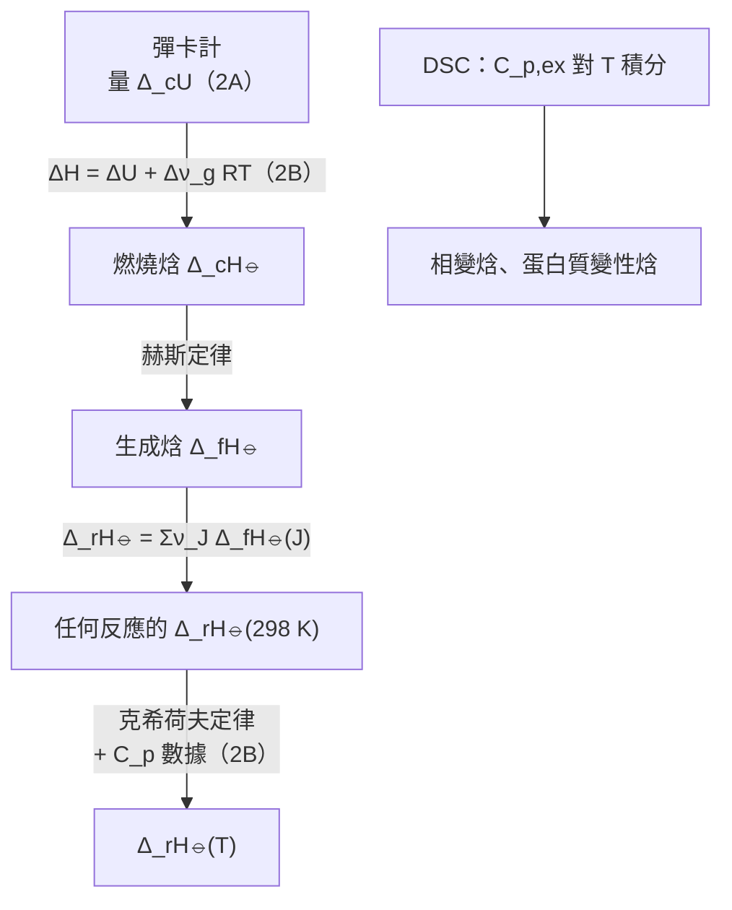

# Focus 2 熱力學第一定律（The First Law）
# 2C 熱化學（Thermochemistry）講義

> **範圍**：上課簡報 p.73–96；課本 Atkins' Physical Chemistry Topic 2C（p.50–57），以及章末 Exercises／Problems（p.71–72）、Integrated activities（p.73–74）
> **標示說明**：
> - 未特別標示的內容以簡報為主
> - **📘 課本補充**：簡報沒有、取自課本的內容
> - **⭐**：必會推導
> - **⚠️**：勘誤或易錯處
> **數據說明**：除非另外註明，熱化學數據都是 298.15 K（簡寫為 298 K）的值

---

## 學習重點

1. 能說明**標準狀態**的定義，並區分標準狀態與**參考狀態**。
2. 能寫出各種相變焓與反應焓的符號，並利用焓是狀態函數推出 $\Delta_\text{sub}H^\ominus = \Delta_\text{fus}H^\ominus + \Delta_\text{vap}H^\ominus$。
3. 能寫出**熱化學方程式**，理解標準反應焓「每莫耳」的意義。
4. 能用**赫斯定律**組合已知反應，求出目標反應的焓變化。
5. 能用**標準生成焓**計算任何反應的標準反應焓，並正確使用化學計量數 $\nu_J$ 的正負號。
6. 能**推導克希荷夫定律**，計算不同溫度下的反應焓，包括 $C_p$ 隨溫度變化的情況。
7. 能說明**微差掃描熱卡計（DSC）**的原理，並由熱譜圖求出焓變化。
8. 能把彈卡計量到的 $\Delta_\text{c}U$ 換算成 $\Delta_\text{c}H$，再求生成焓（綜合 2A、2B、2C）。

---

## 本節在路線圖中的位置

2C 是 2A、2B 的**應用**：把「定壓下 $\Delta H = q_p$」與「$H$ 是狀態函數」用在化學反應上。

---

## 熱化學的基本觀念（簡報 p.74；📘 課本 p.50）

**熱化學（thermochemistry）**：研究化學反應過程中以熱的形式傳遞的能量。

📘 熱化學是熱力學的一個分支：反應容器與其內容物構成系統，化學反應使系統與外界交換能量。

- 反應在**定容**下進行：$q$ 等於 $\Delta U$（2A）
- 反應在**定壓**下進行：$q$ 等於 $\Delta H$（2B）

反過來說，只要知道反應的 $\Delta U$ 或 $\Delta H$，就能預測反應能放出多少熱。

| 過程 | 定壓下的熱 | 焓變化 | 📘 課本另一個名稱 |
|---|---|---|---|
| **放熱（exothermic）** | 熱流到外界 | $\Delta H < 0$ | 放焓過程（exenthalpic） |
| **吸熱（endothermic）** | 熱從外界流入 | $\Delta H > 0$ | 吸焓過程（endenthalpic） |

**簡報 p.74 的三個重點**：

1. 標準相變焓等於相變過程中**定壓**下傳遞的熱。
2. **熱化學方程式（thermochemical equation）**是化學方程式加上對應的焓變化。
3. **赫斯定律（Hess's law）**：總反應的標準焓等於它所拆成的各步驟標準焓的總和。

---

## 2C.1 標準焓變化（Standard Enthalpy Changes）

### 一、標準狀態（Standard State）（簡報 p.75）

> **物質在某指定溫度下的標準狀態，就是它在 1 bar 下的純物質形式。**

📘 例子：
- 液態乙醇在 298 K 的標準狀態：298 K、1 bar 的純液態乙醇。
- 固態鐵在 500 K 的標準狀態：500 K、1 bar 的純鐵。

**標準焓變化（standard enthalpy change）** $\Delta H^\ominus$：反應物與產物**都處於標準狀態**時的焓變化。上標 $\ominus$ 讀作「standard」。

> ⚠️ **易錯：標準狀態沒有規定溫度！**
> - 標準狀態只規定**壓力 1 bar**（和純物質）。溫度可以是任何指定的值。
> - 習慣上，熱力學數據以 **298.15 K** 報告，但這是**慣例**，不是標準狀態的一部分。
> - 不要和 1A 的 STP（0 °C、1 atm）或 SATP（298.15 K、1 bar）混淆。
> - 📘 溶液的標準狀態定義較複雜，留到 Topic 5E。

### 二、物理變化的焓（Enthalpies of Physical Change）（簡報 p.75–78）

伴隨物理狀態改變的標準莫耳焓變化，稱為**標準相變焓（standard enthalpy of transition）** $\Delta_\text{trs}H^\ominus$。

**例子**：

$$
\text{H}_2\text{O(l)} \rightarrow \text{H}_2\text{O(g)} \qquad \Delta_\text{vap}H^\ominus(373\ \text{K}) = +40.66\ \text{kJ mol}^{-1}
$$

$$
\text{H}_2\text{O(s)} \rightarrow \text{H}_2\text{O(l)} \qquad \Delta_\text{fus}H^\ominus(273\ \text{K}) = +6.01\ \text{kJ mol}^{-1}
$$

- **標準汽化焓（standard enthalpy of vaporization）** $\Delta_\text{vap}H^\ominus$：1 bar 的純液體汽化成 1 bar 的氣體時，每莫耳分子的焓變化。
- **標準熔化焓（standard enthalpy of fusion）** $\Delta_\text{fus}H^\ominus$：固體轉變成液體的標準莫耳焓變化。

📘 **符號慣例**：目前的慣例是把過程名稱寫在 $\Delta$ 的**下標**，例如 $\Delta_\text{vap}H$。舊慣例 $\Delta H_\text{vap}$ 仍很常見。新寫法較合理，因為下標說明的是**過程的種類**，而不是被量測的物理量。

**📘 表 2C.1 相變溫度下的標準熔化焓與汽化焓** $\Delta_\text{trs}H^\ominus/(\text{kJ mol}^{-1})$

| 物質 | 熔點 $T_\text{f}$/K | 熔化 | 沸點 $T_\text{b}$/K | 汽化 |
|---|---|---|---|---|
| Ar | 83.81 | 1.188 | 87.29 | 6.506 |
| C₆H₆ | 278.61 | 10.59 | 353.2 | 30.8 |
| H₂O | 273.15 | 6.008 | 373.15 | 40.656（298 K 時為 44.016） |
| He | 3.5 | 0.021 | 4.22 | 0.084 |

> 水的汽化焓在 298 K（44.0）比 373 K（40.7）大，表示**相變焓隨溫度改變**。這可以用 2C.3 的克希荷夫定律解釋。

**表 2C.2 各種反應焓與相變焓**（簡報 p.76）

| 過程 | 變化 | 符號 |
|---|---|---|
| 相變（transition） | 相 α → 相 β | $\Delta_\text{trs}H$ |
| 熔化（fusion） | s → l | $\Delta_\text{fus}H$ |
| 汽化（vaporization） | l → g | $\Delta_\text{vap}H$ |
| 昇華（sublimation） | s → g | $\Delta_\text{sub}H$ |
| 混合（mixing） | 純物質 → 混合物 | $\Delta_\text{mix}H$ |
| 溶解（solution） | 溶質 → 溶液 | $\Delta_\text{sol}H$ |
| 水合（hydration） | X±(g) → X±(aq) | $\Delta_\text{hyd}H$ |
| 原子化（atomization） | 物質(s, l, g) → 原子(g) | $\Delta_\text{at}H$ |
| 游離（ionization） | X(g) → X⁺(g) + e⁻(g) | $\Delta_\text{ion}H$ |
| 電子親和（electron gain） | X(g) + e⁻(g) → X⁻(g) | $\Delta_\text{eg}H$ |
| 反應（reaction） | 反應物 → 產物 | $\Delta_\text{r}H$ |
| 燃燒（combustion） | 化合物(s, l, g) + O₂(g) → CO₂(g) + H₂O(l, g) | $\Delta_\text{c}H$ |
| 生成（formation） | 元素 → 化合物 | $\Delta_\text{f}H$ |
| 活化（activation） | 反應物 → 活化錯合物（activated complex） | $\Delta^\ddagger H$ |

（IUPAC 建議的符號。表中都是莫耳量。）

#### ⭐ 焓是狀態函數的兩個推論（簡報 p.77–78）

**推論 1：昇華焓 = 熔化焓 + 汽化焓**

把固體變成蒸氣有兩條路徑：

- **直接**：昇華 H₂O(s) → H₂O(g)，$\Delta_\text{sub}H^\ominus$
- **間接**：先熔化 H₂O(s) → H₂O(l)，$\Delta_\text{fus}H^\ominus$；再汽化 H₂O(l) → H₂O(g)，$\Delta_\text{vap}H^\ominus$

兩條路徑的初態、末態相同，而焓是狀態函數，所以（**同一溫度下**）

$$
\boxed{\,\Delta_\text{sub}H^\ominus = \Delta_\text{fus}H^\ominus + \Delta_\text{vap}H^\ominus\,} \qquad (2C.1)
$$

📘 熔化焓都是正值，所以**同一溫度下，昇華焓一定大於汽化焓**。

**推論 2：逆過程的焓變化等於正過程的負值**

$$
\boxed{\,\Delta H^\ominus(\text{A} \rightarrow \text{B}) = -\Delta H^\ominus(\text{B} \rightarrow \text{A})\,} \qquad (2C.2)
$$

例：298 K 時水的汽化焓為 +44 kJ mol⁻¹，所以水蒸氣的**凝結焓**為 −44 kJ mol⁻¹。

> 簡報 p.78 的兩張焓能階圖：(1) s → l → g 的兩段箭頭加起來等於 s → g 的一段箭頭；(2) A → B 向上、B → A 向下，長度相同。

### 三、化學變化的焓（Enthalpies of Chemical Change）（簡報 p.79）

報告反應焓變化有兩種方式。

**方式一：熱化學方程式**（化學方程式 + 對應的標準焓變化）

$$
\text{CH}_4\text{(g)} + 2\,\text{O}_2\text{(g)} \rightarrow \text{CO}_2\text{(g)} + 2\,\text{H}_2\text{O(l)} \qquad \Delta H^\ominus = -890\ \text{kJ}
$$

📘 $\Delta H^\ominus$ 的意義：**純的、分開的、處於標準狀態的反應物** → **純的、分開的、處於標準狀態的產物**。

以甲烷燃燒為例：1 mol 純 CH₄(g, 1 bar) 與 2 mol 純 O₂(g, 1 bar) 完全反應，生成 1 mol 純 CO₂(g, 1 bar) 與 2 mol 純液態水（1 bar），數值為 298.15 K 的值。

> 📘 除了溶液中的離子反應以外，混合與分離的焓變化與反應本身相比都可以忽略。

**方式二：寫出化學方程式，並報告標準反應焓（standard reaction enthalpy）** $\Delta_\text{r}H^\ominus$

$$
\text{CH}_4\text{(g)} + 2\,\text{O}_2\text{(g)} \rightarrow \text{CO}_2\text{(g)} + 2\,\text{H}_2\text{O(l)} \qquad \Delta_\text{r}H^\ominus = -890\ \text{kJ mol}^{-1}
$$

> ⚠️ **簡報 p.79 把產物寫成 2 H₂O(g)，應為 2 H₂O(l)**。−890 kJ mol⁻¹ 對應的是**液態水**。若產物是水蒸氣，
> $$\Delta_\text{r}H^\ominus = \Delta_\text{f}H^\ominus(\text{CO}_2) + 2\Delta_\text{f}H^\ominus(\text{H}_2\text{O, g}) - \Delta_\text{f}H^\ominus(\text{CH}_4) = -393.51 + 2(-241.82) - (-74.81) = -802\ \text{kJ mol}^{-1}$$
> 兩者相差 $2\times44$ kJ mol⁻¹，正好是 2 mol 水的汽化焓。**物態一定要寫清楚。**

#### 標準反應焓的定義

對反應 2 A + B → 3 C + D：

$$
\Delta_\text{r}H^\ominus = \{3H^\ominus_\text{m}(\text{C}) + H^\ominus_\text{m}(\text{D})\} - \{2H^\ominus_\text{m}(\text{A}) + H^\ominus_\text{m}(\text{B})\}
$$

一般式：

$$
\boxed{\,\Delta_\text{r}H^\ominus = \sum_\text{產物}\nu H^\ominus_\text{m} - \sum_\text{反應物}\nu H^\ominus_\text{m}\,} \qquad \text{標準反應焓（定義）(2C.3)}
$$

$\nu$ 是**化學計量係數（stoichiometric coefficients）**，無單位且**都是正值**。

📘 **「每莫耳」的意義**：$\Delta_\text{r}H^\ominus$ 的單位 kJ mol⁻¹ 來自式中的莫耳焓。「每莫耳」要對照化學方程式的係數來理解：上例的「每莫耳」是指「每 2 mol A」、「每 1 mol B」、「每 3 mol C」或「每 1 mol D」，也就是**每莫耳反應（per mole of reaction）**。

📘 式 2C.3 實際上不好用，因為**焓的絕對值無法量測**。解決方法是 2C.2 的生成焓。

#### 📘 標準燃燒焓（Standard Enthalpy of Combustion）

$\Delta_\text{c}H^\ominus$：有機化合物**完全氧化**的標準反應焓。

- 含 C、H、O 的化合物 → CO₂(g) + H₂O(**l**)
- 含 N 的化合物 → 另外生成 N₂(g)

例：葡萄糖燃燒

$$
\text{C}_6\text{H}_{12}\text{O}_6\text{(s)} + 6\,\text{O}_2\text{(g)} \rightarrow 6\,\text{CO}_2\text{(g)} + 6\,\text{H}_2\text{O(l)} \qquad \Delta_\text{c}H^\ominus = -2808\ \text{kJ mol}^{-1}
$$

表示 1 mol 葡萄糖在標準狀態下燃燒放出 2808 kJ 的熱。

**📘 表 2C.3 有機化合物 298 K 的標準生成焓與燃燒焓**

| 化合物 | $\Delta_\text{f}H^\ominus$/(kJ mol⁻¹) | $\Delta_\text{c}H^\ominus$/(kJ mol⁻¹) |
|---|---|---|
| 苯 C₆H₆(l) | +49.0 | −3268 |
| 乙烷 C₂H₆(g) | −84.7 | −1560 |
| 葡萄糖 C₆H₁₂O₆(s) | −1274 | −2808 |
| 甲烷 CH₄(g) | −74.8 | −890 |
| 甲醇 CH₃OH(l) | −238.7 | −726 |

### 四、⭐ 赫斯定律（Hess's Law）（簡報 p.80–82）

> **總反應的標準反應焓，等於它所能拆成的各個反應的標準反應焓之和。**

- 📘 各步驟**不必真的能實現**，可以是「假想的」反應，唯一要求是化學方程式要**平衡**。
- **熱力學基礎**：$\Delta_\text{r}H^\ominus$ 與路徑無關（焓是狀態函數），所以它其實就是第一定律的應用。
- **重要性**：很難直接量測的反應，可以由其他反應的數據組合出來。

簡報 p.80 的圖：反應物到產物，「路徑一」直接反應 $\Delta H_\text{r}$；「路徑二」經過中間產物 $\Delta H_1 + \Delta H_2$。兩條路徑的焓變化相同。

#### 📗 簡報 Example 2C.1：由赫斯定律求丙烯的燃燒焓

**題目**：The standard reaction enthalpy for the hydrogenation of propene, CH₂=CHCH₃(g) + H₂(g) → CH₃CH₂CH₃(g), is −124 kJ mol⁻¹. The standard reaction enthalpy for the combustion of propane, CH₃CH₂CH₃(g) + 5 O₂(g) → 3 CO₂(g) + 4 H₂O(l), is −2220 kJ mol⁻¹. The standard reaction enthalpy for the formation of water, H₂(g) + ½ O₂(g) → H₂O(l), is −286 kJ mol⁻¹. Calculate the standard enthalpy of combustion of propene.

（丙烯**氫化（hydrogenation）**的標準反應焓為 −124 kJ mol⁻¹；丙烷燃燒的標準反應焓為 −2220 kJ mol⁻¹；水生成的標準反應焓為 −286 kJ mol⁻¹。計算丙烯的標準燃燒焓。）

**解題思路**：先寫出目標反應，再把已知反應**加加減減**，使中間物（丙烷、H₂）消掉、正好得到目標反應。反應焓照同樣的方式加減。

**詳解**：

**目標反應**：

$$
\text{C}_3\text{H}_6\text{(g)} + \tfrac{9}{2}\,\text{O}_2\text{(g)} \rightarrow 3\,\text{CO}_2\text{(g)} + 3\,\text{H}_2\text{O(l)}
$$

**組合**：

| 反應 | $\Delta_\text{r}H^\ominus$/(kJ mol⁻¹) |
|---|---|
| C₃H₆(g) + H₂(g) → C₃H₈(g) | −124 |
| C₃H₈(g) + 5 O₂(g) → 3 CO₂(g) + 4 H₂O(l) | −2220 |
| H₂O(l) → H₂(g) + ½ O₂(g)（**水生成反應的逆反應**） | **+286** |
| **加總**：C₃H₆(g) + 9/2 O₂(g) → 3 CO₂(g) + 3 H₂O(l) | **−2058** |

**檢查**：C₃H₈ 左右各一個，消去；H₂ 左右各一個，消去；O₂：左 5、右 ½，淨左 9/2 ✓；H₂O：右 4、左 1，淨右 3 ✓。

$$
\Delta_\text{c}H^\ominus(\text{C}_3\text{H}_6) = \boxed{-2058\ \text{kJ mol}^{-1}}
$$

> ⚠️ **易錯**：把反應反過來寫時，$\Delta H$ 要**變號**（式 2C.2）；乘以係數時，$\Delta H$ 也要**乘同樣的係數**。

**📘 自我測驗（Self-test 2C.1）**：由液態苯的標準燃燒焓（−3268 kJ mol⁻¹）與液態環己烷的標準燃燒焓（−3920 kJ mol⁻¹），計算液態苯氫化的標準焓。

> 目標：C₆H₆(l) + 3 H₂(g) → C₆H₁₂(l)
>
> $\Delta_\text{r}H^\ominus = \Delta_\text{c}H^\ominus(\text{C}_6\text{H}_6) + 3\Delta_\text{c}H^\ominus(\text{H}_2) - \Delta_\text{c}H^\ominus(\text{C}_6\text{H}_{12})$
> $= -3268 + 3(-285.83) - (-3920) = \boxed{-206\ \text{kJ mol}^{-1}}$
>
> 💡 **規律**：用燃燒焓計算時，$\Delta_\text{r}H^\ominus = \sum_\text{反應物}\nu\Delta_\text{c}H^\ominus - \sum_\text{產物}\nu\Delta_\text{c}H^\ominus$，方向與生成焓**相反**。

---

## 2C.2 標準生成焓（Standard Enthalpies of Formation）（簡報 p.83–86）

### 一、定義

**物質的標準生成焓（standard enthalpy of formation）** $\Delta_\text{f}H^\ominus$：由**處於參考狀態的元素**生成該化合物的標準反應焓。

**參考狀態（reference state）**：

> **元素的參考狀態，是它在指定溫度、1 bar 下最穩定的狀態。**

| 元素 | 298 K 的參考狀態 |
|---|---|
| 氮 | N₂(g) |
| 汞 | Hg(l) |
| 碳 | **石墨（graphite）**，不是鑽石 |
| 📘 錫 | **白錫**（金屬錫） |
| **磷（例外）** | **白磷（white phosphorus）**，雖然它不是最穩定的同素異形體（allotrope），而是**最容易重現**的形式 |

📘 例：液態苯在 298 K 的標準生成焓對應的反應是

$$
6\,\text{C(s, graphite)} + 3\,\text{H}_2\text{(g)} \rightarrow \text{C}_6\text{H}_6\text{(l)} \qquad \Delta_\text{f}H^\ominus = +49.0\ \text{kJ mol}^{-1}
$$

- 生成焓以**每莫耳分子**（離子化合物則為每莫耳**化學式單位，formula unit**）表示。
- 📘 **參考狀態元素的標準生成焓在任何溫度都是零**，因為它對應的是 N₂(g) → N₂(g) 這種「無變化」的反應。

> ⚠️ **標準狀態 vs 參考狀態**（課本討論題 D2C.3）
>
> | | 標準狀態（standard state） | 參考狀態（reference state） |
> |---|---|---|
> | 適用對象 | **任何物質** | **元素** |
> | 定義 | 指定溫度、1 bar 下的純物質 | 指定溫度、1 bar 下**最穩定**的形式 |
> | 用途 | 定義所有 $\Delta H^\ominus$ | 定義生成焓的零點 |
> | 例子 | 鑽石、石墨各有自己的標準狀態 | 碳的參考狀態只有石墨 |

**📘 表 2C.4、2C.5 298 K 的標準生成焓** $\Delta_\text{f}H^\ominus$/(kJ mol⁻¹)

| 無機物 | | 有機物 | |
|---|---|---|---|
| H₂O(l) | −285.83 | CH₄(g) | −74.81 |
| H₂O(g) | −241.82 | C₆H₆(l) | +49.0 |
| NH₃(g) | −46.11 | C₆H₁₂(l) | −156 |
| N₂H₄(l) | +50.63 | CH₃OH(l) | −238.66 |
| NO₂(g) | +33.18 | CH₃CH₂OH(l) | −277.69 |
| N₂O₄(g) | +9.16 | | |
| NaCl(s) | −411.15 | | |
| KCl(s) | −436.75 | | |

本講義習題另外會用到：$\Delta_\text{f}H^\ominus(\text{CO}_2, \text{g}) = -393.51$ kJ mol⁻¹（課本附錄值）。

### 二、溶液中離子的生成焓（簡報 p.84）

**問題**：不可能製備**只含陽離子或只含陰離子**的溶液，所以無法單獨量測一種離子的生成焓。

**解決方法**：規定**氫離子**的標準生成焓在**任何溫度**都為零：

$$
\boxed{\,\Delta_\text{f}H^\ominus(\text{H}^+, \text{aq}) = 0\,} \qquad \text{溶液中的離子（慣例）(2C.4)}
$$

📘 **例子**：若量得 HBr(aq) 的生成焓為 −122 kJ mol⁻¹，則這個值全部歸給 Br⁻(aq)，$\Delta_\text{f}H^\ominus(\text{Br}^-, \text{aq}) = -122$ kJ mol⁻¹。再結合 AgBr(aq) 的生成焓，就能求出 $\Delta_\text{f}H^\ominus(\text{Ag}^+, \text{aq})$，依此類推。

本質上，這個慣例就是把所有離子的生成焓**平移同一個固定值**，使 H⁺(aq) 剛好為零。

### 三、⭐ 由生成焓計算反應焓（簡報 p.85）

**概念**：把反應想成兩步：

1. 把反應物**「拆解（unforming）」**成參考狀態的元素：焓變化 $= -\sum_\text{反應物}\nu\Delta_\text{f}H^\ominus$（拆解是生成的逆過程，所以取負號）
2. 再由這些元素**生成**產物：焓變化 $= +\sum_\text{產物}\nu\Delta_\text{f}H^\ominus$

由赫斯定律，兩步相加就是 $\Delta_\text{r}H^\ominus$：

$$
\boxed{\,\Delta_\text{r}H^\ominus = \sum_\text{產物}\nu\Delta_\text{f}H^\ominus - \sum_\text{反應物}\nu\Delta_\text{f}H^\ominus\,} \qquad \text{標準反應焓（實用形式）(2C.5a)}
$$

**更精簡的寫法**：引入**化學計量數（stoichiometric numbers）** $\nu_J$，**產物為正、反應物為負**：

$$
\boxed{\,\Delta_\text{r}H^\ominus = \sum_J\nu_J\Delta_\text{f}H^\ominus(\text{J})\,} \qquad (2C.5b)
$$

> ⚠️ **兩種「計量」要分清楚**：
>
> | | 化學計量係數（stoichiometric coefficient） | 化學計量數（stoichiometric number） |
> |---|---|---|
> | 符號 | $\nu$（無下標） | $\nu_J$ 或 $\nu(\text{J})$ |
> | 正負 | **都是正值** | **產物為正、反應物為負** |
> | 用在 | 式 2C.3、2C.5a | 式 2C.5b、2C.7c |

#### 📗 簡報 Brief illustration 2C.1：由生成焓計算反應焓

**題目**：計算反應 2 HN₃(l) + 2 NO(g) → H₂O₂(l) + 4 N₂(g) 的標準反應焓。已知 $\Delta_\text{f}H^\ominus$：H₂O₂(l) −187.78、HN₃(l) +264.0、NO(g) +90.25 kJ mol⁻¹。

**詳解**：

**方法一（式 2C.5a）**：

$$
\Delta_\text{r}H^\ominus = \{\Delta_\text{f}H^\ominus(\text{H}_2\text{O}_2, \text{l}) + 4\Delta_\text{f}H^\ominus(\text{N}_2, \text{g})\} - \{2\Delta_\text{f}H^\ominus(\text{HN}_3, \text{l}) + 2\Delta_\text{f}H^\ominus(\text{NO}, \text{g})\}
$$

$$
= \{-187.78 + 4(0)\} - \{2(264.0) + 2(90.25)\}\ \text{kJ mol}^{-1} = \boxed{-896.3\ \text{kJ mol}^{-1}}
$$

（N₂ 是參考狀態的元素，生成焓為零。）

**方法二（式 2C.5b）**：$\nu(\text{HN}_3) = -2$、$\nu(\text{NO}) = -2$、$\nu(\text{H}_2\text{O}_2) = +1$、$\nu(\text{N}_2) = +4$

$$
\Delta_\text{r}H^\ominus = (+1)\Delta_\text{f}H^\ominus(\text{H}_2\text{O}_2) + (+4)\Delta_\text{f}H^\ominus(\text{N}_2) + (-2)\Delta_\text{f}H^\ominus(\text{HN}_3) + (-2)\Delta_\text{f}H^\ominus(\text{NO})
$$

結果相同。

> ⚠️ 簡報 p.86 的反應式把產物寫成 H₂O₂(**g**)，但計算用的是 H₂O₂(**l**) 的生成焓 −187.78 kJ mol⁻¹。應為 **H₂O₂(l)**（課本亦同）。

---

## 2C.3 反應焓的溫度相依性（The Temperature Dependence of Reaction Enthalpies）（簡報 p.87–89）

### 一、動機

許多標準反應焓已在不同溫度下量過。但若沒有這些數據，可以用**熱容量**與**某一溫度的反應焓**計算其他溫度的反應焓。

📘 很多情況下，**熱容量數據比反應焓數據更精確**，所以這種計算方法往往比在高溫下直接量測反應焓還準確。

### 二、⭐ 推導：克希荷夫定律（Kirchhoff's Law）

**Step 1：單一物質的焓隨溫度的變化**

由 2B 的 $dH = C_p\,dT$（式 2B.6a），物質由 $T_1$ 加熱到 $T_2$（**假設沒有相變**）：

$$
H(T_2) = H(T_1) + \int_{T_1}^{T_2}C_p\,dT \qquad (2C.6)
$$

**Step 2：對反應中每個物質都寫一次**

$$
H^\ominus_\text{m}(\text{J}, T_2) = H^\ominus_\text{m}(\text{J}, T_1) + \int_{T_1}^{T_2}C^\ominus_{p,\text{m}}(\text{J})\,dT
$$

**Step 3：代入 $\Delta_\text{r}H^\ominus = \sum_J\nu_JH^\ominus_\text{m}(\text{J})$**

$$
\Delta_\text{r}H^\ominus(T_2) = \sum_J\nu_JH^\ominus_\text{m}(\text{J}, T_1) + \int_{T_1}^{T_2}\sum_J\nu_JC^\ominus_{p,\text{m}}(\text{J})\,dT
$$

第一項就是 $\Delta_\text{r}H^\ominus(T_1)$，積分內是產物與反應物熱容量的差：

$$
\boxed{\,\Delta_\text{r}H^\ominus(T_2) = \Delta_\text{r}H^\ominus(T_1) + \int_{T_1}^{T_2}\Delta_\text{r}C^\ominus_p\,dT\,} \qquad \text{克希荷夫定律 (2C.7a)}
$$

其中

$$
\Delta_\text{r}C^\ominus_p = \sum_\text{產物}\nu C^\ominus_{p,\text{m}} - \sum_\text{反應物}\nu C^\ominus_{p,\text{m}} \qquad (2C.7b)
$$

或用化學計量數寫成

$$
\Delta_\text{r}C^\ominus_p = \sum_J\nu_JC^\ominus_{p,\text{m}}(\text{J}) \qquad (2C.7c)
$$

**Step 4：$\Delta_\text{r}C^\ominus_p$ 為常數時**

$$
\boxed{\,\Delta_\text{r}H^\ominus(T_2) = \Delta_\text{r}H^\ominus(T_1) + \Delta_\text{r}C^\ominus_p(T_2 - T_1)\,} \qquad \text{克希荷夫定律的積分形式 (2C.7d)}
$$

> 📘 **為什麼常常可以假設 $\Delta_\text{r}C_p^\ominus$ 為常數？** 各物質的熱容量雖然會隨溫度變化，但它們的**差值**變化較小，所以在不太大的溫度範圍內，假設 $\Delta_\text{r}C^\ominus_p$ 為常數通常是好的近似。
>
> 💡 **微分形式**：$\dfrac{d\Delta_\text{r}H^\ominus}{dT} = \Delta_\text{r}C^\ominus_p$。
> - $\Delta_\text{r}C^\ominus_p > 0$：溫度升高，$\Delta_\text{r}H^\ominus$ **變大**（變得較正）
> - $\Delta_\text{r}C^\ominus_p < 0$：溫度升高，$\Delta_\text{r}H^\ominus$ **變小**（變得較負）

**物理意義**（簡報 p.87 的圖，課本圖 2C.1）：溫度升高時，產物與反應物的焓**都會增加**，但增加的幅度由各自的熱容量決定。反應焓的變化，就反映了兩者增加幅度的差。

> ⚠️ **使用克希荷夫定律的前提**：$T_1$ 到 $T_2$ 之間**沒有相變**。若有相變（例如水在 373 K 汽化），要把相變焓另外加進去（見習題 10 的延伸）。

#### 📗 簡報 Example 2C.2：H₂O(g) 在 100 °C 的生成焓

**題目**：The standard enthalpy of formation of H₂O(g) at 298 K is −241.82 kJ mol⁻¹. Estimate its value at 100 °C given the following values of the molar heat capacities at constant pressure: H₂O(g): 33.58 J K⁻¹ mol⁻¹; H₂(g): 28.84 J K⁻¹ mol⁻¹; O₂(g): 29.37 J K⁻¹ mol⁻¹. Assume that the heat capacities are independent of temperature.

（H₂O(g) 在 298 K 的標準生成焓為 −241.82 kJ mol⁻¹。已知各物質的莫耳定壓熱容量，假設與溫度無關，估計 100 °C 時的標準生成焓。）

**解題思路**：$\Delta_\text{r}C^\ominus_p$ 與溫度無關，用積分形式 2C.7d。先寫出化學方程式，找出化學計量係數，算出 $\Delta_\text{r}C^\ominus_p$。

**詳解**：

**Step 1：反應式**

$$
\text{H}_2\text{(g)} + \tfrac{1}{2}\,\text{O}_2\text{(g)} \rightarrow \text{H}_2\text{O(g)}
$$

**Step 2：$\Delta_\text{r}C^\ominus_p$**

$$
\Delta_\text{r}C^\ominus_p = C^\ominus_{p,\text{m}}(\text{H}_2\text{O, g}) - \left\{C^\ominus_{p,\text{m}}(\text{H}_2, \text{g}) + \tfrac{1}{2}C^\ominus_{p,\text{m}}(\text{O}_2, \text{g})\right\}
$$

$$
= 33.58 - \{28.84 + \tfrac{1}{2}(29.37)\}\ \text{J K}^{-1}\,\text{mol}^{-1} = -9.94\ \text{J K}^{-1}\,\text{mol}^{-1}
$$

**Step 3：代入式 2C.7d**（$\Delta T = 373 - 298 = 75$ K）

$$
\Delta_\text{r}H^\ominus(373\ \text{K}) = -241.82\ \text{kJ mol}^{-1} + (75\ \text{K})(-9.94\times10^{-3}\ \text{kJ K}^{-1}\,\text{mol}^{-1}) = \boxed{-242.6\ \text{kJ mol}^{-1}}
$$

> - $\Delta_\text{r}C^\ominus_p < 0$，所以溫度升高時生成焓變得**更負**，但只改變了 0.3%。
> - ⚠️ 簡報 p.89 的 $\Delta_\text{r}C^\ominus_p$ 式子寫成 $C_{p,\text{m}}(\text{H}_2\text{O}) - \{C_{p,\text{m}}(\text{H}_2) + C_{p,\text{m}}(\text{O}_2)\}$，**漏了 O₂ 的係數 ½**。照式子直接算會得到 −24.63，而不是 −9.94。簡報的數值答案是對的，只是式子少寫了 ½。

**📘 自我測驗（Self-test 2C.2）**：由表 2C.5 與附錄的熱容量數據，估計 C₆H₁₂(l) 在 400 K 的標準生成焓。答：−163 kJ mol⁻¹。

---

## 2C.4 實驗技術（Experimental Techniques）

📘 傳統的熱化學工具是卡計（2A、2B）。技術進步之後，可以量測只有**幾毫克**的樣品。

### 一、微差掃描熱卡計（Differential Scanning Calorimetry, DSC）（簡報 p.90–96）

#### 1. 名稱的意義

**DSC 量測物理或化學變化過程中，在定壓下傳入或傳出樣品的熱。**

| 名稱 | 意義 |
|---|---|
| **微差（differential）** | 樣品的量測值與**參考物（reference material）**比較。參考物在分析過程中**不發生**任何物理或化學變化 |
| **掃描（scanning）** | 樣品與參考物的溫度在分析過程中**持續升高**（掃描） |

#### 2. 構造（簡報圖 2C.2）

- 兩個小隔室，分別放樣品與參考物，各自有**加熱器（heater）**與**熱電偶（thermocouple）**。
- 兩者以**固定速率**電熱加溫。時間 $t$ 時的溫度為

$$
T = T_0 + \alpha t
$$

$T_0$ 為初始溫度，$\alpha$ 為**掃描速率（scan rate）**。

- 電腦控制電源，使樣品與參考物在整個分析過程中**溫度始終相同**。輸出的是**維持兩者等溫所需的功率差**。

#### 3. ⭐ 推導：由功率差求焓變化

**Step 1：沒有變化時**

樣品在溫度 $T$ 沒有發生物理或化學變化，傳給樣品的熱為（假設 $C_p$ 與溫度無關）

$$
q_p = C_p\Delta T, \qquad \Delta T = T - T_0 = \alpha t
$$

**Step 2：發生變化時**

若樣品發生物理或化學變化（例如吸熱的熔化），要讓它與參考物升高同樣的溫度，必須多給熱 $q_{p,\text{ex}}$，總共 $q_p + q_{p,\text{ex}}$。

**Step 3：解釋成「表觀熱容量」的增加**

把多出來的熱看成樣品的定壓熱容量**表觀上**由 $C_p$ 增加到 $C_p + C_{p,\text{ex}}$：

$$
\boxed{\,C_{p,\text{ex}} = \frac{q_{p,\text{ex}}}{\Delta T} = \frac{q_{p,\text{ex}}}{\alpha t} = \frac{P_\text{ex}}{\alpha}\,} \qquad (2C.8)
$$

$P_\text{ex} = q_{p,\text{ex}}/t$ 是使樣品與參考物等溫所需的**超額電功率（excess electrical power）**。

**Step 4：積分得焓變化**

$C_{p,\text{ex}}$ 對 $T$ 作圖稱為**熱譜圖（thermogram）**，也稱 DSC 曲線。由 $dH = C_p\,dT$，該過程的焓變化為

$$
\boxed{\,\Delta H = \int_{T_1}^{T_2}C_{p,\text{ex}}\,dT\,} \qquad (2C.9)
$$

$T_1$、$T_2$ 分別是過程開始與結束的溫度。**焓變化等於熱譜圖下方的面積。**

**簡報圖 2C.3：泛素（ubiquitin）在 pH 2.45 的熱譜圖**

- 約 45 °C 以下，蛋白質維持**天然結構（native structure）**，$C_{p,\text{ex}} \approx 0$。
- 45 °C 以上發生**吸熱的構形變化（conformational change）**，即蛋白質變性，$C_{p,\text{ex}}$ 出現峰值（約 65 °C、9 mJ K⁻¹）。
- 峰下面積就是變性的焓變化。

#### 4. 應用（簡報 p.95–96）

**原理**：熱流變化對溫度作圖。

**可量測**：

- **相變**的溫度與熱：**玻璃轉移溫度（glass transition temperature, $T_\text{g}$）**、**熔點（melting temperature, $T_\text{m}$）**、**結晶溫度（crystallization temperature, $T_\text{c}$）**
- **固化反應（curing reaction）**與其他化學反應

> ⚠️ 這裡的 $T_\text{c}$ 是**結晶溫度**，不是 1C 的臨界溫度。

簡報 p.95 的兩張圖：

| | 非晶質熱塑性塑膠（amorphous thermoplastic） | 結晶性聚合物（crystalline polymer） |
|---|---|---|
| 分子鏈 | 隨機糾纏 | 有規則排列的區域 |
| DSC 主要訊號 | $T_\text{g}$（基線階梯狀改變） | $T_\text{m}$（吸熱峰）、$T_\text{c}$（放熱峰） |

**簡報 p.96 的應用整理**：任何具有吸熱或放熱的反應或相變，DSC 都能偵測其起始溫度。例如：

- 金屬材料合金熔煉後的**析出（precipitation）**過程
- 礦物的**脫水反應（dehydration）**
- 有機物的**熱聚合（thermal polymerization）**與**硬化反應（curing）**
- 陶瓷材料的相變
- 玻璃材料的**再結晶（recrystallization）**

可測試固體、粉體、膠體與液體材料在不同溫度下的**反應熱、熔點、玻璃轉移溫度、結晶溫度**。

### 二、📘 等溫滴定熱卡計（Isothermal Titration Calorimetry, ITC）

簡報未提到，課本補充。

**也是「微差」技術**：比較樣品與參考物的熱行為。

**裝置**（課本圖 2C.4）：

- 兩個導熱容器，體積約幾 cm³。
- **參考槽**：裝參考物（例如水）與一個約幾毫瓦的加熱器。
- **樣品槽**：裝一種反應物（例如有結合位置的巨分子溶液）與加熱器。
- 用**注射器（injector）**把精確定量（約 1 mm³）的第二種反應物分次加入樣品槽。

**原理**：

- 監測**維持兩槽溫差固定所需的功率**。
- **放熱反應**：需要的功率**較少**；**吸熱反應**：需要的功率**較多**。
- 第 $i$ 次注射的熱：$q_i = P_i\Delta t$
- 若溶液體積為 $V$、第 $i$ 次注射時反應物 A 的濃度變化為 $\Delta c_i$，則 $q_i = V\Delta_\text{r}H\,\Delta c_i$。
- 把所有 $\Delta c_i$ 加總等於 A 的初始濃度，就能求出 $\Delta_\text{r}H$。

**常見用途**：量測生物分子（如蛋白質與配體）的**結合焓（binding enthalpy）**。

---

## 精選章末習題（含詳解）

> **選題標準**：需要多步推理、綜合 2A／2B 觀念，或有實際應用意義。共 10 題，由基礎到進階排列。數值均已用程式驗算。
> **常用數據**（298 K）：$\Delta_\text{f}H^\ominus$：CO₂(g) −393.51、H₂O(l) −285.83、H₂O(g) −241.82、CH₄(g) −74.81 kJ mol⁻¹；$RT = 2.479$ kJ mol⁻¹

---

### 習題 1｜E2C.6 克希荷夫定律：水煤氣反應（基礎）

**題目**：Calculate $\Delta_\text{r}H^\ominus$ at (i) 298 K, (ii) 478 K for the reaction C(graphite) + H₂O(g) → CO(g) + H₂(g). The standard enthalpies of formation at 298 K of CO(g) and H₂O(g) are −110.53 kJ mol⁻¹ and −241.82 kJ mol⁻¹ respectively; the heat capacities at 298 K are $C^\ominus_{p,\text{m}}$(CO, g) = 29.14 J K⁻¹ mol⁻¹, $C^\ominus_{p,\text{m}}$(H₂, g) = 28.824 J K⁻¹ mol⁻¹, $C^\ominus_{p,\text{m}}$(H₂O, g) = 33.58 J K⁻¹ mol⁻¹, $C^\ominus_{p,\text{m}}$(graphite, s) = 8.527 J K⁻¹ mol⁻¹. Assume all heat capacities to be constant over the temperature range of interest.

（計算反應 C(石墨) + H₂O(g) → CO(g) + H₂(g) 在 (i) 298 K、(ii) 478 K 的標準反應焓。假設熱容量在此溫度範圍內為常數。）

**詳解**：

**(i) 298 K**（石墨、H₂ 是參考狀態的元素，生成焓為零）

$$
\Delta_\text{r}H^\ominus(298\ \text{K}) = \Delta_\text{f}H^\ominus(\text{CO}) - \Delta_\text{f}H^\ominus(\text{H}_2\text{O, g}) = -110.53 - (-241.82) = \boxed{+131.29\ \text{kJ mol}^{-1}}
$$

**(ii) 478 K**

$$
\Delta_\text{r}C^\ominus_p = (29.14 + 28.824) - (8.527 + 33.58) = +15.857\ \text{J K}^{-1}\,\text{mol}^{-1}
$$

$$
\Delta_\text{r}H^\ominus(478\ \text{K}) = 131.29 + (15.857\times10^{-3})(180)\ \text{kJ mol}^{-1} = \boxed{+134.14\ \text{kJ mol}^{-1}}
$$

> **觀念**：
> - 這是工業上製造**水煤氣（water gas）**的反應，強烈吸熱。
> - $\Delta_\text{r}C^\ominus_p > 0$，所以溫度升高時反應焓變大（更吸熱）。
> - ⚠️ **石墨不能漏掉**：雖然它的生成焓是零，但**熱容量不是零**，計算 $\Delta_\text{r}C_p$ 時一定要算進去。

---

### 習題 2｜E2C.12 赫斯定律 + $\Delta_\text{r}U$

**題目**：Given the reactions (1) and (2) below, determine (i) $\Delta_\text{r}H^\ominus$ and $\Delta_\text{r}U^\ominus$ for reaction (3), (ii) $\Delta_\text{f}H^\ominus$ for both HI(g) and H₂O(g), all at 298 K.

(1) H₂(g) + I₂(s) → 2 HI(g)  $\Delta_\text{r}H^\ominus = +52.96$ kJ mol⁻¹
(2) 2 H₂(g) + O₂(g) → 2 H₂O(g)  $\Delta_\text{r}H^\ominus = -483.64$ kJ mol⁻¹
(3) 4 HI(g) + O₂(g) → 2 I₂(s) + 2 H₂O(g)

（由反應 (1)、(2) 求：(i) 反應 (3) 的 $\Delta_\text{r}H^\ominus$ 與 $\Delta_\text{r}U^\ominus$；(ii) HI(g) 與 H₂O(g) 的標準生成焓。）

**詳解**：

**(i) Step 1：組合反應**

反應 (3) 中 HI 在左邊、係數 4，所以要用 **−2 × (1)**；H₂O 在右邊、係數 2，所以用 **+1 × (2)**：

| 反應 | $\Delta_\text{r}H^\ominus$/(kJ mol⁻¹) |
|---|---|
| −2 × (1)：4 HI(g) → 2 H₂(g) + 2 I₂(s) | −2 × 52.96 = −105.92 |
| +1 × (2)：2 H₂(g) + O₂(g) → 2 H₂O(g) | −483.64 |
| **(3)** = 加總 | **−589.56** |

$$
\Delta_\text{r}H^\ominus(3) = \boxed{-589.56\ \text{kJ mol}^{-1}}
$$

**Step 2：$\Delta_\text{r}U^\ominus$**（2B 的式 2B.4）

$\Delta\nu_g = 2 - (4 + 1) = -3$（I₂ 是固體，不算）

$$
\Delta_\text{r}U^\ominus = \Delta_\text{r}H^\ominus - \Delta\nu_gRT = -589.56 - (-3)(2.479)\ \text{kJ mol}^{-1} = \boxed{-582.12\ \text{kJ mol}^{-1}}
$$

**(ii) 生成焓**

I₂(s) 是碘在 298 K 的參考狀態，所以反應 (1) 就是生成 2 mol HI(g) 的反應；反應 (2) 是生成 2 mol H₂O(g)：

$$
\Delta_\text{f}H^\ominus(\text{HI, g}) = \frac{+52.96}{2} = \boxed{+26.48\ \text{kJ mol}^{-1}}, \qquad
\Delta_\text{f}H^\ominus(\text{H}_2\text{O, g}) = \frac{-483.64}{2} = \boxed{-241.82\ \text{kJ mol}^{-1}}
$$

> **檢查**：用 (ii) 的生成焓直接算反應 (3)：$2(-241.82) - 4(26.48) = -589.56$ ✓

---

### 習題 3｜P2C.3 環丙烷的生成焓與異構化焓

**題目**：The standard enthalpy of combustion of cyclopropane is −2091 kJ mol⁻¹ at 25 °C. (a) From this information and enthalpy of formation data for CO₂(g) and H₂O(l), calculate the enthalpy of formation of cyclopropane. (b) The enthalpy of formation of propene is +20.42 kJ mol⁻¹. Calculate the enthalpy of isomerization of cyclopropane to propene.

（環丙烷在 25 °C 的標準燃燒焓為 −2091 kJ mol⁻¹。(a) 由此與 CO₂(g)、H₂O(l) 的生成焓，計算環丙烷的生成焓。(b) 丙烯的生成焓為 +20.42 kJ mol⁻¹，計算環丙烷**異構化（isomerization）**成丙烯的焓變化。）

**詳解**：

**(a)** 燃燒反應：

$$
\text{C}_3\text{H}_6\text{(g, 環丙烷)} + \tfrac{9}{2}\,\text{O}_2\text{(g)} \rightarrow 3\,\text{CO}_2\text{(g)} + 3\,\text{H}_2\text{O(l)}
$$

由式 2C.5a：

$$
\Delta_\text{c}H^\ominus = 3\Delta_\text{f}H^\ominus(\text{CO}_2) + 3\Delta_\text{f}H^\ominus(\text{H}_2\text{O, l}) - \Delta_\text{f}H^\ominus(\text{環丙烷})
$$

移項：

$$
\Delta_\text{f}H^\ominus(\text{環丙烷}) = 3(-393.51) + 3(-285.83) - (-2091)\ \text{kJ mol}^{-1} = \boxed{+53.0\ \text{kJ mol}^{-1}}
$$

**(b)** 環丙烷 → 丙烯：

$$
\Delta_\text{isom}H^\ominus = \Delta_\text{f}H^\ominus(\text{丙烯}) - \Delta_\text{f}H^\ominus(\text{環丙烷}) = 20.42 - 52.98 = \boxed{-32.6\ \text{kJ mol}^{-1}}
$$

> **觀念**：
> - 異構化**放熱**約 33 kJ mol⁻¹，這就是環丙烷**環張力（ring strain）**的量度：C–C–C 鍵角被迫壓縮成 60°（正常 sp³ 約 109.5°），分子能量較高。
> - 也可以直接由燃燒焓算：丙烯的燃燒焓是 −2058（Example 2C.1），比環丙烷的 −2091 少放 33 kJ，兩者一致。

---

### 習題 4｜E2C.2 彈卡計：$\Delta_\text{c}U$ 與 $\Delta_\text{c}H$ 的區別

**題目**：When 120 mg of naphthalene, C₁₀H₈(s), was burned in a bomb calorimeter the temperature rose by 3.05 K. Calculate the calorimeter constant. By how much will the temperature rise when 150 mg of phenol, C₆H₅OH(s), is burned in the calorimeter under the same conditions? ($\Delta_\text{c}H^\ominus$(C₁₀H₈, s) = −5157 kJ mol⁻¹, $\Delta_\text{c}H^\ominus$(C₆H₅OH, s) = −3058 kJ mol⁻¹)

（120 mg 的萘 C₁₀H₈(s) 在彈卡計中燃燒，溫度上升 3.05 K。計算卡計常數。在相同條件下燃燒 150 mg 的苯酚 C₆H₅OH(s)，溫度會上升多少？）

**解題思路**：
1. **彈卡計是定容的**，量到的熱是 $q_V = -\Delta_\text{c}U$，**不是** $\Delta_\text{c}H$。
2. 題目給的是 $\Delta_\text{c}H^\ominus$，嚴格來說要先用 $\Delta_\text{c}U = \Delta_\text{c}H - \Delta\nu_gRT$ 換算。

**詳解**：

**Step 1：換算成 $\Delta_\text{c}U$**

| 化合物 | 燃燒反應 | $\Delta\nu_g$ | $\Delta_\text{c}U = \Delta_\text{c}H - \Delta\nu_gRT$ |
|---|---|---|---|
| 萘 | C₁₀H₈(s) + 12 O₂(g) → 10 CO₂(g) + 4 H₂O(l) | 10 − 12 = −2 | −5157 + 2(2.479) = −5152.0 kJ mol⁻¹ |
| 苯酚 | C₆H₅OH(s) + 7 O₂(g) → 6 CO₂(g) + 3 H₂O(l) | 6 − 7 = −1 | −3058 + 2.479 = −3055.5 kJ mol⁻¹ |

**Step 2：卡計常數**

$$
n(\text{萘}) = \frac{0.120\ \text{g}}{128.17\ \text{g mol}^{-1}} = 9.363\times10^{-4}\ \text{mol}
$$

$$
C = \frac{|q|}{\Delta T} = \frac{(9.363\times10^{-4}\ \text{mol})(5152.0\ \text{kJ mol}^{-1})}{3.05\ \text{K}} = \boxed{1.58\ \text{kJ K}^{-1}}
$$

**Step 3：苯酚的溫升**

$$
n(\text{苯酚}) = \frac{0.150\ \text{g}}{94.11\ \text{g mol}^{-1}} = 1.594\times10^{-3}\ \text{mol}, \qquad |q| = (1.594\times10^{-3})(3055.5)\ \text{kJ} = 4.870\ \text{kJ}
$$

$$
\Delta T = \frac{4.870\ \text{kJ}}{1.5815\ \text{kJ K}^{-1}} = \boxed{3.08\ \text{K}}
$$

> **觀念**：
> - 若直接用 $\Delta_\text{c}H$ 當作彈卡計的熱，得到 $C = 1.583$ kJ K⁻¹、$\Delta T = 3.08$ K，**本題差異不到 0.1%**，因為 $\Delta\nu_gRT$（數 kJ）遠小於燃燒焓（數千 kJ）。
> - 但**觀念上一定要清楚**：彈卡計量的是 $\Delta U$。計算**生成焓**這種需要精確值的題目（習題 5、6、7）時，換算就很重要。

---

### 習題 5｜P2C.5 由彈卡計數據求 D-核糖的生成焓

**題目**：A sample of the sugar D-ribose (C₅H₁₀O₅) of mass 0.727 g was placed in a calorimeter and then ignited in the presence of excess oxygen. The temperature rose by 0.910 K. In a separate experiment in the same calorimeter, the combustion of 0.825 g of benzoic acid, for which the internal energy of combustion is −3251 kJ mol⁻¹, gave a temperature rise of 1.940 K. Calculate the enthalpy of formation of D-ribose.

（0.727 g 的 **D-核糖（D-ribose）**C₅H₁₀O₅ 在卡計中與過量氧氣燃燒，溫度上升 0.910 K。在同一卡計中燃燒 0.825 g 的**苯甲酸（benzoic acid）**，溫度上升 1.940 K；苯甲酸的燃燒內能為 −3251 kJ mol⁻¹。計算 D-核糖的生成焓。）

**解題思路**：這題串起 2A、2B、2C：

**詳解**：

**Step 1：用苯甲酸校正卡計**（苯甲酸 C₆H₅COOH，$M = 122.12$ g mol⁻¹；題目給的就是 $\Delta_\text{c}U$，正好適用於定容的卡計）

$$
C = \frac{(0.825/122.12\ \text{mol})(3251\ \text{kJ mol}^{-1})}{1.940\ \text{K}} = \frac{21.96\ \text{kJ}}{1.940\ \text{K}} = 11.32\ \text{kJ K}^{-1}
$$

**Step 2：核糖的 $\Delta_\text{c}U$**（$M = 150.13$ g mol⁻¹）

$$
q_V = C\Delta T = (11.32\ \text{kJ K}^{-1})(0.910\ \text{K}) = 10.30\ \text{kJ}
$$

$$
n = \frac{0.727\ \text{g}}{150.13\ \text{g mol}^{-1}} = 4.842\times10^{-3}\ \text{mol}
$$

$$
\Delta_\text{c}U = -\frac{10.30\ \text{kJ}}{4.842\times10^{-3}\ \text{mol}} = -2127\ \text{kJ mol}^{-1}
$$

（負號：燃燒放熱，系統失去能量。）

**Step 3：換算成 $\Delta_\text{c}H$**

$$
\text{C}_5\text{H}_{10}\text{O}_5\text{(s)} + 5\,\text{O}_2\text{(g)} \rightarrow 5\,\text{CO}_2\text{(g)} + 5\,\text{H}_2\text{O(l)}
$$

$\Delta\nu_g = 5 - 5 = 0$，所以 $\Delta_\text{c}H = \Delta_\text{c}U = -2127$ kJ mol⁻¹。

**Step 4：生成焓**

$$
\Delta_\text{f}H^\ominus(\text{核糖}) = 5\Delta_\text{f}H^\ominus(\text{CO}_2) + 5\Delta_\text{f}H^\ominus(\text{H}_2\text{O, l}) - \Delta_\text{c}H^\ominus
$$

$$
= 5(-393.51) + 5(-285.83) - (-2127)\ \text{kJ mol}^{-1} = \boxed{-1269\ \text{kJ mol}^{-1}}
$$

> **觀念**：醣類（C$_n$H$_{2n}$O$_n$）燃燒時，消耗的 O₂ 與生成的 CO₂ 莫耳數相同，所以 $\Delta\nu_g = 0$，$\Delta_\text{c}H = \Delta_\text{c}U$。葡萄糖（習題 7）也是如此。

---

### 習題 6｜P2C.7 C₆₀ 的燃燒焓與生成焓

**題目**：Kolesov et al. reported the standard enthalpy of combustion and of formation of crystalline C₆₀ based on calorimetric measurements. In one of their runs, they found the standard specific internal energy of combustion to be −36.0334 kJ g⁻¹ at 298.15 K. Compute $\Delta_\text{c}H^\ominus$ and $\Delta_\text{f}H^\ominus$ of C₆₀.

（Kolesov 等人以卡計量測結晶 C₆₀（**富勒烯，fullerene**）的燃燒焓與生成焓。某次實驗中，298.15 K 的**標準比燃燒內能（standard specific internal energy of combustion）**為 −36.0334 kJ g⁻¹。計算 C₆₀ 的 $\Delta_\text{c}H^\ominus$ 與 $\Delta_\text{f}H^\ominus$。）

**詳解**：

**Step 1：換成莫耳量**（$M = 60\times12.011 = 720.66$ g mol⁻¹）

$$
\Delta_\text{c}U^\ominus = (-36.0334\ \text{kJ g}^{-1})(720.66\ \text{g mol}^{-1}) = -25\,968\ \text{kJ mol}^{-1}
$$

**Step 2：$\Delta_\text{c}H^\ominus$**

$$
\text{C}_{60}\text{(s)} + 60\,\text{O}_2\text{(g)} \rightarrow 60\,\text{CO}_2\text{(g)}
$$

$\Delta\nu_g = 60 - 60 = 0$，所以

$$
\Delta_\text{c}H^\ominus = \Delta_\text{c}U^\ominus = \boxed{-25\,968\ \text{kJ mol}^{-1}}
$$

**Step 3：$\Delta_\text{f}H^\ominus$**

$$
\Delta_\text{f}H^\ominus(\text{C}_{60}) = 60\Delta_\text{f}H^\ominus(\text{CO}_2) - \Delta_\text{c}H^\ominus = 60(-393.51) - (-25\,968)\ \text{kJ mol}^{-1} = \boxed{+2357\ \text{kJ mol}^{-1}}
$$

> **觀念**：
> - 生成焓**為正**，表示 C₆₀ 比等量的石墨（參考狀態）**不穩定**，每個碳原子約高 39 kJ mol⁻¹。原因是 C₆₀ 的球形結構使 sp² 碳**彎曲**，產生張力。
> - ⚠️ 本題的生成焓是兩個大數相減（−23 611 與 −25 968），**有效位數會大量流失**。燃燒焓只要差 0.1%（26 kJ），生成焓就差約 1%。這是用燃燒焓求生成焓的通病。

---

### 習題 7｜P2C.11 葡萄糖：有氧氧化 vs 無氧糖解

**題目**：In biological cells that have a plentiful supply of oxygen, glucose is oxidized completely to CO₂ and H₂O by a process called aerobic oxidation. Muscle cells may be deprived of O₂ during vigorous exercise and, in that case, one molecule of glucose is converted to two molecules of lactic acid (CH₃CH(OH)COOH) by a process called anaerobic glycolysis. (a) When 0.3212 g of glucose was burned at 298 K in a bomb calorimeter of calorimeter constant 641 J K⁻¹ the temperature rose by 7.793 K. Calculate (i) the standard molar enthalpy of combustion, (ii) the standard internal energy of combustion, and (iii) the standard enthalpy of formation of glucose. (b) What is the biological advantage (in kilojoules per mole of energy released as heat) of complete aerobic oxidation compared with anaerobic glycolysis to lactic acid?

（氧氣充足的細胞中，葡萄糖經**有氧氧化（aerobic oxidation）**完全氧化成 CO₂ 與 H₂O。劇烈運動時肌肉細胞可能缺氧，此時 1 分子葡萄糖經**無氧糖解（anaerobic glycolysis）**轉變為 2 分子**乳酸（lactic acid）**。(a) 0.3212 g 葡萄糖在卡計常數 641 J K⁻¹ 的彈卡計中燃燒，溫度上升 7.793 K。計算 (i) 標準莫耳燃燒焓、(ii) 標準燃燒內能、(iii) 標準生成焓。(b) 每莫耳葡萄糖完全有氧氧化比無氧糖解多放出多少熱？乳酸的 $\Delta_\text{f}H^\ominus = -694.0$ kJ mol⁻¹（取自課本附錄）。）

**詳解**：

**(a)**

$$
q_V = C\Delta T = (641\ \text{J K}^{-1})(7.793\ \text{K}) = 4995\ \text{J}
$$

$$
n = \frac{0.3212\ \text{g}}{180.16\ \text{g mol}^{-1}} = 1.783\times10^{-3}\ \text{mol}
$$

**(ii)**

$$
\Delta_\text{c}U^\ominus = -\frac{4.995\ \text{kJ}}{1.783\times10^{-3}\ \text{mol}} = \boxed{-2802\ \text{kJ mol}^{-1}}
$$

**(i)** C₆H₁₂O₆(s) + 6 O₂(g) → 6 CO₂(g) + 6 H₂O(l)，$\Delta\nu_g = 0$：

$$
\Delta_\text{c}H^\ominus = \Delta_\text{c}U^\ominus = \boxed{-2802\ \text{kJ mol}^{-1}}
$$

（與表 2C.3 的 −2808 kJ mol⁻¹ 相差 0.2%。）

**(iii)**

$$
\Delta_\text{f}H^\ominus(\text{葡萄糖}) = 6(-393.51) + 6(-285.83) - (-2802)\ \text{kJ mol}^{-1} = \boxed{-1274\ \text{kJ mol}^{-1}}
$$

**(b)** 無氧糖解：C₆H₁₂O₆(s) → 2 CH₃CH(OH)COOH(s)

$$
\Delta_\text{r}H^\ominus = 2(-694.0) - (-1274) = -114\ \text{kJ mol}^{-1}
$$

$$
\text{有氧的優勢} = |-2802| - |-114| = \boxed{\approx 2690\ \text{kJ mol}^{-1}}
$$

> **觀念**：
> - 無氧糖解只釋放完全氧化的約 **4%**，所以缺氧時肌肉很快疲勞，運動後要大量吸氧把乳酸氧化掉。
> - 💡 也可以把有氧氧化拆成「糖解 + 乳酸燃燒」兩步（赫斯定律）：2 mol 乳酸的燃燒焓約 −2688 kJ，就是兩者的差。

---

### 習題 8｜P2C.6 Cr(C₆H₆)₂ 在 583 K 的生成焓（進階）

**題目**：For the reaction Cr(C₆H₆)₂(s) → Cr(s) + 2 C₆H₆(g), $\Delta_\text{r}U^\ominus$(583 K) = +8.0 kJ mol⁻¹. Find the corresponding reaction enthalpy and estimate the standard enthalpy of formation of Cr(C₆H₆)₂(s) at 583 K.

（**二苯鉻（dibenzenechromium）**的分解反應 Cr(C₆H₆)₂(s) → Cr(s) + 2 C₆H₆(g) 在 583 K 的 $\Delta_\text{r}U^\ominus = +8.0$ kJ mol⁻¹。求對應的反應焓，並估計 Cr(C₆H₆)₂(s) 在 583 K 的標準生成焓。）

**需要的數據**（取自課本附錄）：C₆H₆(g)：$\Delta_\text{f}H^\ominus(298\ \text{K}) = +82.93$ kJ mol⁻¹、$C^\ominus_{p,\text{m}} = 81.67$ J K⁻¹ mol⁻¹；C(石墨) 8.527、H₂(g) 28.824 J K⁻¹ mol⁻¹。

**解題思路**：
1. $\Delta_\text{r}U \to \Delta_\text{r}H$：用 $\Delta\nu_gRT$，**溫度用 583 K**。
2. 生成焓要用 583 K 的值。苯的生成焓只有 298 K 的數據，所以要先用**克希荷夫定律**把它換到 583 K。

**詳解**：

**Step 1：$\Delta_\text{r}H^\ominus$（583 K）**

$\Delta\nu_g = +2$（只有苯是氣體）

$$
\Delta_\text{r}H^\ominus = \Delta_\text{r}U^\ominus + \Delta\nu_gRT = 8.0 + 2(8.3145\times10^{-3})(583)\ \text{kJ mol}^{-1} = \boxed{+17.7\ \text{kJ mol}^{-1}}
$$

**Step 2：苯在 583 K 的生成焓**（克希荷夫定律）

苯的生成反應：6 C(s, graphite) + 3 H₂(g) → C₆H₆(g)

$$
\Delta_\text{r}C^\ominus_p = 81.67 - 6(8.527) - 3(28.824) = -55.96\ \text{J K}^{-1}\,\text{mol}^{-1}
$$

$$
\Delta_\text{f}H^\ominus(\text{C}_6\text{H}_6, \text{g}, 583\ \text{K}) = 82.93 + (-55.96\times10^{-3})(583 - 298)\ \text{kJ mol}^{-1} = +66.99\ \text{kJ mol}^{-1}
$$

**Step 3：二苯鉻的生成焓**

Cr(s) 是參考狀態，生成焓為零：

$$
\Delta_\text{r}H^\ominus = 2\Delta_\text{f}H^\ominus(\text{C}_6\text{H}_6, \text{g}) - \Delta_\text{f}H^\ominus(\text{Cr(C}_6\text{H}_6)_2)
$$

$$
\Delta_\text{f}H^\ominus(\text{Cr(C}_6\text{H}_6)_2, 583\ \text{K}) = 2(66.99) - 17.7 = \boxed{+116\ \text{kJ mol}^{-1}}
$$

> **觀念**：
> - 若忽略苯生成焓的溫度變化，直接用 298 K 的 82.93，會得到 +148 kJ mol⁻¹，**差了約 30 kJ mol⁻¹**。溫度差將近 300 K 時，克希荷夫修正不能省略。
> - 本題綜合了三個工具：$\Delta U \to \Delta H$（2B）、克希荷夫定律（2C.3）、由反應焓求生成焓（2C.2）。

---

### 習題 9｜P2C.9 甲烷在 500 K 的燃燒焓：$C_p$ 隨溫度變化（進階）

**題目**：It is sometimes appropriate to express the temperature dependence of the heat capacity by the empirical expression $C_{p,\text{m}} = \alpha + \beta T + \gamma T^2$. Use this expression to estimate the standard enthalpy of combustion of methane to carbon dioxide and water vapour at 500 K. Use the following data:

| | α/(J K⁻¹ mol⁻¹) | β/(mJ K⁻² mol⁻¹) | γ/(μJ K⁻³ mol⁻¹) |
|---|---|---|---|
| CH₄(g) | 14.16 | 75.5 | −17.99 |
| CO₂(g) | 26.86 | 6.97 | −0.82 |
| O₂(g) | 25.72 | 12.98 | −3.862 |
| H₂O(g) | 30.36 | 9.61 | 1.184 |

（有時熱容量的溫度相依性可以寫成 $C_{p,\text{m}} = \alpha + \beta T + \gamma T^2$。用此式估計甲烷燃燒成 CO₂ 與**水蒸氣**在 500 K 的標準燃燒焓。）

**解題思路**：
1. 先求 298 K 的燃燒焓（產物是 H₂O(**g**)）。
2. $\Delta_\text{r}C_p$ 也寫成 $\Delta\alpha + \Delta\beta T + \Delta\gamma T^2$，代入克希荷夫定律積分。

**詳解**：

**Step 1：298 K 的燃燒焓**

$$
\text{CH}_4\text{(g)} + 2\,\text{O}_2\text{(g)} \rightarrow \text{CO}_2\text{(g)} + 2\,\text{H}_2\text{O(g)}
$$

$$
\Delta_\text{c}H^\ominus(298\ \text{K}) = -393.51 + 2(-241.82) - (-74.81) = -802.34\ \text{kJ mol}^{-1}
$$

**Step 2：$\Delta\alpha$、$\Delta\beta$、$\Delta\gamma$**（$\nu$：CO₂ +1、H₂O +2、CH₄ −1、O₂ −2）

$$
\Delta\alpha = 26.86 + 2(30.36) - 14.16 - 2(25.72) = 21.98\ \text{J K}^{-1}\,\text{mol}^{-1}
$$

$$
\Delta\beta = 6.97 + 2(9.61) - 75.5 - 2(12.98) = -75.27\ \text{mJ K}^{-2}\,\text{mol}^{-1}
$$

$$
\Delta\gamma = -0.82 + 2(1.184) - (-17.99) - 2(-3.862) = 27.26\ \mu\text{J K}^{-3}\,\text{mol}^{-1}
$$

**Step 3：積分克希荷夫定律**

$$
\int_{T_1}^{T_2}\Delta_\text{r}C_p\,dT = \Delta\alpha(T_2 - T_1) + \tfrac{1}{2}\Delta\beta(T_2^2 - T_1^2) + \tfrac{1}{3}\Delta\gamma(T_2^3 - T_1^3)
$$

$T_1 = 298.15$ K、$T_2 = 500$ K：

| 項 | 數值/(J mol⁻¹) |
|---|---|
| $\Delta\alpha(T_2 - T_1)$ | +4437 |
| $\frac{1}{2}\Delta\beta(T_2^2 - T_1^2)$ | −6063 |
| $\frac{1}{3}\Delta\gamma(T_2^3 - T_1^3)$ | +895 |
| 合計 | −732 |

**Step 4：**

$$
\Delta_\text{c}H^\ominus(500\ \text{K}) = -802.34 - 0.73\ \text{kJ mol}^{-1} = \boxed{-803.1\ \text{kJ mol}^{-1}}
$$

> **觀念**：
> - 溫度升高約 200 K，燃燒焓只改變 0.1%。燃燒焓非常大，相對來說受溫度的影響很小。
> - 三項中有正有負、互相抵消，所以**不能只看單一項判斷趨勢**。
> - ⚠️ **數據問題**：表中「CO₂」的係數算出 298 K 的 $C_{p,\text{m}} = 28.9$ J K⁻¹ mol⁻¹，但 CO₂ 的實際值是 37.1。這組係數其實是 **CO** 的（CO 在 298 K 為 29.1）。若改用 CO₂ 的正確係數（$\alpha = 26.65$、$\beta = 42.26$ mJ、$\gamma = -14.25$ μJ），結果為 −800.7 kJ mol⁻¹。考試時照題目給的數據算即可，但要知道這個問題。

---

### 習題 10｜I2.3 + I2.4 不計算，判斷反應焓隨溫度的變化（觀念）

**題目**：
- **I2.3**：It is often useful to be able to anticipate, without doing a detailed calculation, whether an increase in temperature will result in a raising or a lowering of a reaction enthalpy. The constant-pressure molar heat capacity of a gas of linear molecules is approximately $\frac{7}{2}R$ whereas that of a gas of nonlinear molecules is approximately $4R$. Decide whether the standard enthalpies of the following reactions will increase or decrease with increasing temperature: (a) 2 H₂(g) + O₂(g) → 2 H₂O(g); (b) CH₄(g) + 2 O₂(g) → CO₂(g) + 2 H₂O(g); (c) N₂(g) + 3 H₂(g) → 2 NH₃(g).
- **I2.4**：The molar heat capacity of liquid water is approximately $9R$. Decide whether the standard enthalpy of the first two reactions in the preceding exercise will increase or decrease with a rise in temperature if the water is produced as a liquid.

（不做詳細計算，預測溫度升高時反應焓會變大還是變小。線形分子氣體的 $C_{p,\text{m}} \approx \frac{7}{2}R$，非線形分子約 $4R$，液態水約 $9R$。）

**解題思路**：由克希荷夫定律的微分形式 $d\Delta_\text{r}H^\ominus/dT = \Delta_\text{r}C^\ominus_p$，只要判斷 $\Delta_\text{r}C_p$ 的正負。

**詳解**：

先分類：H₂、O₂、N₂、CO₂ 是**線形**（$\frac{7}{2}R$）；H₂O、CH₄、NH₃ 是**非線形**（$4R$）。

| 反應 | $\Delta_\text{r}C^\ominus_p$ | 符號 | 溫度升高時 $\Delta_\text{r}H^\ominus$ |
|---|---|---|---|
| (a) 2 H₂ + O₂ → 2 H₂O(g) | $2(4R) - 3(\frac{7}{2}R) = -2.5R$ | − | **變小**（更負、更放熱） |
| (b) CH₄ + 2 O₂ → CO₂ + 2 H₂O(g) | $(\frac{7}{2}R + 8R) - (4R + 7R) = +0.5R$ | + | **變大**（較不放熱） |
| (c) N₂ + 3 H₂ → 2 NH₃ | $8R - 4(\frac{7}{2}R) = -6R$ | − | **變小**（更負） |
| (a′) 2 H₂ + O₂ → 2 H₂O(**l**) | $2(9R) - 3(\frac{7}{2}R) = +7.5R$ | + | **變大** |
| (b′) CH₄ + 2 O₂ → CO₂ + 2 H₂O(**l**) | $(\frac{7}{2}R + 18R) - (4R + 7R) = +10.5R$ | + | **變大** |

> **觀念**：
> - 產物是液態水時，因為液體熱容量大（$9R$），$\Delta_\text{r}C_p$ 由負變正，**趨勢完全相反**。物態再次影響結論。
> - (b) 的 $\Delta_\text{r}C_p = +0.5R \approx 4$ J K⁻¹ mol⁻¹，與習題 9 用實際數據算出的 298 K 值（約 +2 J K⁻¹ mol⁻¹）同號、同數量級。

---

## 觀念問答練習

**Q1.（D2C.1）在沒有電力的地方，可以掛起浸濕水的布條當作簡易冷氣。為什麼有效？**
> 水汽化是吸熱過程，$\Delta_\text{vap}H^\ominus(298\ \text{K}) = +44$ kJ mol⁻¹。布條上的水蒸發時，從周圍空氣吸收大量的熱，使空氣溫度下降。水的汽化焓特別大（氫鍵），所以效果明顯。

**Q2.（D2C.2）說明兩種量測化學反應焓變化的卡計方法。**
> (1) **定容彈卡計**：反應在密閉的鋼彈中進行，量到 $q_V = \Delta U$，再用 $\Delta H = \Delta U + \Delta\nu_gRT$ 換算。(2) **定壓卡計**（如開口的隔熱容器、火焰卡計）：直接量到 $q_p = \Delta H$。另外 DSC 在定壓下量測 $C_{p,\text{ex}}$，積分得 $\Delta H$；ITC 用於溶液中的結合反應。

**Q3.（D2C.3）區分「標準狀態」與「參考狀態」及其用途。**
> 標準狀態適用於任何物質，是指定溫度、1 bar 下的純物質，用來定義所有標準焓變化 $\Delta H^\ominus$。參考狀態只用於元素，是指定溫度、1 bar 下最穩定的形式（白磷例外），用來定義生成焓的零點。例如鑽石有自己的標準狀態，但碳的參考狀態是石墨。

**Q4.（D2C.4）為什麼「燃燒焓」、「汽化焓」比舊說法「燃燒熱」、「汽化熱」更恰當？**
> 熱 $q$ 是路徑函數，同一個反應在定容與定壓下放出的熱不同（差 $\Delta\nu_gRT$）。焓是狀態函數，數值只由初末狀態決定，而且它等於**定壓**下的熱，條件明確。所以用「焓」才能精確定義這個量。

**Q5. 為什麼標準狀態不規定溫度，熱力學數據卻多是 298 K？**
> 標準狀態的定義只要求 1 bar 的純物質，任何溫度都有對應的標準狀態。298.15 K 只是報告數據的慣例溫度，方便比較。要用其他溫度的數據時，用克希荷夫定律換算。

**Q6. 為什麼要規定 $\Delta_\text{f}H^\ominus(\text{H}^+, \text{aq}) = 0$？**
> 溶液必須電中性，不能只量一種離子。規定 H⁺(aq) 為零，等於把所有離子的生成焓平移同一個值；由 HCl(aq)、HBr(aq) 等數據可依序推出其他離子的值。所有電中性組合的反應焓不受這個平移影響。

**Q7. 赫斯定律的熱力學基礎是什麼？反應步驟一定要真的能發生嗎？**
> 基礎是焓為狀態函數，$\Delta_\text{r}H$ 與路徑無關。步驟不必能真的發生，可以是假想反應，只要化學方程式平衡即可。

**Q8. 用克希荷夫定律時要注意什麼？**
> (1) $T_1$ 到 $T_2$ 之間不能有相變，否則要另外加入相變焓；(2) 參考狀態元素的生成焓為零，但熱容量不為零，計算 $\Delta_\text{r}C_p$ 時不能漏掉；(3) 溫度範圍大時，要用 $C_p$ 的經驗式積分。

**Q9. DSC 中「微差」與「掃描」各代表什麼？熱譜圖的峰面積代表什麼？**
> 「微差」指樣品與不發生變化的參考物比較；「掃描」指兩者的溫度以固定速率 $\alpha$ 升高。熱譜圖是 $C_{p,\text{ex}}$ 對 $T$ 作圖，峰下面積 $\int C_{p,\text{ex}}\,dT$ 就是該過程的焓變化。

---

## 簡報勘誤與注意事項

| 位置 | 原文 | 說明／更正 | 重要性 |
|---|---|---|---|
| 簡報 p.74 | into which a reaction may be divide | divided | 低 |
| **簡報 p.79** | CH₄(g) + 2 O₂(g) → CO₂(g) + 2 H₂O(**g**)，$\Delta H^\ominus = -890$ kJ | −890 對應 **H₂O(l)**（課本亦為 l）；若為 H₂O(g)，應為 −802 kJ | **高** |
| 簡報 p.85 | The value of for the overall reaction | 漏了符號 $\Delta_\text{r}H^\ominus$ | 低 |
| **簡報 p.86** | 2 HN₃(l) + 2 NO(g) → H₂O₂(**g**) + 4 N₂(g) | 應為 **H₂O₂(l)**，與計算所用的 $\Delta_\text{f}H^\ominus(\text{H}_2\text{O}_2, \text{l}) = -187.78$ 一致 | 中 |
| 簡報 p.87 | Reatants | Reactants | 低 |
| **簡報 p.89** | $\Delta_\text{r}C^\ominus_p = C_{p,\text{m}}(\text{H}_2\text{O}) - \{C_{p,\text{m}}(\text{H}_2) + C_{p,\text{m}}(\text{O}_2)\}$ | 漏了係數 **½**：應為 $-\{C_{p,\text{m}}(\text{H}_2) + \frac{1}{2}C_{p,\text{m}}(\text{O}_2)\}$。數值答案 −9.94 是對的 | 中 |
| 簡報 p.91 | 掃描速率用 $\alpha$ | 與 2D 的**膨脹係數** $\alpha$ 同一個符號，注意區分 | 低 |
| 簡報 p.95 | Phase transition (Tg, Tm, Tc) | 此處 $T_\text{c}$ 是**結晶溫度**，不是 1C 的臨界溫度 | 低 |
| 簡報 p.96 | 才料；玻璃轉化溫度 | **材料**；台灣慣用「**玻璃轉移溫度**」（glass transition temperature） | 低 |
| 課本 E2C.4 | H₂O(l) 的生成焓 −285.3 kJ mol⁻¹ | 與表 2C.4 的 **−285.83** 不一致，應為漏印 | 低 |
| 課本 P2C.9 | 「CO₂」的 α、β、γ | 算出 298 K 的 $C_p = 28.9$，實際 CO₂ 為 37.1；這組係數疑為 **CO** 的數據（見習題 9） | 中 |

---

## 本節公式總整理

| 名稱 | 公式 | 適用條件／說明 | 編號 |
|---|---|---|---|
| 標準狀態 | 指定溫度、1 bar 的純物質 | 不規定溫度 | — |
| ⭐ 昇華焓 | $\Delta_\text{sub}H^\ominus = \Delta_\text{fus}H^\ominus + \Delta_\text{vap}H^\ominus$ | 同一溫度 | 2C.1 |
| 逆過程 | $\Delta H^\ominus(\text{A} \to \text{B}) = -\Delta H^\ominus(\text{B} \to \text{A})$ | — | 2C.2 |
| 標準反應焓（定義） | $\Delta_\text{r}H^\ominus = \sum_\text{產物}\nu H^\ominus_\text{m} - \sum_\text{反應物}\nu H^\ominus_\text{m}$ | $\nu$ 為正 | 2C.3 |
| 赫斯定律 | 總反應焓 = 各步驟反應焓之和 | 焓是狀態函數 | — |
| 離子慣例 | $\Delta_\text{f}H^\ominus(\text{H}^+, \text{aq}) = 0$ | 任何溫度 | 2C.4 |
| ⭐ 由生成焓求反應焓 | $\Delta_\text{r}H^\ominus = \sum_\text{產物}\nu\Delta_\text{f}H^\ominus - \sum_\text{反應物}\nu\Delta_\text{f}H^\ominus$ | — | 2C.5a |
| 同上（化學計量數） | $\Delta_\text{r}H^\ominus = \sum_J\nu_J\Delta_\text{f}H^\ominus(\text{J})$ | $\nu_J$：產物正、反應物負 | 2C.5b |
| 由燃燒焓求反應焓 | $\Delta_\text{r}H^\ominus = \sum_\text{反應物}\nu\Delta_\text{c}H^\ominus - \sum_\text{產物}\nu\Delta_\text{c}H^\ominus$ | 方向與生成焓相反 | — |
| 物質焓隨溫度 | $H(T_2) = H(T_1) + \int_{T_1}^{T_2}C_p\,dT$ | 無相變 | 2C.6 |
| ⭐ 克希荷夫定律 | $\Delta_\text{r}H^\ominus(T_2) = \Delta_\text{r}H^\ominus(T_1) + \int_{T_1}^{T_2}\Delta_\text{r}C^\ominus_p\,dT$ | 無相變 | 2C.7a |
| 反應熱容量 | $\Delta_\text{r}C^\ominus_p = \sum_\text{產物}\nu C^\ominus_{p,\text{m}} - \sum_\text{反應物}\nu C^\ominus_{p,\text{m}} = \sum_J\nu_JC^\ominus_{p,\text{m}}(\text{J})$ | 元素也要算 | 2C.7b,c |
| 克希荷夫（積分形式） | $\Delta_\text{r}H^\ominus(T_2) = \Delta_\text{r}H^\ominus(T_1) + \Delta_\text{r}C^\ominus_p(T_2 - T_1)$ | $\Delta_\text{r}C_p$ 為常數 | 2C.7d |
| 克希荷夫（微分形式） | $d\Delta_\text{r}H^\ominus/dT = \Delta_\text{r}C^\ominus_p$ | 判斷趨勢 | — |
| $\Delta U$ 與 $\Delta H$ | $\Delta_\text{r}H^\ominus = \Delta_\text{r}U^\ominus + \Delta\nu_gRT$ | 彈卡計換算（2B） | 2B.4 |
| DSC 線性升溫 | $T = T_0 + \alpha t$ | $\alpha$：掃描速率 | — |
| ⭐ DSC 超額熱容量 | $C_{p,\text{ex}} = \dfrac{q_{p,\text{ex}}}{\Delta T} = \dfrac{q_{p,\text{ex}}}{\alpha t} = \dfrac{P_\text{ex}}{\alpha}$ | — | 2C.8 |
| ⭐ DSC 焓變化 | $\Delta H = \int_{T_1}^{T_2}C_{p,\text{ex}}\,dT$ | 熱譜圖峰面積 | 2C.9 |
| ITC | $q_i = P_i\Delta t = V\Delta_\text{r}H\,\Delta c_i$ | — | — |

---

## 專有名詞中英對照表

| 中文 | 英文 |
|---|---|
| 熱化學 | thermochemistry |
| 放熱的／吸熱的 | exothermic / endothermic |
| 放焓的／吸焓的 | exenthalpic / endenthalpic |
| 標準狀態 | standard state |
| 參考狀態 | reference state |
| 標準焓變化 | standard enthalpy change |
| 標準相變焓 | standard enthalpy of transition |
| 標準汽化焓 | standard enthalpy of vaporization |
| 標準熔化焓 | standard enthalpy of fusion |
| 昇華焓 | enthalpy of sublimation |
| 凝結 | condensation |
| 混合焓 | enthalpy of mixing |
| 溶解焓 | enthalpy of solution |
| 水合焓 | enthalpy of hydration |
| 原子化焓 | enthalpy of atomization |
| 游離焓 | enthalpy of ionization |
| 電子親和焓 | electron-gain enthalpy |
| 活化焓 | enthalpy of activation |
| 活化錯合物 | activated complex |
| 熱化學方程式 | thermochemical equation |
| 標準反應焓 | standard reaction enthalpy |
| 每莫耳反應 | per mole of reaction |
| 標準燃燒焓 | standard enthalpy of combustion |
| 標準生成焓 | standard enthalpy of formation |
| 化學計量係數 | stoichiometric coefficient |
| 化學計量數 | stoichiometric number |
| 赫斯定律 | Hess's law |
| 氫化 | hydrogenation |
| 異構化 | isomerization |
| 環張力 | ring strain |
| 同素異形體 | allotrope |
| 白磷 | white phosphorus |
| 石墨 | graphite |
| 化學式單位 | formula unit |
| 克希荷夫定律 | Kirchhoff's law |
| 反應熱容量 | reaction heat capacity ($\Delta_\text{r}C_p$) |
| 水煤氣 | water gas |
| 微差掃描熱卡計 | differential scanning calorimetry / calorimeter (DSC) |
| 參考物 | reference material |
| 掃描速率 | scan rate |
| 熱電偶 | thermocouple |
| 加熱器 | heater |
| 超額熱容量 | excess heat capacity |
| 超額電功率 | excess electrical power |
| 熱譜圖 | thermogram |
| 泛素 | ubiquitin |
| 天然結構 | native structure |
| 構形變化 | conformational change |
| 玻璃轉移溫度 | glass transition temperature ($T_\text{g}$) |
| 熔點 | melting temperature ($T_\text{m}$) |
| 結晶溫度 | crystallization temperature ($T_\text{c}$) |
| 固化反應 | curing reaction |
| 非晶質熱塑性塑膠 | amorphous thermoplastic |
| 結晶性聚合物 | crystalline polymer |
| 析出 | precipitation |
| 脫水 | dehydration |
| 熱聚合 | thermal polymerization |
| 再結晶 | recrystallization |
| 等溫滴定熱卡計 | isothermal titration calorimetry (ITC) |
| 注射器 | injector |
| 結合焓 | binding enthalpy |
| 彈卡計 | bomb calorimeter |
| 卡計常數 | calorimeter constant |
| 苯甲酸 | benzoic acid |
| D-核糖 | D-ribose |
| 富勒烯 | fullerene |
| 比燃燒內能 | specific internal energy of combustion |
| 有氧氧化 | aerobic oxidation |
| 無氧糖解 | anaerobic glycolysis |
| 乳酸 | lactic acid |
| 二苯鉻 | dibenzenechromium |
| 萘 | naphthalene |
| 苯酚 | phenol |

---

## 本節自我檢核

- [ ] 能定義標準狀態，並說明它與溫度、參考狀態的關係
- [ ] 能說出表 2C.2 各種相變焓、反應焓的符號與意義
- [ ] 能利用焓是狀態函數推出 $\Delta_\text{sub}H = \Delta_\text{fus}H + \Delta_\text{vap}H$ 與正逆反應的關係
- [ ] 能寫出熱化學方程式，並說明 $\Delta_\text{r}H^\ominus$「每莫耳」的意義
- [ ] 能用赫斯定律組合反應（含反向、乘係數）
- [ ] 能定義標準生成焓，知道碳是石墨、磷是白磷、H⁺(aq) 為零
- [ ] 能用生成焓（$\nu_J$ 有正負）或燃燒焓計算反應焓
- [ ] 能**推導**克希荷夫定律，並計算 $\Delta_\text{r}C_p$ 為常數或為多項式的情況
- [ ] 能不經計算判斷反應焓隨溫度變化的趨勢
- [ ] 能把彈卡計的 $\Delta_\text{c}U$ 換算成 $\Delta_\text{c}H$，再求生成焓
- [ ] 能**推導** DSC 的 $C_{p,\text{ex}} = P_\text{ex}/\alpha$ 與 $\Delta H = \int C_{p,\text{ex}}\,dT$，並判讀熱譜圖
- [ ] 能說明 ITC 的原理
