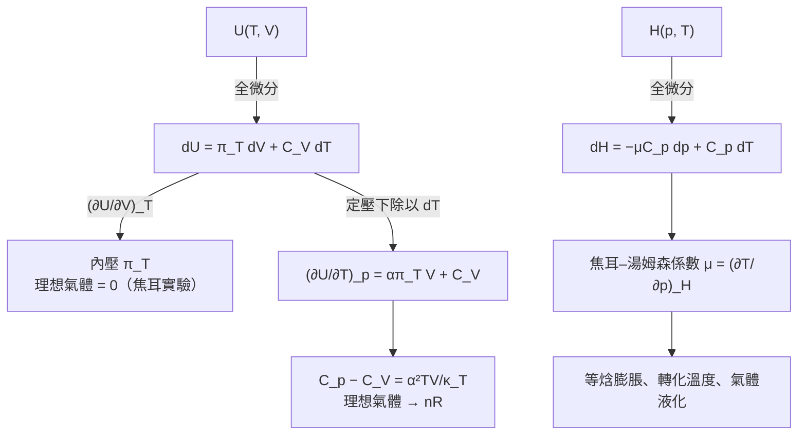

# Focus 2 熱力學第一定律（The First Law）
# 2D 狀態函數與正合微分（State Functions and Exact Differentials）講義

> **範圍**：上課簡報 p.97–143；課本 Atkins' Physical Chemistry Topic 2D（p.58–64），以及章末 Exercises／Problems（p.72–73）、Integrated activities（p.74）
> **標示說明**：
> - 未特別標示的內容以簡報為主
> - **📘 課本補充**：簡報沒有、取自課本的內容
> - **⭐**：必會推導
> - **⚠️**：勘誤或易錯處
> **本節特色**：2D 是 Focus 2 中**推導最多**的一節，核心技巧是「把狀態函數寫成兩個變數的全微分，再用偏微分關係把陌生的量換成能量測的量」。建議先複習 2A 的偏微分工具（三個關係與歐拉連鎖關係）。

---

## 學習重點

1. 能區分**狀態函數**與**路徑函數**，以及**正合微分**與**非正合微分**。
2. 能寫出 $dU = \pi_T\,dV + C_V\,dT$，說明**內壓** $\pi_T$ 的物理意義與正負號。
3. 能說明**焦耳實驗**的推論與限制。
4. 能定義**膨脹係數** $\alpha$ 與**等溫壓縮係數** $\kappa_T$，並算出理想氣體的值。
5. 能**推導** $C_p - C_V = \alpha^2TV/\kappa_T$，並說明它在理想氣體時化為 $nR$。
6. 能**推導** $dH = -\mu C_p\,dp + C_p\,dT$，定義**焦耳–湯姆森係數** $\mu$ 與等溫焦耳–湯姆森係數 $\mu_T$。
7. 能**證明**焦耳–湯姆森膨脹是**等焓過程**，並用分子間作用力解釋冷卻、加熱與**轉化溫度**。

---

## 本節在路線圖中的位置

2D 把 $U$、$H$ 當作**兩個變數的函數**來處理，回答兩個問題：

---

## 狀態函數與路徑函數（簡報 p.97–98）

| | 狀態函數（state function） | 路徑函數（path function） |
|---|---|---|
| 定義 | 只取決於系統**目前的狀態**，與歷史無關 | 取決於兩個狀態之間**所走的路徑** |
| 例子 | 溫度、壓力、體積、內能 $U$、焓 $H$ | 功 $w$、熱 $q$ |
| 能否說系統「擁有」 | 可以：系統擁有某個內能 | **不可以**：系統不「擁有」功或熱 |
| 變化量寫法 | $\Delta U = U_f - U_i$ | 只寫 $w$、$q$，不寫 $\Delta w$、$\Delta q$ |

功或熱所傳遞的能量，與狀態之間**所走的路徑**有關，而不是與狀態本身有關。

📘 熱力學的威力之一，就是利用狀態函數的**數學性質**，推導出物理性質之間意想不到的關係。實用價值在於：**可以把幾個容易量測的性質組合起來，求出一個難以直接量測的性質。**

**📗 簡報 p.98 的補充：狀態性質的分類**

依與系統質量的關係，狀態性質分為：

| 類別 | 說明 | 例子 |
|---|---|---|
| **示量性質（extensive property）**，又稱外延性質 | 與物質的量有關，**具加成性** | 質量、體積、內能 |
| **示強性質（intensive property）**，又稱內含性質 | 與物質的量無關 | 溫度、壓力、比熱、莫耳體積、密度、濃度 |

---

## 2D.1 正合微分與非正合微分（Exact and Inexact Differentials）（簡報 p.99–106）

### 一、兩條路徑的例子（簡報 p.99–100；課本圖 2D.1）

系統由初態 $i$（內能 $U_i$）變到末態 $f$（內能 $U_f$），比較兩條路徑：

| | 路徑 1 | 路徑 2 |
|---|---|---|
| 過程 | **絕熱**膨脹 | **非絕熱**膨脹 |
| 熱 | $q_1 = 0$ | $q_2 \neq 0$（有熱流入） |
| 功 | $w_1$ | $w_2 \neq w_1$ |
| 內能變化 | $\Delta U = U_f - U_i$ | **相同** $\Delta U$ |

📘 注意用語：**$U$ 是狀態的性質；$w$ 是路徑的性質。**

### 二、正合微分（Exact Differential）（簡報 p.101）

系統沿某條路徑由 $i$ 變到 $f$，$U$ 的總變化是路徑上所有無限小變化的積分：

$$
\Delta U = \int_i^f dU \qquad (2D.1)
$$

$\Delta U$ 只由初態與末態決定，**與路徑無關**。這種「積分結果與路徑無關」的性質，稱 $dU$ 為**正合微分（exact differential）**。

> **正合微分**：積分結果與初末狀態之間的路徑**無關**的無限小量。

### 三、非正合微分（Inexact Differential）（簡報 p.102–103）

系統被加熱時，傳遞的總熱量是路徑上每一點貢獻的總和：

$$
q = \int_{i,\,\text{path}}^f dq \qquad (2D.2)
$$

**與式 2D.1 的兩個差別**：

1. 積分結果是 **$q$，不是 $\Delta q$**。$q$ 不是狀態函數，以熱提供的能量不能寫成 $q_f - q_i$。
2. **必須指定積分路徑**。例如絕熱路徑 $q = 0$，同樣兩個狀態之間的非絕熱路徑 $q \neq 0$。

> **非正合微分（inexact differential）**：積分結果**與路徑有關**的無限小量。$dq$ 常寫成 **$đq$**，強調它是非正合的、需要指定路徑。

功也一樣：絕熱與非絕熱路徑的功一般不同，所以 $dw$ 也是非正合微分，常寫成 $đw$。

| | 正合微分 | 非正合微分 |
|---|---|---|
| 例子 | $dU$、$dH$、$dV$、$dT$ | $đq$、$đw$ |
| 積分 | $\int_i^f dU = \Delta U$ | $\int_{i,\,\text{path}}^f đq = q$ |
| 需要指定路徑？ | 否 | **是** |
| 對應的量 | 狀態函數 | 路徑函數 |

> 💡 **第一定律的深刻意義**：$đq$ 與 $đw$ **各自**都與路徑有關，但它們的**和** $dU = đq + đw$ 卻與路徑無關。

#### 📘 延伸：如何用數學判斷正合微分？

設 $df = M(x,y)\,dx + N(x,y)\,dy$。由 2A 的「二階偏微分與順序無關」，若 $df$ 是某個函數 $f$ 的全微分，則 $M = (\partial f/\partial x)_y$、$N = (\partial f/\partial y)_x$，所以

$$
df\ \text{是正合微分} \iff \left(\frac{\partial M}{\partial y}\right)_x = \left(\frac{\partial N}{\partial x}\right)_y
$$

**例：理想氣體的可逆 $đq$ 不是正合微分**

理想氣體可逆變化：$đq = dU - đw = C_V\,dT + p\,dV = C_V\,dT + \dfrac{nRT}{V}\,dV$

$$
\left(\frac{\partial C_V}{\partial V}\right)_T = 0, \qquad \left(\frac{\partial(nRT/V)}{\partial T}\right)_V = \frac{nR}{V} \neq 0
$$

兩者不相等，所以 $đq$ **不是**正合微分 ✓。

> 有趣的是，若把 $đq$ 除以 $T$：$\dfrac{đq}{T} = \dfrac{C_V}{T}dT + \dfrac{nR}{V}dV$，此時兩邊交叉偏微分都是 0，**變成正合微分了**！這個新的狀態函數就是第 3 章的**熵（entropy）**，$dS = đq_\text{rev}/T$。

### 四、📗 簡報 Example 2D.1：兩條路徑的 $w$、$q$、$\Delta U$（簡報 p.104–106）

**題目**：Consider a perfect gas inside a cylinder fitted with a piston. Let the initial state be $T, V_i$ and the final state be $T, V_f$. The change of state can be brought about in many ways, of which the two simplest are the following: Path 1, in which there is free expansion against zero external pressure; Path 2, in which there is reversible, isothermal expansion. Calculate $w$, $q$, and $\Delta U$ for each process.

（汽缸中的理想氣體，由初態 $(T, V_i)$ 變到末態 $(T, V_f)$。路徑 1：對抗零外壓的自由膨脹；路徑 2：可逆等溫膨脹。計算兩個過程的 $w$、$q$、$\Delta U$。）

**解題思路**：熱力學計算的好起點，是**回到基本原理**，找一個比較容易計算的量來表示要求的量。

- 理想氣體的內能只與溫度有關、與體積無關（2A），初末溫度相同，所以**兩條路徑的 $\Delta U = 0$**。
- 再由第一定律 $\Delta U = q + w$ 求 $q$。

**詳解**：兩條路徑都是 $\Delta U = 0$，所以 $q = -w$。

| | 路徑 1：自由膨脹 | 路徑 2：可逆等溫膨脹 |
|---|---|---|
| $\Delta U$ | 0 | 0 |
| $w$ | **0**（$p_\text{ex} = 0$，式 2A.7） | **$-nRT\ln(V_f/V_i)$**（式 2A.9） |
| $q$ | **0** | **$+nRT\ln(V_f/V_i)$** |

**📘 自我測驗（Self-test 2D.1）**：理想氣體對抗**不為零的定外壓**做不可逆等溫膨脹，求 $q$、$w$、$\Delta U$。

> $\Delta U = 0$（等溫、理想氣體）；$w = -p_\text{ex}\Delta V$；$q = -w = +p_\text{ex}\Delta V$

---

## 2D.2 內能的變化（Changes in Internal Energy）（簡報 p.107–129）

📘 本節以下都考慮**組成固定的封閉系統**（closed system of constant composition），即每種化學物質的量都不變。

### 一、⭐ 一般考量（General Considerations）（簡報 p.107–111）

**為什麼只需要兩個變數？** $U$ 可以看成 $V$、$T$、$p$ 的函數。但因為有**狀態方程式**把三者聯繫起來，只要指定其中兩個，第三個就決定了。所以 $U$ 可以只用兩個獨立變數表示：$(V, T)$、$(p, T)$ 或 $(p, V)$。📘 選 $V$ 與 $T$ 得到的式子最簡單。

**Step 1：寫出全微分**

$U$ 是 $V$ 與 $T$ 的函數，兩者各改變無限小量時（2A 的偏微分工具）：

$$
\boxed{\,dU = \left(\frac{\partial U}{\partial T}\right)_V dT + \left(\frac{\partial U}{\partial V}\right)_T dV\,} \qquad \text{$U$ 隨 $T$、$V$ 變化的一般式 (2D.3)}
$$

簡報圖（課本圖 2D.2）：$U$ 是 $(V, T)$ 平面上的曲面，$dU$ 是同時改變 $dV$ 與 $dT$ 時曲面高度的變化。

**Step 2：辨認第一個係數**（簡報 p.109–110 的推導）

由第一定律 $dU = đq + đw$，且 $đw = -p_\text{ex}\,dV$（只有膨脹功）：

$$
đq - p_\text{ex}\,dV = \left(\frac{\partial U}{\partial T}\right)_V dT + \left(\frac{\partial U}{\partial V}\right)_T dV
$$

令**定容** $dV = 0$：

$$
đq = \left(\frac{\partial U}{\partial T}\right)_V dT \;\Rightarrow\; \frac{đq_V}{dT} = \left(\frac{\partial U}{\partial T}\right)_V = C_V
$$

所以第一個係數就是 2A 的**定容熱容量**。

> ⚠️ 簡報 p.109–111 把左邊寫成「$dq + p\,dV$」，應為 **$đq - p_\text{ex}\,dV$**（因為 $đw = -p_\text{ex}\,dV$）。這裡令 $dV = 0$，所以不影響結論。

**Step 3：定義第二個係數：內壓（Internal Pressure）**

$$
\boxed{\,\pi_T = \left(\frac{\partial U}{\partial V}\right)_T\,} \qquad \text{內壓（定義）(2D.4)}
$$

$\pi_T$ 是**定溫下內能隨體積的變化率**（課本圖 2D.3：$U$–$V$–$T$ 曲面上，沿 $V$ 方向的斜率）。

**單位**：J m⁻³ = (N m) m⁻³ = N m⁻² = Pa，與壓力**相同**，但它來自樣品內部分子之間的交互作用，所以稱為「內壓」。

**Step 4：合併**

$$
\boxed{\,dU = \pi_T\,dV + C_V\,dT\,} \qquad (2D.5)
$$

### 二、內壓的物理意義（簡報 p.112–114；課本圖 2D.4）

| 情況 | $\pi_T$ | 定溫下體積增加時 | 原因 |
|---|---|---|---|
| **理想氣體** | **$= 0$** | $U$ 不變 | 分子間沒有交互作用，內能與分子間距無關 |
| **吸引力主導** | **$> 0$** | $U$ **增加** | 分子平均距離變大，有利的吸引作用減弱，位能升高 |
| **排斥力主導** | **$< 0$** | $U$ **減少** | 排斥作用減弱，位能降低 |

> 與 1C 對照：吸引力主導時 $Z < 1$、$\pi_T > 0$；排斥力主導時 $Z > 1$、$\pi_T < 0$。
>
> 💡 **凡得瓦氣體**的內壓為 $\pi_T = a/V_\text{m}^2$（見習題 9 的推導），只與吸引項 $a$ 有關，恆為正。

### 三、焦耳實驗（Joule's Experiment）（簡報 p.112–118）

**構想**：焦耳（James Joule）認為，觀察氣體**向真空膨脹**時的溫度變化，就能量出 $\pi_T$。

**裝置**（課本圖 2D.5）：兩個金屬容器浸在水浴中，一個裝約 **22 atm** 的空氣，另一個抽成真空。打開活栓讓空氣膨脹到真空中，量水浴的溫度變化。

**結果**：**沒有觀察到溫度變化。**

**⭐ 熱力學推論**：

1. 向真空膨脹是**自由膨脹**，$p_\text{ex} = 0$，所以 **$w = 0$**。
2. 水浴溫度沒變，表示沒有熱進出系統（氣體），**$q = 0$**。
3. 所以在實驗精確度內 **$\Delta U = 0$**。

代入式 2D.5（簡報 p.114）：溫度不變 $dT = 0$、$\Delta U = 0$，但 $dV \neq 0$：

$$
0 = \pi_T\,dV + C_V(0) \;\Rightarrow\; \pi_T = \left(\frac{\partial U}{\partial V}\right)_T = 0
$$

焦耳因此得出結論：**氣體等溫膨脹時 $U$ 不變，$\pi_T = 0$。**

**⚠️ 實驗的限制**：焦耳的實驗很粗糙。裝置（金屬容器加水浴）的**熱容量太大**，真實氣體其實會產生的微小溫度變化**根本量不出來**。

> 📘 課本的評語：焦耳**抓到了氣體的一個重要極限性質，也就是理想氣體的性質**，但沒有偵測到真實氣體特有的微小偏差。

#### 📗 簡報例題：焦耳實驗的靈敏度（簡報 p.117–118）

**題目**：In Joule's experiment to determine $(\partial U/\partial V)_T$, the heat capacities of the gas and the water bath surroundings were related by $C_\text{surroundings}/C_\text{system} \approx 1000$. If the precision with which the temperature of the surroundings could be measured is 0.006 °C, what is the minimum detectable change in the temperature of the gas?

（焦耳實驗中，水浴（外界）與氣體（系統）的熱容量比約為 1000。若外界溫度的量測精確度為 0.006 °C，氣體最小要有多大的溫度變化才偵測得到？）

**詳解**：

把裝置看成放在剛性絕熱外殼中的兩個交互作用系統：容器 A、B 內的氣體，以及水浴加容器。這兩者合起來與宇宙其他部分隔絕，所以總熱量為零：

$$
q = C_\text{bath}\Delta T_\text{bath} + C_\text{gas}\Delta T_\text{gas} = 0
$$

$$
\Delta T_\text{gas} = -\frac{C_\text{bath}}{C_\text{gas}}\Delta T_\text{bath} = -1000\times(\pm0.006\ ^\circ\text{C})
$$

$$
|\Delta T_\text{gas}| = \boxed{6\ ^\circ\text{C}}
$$

> **意義**：氣體的溫度必須變化**至少 6 °C**，水浴才會有 0.006 °C 的可偵測變化。真實空氣自由膨脹的溫度變化遠小於此，所以焦耳看不到。
> 這裡的 $\Delta T_\text{gas}$ 是膨脹後的氣體與水浴達到熱平衡時的溫度變化，等於膨脹過程中溫度變化的**負值**。

### 四、定壓下的內能變化（Changes in Internal Energy at Constant Pressure）（簡報 p.119–129）

#### 1. ⭐ 推導 $(\partial U/\partial T)_p$

**問題**：$C_V$ 告訴我們**定容**下 $U$ 隨 $T$ 的變化。那**定壓**下呢？

**Step 1**：式 2D.5 兩邊除以 $dT$：

$$
\frac{dU}{dT} = \pi_T\frac{dV}{dT} + C_V
$$

**Step 2**：加上**定壓**的條件，$dU/dT$、$dV/dT$ 都變成定壓下的偏微分：

$$
\left(\frac{\partial U}{\partial T}\right)_p = \pi_T\left(\frac{\partial V}{\partial T}\right)_p + C_V
$$

**Step 3**：右邊的 $(\partial V/\partial T)_p$ 是**定壓下體積對溫度作圖的斜率**，可以由一個可量測的性質表示。

> 📘 熱力學推導的訣竅：**每推一步，都要看看式子裡有沒有可以辨認、可以量測的物理量。**

#### 2. 膨脹係數與等溫壓縮係數

**膨脹係數（expansion coefficient）**：

$$
\boxed{\,\alpha = \frac{1}{V}\left(\frac{\partial V}{\partial T}\right)_p\,} \qquad \text{膨脹係數（定義）(2D.6)}
$$

物理意義：**溫度上升時，體積變化的比例**。$\alpha$ 大表示樣品的體積對溫度變化反應強烈。

**等溫壓縮係數（isothermal compressibility）**（$\kappa$ 讀作 kappa）：

$$
\boxed{\,\kappa_T = -\frac{1}{V}\left(\frac{\partial V}{\partial p}\right)_T\,} \qquad \text{等溫壓縮係數（定義）(2D.7)}
$$

物理意義：**壓力增加時，體積變化的比例**。

> ⚠️ **為什麼有負號？** 壓力增加（$dp > 0$）會使體積**減少**（$dV < 0$），所以 $(\partial V/\partial p)_T < 0$。加上負號後 $\kappa_T$ 才是**正值**。

**📘 表 2D.1 298 K 的膨脹係數與等溫壓縮係數**

| 物質 | $\alpha/(10^{-4}\ \text{K}^{-1})$ | $\kappa_T/(10^{-6}\ \text{bar}^{-1})$ |
|---|---|---|
| **液體**：苯（benzene） | 12.4 | 92.1 |
| 水 | 2.1 | 49.6 |
| **固體**：鑽石（diamond） | 0.030 | 0.187 |
| 鉛（lead） | 0.861 | 2.21 |

#### 📗 簡報 Example 2D.2：理想氣體的膨脹係數（簡報 p.121）

**題目**：Derive an expression for the expansion coefficient of a perfect gas.（推導理想氣體的膨脹係數。）

**解題思路**：把狀態方程式中 $V$ 用 $T$ 表示，代入式 2D.6。下標 $p$ 表示 $p$ 視為常數。

**詳解**：$pV = nRT \Rightarrow V = nRT/p$

$$
\alpha = \frac{1}{V}\left(\frac{\partial(nRT/p)}{\partial T}\right)_p = \frac{1}{V}\times\frac{nR}{p} = \frac{nR}{pV} = \frac{nR}{nRT} = \boxed{\frac{1}{T}}
$$

**物理意義**：溫度越高，理想氣體的體積對溫度變化的反應越**不**敏感。

**📘 自我測驗（Self-test 2D.2）**：推導理想氣體的等溫壓縮係數。

$$
\kappa_T = -\frac{1}{V}\left(\frac{\partial(nRT/p)}{\partial p}\right)_T = -\frac{1}{V}\left(-\frac{nRT}{p^2}\right) = \frac{nRT}{p^2V} = \boxed{\frac{1}{p}}
$$

壓力越高，理想氣體越難再壓縮。

#### 3. ⭐ 定壓下的內能與溫度

把 $\alpha$ 的定義代入 $(\partial U/\partial T)_p$ 的式子（$(\partial V/\partial T)_p = \alpha V$）：

$$
\boxed{\,\left(\frac{\partial U}{\partial T}\right)_p = \alpha\pi_TV + C_V\,} \qquad (2D.8)
$$

📘 此式**完全一般**（只要系統封閉、組成固定）。它把定壓下 $U$ 隨 $T$ 的變化，用三個量表示：$C_V$（一個實驗可量）、$\alpha$（另一個實驗可量）、$\pi_T$。

**理想氣體** $\pi_T = 0$：

$$
\boxed{\,\left(\frac{\partial U}{\partial T}\right)_p = C_V\,} \qquad \text{（理想氣體）(2D.9)}
$$

> **意義**：$C_V$ 的**定義**是定容下 $U$ 對 $T$ 的斜率；但對理想氣體，$C_V$ **也**是定壓下 $U$ 對 $T$ 的斜率。這就是 2B 推導 $C_p - C_V = nR$ 時「關鍵步驟」的嚴格依據。

#### 4. ⭐ 理想氣體 $C_p - C_V = nR$（簡報 p.122）

$$
C_p - C_V = \left(\frac{\partial H}{\partial T}\right)_p - \left(\frac{\partial U}{\partial T}\right)_V \overset{\text{2D.9}}{=} \left(\frac{\partial H}{\partial T}\right)_p - \left(\frac{\partial U}{\partial T}\right)_p
$$

代入 $H = U + pV = U + nRT$：

$$
C_p - C_V = \left(\frac{\partial U}{\partial T}\right)_p + nR - \left(\frac{\partial U}{\partial T}\right)_p = \boxed{nR} \qquad (2D.10)
$$

#### 5. ⭐⭐ 任何物質的 $C_p - C_V$（簡報 p.123–129）

這是本節**最長**的推導，分 4 步。

**Step 1：展開**

$$
C_p - C_V = \left(\frac{\partial H}{\partial T}\right)_p - \left(\frac{\partial U}{\partial T}\right)_V = \left(\frac{\partial U}{\partial T}\right)_p + \left(\frac{\partial(pV)}{\partial T}\right)_p - \left(\frac{\partial U}{\partial T}\right)_V
$$

（用 $H = U + pV$）

代入式 2D.8 與 $C_V = (\partial U/\partial T)_V$：

$$
= (\alpha\pi_TV + C_V) + \left(\frac{\partial(pV)}{\partial T}\right)_p - C_V
$$

定壓下 $p$ 為常數：

$$
\left(\frac{\partial(pV)}{\partial T}\right)_p = p\left(\frac{\partial V}{\partial T}\right)_p = p\alpha V
$$

所以

$$
C_p - C_V = \alpha(p + \pi_T)V
$$

**物理意義**（簡報 p.124–126）：

| 項 | 意義 |
|---|---|
| $\alpha pV$ | 推開大氣所需的功：$(\partial V/\partial T)_p$ 是溫度改變造成的體積變化，乘以 $p$ 變成功 |
| $\alpha\pi_TV$ | **把組成系統的分子拉開所需的功**（克服分子間吸引力） |

**Step 2：代入熱力學狀態方程式**

第 3 章（Topic 3D）會證明（簡報 p.126 先借用）：

$$
\pi_T = T\left(\frac{\partial p}{\partial T}\right)_V - p \qquad \text{（熱力學狀態方程式，thermodynamic equation of state）}
$$

代入後 $p$ 消去：

$$
C_p - C_V = \alpha\left[p + T\left(\frac{\partial p}{\partial T}\right)_V - p\right]V = \alpha TV\left(\frac{\partial p}{\partial T}\right)_V
$$

**Step 3：把 $(\partial p/\partial T)_V$ 換成 $\alpha$ 與 $\kappa_T$**（簡報 p.127–128）

把 $V$ 看成 $p$、$T$ 的函數：

$$
dV = \left(\frac{\partial V}{\partial T}\right)_p dT + \left(\frac{\partial V}{\partial p}\right)_T dp
$$

要求**定容** $dV = 0$：

$$
\left(\frac{\partial V}{\partial T}\right)_p dT = -\left(\frac{\partial V}{\partial p}\right)_T dp \qquad (\text{定容})
$$

兩邊除以 $dT$（定容）：

$$
\left(\frac{\partial V}{\partial T}\right)_p = -\left(\frac{\partial V}{\partial p}\right)_T\left(\frac{\partial p}{\partial T}\right)_V
$$

$$
\left(\frac{\partial p}{\partial T}\right)_V = -\frac{(\partial V/\partial T)_p}{(\partial V/\partial p)_T} = -\frac{\alpha V}{-\kappa_TV} = \boxed{\frac{\alpha}{\kappa_T}}
$$

> 💡 這其實就是 2A 的**歐拉連鎖關係**（$x, y, z \to V, T, p$）的應用。

**Step 4：代回**

$$
\boxed{\,C_p - C_V = \frac{\alpha^2TV}{\kappa_T}\,} \qquad (2D.11)
$$

📘 式 2D.11 對**任何物質**都成立（「普遍成立」，universally true），證明需要第二定律。

**檢查：理想氣體**（$\alpha = 1/T$、$\kappa_T = 1/p$）

$$
C_p - C_V = \frac{(1/T)^2\cdot T\cdot V}{1/p} = \frac{pV}{T} = nR \quad ✓
$$

> 📘 **凝相的 $C_p$ 與 $C_V$ 一定相近嗎？** 液體、固體的 $\alpha$ 很小，看起來 $C_p \approx C_V$。但 $\kappa_T$ **也可能很小**，所以 $\alpha^2/\kappa_T$ 可能很大。換句話說，雖然推開大氣只需要很少的功，但固體膨脹時要把原子彼此拉開，可能需要**很多**功。
>
> 📘 由式 2D.11 還可以看出：$\kappa_T > 0$、$\alpha^2 \geq 0$，所以 **$C_p \geq C_V$ 對所有物質都成立**；只有 $\alpha = 0$ 時兩者相等，例如 4 °C 的水（密度最大）。

#### 📘 課本 Brief illustration 2D.1：水的 $C_{p,\text{m}} - C_{V,\text{m}}$

25 °C 的水：$\alpha = 2.1\times10^{-4}$ K⁻¹、$\kappa_T = 4.90\times10^{-10}$ Pa⁻¹、$V_\text{m} = M/\rho = 18.1$ cm³ mol⁻¹。用 $V_\text{m}$ 代替 $V$：

$$
C_{p,\text{m}} - C_{V,\text{m}} = \frac{(2.1\times10^{-4}\ \text{K}^{-1})^2(298\ \text{K})(1.81\times10^{-5}\ \text{m}^3\,\text{mol}^{-1})}{4.90\times10^{-10}\ \text{Pa}^{-1}} = 0.485\ \text{J K}^{-1}\,\text{mol}^{-1}
$$

水的 $C_{p,\text{m}} = 75.3$ J K⁻¹ mol⁻¹，所以 $C_{V,\text{m}} = 74.8$ J K⁻¹ mol⁻¹，兩者只差 0.6%。但**有些物質兩者可差到 30%**（見習題 5 的苯）。

---

## 2D.3 焓的變化（Changes in Enthalpy）（簡報 p.130–131）

$H = U + pV$，而 $U$、$p$、$V$ 都是狀態函數，所以 $H$ 也是狀態函數，**$dH$ 是正合微分**。

因為 $\Delta H = q_p$（2B），$H$ 在**壓力可控制**時特別有用，所以把 $H$ 看成 **$p$ 與 $T$ 的函數**。

### ⭐ 推導：$H$ 隨 $p$、$T$ 的變化

**Step 1：寫出全微分**

$$
dH = \left(\frac{\partial H}{\partial p}\right)_T dp + \underbrace{\left(\frac{\partial H}{\partial T}\right)_p}_{C_p} dT = \left(\frac{\partial H}{\partial p}\right)_T dp + C_p\,dT
$$

**Step 2：把 $(\partial H/\partial p)_T$ 換成可辨認的量**

令焓不變（$dH = 0$）：

$$
\left(\frac{\partial H}{\partial p}\right)_T dp = -C_p\,dT \qquad (\text{定焓})
$$

兩邊除以 $dp$，並把「定焓」寫進偏微分的下標：

$$
\left(\frac{\partial H}{\partial p}\right)_T = -C_p\left(\frac{\partial T}{\partial p}\right)_H
$$

**Step 3：定義焦耳–湯姆森係數**

$$
\boxed{\,\mu = \left(\frac{\partial T}{\partial p}\right)_H\,} \qquad \text{焦耳–湯姆森係數（Joule–Thomson coefficient，定義）(2D.12)}
$$

所以

$$
\left(\frac{\partial H}{\partial p}\right)_T = -C_p\mu
$$

**Step 4：代回**

$$
\boxed{\,dH = -\mu C_p\,dp + C_p\,dT\,} \qquad \text{焓隨溫度與壓力的變化 (2D.13)}
$$

> 💡 **與 $dU$ 的對照**：
>
> | | 內能 $U(V, T)$ | 焓 $H(p, T)$ |
> |---|---|---|
> | 全微分 | $dU = \pi_T\,dV + C_V\,dT$ | $dH = -\mu C_p\,dp + C_p\,dT$ |
> | 溫度係數 | $C_V$ | $C_p$ |
> | 另一個係數 | $\pi_T = (\partial U/\partial V)_T$ | $-\mu C_p = (\partial H/\partial p)_T$ |
> | 理想氣體 | $\pi_T = 0$ | $\mu = 0$ |

---

## 2D.4 焦耳–湯姆森效應（The Joule–Thomson Effect）（簡報 p.132–143）

### 一、什麼是焦耳–湯姆森效應？（簡報 p.132–133）

簡報 p.132 的說明：一種靠氣體壓縮或膨脹產生**冷卻或升溫**的現象。在**絕熱**條件下，高壓氣體通過小孔或**多孔塞（porous plug／porous plate）**而降壓。在一定條件下，氣體溫度會下降。

📘 **焦耳–湯姆森係數的分析，是氣體液化技術的核心。**

要量 $\mu$，必須量測**定焓**過程中溫度變化與壓力變化的比值 $\Delta T/\Delta p$，也就是讓膨脹成為**等焓（isenthalpic）**過程。

焦耳與威廉·湯姆森（William Thomson，即後來的**克耳文勳爵 Lord Kelvin**）想出的方法：讓氣體穿過多孔障壁，**從一個定壓膨脹到另一個定壓**，並監測膨脹造成的溫度差（課本圖 2D.6）。整個裝置是**絕熱**的。

> **焦耳–湯姆森效應**：氣體**等焓膨脹**時發生的溫度變化。

> ⚠️ **不要和焦耳實驗混淆**（簡報 p.132 把兩者放在同一頁）：
>
> | | 焦耳實驗（2D.2） | 焦耳–湯姆森實驗（2D.4） |
> |---|---|---|
> | 過程 | 向**真空**自由膨脹 | 穿過多孔塞，由**高壓定壓**膨脹到**低壓定壓** |
> | 外壓 | $p_\text{ex} = 0$ | 上游 $p_i$、下游 $p_f$，都不為零 |
> | 守恆的量 | $U$（$q = 0$、$w = 0$） | **$H$**（$q = 0$，但 $w \neq 0$） |
> | 量測的係數 | $\pi_T = (\partial U/\partial V)_T$ | $\mu = (\partial T/\partial p)_H$ |
> | 靈敏度 | 很差（水浴熱容量太大） | 好（連續流動、穩態量測） |

### 二、⭐ 證明：焦耳–湯姆森膨脹是等焓過程（簡報 p.136–139）

**設定**：考慮一定量的氣體，由高壓側（壓力 $p_i$、溫度 $T_i$、體積 $V_i$）通過**節流閥（throttle）**到低壓側（$p_f$、$T_f$、$V_f$）。上游與下游的氣體分別像活塞一樣，以固定壓力推動或阻擋這團氣體。

**Step 1：絕熱 → $\Delta U = w$**

整個裝置絕熱，$q = 0$，所以 $\Delta U = w$。

**Step 2：上游的功**

上游氣體以固定壓力 $p_i$ 把這團氣體推過障壁，它在上游的體積由 $V_i$ 變為 0。對氣體作的功：

$$
w_1 = -p_i(0 - V_i) = +p_iV_i
$$

（外界對氣體作功，所以為正。）

**Step 3：下游的功**

氣體在下游推開下游的氣體，對抗固定壓力 $p_f$，體積由 0 變為 $V_f$：

$$
w_2 = -p_f(V_f - 0) = -p_fV_f
$$

**Step 4：總功與內能變化**

$$
w = w_1 + w_2 = p_iV_i - p_fV_f
$$

$$
U_f - U_i = w = p_iV_i - p_fV_f
$$

**Step 5：整理**

$$
U_f + p_fV_f = U_i + p_iV_i \quad\Longrightarrow\quad \boxed{\,H_f = H_i\,}
$$

**所以膨脹過程中焓不變。** 這就是**等焓膨脹**。

> ⚠️ **易錯**：簡報 p.134 寫「膨脹過程中流體不會與外界交換任何能量」，這句話**不正確**。過程中 $q = 0$，但**有功的交換**（$w = p_iV_i - p_fV_f \neq 0$），所以 $U$ 會改變；守恆的是 $H$，不是 $U$。

### 三、量測焦耳–湯姆森係數（簡報 p.135、p.140–141）

#### 1. 傳統方法

量 $\Delta T/\Delta p$，取 $\Delta p \to 0$ 的極限。

#### 2. 現代方法：等溫焦耳–湯姆森係數

現代量測 $\mu$ 的方法是**間接的**：先量**等溫焦耳–湯姆森係數（isothermal Joule–Thomson coefficient）**：

$$
\boxed{\,\mu_T = \left(\frac{\partial H}{\partial p}\right)_T\,}
$$

由 2D.3 的結果 $(\partial H/\partial p)_T = -C_p\mu$：

$$
\boxed{\,\mu_T = -C_p\mu\,}
$$

**做法**（簡報 p.135 的圖）：

- 用穩定壓力把氣體**連續**泵過熱交換器，維持穩態。
- 量測通過多孔塞時的**陡峭壓降** $\Delta p$。
- 在塞子後方緊接一個**電熱器**，恰好抵銷冷卻效應，使溫度不變（等溫）。
- 監測電熱器提供的能量。因為 $\Delta H = q_p$，這就是 $\Delta H$。
- 由 $\Delta p \to 0$ 時 $\Delta H/\Delta p$ 的極限值求 $\mu_T$，再換算成 $\mu$。

> 簡報 p.140 的圖：$\mu_T$ 是 $H$–$p$–$T$ 曲面上，**固定 $T$ 沿 $p$ 方向**的斜率。
>
> ⚠️ 簡報 p.140 的文字寫「isothermal Joule–Thomson coefficient, the quantity $\mu = (\partial T/\partial p)_H$」，**把兩個係數搞混了**。等溫焦耳–湯姆森係數是 **$\mu_T = (\partial H/\partial p)_T$**（同頁的圖是對的）；$\mu = (\partial T/\partial p)_H$ 是焦耳–湯姆森係數本身。

#### 📘 課本 Brief illustration 2D.2：氮氣的焦耳–湯姆森冷卻

氮氣在 298 K、1 bar 的 $\mu = +0.27$ K bar⁻¹（📘 $\mu$ 是示強性質）。等焓條件下壓力改變 $\Delta p = -10$ bar 時：

$$
\Delta T \approx \mu\Delta p = (+0.27\ \text{K bar}^{-1})(-10\ \text{bar}) = \boxed{-2.7\ \text{K}}
$$

### 四、焦耳–湯姆森係數的正負與轉化溫度（簡報 p.142–143）

#### 1. 理想氣體 vs 真實氣體

- **理想氣體 $\mu = 0$**，焦耳–湯姆森膨脹時溫度不變。這清楚顯示**分子間作用力**決定了這個效應的大小。
  > 理由：理想氣體 $H = U + nRT$ 只與 $T$ 有關，定焓就是定溫。
- **真實氣體 $\mu \neq 0$**。正負號取決於**氣體種類、壓力、溫度，以及吸引力與排斥力的相對大小**。

| $\mu$ | 膨脹時（$dp < 0$） | 名稱 |
|---|---|---|
| $\mu > 0$ | $dT < 0$，**冷卻** | 冷卻區 |
| $\mu < 0$ | $dT > 0$，**加熱** | 加熱區 |

📘 **即使壓力降低到狀態方程式接近理想氣體，$\mu$ 也不一定趨近於零。** 這與 1C 討論的性質（如 $Z$ 的斜率）類似：$\mu$ 取決於**導數**，而不是 $p$、$V$、$T$ 本身。

#### 2. 等焓線與轉化溫度（簡報 p.142 左圖，課本圖 2D.8）

- 圖中的藍色曲線是**等焓線（isenthalps）**，即焓固定的曲線。在絕熱條件下降低壓力，系統沿著某條等焓線移動。
- 等焓線斜率 $(\partial T/\partial p)_H = \mu$：
  - 邊界內（淺色區）：斜率為正，$\mu > 0$，膨脹冷卻
  - 邊界外（粉紅區）：斜率為負，$\mu < 0$，膨脹加熱
- **轉化溫度曲線（inversion temperature curve）**通過各等焓線**斜率由負變正**的點（等焓線的極大值）。給定壓力下，邊界對應的溫度就是該壓力下的**轉化溫度（inversion temperature）**。

**簡報 p.142 右圖**（中文圖）：上游狀態 1 $(p_1, T_1)$ 固定，改變下游壓力得到一系列下游狀態 2 $(p_2, T_2)$。這些點都與狀態 1 等焓，連起來就是一條等焓線。

#### 3. 上、下轉化溫度（簡報 p.143，課本圖 2D.9）

氣體通常有**兩個轉化溫度**：

- 溫度低於**上轉化溫度（upper inversion temperature）** $T_I$ 時，在某一溫度會加熱（$\mu < 0$）的氣體會變成**冷卻**（$\mu > 0$）。
- 溫度再低於**下轉化溫度（lower inversion temperature）**，又回到加熱。
- 例：圖中氮氣在約 200 atm 時，上轉化溫度約 440 K、下轉化溫度約 190 K。

**📘 表 2D.2 轉化溫度、正常熔點、正常沸點與焦耳–湯姆森係數**（1 bar、298 K）

| 氣體 | $T_I$/K | $T_\text{f}$/K | $T_\text{b}$/K | $\mu$/(K bar⁻¹) |
|---|---|---|---|---|
| Ar | 723 | 83.8 | 87.3 | — |
| CO₂ | 1500 | 194.7（昇華） | — | +1.11（300 K） |
| He | 40 | — | 4.22 | **−0.062** |
| N₂ | 621 | 63.3 | 77.4 | +0.27 |

> **判讀**：
> - He 的上轉化溫度只有 40 K，室溫下 $\mu < 0$，**節流膨脹會變熱**。所以液化 He 必須先用其他方法（例如液態氫）預冷到 40 K 以下。
> - H₂ 的上轉化溫度約 200 K（圖 2D.9），也要先預冷。
> - N₂、空氣、CO₂ 在室溫就低於轉化溫度，可直接用焦耳–湯姆森效應冷卻。

#### 4. 應用：林德冷凍機（Linde Refrigerator）（📘 課本圖 2D.7）

- 高壓氣體經**節流閥（throttle）**膨脹而冷卻。
- 冷卻後的氣體經**熱交換器（heat exchanger）**回流，冷卻正要進來的高壓氣體；這些氣體膨脹後又冷得更多。
- 如此循環，最後氣體冷到**凝結成液體**，從節流閥滴下。
- 前提：氣體必須**低於轉化溫度**。

### 五、📘 焦耳–湯姆森效應的分子解釋

**類比：往上拋的球**

球往上升時，地球引力使它減速，**動能轉換成位能**。

**氣體分子也一樣**（1C：真實氣體分子互相吸引）：

1. 由動力論與能量均分定理，分子的平均動能正比於溫度，所以**讓分子變慢就等於讓氣體降溫**。
2. 讓氣體膨脹，分子之間的平均距離變大。
3. 分子要**對抗鄰近分子的吸引力**才能彼此遠離，一部分**動能轉換成位能**，分子變慢，溫度下降。
4. 膨脹時**不能讓外界的熱進來**，所以要在絕熱下進行。

| 條件 | 主導作用 | $Z$（1C） | $\mu$ | 膨脹時 |
|---|---|---|---|---|
| 吸引力主導 | 分子要「爬坡」才能分開 | $Z < 1$ | $\mu > 0$ | **冷卻** |
| 排斥力主導 | 分子分開時位能下降、動能增加 | $Z > 1$ | $\mu < 0$ | **加熱** |

> 💡 若分子減速到鄰近分子能以吸引力「抓住」它們，冷卻的氣體就會**凝結成液體**。這就是氣體液化的原理。

---

## 精選章末習題（含詳解）

> **選題標準**：以推導為主，並搭配實際數值。共 11 題，由基礎到進階排列。數值均已用程式驗算。
> **常數**：$R = 8.3145$ J K⁻¹ mol⁻¹ ＝ 0.082 057 dm³ atm K⁻¹ mol⁻¹；1 dm³ atm = 101.325 J
> **凡得瓦係數**（課本表 1C.3）：Ar $a = 1.337$、$b = 0.0320$；N₂ $a = 1.352$、$b = 0.0387$（$a$ 單位 dm⁶ atm mol⁻²，$b$ 單位 dm³ mol⁻¹）

---

### 習題 1｜E2D.1 水蒸氣的內壓（基礎）

**題目**：Estimate the internal pressure of water vapour at 1.00 bar and 400 K, treating it as a van der Waals gas, for which $\pi_T = a/V_\text{m}^2$. You may simplify the problem by assuming that the molar volume can be predicted from the perfect gas equation; take the value of $a$ to be 5.464 dm⁶ atm mol⁻².

（把水蒸氣視為凡得瓦氣體，$\pi_T = a/V_\text{m}^2$，估計 1.00 bar、400 K 時的內壓。莫耳體積可用理想氣體方程式近似，$a = 5.464$ dm⁶ atm mol⁻²。）

**詳解**：

$$
V_\text{m} \approx \frac{RT}{p} = \frac{(0.083\,145\ \text{dm}^3\,\text{bar K}^{-1}\text{mol}^{-1})(400\ \text{K})}{1.00\ \text{bar}} = 33.26\ \text{dm}^3\,\text{mol}^{-1}
$$

$$
\pi_T = \frac{a}{V_\text{m}^2} = \frac{5.464\ \text{dm}^6\,\text{atm mol}^{-2}}{(33.26\ \text{dm}^3\,\text{mol}^{-1})^2} = 4.94\times10^{-3}\ \text{atm} = \boxed{501\ \text{Pa}}
$$

> **觀念**：內壓只有外壓（1 bar = 10⁵ Pa）的 0.5%，表示此條件下水蒸氣接近理想氣體。$\pi_T > 0$ 反映水分子間的吸引力（氫鍵）。

---

### 習題 2｜E2D.5 凡得瓦氣體等溫膨脹的 $\Delta U$、$q$、$w$

**題目**：For a van der Waals gas, $\pi_T = a/V_\text{m}^2$. Assuming that this relation applies, calculate $\Delta U_\text{m}$ for the isothermal expansion of argon gas from an initial volume of 1.00 dm³ to 30.00 dm³ at 298 K. What are the values of $q$ and $w$?

（凡得瓦氣體 $\pi_T = a/V_\text{m}^2$。計算氬氣在 298 K 由 1.00 dm³ 等溫膨脹到 30.00 dm³ 的 $\Delta U_\text{m}$，以及 $q$、$w$。假設 1 mol、可逆膨脹。）

**解題思路**：
1. 等溫 $dT = 0$，由式 2D.5：$dU = \pi_T\,dV$，積分即得 $\Delta U$。
2. $w$ 需要指定路徑。題目沒說，取**可逆**（課本解答的做法），用 2A 習題 8 的凡得瓦等溫可逆功。
3. $q = \Delta U - w$。

**詳解**：

**Step 1：$\Delta U_\text{m}$**

$$
\Delta U_\text{m} = \int_{V_i}^{V_f}\pi_T\,dV_\text{m} = \int_{V_i}^{V_f}\frac{a}{V_\text{m}^2}\,dV_\text{m} = a\left(\frac{1}{V_i} - \frac{1}{V_f}\right)
$$

$$
= (1.337\ \text{dm}^6\,\text{atm mol}^{-2})\left(\frac{1}{1.00} - \frac{1}{30.00}\right)\text{dm}^{-3} = 1.292\ \text{dm}^3\,\text{atm mol}^{-1} = \boxed{+131\ \text{J mol}^{-1}}
$$

**Step 2：$w$（可逆）**

$$
w = -RT\ln\frac{V_f - b}{V_i - b} + a\left(\frac{1}{V_i} - \frac{1}{V_f}\right)
$$

$$
= -(8.3145)(298)\ln\frac{30.00 - 0.0320}{1.00 - 0.0320}\ \text{J} + 131\ \text{J} = -8505 + 131 = \boxed{-8.37\ \text{kJ}}
$$

**Step 3：$q$**

$$
q = \Delta U - w = 131 - (-8374)\ \text{J} = \boxed{+8.51\ \text{kJ}}
$$

> **觀念**：
> - $\Delta U > 0$：Ar 分子間以吸引力為主，膨脹時分子被拉開，**位能上升**。理想氣體則 $\Delta U = 0$。
> - 有趣的結果：$q = RT\ln\dfrac{V_f - b}{V_i - b}$，**$a$ 完全消失了**。吸引力使內能增加 $a(1/V_i - 1/V_f)$，同時也使作的功減少同樣的量，兩者在 $q$ 中抵消。

---

### 習題 3｜E2D.6 由 $V(T)$ 求膨脹係數

**題目**：The volume of a certain liquid varies with temperature as $V = V'\{0.75 + 3.9\times10^{-4}(T/\text{K}) + 1.48\times10^{-6}(T/\text{K})^2\}$, where $V'$ is its volume at 300 K. Calculate its expansion coefficient, $\alpha$, at 320 K.

（某液體的體積隨溫度的變化如上，$V'$ 是 300 K 時的體積。計算 320 K 時的膨脹係數。）

**詳解**：

$$
\alpha = \frac{1}{V}\left(\frac{\partial V}{\partial T}\right)_p = \frac{V'\{3.9\times10^{-4} + 2(1.48\times10^{-6})(T/\text{K})\}\ \text{K}^{-1}}{V'\{0.75 + 3.9\times10^{-4}(T/\text{K}) + 1.48\times10^{-6}(T/\text{K})^2\}}
$$

$V'$ 消去（**膨脹係數與樣品大小無關**，是示強性質）。代入 $T = 320$ K：

$$
\alpha = \frac{3.9\times10^{-4} + 9.472\times10^{-4}}{0.75 + 0.1248 + 0.1516}\ \text{K}^{-1} = \frac{1.337\times10^{-3}}{1.0264}\ \text{K}^{-1} = \boxed{1.30\times10^{-3}\ \text{K}^{-1}}
$$

> ⚠️ **易錯**：分母要用 **320 K 的體積**，不是 300 K 的 $V'$。若用 $V'$，分母變成 1（因為 300 K 時括號內恰為 1.000），答案會偏大約 3%。

---

### 習題 4｜E2D.8 加壓使鉛的密度增加 0.10%

**題目**：The isothermal compressibility, $\kappa_T$, of lead at 293 K is $2.21\times10^{-6}$ atm⁻¹. Calculate the pressure that must be applied in order to increase its density by 0.10 per cent.

（鉛在 293 K 的等溫壓縮係數為 $2.21\times10^{-6}$ atm⁻¹。要使密度增加 0.10%，必須施加多大的壓力？）

**解題思路**：密度與體積成反比，$\rho \propto 1/V$。密度增加 0.10% 等於體積縮小約 0.10%。

**詳解**：

$$
\frac{\rho_f}{\rho_i} = 1.0010 \;\Rightarrow\; \frac{V_f}{V_i} = \frac{1}{1.0010} \;\Rightarrow\; \frac{\Delta V}{V} \approx -9.99\times10^{-4}
$$

由 $\kappa_T = -\dfrac{1}{V}\dfrac{\Delta V}{\Delta p}$（$\kappa_T$ 視為常數）：

$$
\Delta p = -\frac{\Delta V/V}{\kappa_T} = \frac{9.99\times10^{-4}}{2.21\times10^{-6}\ \text{atm}^{-1}} = \boxed{452\ \text{atm}}
$$

> **比較**（E2D.3）：水的 $\kappa_T = 4.96\times10^{-5}$ atm⁻¹，同樣使密度增加 0.10% 只需 **20 atm**。鉛比水難壓縮約 22 倍。

---

### 習題 5｜E2D.9 液態苯的 $C_{p,\text{m}} - C_{V,\text{m}}$

**題目**：Use data from the Resource section to evaluate the difference $C_{p,\text{m}} - C_{V,\text{m}}$ in molar heat capacities for liquid benzene at 298 K.

（計算 298 K 液態苯的 $C_{p,\text{m}} - C_{V,\text{m}}$。數據：表 2D.1 的 $\alpha = 12.4\times10^{-4}$ K⁻¹、$\kappa_T = 92.1\times10^{-6}$ bar⁻¹；苯的密度 0.879 g cm⁻³、$M = 78.11$ g mol⁻¹。）

**詳解**：

**Step 1：莫耳體積**

$$
V_\text{m} = \frac{M}{\rho} = \frac{78.11\ \text{g mol}^{-1}}{0.879\ \text{g cm}^{-3}} = 88.9\ \text{cm}^3\,\text{mol}^{-1} = 8.89\times10^{-5}\ \text{m}^3\,\text{mol}^{-1}
$$

**Step 2：換算 $\kappa_T$ 的單位**

$$
\kappa_T = 92.1\times10^{-6}\ \text{bar}^{-1} = 92.1\times10^{-6}/(10^5\ \text{Pa}) = 9.21\times10^{-10}\ \text{Pa}^{-1}
$$

**Step 3：代入式 2D.11**

$$
C_{p,\text{m}} - C_{V,\text{m}} = \frac{\alpha^2TV_\text{m}}{\kappa_T} = \frac{(12.4\times10^{-4})^2(298)(8.89\times10^{-5})}{9.21\times10^{-10}}\ \text{J K}^{-1}\,\text{mol}^{-1} = \boxed{44.2\ \text{J K}^{-1}\,\text{mol}^{-1}}
$$

> **觀念**：
> - 液態苯的 $C_{p,\text{m}} = 136$ J K⁻¹ mol⁻¹，所以 $C_{V,\text{m}} \approx 92$ J K⁻¹ mol⁻¹，兩者相差約 **32%**，正是課本說的「可差到 30%」的例子。
> - 與水（0.485 J K⁻¹ mol⁻¹）相比差了將近 100 倍。原因是苯的 $\alpha$ 約為水的 6 倍，$\alpha^2$ 就差 35 倍。
> - **結論：「凝相的 $C_p \approx C_V$」不一定成立**，要用式 2D.11 實際計算。
> - 同法計算液態乙醇（E2D.10，$\alpha = 11.2\times10^{-4}$ K⁻¹、$\kappa_T = 76.8\times10^{-6}$ bar⁻¹、$\rho = 0.789$ g cm⁻³）得 28.4 J K⁻¹ mol⁻¹。

---

### 習題 6｜P2D.2 + P2D.3 用偏微分改寫 $C_p - C_V$

**題目**：
- **P2D.2**：Starting from the expression $C_p - C_V = T(\partial p/\partial T)_V(\partial V/\partial T)_p$, use the appropriate relations between partial derivatives to show that
$$C_p - C_V = -\frac{T(\partial V/\partial T)_p^2}{(\partial V/\partial p)_T}$$
Use this expression to evaluate $C_p - C_V$ for a perfect gas.
- **P2D.3**：(a) Write expressions for $dV$ and $dp$ given that $V$ is a function of $p$ and $T$ and $p$ is a function of $V$ and $T$. (b) Deduce expressions for $d\ln V$ and $d\ln p$ in terms of the expansion coefficient and the isothermal compressibility.

（P2D.2：由 $C_p - C_V = T(\partial p/\partial T)_V(\partial V/\partial T)_p$ 出發，用偏微分關係證明上式，並計算理想氣體的 $C_p - C_V$。P2D.3：(a) 寫出 $V(p, T)$ 與 $p(V, T)$ 的全微分；(b) 以 $\alpha$、$\kappa_T$ 表示 $d\ln V$ 與 $d\ln p$。）

**詳解**：

**P2D.2**

**Step 1**：用歐拉連鎖關係（關係 3）改寫 $(\partial p/\partial T)_V$：

$$
\left(\frac{\partial p}{\partial T}\right)_V = -\left(\frac{\partial p}{\partial V}\right)_T\left(\frac{\partial V}{\partial T}\right)_p = -\frac{(\partial V/\partial T)_p}{(\partial V/\partial p)_T}
$$

（第二個等號用倒數關係，關係 2。）

**Step 2**：代入

$$
C_p - C_V = T\left[-\frac{(\partial V/\partial T)_p}{(\partial V/\partial p)_T}\right]\left(\frac{\partial V}{\partial T}\right)_p = \boxed{-\frac{T(\partial V/\partial T)_p^2}{(\partial V/\partial p)_T}}
$$

> 用 $\alpha V = (\partial V/\partial T)_p$、$-\kappa_TV = (\partial V/\partial p)_T$ 代入，就回到式 2D.11：$\dfrac{T\alpha^2V^2}{\kappa_TV} = \dfrac{\alpha^2TV}{\kappa_T}$ ✓

**Step 3：理想氣體**

$$
\left(\frac{\partial V}{\partial T}\right)_p = \frac{nR}{p}, \qquad \left(\frac{\partial V}{\partial p}\right)_T = -\frac{nRT}{p^2}
$$

$$
C_p - C_V = -\frac{T(nR/p)^2}{-nRT/p^2} = \frac{Tn^2R^2/p^2}{nRT/p^2} = \boxed{nR} \quad ✓
$$

> 💡 **物理意義**：$(\partial V/\partial p)_T < 0$ 對所有穩定物質都成立，分子 $(\partial V/\partial T)_p^2 \geq 0$，所以 **$C_p - C_V \geq 0$ 恆成立**。

**P2D.3**

**(a)**

$$
dV = \left(\frac{\partial V}{\partial p}\right)_T dp + \left(\frac{\partial V}{\partial T}\right)_p dT, \qquad
dp = \left(\frac{\partial p}{\partial V}\right)_T dV + \left(\frac{\partial p}{\partial T}\right)_V dT
$$

**(b)** $dV$ 的式子除以 $V$，代入 $\alpha$、$\kappa_T$ 的定義：

$$
\boxed{\,d\ln V = \frac{dV}{V} = -\kappa_T\,dp + \alpha\,dT\,}
$$

$dp$ 的式子：$(\partial p/\partial V)_T = 1/(\partial V/\partial p)_T = -1/(\kappa_TV)$；$(\partial p/\partial T)_V = \alpha/\kappa_T$。除以 $p$：

$$
\boxed{\,d\ln p = -\frac{1}{p\kappa_T}\,d\ln V + \frac{\alpha}{p\kappa_T}\,dT\,}
$$

> **檢查（理想氣體）**：$\kappa_T = 1/p$、$\alpha = 1/T$ 代入：$d\ln V = -d\ln p + d\ln T$，即 $\ln V + \ln p - \ln T = $ 常數，也就是 $pV/T = $ 常數 ✓

---

### 習題 7｜P2D.5 凡得瓦氣體的 $\kappa_T$ 與 $\alpha$

**題目**：Calculate the isothermal compressibility and the expansion coefficient of a gas that obeys the van der Waals equation of state, $p = nRT/(V - nb) - n^2a/V^2$. Show, using Euler's chain relation, that $\kappa_TR = \alpha(V_\text{m} - b)$.

（計算凡得瓦氣體的等溫壓縮係數與膨脹係數，並用歐拉連鎖關係證明 $\kappa_TR = \alpha(V_\text{m} - b)$。）

**解題思路**：凡得瓦方程式寫成 $p(V, T)$ 的形式，直接微分 $p$ 比微分 $V$ 容易。先求 $(\partial p/\partial V)_T$ 與 $(\partial p/\partial T)_V$，再用倒數關係與歐拉連鎖關係轉換。

**詳解**（以莫耳量表示）：

**Step 1：兩個容易算的偏微分**

$$
\left(\frac{\partial p}{\partial V_\text{m}}\right)_T = -\frac{RT}{(V_\text{m} - b)^2} + \frac{2a}{V_\text{m}^3}, \qquad
\left(\frac{\partial p}{\partial T}\right)_{V_\text{m}} = \frac{R}{V_\text{m} - b}
$$

**Step 2：等溫壓縮係數**（倒數關係）

$$
\kappa_T = -\frac{1}{V_\text{m}}\left(\frac{\partial V_\text{m}}{\partial p}\right)_T = -\frac{1}{V_\text{m}(\partial p/\partial V_\text{m})_T}
$$

$$
\boxed{\,\kappa_T = \frac{1}{V_\text{m}\left[\dfrac{RT}{(V_\text{m} - b)^2} - \dfrac{2a}{V_\text{m}^3}\right]} = \frac{V_\text{m}^2(V_\text{m} - b)^2}{RTV_\text{m}^3 - 2a(V_\text{m} - b)^2}\,}
$$

**Step 3：膨脹係數**（用正文 2D.2 推導 $C_p - C_V$ 時得到的 $(\partial p/\partial T)_V = \alpha/\kappa_T$，它就是歐拉連鎖關係的結果）

$$
\alpha = \kappa_T\left(\frac{\partial p}{\partial T}\right)_{V_\text{m}} = \boxed{\frac{\kappa_TR}{V_\text{m} - b}}
$$

**Step 4：證明所求關係**

由 Step 3 直接移項：

$$
\boxed{\,\kappa_TR = \alpha(V_\text{m} - b)\,}
$$

> **檢查**：
> - $a = b = 0$（理想氣體）：$\kappa_T = V_\text{m}^2/(RTV_\text{m}) = V_\text{m}/RT = 1/p$ ✓，$\alpha = R/(pV_\text{m}) = 1/T$ ✓
> - 數值驗證：CO₂（$a = 3.610$、$b = 0.0429$）在 300 K、$V_\text{m} = 1.00$ dm³ mol⁻¹ 時，$\kappa_T = 0.0509$ atm⁻¹、$\alpha = 4.36\times10^{-3}$ K⁻¹，兩邊都等於 $4.18\times10^{-3}$ ✓
> - **臨界點**時 $(\partial p/\partial V_\text{m})_T = 0$，$\kappa_T \to \infty$：在臨界點，氣體可以「無限」地被壓縮。

---

### 習題 8｜P2D.7 只有排斥力的氣體：節流膨脹會變冷還是變熱？

**題目**：A gas obeying the equation of state $p(V - nb) = nRT$ is subjected to a Joule–Thomson expansion. Will the temperature increase, decrease, or remain the same?

（遵守狀態方程式 $p(V - nb) = nRT$ 的氣體進行焦耳–湯姆森膨脹，溫度會上升、下降還是不變？）

**解題思路**：由式 2D.13，$\mu = -\dfrac{1}{C_p}\left(\dfrac{\partial H}{\partial p}\right)_T$。所以要算 $(\partial H/\partial p)_T$。需要先知道這種氣體的 $U$ 與體積有沒有關係。

**詳解**：

**Step 1：內壓**（用簡報 p.126 的 $\pi_T = T(\partial p/\partial T)_V - p$）

$$
p = \frac{nRT}{V - nb} \;\Rightarrow\; \left(\frac{\partial p}{\partial T}\right)_V = \frac{nR}{V - nb}
$$

$$
\pi_T = T\cdot\frac{nR}{V - nb} - \frac{nRT}{V - nb} = 0
$$

**$U$ 只與溫度有關**。物理上也合理：這個方程式只有硬球排斥（$b$），**沒有吸引項**，而硬球之間除了接觸外沒有位能。

**Step 2：寫出 $H$**

$$
H = U + pV = U(T) + p(V - nb) + nbp = U(T) + nRT + nbp
$$

**Step 3：求 $(\partial H/\partial p)_T$**

前兩項只與 $T$ 有關，定溫下不變：

$$
\left(\frac{\partial H}{\partial p}\right)_T = nb
$$

**Step 4：$\mu$**

$$
\mu = -\frac{1}{C_p}\left(\frac{\partial H}{\partial p}\right)_T = \boxed{-\frac{nb}{C_p} < 0}
$$

焦耳–湯姆森膨脹時 $dp < 0$，$dT = \mu\,dp > 0$，**溫度上升**。

> **觀念**：只有排斥力的氣體，在任何溫度下 $\mu < 0$，**永遠不會因節流膨脹而冷卻**，也就沒有轉化溫度。這與 2D.4 的分子解釋一致：排斥力主導（$Z > 1$）時膨脹會加熱。He 在室溫的行為就很接近這種情況（$\mu = -0.062$ K bar⁻¹）。

---

### 習題 9｜P2D.8 凡得瓦氣體的焦耳–湯姆森係數（進階）

**題目**：Use the fact that $(\partial U/\partial V)_T = a/V_\text{m}^2$ for a van der Waals gas (Topic 1C) to show that $\mu C_{p,\text{m}} \approx (2a/RT) - b$ by using the definition of $\mu$ and appropriate relations between partial derivatives. *Hint*: Use the approximation $pV_\text{m} \approx RT$ when it is justifiable to do so.

（利用凡得瓦氣體 $(\partial U/\partial V)_T = a/V_\text{m}^2$，證明 $\mu C_{p,\text{m}} \approx 2a/RT - b$。提示：在合理時使用 $pV_\text{m} \approx RT$。）

**解題思路**：$\mu C_{p,\text{m}} = -(\partial H_\text{m}/\partial p)_T$，而 $H_\text{m} = U_\text{m} + pV_\text{m}$，分兩項處理。

**詳解**：

**Step 1：拆成兩項**

$$
\mu C_{p,\text{m}} = -\left(\frac{\partial H_\text{m}}{\partial p}\right)_T = -\left(\frac{\partial U_\text{m}}{\partial p}\right)_T - \left(\frac{\partial(pV_\text{m})}{\partial p}\right)_T
$$

**Step 2：第一項**（連鎖律：先對 $V_\text{m}$、再對 $p$）

$$
\left(\frac{\partial U_\text{m}}{\partial p}\right)_T = \left(\frac{\partial U_\text{m}}{\partial V_\text{m}}\right)_T\left(\frac{\partial V_\text{m}}{\partial p}\right)_T = \frac{a}{V_\text{m}^2}\left(\frac{\partial V_\text{m}}{\partial p}\right)_T
$$

$a$ 已經是修正項，所以其餘部分用理想氣體近似：$V_\text{m} \approx RT/p$、$(\partial V_\text{m}/\partial p)_T \approx -RT/p^2$：

$$
\left(\frac{\partial U_\text{m}}{\partial p}\right)_T \approx \frac{ap^2}{R^2T^2}\left(-\frac{RT}{p^2}\right) = -\frac{a}{RT}
$$

**Step 3：第二項**

由 1C，凡得瓦方程式的維里形式：$pV_\text{m} = RT\left(1 + \dfrac{B}{V_\text{m}} + \cdots\right)$，$B = b - \dfrac{a}{RT}$。

保留一階、並用 $1/V_\text{m} \approx p/RT$：

$$
pV_\text{m} \approx RT + \left(b - \frac{a}{RT}\right)p \;\Rightarrow\; \left(\frac{\partial(pV_\text{m})}{\partial p}\right)_T \approx b - \frac{a}{RT}
$$

**Step 4：合併**

$$
\mu C_{p,\text{m}} \approx -\left(-\frac{a}{RT}\right) - \left(b - \frac{a}{RT}\right) = \boxed{\frac{2a}{RT} - b}
$$

**數值檢驗：N₂ 在 298 K**（$C_{p,\text{m}} = 29.1$ J K⁻¹ mol⁻¹）

$$
\frac{2a}{RT} - b = \frac{2(1.352)}{(0.082\,057)(298.15)} - 0.0387 = 0.0718\ \text{dm}^3\,\text{mol}^{-1} = 7.28\ \text{J atm}^{-1}\,\text{mol}^{-1}
$$

$$
\mu = \frac{7.28}{29.1}\ \text{K atm}^{-1} = 0.250\ \text{K atm}^{-1} = \boxed{0.247\ \text{K bar}^{-1}}
$$

與表 2D.2 的實驗值 +0.27 K bar⁻¹ 相當接近。

**延伸：轉化溫度**

令 $\mu = 0$：

$$
\frac{2a}{RT_I} = b \;\Rightarrow\; \boxed{T_I = \frac{2a}{Rb}}
$$

| 氣體 | 凡得瓦預測 $T_I = 2a/Rb$ | 實驗值（表 2D.2） |
|---|---|---|
| N₂ | 851 K | 621 K |
| Ar | 1018 K | 723 K |
| CO₂ | 2051 K | 1500 K |
| He | 35 K | 40 K |

> **觀念**：
> - **$2a/RT$ 項（吸引）使 $\mu > 0$（冷卻）；$b$ 項（排斥）使 $\mu < 0$（加熱）**。低溫時吸引項主導，高溫時排斥項主導，與 2D.4 的分子解釋完全一致。
> - 凡得瓦預測的 $T_I$ 普遍**偏高約 35–40%**，但數量級與趨勢都正確。He 的 $a$ 極小，所以轉化溫度極低。
> - 💡 **與波以耳溫度比較**：1C 推出凡得瓦氣體 $T_\text{B} = a/Rb$，所以 **$T_I = 2T_\text{B}$**（低壓極限下）。

---

### 習題 10｜P2D.9 新冷媒 HFC-134a 的焦耳–湯姆森係數

**題目**：Concerns over the harmful effects of chlorofluorocarbons on stratospheric ozone have motivated a search for new refrigerants. One such alternative is 1,1,1,2-tetrafluoroethane (refrigerant HFC-134a). (a) Compute $\mu$ at 0.100 MPa and 300 K from the following data (all referring to 300 K):

| $p$/MPa | 0.080 | 0.100 | 0.12 |
|---|---|---|---|
| Specific enthalpy/(kJ kg⁻¹) | 426.48 | 426.12 | 425.76 |

(The specific constant-pressure heat capacity is 0.7649 kJ K⁻¹ kg⁻¹.) (b) Compute $\mu$ at 1.00 MPa and 350 K from the following data (all referring to 350 K):

| $p$/MPa | 0.80 | 1.00 | 1.2 |
|---|---|---|---|
| Specific enthalpy/(kJ kg⁻¹) | 461.93 | 459.12 | 456.15 |

(The specific constant-pressure heat capacity is 1.0392 kJ K⁻¹ kg⁻¹.)

（**氟氯碳化物（chlorofluorocarbons, CFCs）**會破壞平流層臭氧，促使人們尋找新冷媒，例如 **1,1,1,2-四氟乙烷（冷媒 HFC-134a）**。由上表數據計算：(a) 0.100 MPa、300 K；(b) 1.00 MPa、350 K 的焦耳–湯姆森係數。）

**解題思路**：表中是**等溫**下比焓對壓力的數據，可直接算 $(\partial h/\partial p)_T$，即**等溫焦耳–湯姆森係數**（比值形式）。再用 $\mu = -\dfrac{1}{c_p}\left(\dfrac{\partial h}{\partial p}\right)_T$。這正是 2D.4 介紹的「現代間接量測法」。

**詳解**：用中心差分估計斜率。

**(a)**

$$
\left(\frac{\partial h}{\partial p}\right)_T \approx \frac{425.76 - 426.48}{0.12 - 0.080}\ \frac{\text{kJ kg}^{-1}}{\text{MPa}} = -18.0\ \text{kJ kg}^{-1}\,\text{MPa}^{-1}
$$

$$
\mu = -\frac{-18.0\ \text{kJ kg}^{-1}\,\text{MPa}^{-1}}{0.7649\ \text{kJ K}^{-1}\,\text{kg}^{-1}} = \boxed{23.5\ \text{K MPa}^{-1}} = 0.235\ \text{K bar}^{-1}
$$

**(b)**

$$
\left(\frac{\partial h}{\partial p}\right)_T \approx \frac{456.15 - 461.93}{1.2 - 0.80}\ \frac{\text{kJ kg}^{-1}}{\text{MPa}} = -14.45\ \text{kJ kg}^{-1}\,\text{MPa}^{-1}
$$

$$
\mu = -\frac{-14.45}{1.0392}\ \text{K MPa}^{-1} = \boxed{13.9\ \text{K MPa}^{-1}} = 0.139\ \text{K bar}^{-1}
$$

> **觀念**：
> - 兩者都 $\mu > 0$，所以節流膨脹時會**冷卻**，這正是冷媒在冷氣、冰箱中的作用原理（膨脹閥）。
> - 溫度較高（350 K）時 $\mu$ 較小，因為分子動能大，吸引力的相對影響減弱（習題 9 的 $2a/RT$ 項變小）。
> - 用比焓（每 kg）與比熱容量（每 kg）時，質量單位相消，$\mu$ 的單位仍是 K/壓力。

---

### 習題 11｜I2.5 證明理想氣體 $(\partial C_V/\partial V)_T = 0$

**題目**：As shown in Part 1 of the Resource section it is a property of partial derivatives that
$$\left(\frac{\partial}{\partial y}\left(\frac{\partial f}{\partial x}\right)_y\right)_x = \left(\frac{\partial}{\partial x}\left(\frac{\partial f}{\partial y}\right)_x\right)_y$$
Use this property and eqn 2A.14 to write an expression for $(\partial C_V/\partial V)_T$ as a second derivative of $U$ and find its relation to $(\partial U/\partial V)_T$. Then show that $(\partial C_V/\partial V)_T = 0$ for a perfect gas.

（利用「二階偏微分與順序無關」與 $C_V = (\partial U/\partial T)_V$，把 $(\partial C_V/\partial V)_T$ 寫成 $U$ 的二階偏微分，找出它與 $(\partial U/\partial V)_T$ 的關係，並證明理想氣體的 $(\partial C_V/\partial V)_T = 0$。）

**詳解**：

**Step 1**：代入 $C_V$ 的定義

$$
\left(\frac{\partial C_V}{\partial V}\right)_T = \left(\frac{\partial}{\partial V}\left(\frac{\partial U}{\partial T}\right)_V\right)_T
$$

**Step 2**：交換微分順序（$U$ 是狀態函數，$dU$ 是正合微分）

$$
= \left(\frac{\partial}{\partial T}\left(\frac{\partial U}{\partial V}\right)_T\right)_V = \boxed{\left(\frac{\partial\pi_T}{\partial T}\right)_V}
$$

**Step 3**：理想氣體 $\pi_T = 0$（在所有溫度都成立），所以

$$
\left(\frac{\partial C_V}{\partial V}\right)_T = \left(\frac{\partial(0)}{\partial T}\right)_V = \boxed{0}
$$

> **觀念**：
> - 理想氣體的 $C_V$ **與體積無關**，只可能與溫度有關。這與能量均分定理的結果一致（$C_{V,\text{m}} = \frac{3}{2}R$ 等，與體積無關）。
> - 對凡得瓦氣體，$\pi_T = a/V_\text{m}^2$ 與 $T$ 無關，所以 $(\partial C_V/\partial V)_T$ **也是 0**。凡得瓦氣體的 $C_V$ 同樣與體積無關。
> - 這是「**狀態函數的二階偏微分可交換**」的典型應用，第 3 章的**馬克士威關係式（Maxwell relations）**也用同樣的技巧。

---

## 觀念問答練習

**Q1.（D2D.1）說明凡得瓦氣體的內能在定溫下應如何隨體積變化。**
> 凡得瓦氣體的 $\pi_T = a/V_\text{m}^2 > 0$，所以定溫下體積增加時 $U$ **增加**。原因是分子間的吸引力使膨脹時分子要克服吸引才能分開，位能升高。積分得 $U_\text{m}(V_f) - U_\text{m}(V_i) = a(1/V_i - 1/V_f)$。排斥項 $b$ 不影響 $\pi_T$。

**Q2.（D2D.2）為什麼理想氣體沒有轉化溫度？**
> 理想氣體 $H = U(T) + nRT$ 只與溫度有關，所以等焓就是等溫，$\mu = (\partial T/\partial p)_H = 0$ 在任何溫度、壓力下都成立。$\mu$ 永遠不會由正變負，也就沒有轉化溫度。焦耳–湯姆森效應完全來自分子間作用力。

**Q3. 什麼是正合微分？為什麼 $đq$ 不是正合微分？**
> 正合微分的積分結果只取決於初末狀態，與路徑無關，對應狀態函數（如 $dU$）。同樣兩個狀態之間，絕熱路徑 $q = 0$、非絕熱路徑 $q \neq 0$，所以 $\int đq$ 與路徑有關，$đq$ 是非正合微分。

**Q4. 內壓 $\pi_T$ 的正負號代表什麼？**
> $\pi_T > 0$：吸引力主導，定溫膨脹時內能增加；$\pi_T < 0$：排斥力主導，膨脹時內能減少；$\pi_T = 0$：理想氣體，無分子間作用。

**Q5. 焦耳實驗推論出什麼？為什麼這個結論不精確？**
> 自由膨脹 $w = 0$，水浴溫度不變表示 $q = 0$，所以 $\Delta U = 0$，推得 $\pi_T = 0$。但水浴與容器的熱容量約為氣體的 1000 倍，氣體溫度要變化約 6 °C 水浴才量得到 0.006 °C，真實氣體的微小溫度變化完全被淹沒。焦耳得到的是理想氣體的極限性質。

**Q6. 為什麼焦耳–湯姆森膨脹是等焓過程？**
> 裝置絕熱，$q = 0$，$\Delta U = w$。上游對氣體作功 $p_iV_i$，氣體對下游作功 $p_fV_f$，所以 $U_f - U_i = p_iV_i - p_fV_f$，移項得 $U_f + p_fV_f = U_i + p_iV_i$，即 $H_f = H_i$。

**Q7. $C_p - C_V = \alpha(p + \pi_T)V$ 中兩項的物理意義為何？**
> $\alpha pV$ 是定壓加熱時體積膨脹、推開大氣所作的功；$\alpha\pi_TV$ 是膨脹時把分子彼此拉開、克服分子間作用力所需的能量。理想氣體只有第一項，等於 $nR$。

**Q8. 為什麼液化氦氣不能直接用焦耳–湯姆森膨脹？**
> 氦的上轉化溫度只有約 40 K，室溫下 $\mu < 0$，節流膨脹反而會加熱。必須先用其他方法把氦預冷到 40 K 以下，焦耳–湯姆森膨脹才能產生冷卻。

**Q9. 從分子觀點說明為什麼吸引力主導時，節流膨脹會冷卻。**
> 膨脹使分子平均距離增加，分子必須對抗鄰近分子的吸引力才能分開，就像往上拋的球對抗重力而減速。部分動能轉換成位能，分子變慢，溫度下降。膨脹必須在絕熱下進行，不讓外界的熱補充能量。

---

## 簡報勘誤與注意事項

| 位置 | 原文 | 說明／更正 | 重要性 |
|---|---|---|---|
| 簡報 p.104–106 | Path 1、Path 2 | 課本寫作 Path A、Path B（內容相同） | 低 |
| **簡報 p.109–111 右上角** | $dU = C_v\,dT + p\,dV$ | 應為 **$dU = C_V\,dT + \pi_T\,dV$**（第二項是內壓 $\pi_T$，不是外壓 $p$） | 中 |
| 簡報 p.109–111 | $dq + P\,dV = \cdots$；$dq + P_\text{ex}\,dV = \cdots$ | 因為 $đw = -p_\text{ex}\,dV$，應為 **$đq - p_\text{ex}\,dV$**。該頁令 $dV = 0$，不影響結論 | 中 |
| 簡報 p.111 | J/m³ = (J/m)/m² = Kgms²/m² | 單位寫法有誤：J m⁻³ = N m⁻² = **kg m⁻¹ s⁻²** = Pa | 低 |
| 簡報 p.118 | $\Delta T_\text{gas} = -(1000)(0.006\ ^\circ\text{C}) = 6\ ^\circ\text{C}$ | 等號兩邊符號不一致；應寫成 $|\Delta T_\text{gas}| = 6$ °C | 低 |
| 簡報 p.122 | they differ … become some of the energy … | **because** | 低 |
| 簡報 p.122 | $\left(\frac{\partial U}{\partial T}\right)_V = \left(\frac{\partial U}{\partial T}\right)_p$ | 只對**理想氣體**成立（式 2D.9），一般物質不成立 | 中 |
| **簡報 p.132** | 在焦耳–湯姆森效應的標題下，用焦耳自由膨脹的圖說明 | 兩個實驗**不同**：焦耳實驗是向真空膨脹（$U$ 不變），焦耳–湯姆森實驗是穿過多孔塞在兩個定壓之間膨脹（$H$ 不變） | 中 |
| **簡報 p.134** | 膨脹過程中流體不會與外界交換任何能量 | **不正確**。$q = 0$，但有功的交換 $w = p_iV_i - p_fV_f$；守恆的是 $H$，不是 $U$ | 中 |
| **簡報 p.140** | isothermal Joule–Thomson coefficient, the quantity $\mu = (\partial T/\partial p)_H$ | 等溫焦耳–湯姆森係數是 **$\mu_T = (\partial H/\partial p)_T$**（同頁圖示正確）；$\mu = (\partial T/\partial p)_H$ 是焦耳–湯姆森係數 | **高** |
| 簡報 p.141 | $\Delta T \infty \Delta P$；$\mu_{JT}$ | 應為 $\Delta T \propto \Delta p$；$\mu_{JT}$ 就是 $\mu$ | 低 |
| 課本 BI 2D.1 | $\kappa_T = 49.0\times10^{-6}$ bar⁻¹ | 表 2D.1 為 49.6；用 49.6 算得 0.480 J K⁻¹ mol⁻¹，差異很小 | 低 |

---

## 本節公式總整理

| 名稱 | 公式 | 適用條件／說明 | 編號 |
|---|---|---|---|
| 正合微分 | $\Delta U = \int_i^f dU$ | 與路徑無關 | 2D.1 |
| 非正合微分 | $q = \int_{i,\,\text{path}}^f đq$ | 與路徑有關 | 2D.2 |
| 正合判別 | $df = M\,dx + N\,dy$ 正合 ⟺ $(\partial M/\partial y)_x = (\partial N/\partial x)_y$ | 📘 延伸 | — |
| ⭐ $U$ 的全微分 | $dU = (\partial U/\partial T)_V\,dT + (\partial U/\partial V)_T\,dV$ | 封閉系統、組成固定 | 2D.3 |
| ⭐ 內壓 | $\pi_T = (\partial U/\partial V)_T$ | 理想氣體 0；凡得瓦 $a/V_\text{m}^2$ | 2D.4 |
| $dU$ | $dU = \pi_T\,dV + C_V\,dT$ | — | 2D.5 |
| 膨脹係數 | $\alpha = \frac{1}{V}(\partial V/\partial T)_p$ | 理想氣體 $1/T$ | 2D.6 |
| 等溫壓縮係數 | $\kappa_T = -\frac{1}{V}(\partial V/\partial p)_T$ | 理想氣體 $1/p$ | 2D.7 |
| ⭐ 定壓下 $U$ 對 $T$ | $(\partial U/\partial T)_p = \alpha\pi_TV + C_V$ | 一般 | 2D.8 |
| 理想氣體 | $(\partial U/\partial T)_p = C_V$ | 理想氣體 | 2D.9 |
| 熱容量差 | $C_p - C_V = nR$ | 理想氣體 | 2D.10 |
| 中間結果 | $C_p - C_V = \alpha(p + \pi_T)V$ | 一般 | — |
| 熱力學狀態方程式 | $\pi_T = T(\partial p/\partial T)_V - p$ | 3D 證明 | — |
| 偏微分關係 | $(\partial p/\partial T)_V = \alpha/\kappa_T$ | 歐拉連鎖關係 | — |
| ⭐⭐ 熱容量差 | $C_p - C_V = \alpha^2TV/\kappa_T$ | **任何物質** | 2D.11 |
| ⭐ 焦耳–湯姆森係數 | $\mu = (\partial T/\partial p)_H$ | 理想氣體 0 | 2D.12 |
| ⭐ $H$ 的全微分 | $dH = -\mu C_p\,dp + C_p\,dT$ | — | 2D.13 |
| 等溫焦耳–湯姆森係數 | $\mu_T = (\partial H/\partial p)_T = -C_p\mu$ | 現代量測法 | — |
| 焦耳–湯姆森膨脹 | $H_f = H_i$；$\Delta T \approx \mu\Delta p$ | 絕熱、穩流 | — |
| 凡得瓦氣體 | $\mu C_{p,\text{m}} \approx 2a/RT - b$；$T_I = 2a/Rb$ | 低壓近似（習題 9） | — |
| 只有排斥的氣體 | $\mu = -nb/C_p$ | $p(V - nb) = nRT$（習題 8） | — |
| 凡得瓦 $\kappa_T$、$\alpha$ | $\kappa_TR = \alpha(V_\text{m} - b)$ | 習題 7 | — |
| $d\ln V$ | $d\ln V = \alpha\,dT - \kappa_T\,dp$ | 習題 6 | — |
| $C_V$ 與體積 | $(\partial C_V/\partial V)_T = (\partial\pi_T/\partial T)_V$ | 理想氣體為 0（習題 11） | — |

---

## 專有名詞中英對照表

| 中文 | 英文 |
|---|---|
| 狀態函數 | state function |
| 路徑函數 | path function |
| 示量性質（外延性質） | extensive property |
| 示強性質（內含性質） | intensive property |
| 正合微分 | exact differential |
| 非正合微分 | inexact differential |
| 全微分 | (total) differential |
| 偏微分 | partial derivative |
| 熵 | entropy |
| 組成固定的封閉系統 | closed system of constant composition |
| 狀態方程式 | equation of state |
| 熱力學狀態方程式 | thermodynamic equation of state |
| 內壓 | internal pressure |
| 焦耳實驗 | Joule experiment |
| 活栓 | stopcock |
| 水浴 | water bath |
| 膨脹係數 | expansion coefficient |
| 等溫壓縮係數 | isothermal compressibility |
| 歐拉連鎖關係 | Euler chain relation |
| 倒數關係 | reciprocal relation |
| 馬克士威關係式 | Maxwell relations |
| 焦耳–湯姆森效應 | Joule–Thomson effect |
| 焦耳–湯姆森係數 | Joule–Thomson coefficient |
| 等溫焦耳–湯姆森係數 | isothermal Joule–Thomson coefficient |
| 克耳文勳爵 | Lord Kelvin (William Thomson) |
| 等焓的 | isenthalpic |
| 等焓線 | isenthalp |
| 多孔塞 | porous plug / porous barrier |
| 節流閥 | throttle |
| 上游／下游壓力 | upstream / downstream pressure |
| 熱交換器 | heat exchanger |
| 熱電偶 | thermocouple |
| 轉化溫度 | inversion temperature |
| 上轉化溫度／下轉化溫度 | upper / lower inversion temperature |
| 轉化溫度曲線 | inversion temperature curve |
| 林德冷凍機 | Linde refrigerator |
| 壓縮機 | compressor |
| 氣體液化 | liquefaction of gases |
| 冷媒 | refrigerant |
| 氟氯碳化物 | chlorofluorocarbons (CFCs) |
| 1,1,1,2-四氟乙烷 | 1,1,1,2-tetrafluoroethane (HFC-134a) |
| 平流層臭氧 | stratospheric ozone |
| 比焓 | specific enthalpy |
| 比熱容量 | specific heat capacity |
| 中心差分 | central difference |
| 鑽石 | diamond |
| 鉛 | lead |
| 苯 | benzene |
| 凡得瓦氣體 | van der Waals gas |
| 波以耳溫度 | Boyle temperature |
| 壓縮因子 | compression factor |

---

## 本節自我檢核

- [ ] 能區分狀態函數／路徑函數、正合微分／非正合微分，並舉例
- [ ] 能用交叉偏微分判斷一個微分是否為正合微分
- [ ] 能計算 Example 2D.1 中兩條路徑的 $w$、$q$、$\Delta U$
- [ ] 能**推導** $dU = \pi_T\,dV + C_V\,dT$，說明 $\pi_T$ 的單位與正負號意義
- [ ] 能說明焦耳實驗的推論與限制，並計算其靈敏度
- [ ] 能定義 $\alpha$、$\kappa_T$，並推導理想氣體的 $\alpha = 1/T$、$\kappa_T = 1/p$
- [ ] 能**推導** $(\partial U/\partial T)_p = \alpha\pi_TV + C_V$
- [ ] 能**推導** $C_p - C_V = \alpha^2TV/\kappa_T$ 的四個步驟，並說明 $\alpha pV$、$\alpha\pi_TV$ 的意義
- [ ] 能**推導** $(\partial p/\partial T)_V = \alpha/\kappa_T$
- [ ] 能**推導** $dH = -\mu C_p\,dp + C_p\,dT$，並區分 $\mu$ 與 $\mu_T$
- [ ] 能**證明**焦耳–湯姆森膨脹是等焓過程，並區分它與焦耳實驗
- [ ] 能判讀等焓線圖與轉化溫度曲線，說明上、下轉化溫度
- [ ] 能用分子間作用力解釋冷卻（$\mu > 0$）與加熱（$\mu < 0$）
- [ ] 能說明林德冷凍機的原理，以及為什麼 He、H₂ 需要預冷
- [ ] 能**推導**凡得瓦氣體的 $\mu C_{p,\text{m}} \approx 2a/RT - b$ 與 $T_I = 2a/Rb$
