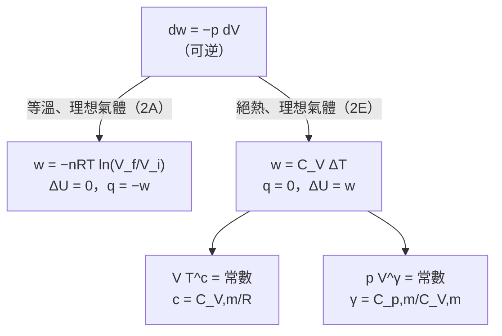
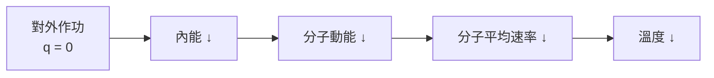

# Focus 2 熱力學第一定律（The First Law）
# 2E 絕熱變化（Adiabatic Changes）講義

> **範圍**：上課簡報 p.144–149（以及 p.150–153 的總結頁）；課本 Atkins' Physical Chemistry Topic 2E（p.66–68），以及章末 Exercises／Problems（p.73）、Integrated activities（p.74）
> **標示說明**：
> - 未特別標示的內容以簡報為主
> - **📘 課本補充**：簡報沒有、取自課本的內容
> - **⭐**：必會推導
> - **⚠️**：勘誤或易錯處
> **本節範圍**：除了「延伸例題」之外，所有結果都只適用於**理想氣體**，且 $C_V$ 視為與溫度無關。

---

## 學習重點

1. 能從巨觀與分子兩個角度，說明理想氣體絕熱膨脹時為什麼會降溫。
2. 能用「兩步路徑」**推導** $w_\text{ad} = C_V\Delta T$，並知道它對**任何**絕熱過程都成立。
3. 能**推導**可逆絕熱過程的溫度–體積關係 $VT^c = $ 常數。
4. 能用**兩種方法推導** $pV^\gamma = $ 常數，並寫出溫度–壓力關係。
5. 能說明**絕熱線比等溫線陡**的原因，並以數學證明斜率比為 $\gamma$。
6. 能區分**可逆**與**不可逆**絕熱膨脹的計算方法。
7. 能用能量均分定理估計 $\gamma$，並解釋為什麼振動通常不計入。

---

## 本節在路線圖中的位置（簡報 p.150）

2E 是路線圖左下角「**可逆、絕熱、理想氣體**」那一格，與 2A 的「可逆、等溫、理想氣體」並列：

📘 **為什麼要學這一節？** 絕熱過程與等溫過程互補，兩者會一起出現在第 3 章討論**第二定律**的**卡諾循環（Carnot cycle）**中。

---

## 2E.1 溫度的變化（The Change in Temperature）

### 一、為什麼絕熱膨脹會降溫？（簡報 p.144）

**巨觀**：氣體在隔熱容器中絕熱膨脹時，**對外作功，但沒有熱流入**，所以內能下降，溫度也下降。

**分子觀點**（簡報 p.144 的箭頭）：

> 📘 **關鍵**：理想氣體的內能**全部**是分子的動能（沒有位能），而平均動能正比於 $T$。所以內能減少，溫度就一定下降。

### 二、⭐ 推導：絕熱功 $w_\text{ad} = C_V\Delta T$（簡報 p.145；課本圖 2E.1）

**目標**：理想氣體由 $(T_i, V_i)$ 絕熱變化到 $(T_f, V_f)$，求功。

**技巧**：$U$ 是**狀態函數**，$\Delta U$ 與路徑無關。所以可以**另選一條方便計算的路徑**算 $\Delta U$，不必管實際過程。

**Step 1：等溫改變體積** $(T_i, V_i) \to (T_i, V_f)$

理想氣體的內能**與體積無關**（2A；2D 的 $\pi_T = 0$），所以

$$
\Delta U_1 = 0
$$

**Step 2：定容改變溫度** $(T_i, V_f) \to (T_f, V_f)$

$C_V$ 與溫度無關時：

$$
\Delta U_2 = C_V(T_f - T_i) = C_V\Delta T
$$

**Step 3：合併**

$$
\Delta U = \Delta U_1 + \Delta U_2 = C_V\Delta T
$$

**Step 4：加上絕熱條件**

絕熱 $q = 0$，由第一定律 $\Delta U = q + w = w_\text{ad}$（下標 ad 表示絕熱，adiabatic）：

$$
\boxed{\,w_\text{ad} = C_V\Delta T\,} \qquad \text{絕熱功（理想氣體）(2E.1)}
$$

**意義**：理想氣體絕熱膨脹所作的功，**正比於初末狀態的溫度差**。

📘 這完全符合分子觀點：平均動能正比於 $T$，所以只由溫度造成的內能變化也正比於 $\Delta T$。

> ⚠️ **兩個重要提醒**：
> 1. 式 2E.1 **沒有用到「可逆」**。只要是**理想氣體的絕熱過程**，不論可逆或不可逆，$w_\text{ad} = C_V\Delta T$ 都成立。差別只在不同過程的 $\Delta T$ 不同（見本節「延伸例題」）。
> 2. ⚠️ **正負號**：膨脹時 $\Delta T < 0$，所以 $w_\text{ad} < 0$（系統對外作功）。簡報 p.23、p.34、p.150 路線圖寫成「$w = -C_V\Delta T$」是**錯的**，簡報 p.145 與課本都是 **$w_\text{ad} = +C_V\Delta T$**。

**同理，焓的變化**（理想氣體的 $H$ 也只與 $T$ 有關）：

$$
\Delta H = C_p\Delta T
$$

這同樣對任何理想氣體的絕熱過程都成立。

### 三、⭐ 推導：可逆絕熱膨脹的溫度變化（簡報 p.146–147）

**條件**：**可逆**（外壓隨時等於氣體壓力 $p$）、**絕熱**、**理想氣體**、$C_V$ 為常數。

氣體絕熱膨脹時，壓力與溫度都會下降。先考慮無限小的變化。

**Step 1：寫出溫度與體積變化的關係**

可逆膨脹 $dV$ 時，$đw = -p\,dV$。絕熱 $đq = 0$，所以 $dU = đw_\text{ad} = -p\,dV$。

理想氣體 $dU = C_V\,dT$。兩式相等：

$$
C_V\,dT = -p\,dV
$$

用 $p = nRT/V$ 代入，並把 $T$ 移到左邊（**分離變數**）：

$$
\frac{C_V\,dT}{T} = -\frac{nR\,dV}{V}
$$

**Step 2：積分**

注意積分上下限要**對應**：$V = V_i$ 時 $T = T_i$；$V = V_f$ 時 $T = T_f$。$C_V$ 與溫度無關，可移到積分外：

$$
C_V\int_{T_i}^{T_f}\frac{dT}{T} = -nR\int_{V_i}^{V_f}\frac{dV}{V}
$$

$$
C_V\ln\frac{T_f}{T_i} = -nR\ln\frac{V_f}{V_i}
$$

**Step 3：化簡**

用 $\ln(x/y) = -\ln(y/x)$，兩邊除以 $nR$：

$$
\frac{C_V}{nR}\ln\frac{T_f}{T_i} = \ln\frac{V_i}{V_f}
$$

定義

$$
c = \frac{C_V}{nR} = \frac{C_{V,\text{m}}}{R}
$$

再用 $a\ln x = \ln x^a$：

$$
\ln\left(\frac{T_f}{T_i}\right)^c = \ln\frac{V_i}{V_f} \;\Rightarrow\; \left(\frac{T_f}{T_i}\right)^c = \frac{V_i}{V_f}
$$

$$
\boxed{\,T_f = T_i\left(\frac{V_i}{V_f}\right)^{1/c}\,} \qquad c = \frac{C_{V,\text{m}}}{R} \qquad \text{溫度變化（可逆絕熱膨脹、理想氣體）(2E.2a)}
$$

兩邊取 $c$ 次方並整理，得等價的形式：

$$
\boxed{\,V_iT_i^c = V_fT_f^c\,} \qquad (2E.2b)
$$

常簡寫為 **$VT^c = $ 常數**。

| 氣體（不計振動） | $C_{V,\text{m}}$ | $c = C_{V,\text{m}}/R$ | $1/c$ |
|---|---|---|---|
| 單原子 | $\frac{3}{2}R$ | 3/2 | 2/3 |
| 線形分子 | $\frac{5}{2}R$ | 5/2 | 2/5 |
| 非線形分子 | $3R$ | 3 | 1/3 |

> ⚠️ **易錯**：
> - $1/c = R/C_{V,\text{m}} = \gamma - 1$（見 2E.2），所以 2E.2a 也可寫成 $T_f = T_i(V_i/V_f)^{\gamma - 1}$，即 $TV^{\gamma - 1} = $ 常數。
> - 膨脹時 $V_i/V_f < 1$，所以 $T_f < T_i$：**可逆絕熱膨脹一定降溫**。
> - 這個式子**只適用於可逆**絕熱過程；不可逆絕熱過程要直接解能量守恆（見延伸例題）。

#### 📗 簡報 Brief illustration 2E.1：氬的可逆絕熱膨脹（簡報 p.148）

**題目**：Consider the adiabatic, reversible expansion of 0.020 mol Ar, initially at 25 °C, from 0.50 dm³ to 1.00 dm³. The molar heat capacity of argon at constant volume is 12.47 J K⁻¹ mol⁻¹, so $c = 1.501$. Calculate the final temperature and the work done.

（0.020 mol Ar 由 25 °C、0.50 dm³ 可逆絕熱膨脹到 1.00 dm³。氬的 $C_{V,\text{m}} = 12.47$ J K⁻¹ mol⁻¹，$c = 1.501$。求末溫與功。）

**詳解**：

**Step 1：末溫**（式 2E.2a）

$$
T_f = (298\ \text{K})\times\left(\frac{0.50\ \text{dm}^3}{1.00\ \text{dm}^3}\right)^{1/1.501} = (298\ \text{K})(0.630) = \boxed{188\ \text{K}}
$$

$$
\Delta T = 188 - 298 = -110\ \text{K}
$$

**Step 2：功**（式 2E.1）

$$
w_\text{ad} = C_V\Delta T = nC_{V,\text{m}}\Delta T = (0.020\ \text{mol})(12.47\ \text{J K}^{-1}\,\text{mol}^{-1})(-110\ \text{K}) = \boxed{-27\ \text{J}}
$$

> 📘 **注意**：**溫度變化與氣體的量無關**（式 2E.2a 中沒有 $n$），但**功與氣體的量有關**（式 2E.1 中有 $n$）。

---

## 2E.2 壓力的變化（The Change in Pressure）（簡報 p.149）

### 一、⭐ 推導 $pV^\gamma = $ 常數

#### 方法一：由溫度–體積關係推導（課本與簡報的方法）

**Step 1**：初態與末態都滿足理想氣體方程式（**不論過程如何**），所以

$$
\frac{p_iV_i}{p_fV_f} = \frac{T_i}{T_f}
$$

**Step 2**：由式 2E.2a，

$$
\frac{T_i}{T_f} = \left(\frac{V_f}{V_i}\right)^{1/c}
$$

代入：

$$
\frac{p_i}{p_f} = \frac{V_f}{V_i}\left(\frac{V_f}{V_i}\right)^{1/c} = \left(\frac{V_f}{V_i}\right)^{1 + 1/c}
$$

**Step 3**：計算指數。理想氣體 $C_{p,\text{m}} - C_{V,\text{m}} = R$（2B）：

$$
1 + \frac{1}{c} = 1 + \frac{R}{C_{V,\text{m}}} = \frac{C_{V,\text{m}} + R}{C_{V,\text{m}}} = \frac{C_{p,\text{m}}}{C_{V,\text{m}}} \equiv \gamma
$$

$\gamma$ 稱為**熱容比（heat capacity ratio）**。

**Step 4**：

$$
\frac{p_i}{p_f} = \left(\frac{V_f}{V_i}\right)^\gamma \;\Rightarrow\; \boxed{\,p_fV_f^\gamma = p_iV_i^\gamma\,} \qquad \text{壓力變化（可逆絕熱膨脹、理想氣體）(2E.3)}
$$

常簡寫為 **$pV^\gamma = $ 常數**。

> 💡 重點記住 **$\dfrac{1}{c} = \gamma - 1$**，因為 $\dfrac{R}{C_{V,\text{m}}} = \dfrac{C_{p,\text{m}} - C_{V,\text{m}}}{C_{V,\text{m}}} = \gamma - 1$。

#### 方法二：直接由微分式推導（📘 補充，不需先求溫度關係）

**Step 1**：由 2E.1 的 Step 1：$C_V\,dT = -p\,dV$

**Step 2**：對 $pV = nRT$ 取微分：$p\,dV + V\,dp = nR\,dT$，所以 $dT = \dfrac{p\,dV + V\,dp}{nR}$

**Step 3**：代入 Step 1：

$$
\frac{C_V}{nR}(p\,dV + V\,dp) = -p\,dV
$$

$$
C_V\,V\,dp + (C_V + nR)\,p\,dV = 0
$$

**Step 4**：兩邊除以 $C_V\,pV$，用 $C_p = C_V + nR$（理想氣體）：

$$
\frac{dp}{p} + \frac{C_p}{C_V}\frac{dV}{V} = 0 \;\Rightarrow\; \frac{dp}{p} + \gamma\frac{dV}{V} = 0
$$

**Step 5**：積分

$$
\ln p + \gamma\ln V = \text{常數} \;\Rightarrow\; \boxed{\,pV^\gamma = \text{常數}\,}
$$

> 💡 方法二的好處：一步就看出 $\gamma$ 從哪裡來，也很容易推廣到其他變數組合。

### 二、三種形式的可逆絕熱方程式

把 $pV^\gamma = $ 常數與 $pV = nRT$ 組合，可以得到三種等價形式：

| 變數 | 形式 | 指數 |
|---|---|---|
| $T$、$V$ | $TV^{\gamma - 1} = $ 常數（即 $VT^c = $ 常數） | $\gamma - 1 = 1/c = R/C_{V,\text{m}}$ |
| $p$、$V$ | $pV^\gamma = $ 常數 | $\gamma = C_{p,\text{m}}/C_{V,\text{m}}$ |
| $T$、$p$ | $Tp^{(1-\gamma)/\gamma} = $ 常數，即 $\dfrac{T_f}{T_i} = \left(\dfrac{p_f}{p_i}\right)^{R/C_{p,\text{m}}}$ | $\dfrac{\gamma - 1}{\gamma} = \dfrac{R}{C_{p,\text{m}}}$ |

> 第三種形式在題目給**初末壓力**時特別方便（見習題 4）。

### 三、各類氣體的 $\gamma$

📘 用 2A 的能量均分結果（**振動在常溫下貢獻很小**，不計）：

| 氣體 | $C_{V,\text{m}}$ | $C_{p,\text{m}} = C_{V,\text{m}} + R$ | $\gamma = C_{p,\text{m}}/C_{V,\text{m}}$ |
|---|---|---|---|
| 單原子（He、Ar） | $\frac{3}{2}R$ | $\frac{5}{2}R$ | **5/3 ≈ 1.67** |
| 線形分子（N₂、O₂、CO₂） | $\frac{5}{2}R$ | $\frac{7}{2}R$ | **7/5 = 1.40** |
| 非線形多原子分子（H₂O、CH₄、NH₃） | $3R$ | $4R$ | **4/3 ≈ 1.33** |

$\gamma$ 永遠**大於 1**；分子越複雜（自由度越多），$\gamma$ 越接近 1。

### 四、⭐ 絕熱線與等溫線（Adiabats and Isotherms）

**絕熱線（adiabat）**：絕熱過程的 $p$ 對 $V$ 曲線。課本圖 2E.2（簡報 p.149）畫出可逆絕熱線與等溫線：

| | 等溫線（isotherm） | 絕熱線（adiabat） |
|---|---|---|
| 關係 | $p \propto 1/V$ | $p \propto 1/V^\gamma$ |
| 曲線陡度 | 較平緩 | **較陡**（因為 $\gamma > 1$） |
| 膨脹時溫度 | 不變 | 下降 |
| 熱 | 從外界流入，維持溫度 | $q = 0$ |

**物理原因**：等溫膨脹時，**熱流入系統維持溫度**，所以壓力下降得較少；絕熱膨脹時沒有熱流入，溫度也跟著下降，壓力因為 $V$ 增加**與** $T$ 下降**兩個原因**而降低，所以下降得更快。

**⭐ 數學證明：斜率比為 $\gamma$**

在同一點 $(p, V)$ 比較兩條曲線的斜率：

- 等溫線 $pV = $ 常數：$p\,dV + V\,dp = 0 \Rightarrow \left(\dfrac{\partial p}{\partial V}\right)_T = -\dfrac{p}{V}$
- 絕熱線 $pV^\gamma = $ 常數：由方法二 $\dfrac{dp}{p} = -\gamma\dfrac{dV}{V} \Rightarrow \left(\dfrac{\partial p}{\partial V}\right)_\text{ad} = -\gamma\dfrac{p}{V}$

$$
\boxed{\,\frac{(\partial p/\partial V)_\text{ad}}{(\partial p/\partial V)_T} = \gamma > 1\,}
$$

**絕熱線在任何一點的斜率都是等溫線的 $\gamma$ 倍**，所以比較陡。

#### 📘 課本 Brief illustration 2E.2：氬的絕熱壓力變化

**題目**：氬（$\gamma = 5/3$）由 100 kPa 可逆絕熱膨脹到兩倍體積，末壓力為何？與等溫膨脹比較。

**詳解**：

$$
p_f = \left(\frac{V_i}{V_f}\right)^\gamma p_i = \left(\frac{1}{2}\right)^{5/3}(100\ \text{kPa}) = \boxed{31\ \text{kPa}}
$$

若是**等溫**膨脹到兩倍體積，末壓力為 $\frac{1}{2}\times100 = 50$ kPa。絕熱膨脹的壓力降得更多 ✓。

### 五、📘 延伸例題：不可逆絕熱膨脹（自編，常見考題）

> 本題不在課本範圍內，但「可逆 vs 不可逆絕熱膨脹」是熱力學常考的比較題，特別附上。

**題目**：1.00 mol Ar（理想氣體，$C_{V,\text{m}} = \frac{3}{2}R$）在 300 K、10.0 atm 下，在隔熱的汽缸中膨脹到 1.00 atm。分別計算 (a) 可逆絕熱膨脹、(b) 對抗 1.00 atm 定外壓的不可逆絕熱膨脹的末溫與功。

**解題思路**：
- (a) 可逆 → 可以用 2E.2 的公式。
- (b) **不可逆 → 不能用 $pV^\gamma = $ 常數**。改用兩個一定成立的式子：
  - 理想氣體的任何絕熱過程：$w = \Delta U = C_V\Delta T$（式 2E.1）
  - 對抗定外壓：$w = -p_\text{ex}\Delta V$（式 2A.6）

**詳解**：

**(a) 可逆**（用溫度–壓力形式，$R/C_{p,\text{m}} = R/\frac{5}{2}R = 2/5$）：

$$
T_f = T_i\left(\frac{p_f}{p_i}\right)^{2/5} = (300\ \text{K})(0.100)^{0.4} = \boxed{119\ \text{K}}
$$

$$
w = C_V\Delta T = \tfrac{3}{2}(8.3145)(119.4 - 300)\ \text{J} = \boxed{-2.25\ \text{kJ}}
$$

**(b) 不可逆**：令兩個功的式子相等

$$
C_{V,\text{m}}(T_f - T_i) = -p_\text{ex}(V_f - V_i) = -p_\text{ex}\left(\frac{RT_f}{p_f} - \frac{RT_i}{p_i}\right)
$$

$p_\text{ex} = p_f = 1.00$ atm、$p_i = 10.0$ atm：

$$
\tfrac{3}{2}R(T_f - T_i) = -RT_f + \tfrac{1}{10}RT_i
$$

$$
\tfrac{5}{2}T_f = \left(\tfrac{3}{2} + \tfrac{1}{10}\right)T_i = 1.6\,T_i \;\Rightarrow\; T_f = 0.64\,T_i = \boxed{192\ \text{K}}
$$

$$
w = C_V\Delta T = \tfrac{3}{2}(8.3145)(192 - 300)\ \text{J} = \boxed{-1.35\ \text{kJ}}
$$

| | 可逆絕熱 | 不可逆絕熱（$p_\text{ex} = p_f$） |
|---|---|---|
| 末溫 | 119 K | 192 K |
| 對外作功 $|w|$ | 2.25 kJ | 1.35 kJ |

> **觀念**：
> - 同樣降到 1 atm，**可逆過程降溫較多、對外作功較多**，與 2A「可逆過程作最大功」一致。
> - 不可逆過程中有一部分「推力」被浪費，內能減少得較少，所以末溫較高。
> - 兩個過程的末態**不同**（末溫不同），所以不是「同一兩個狀態間的兩條路徑」。

---

## 可逆等溫 vs 可逆絕熱：總比較（理想氣體）

| | 可逆等溫膨脹 | 可逆絕熱膨脹 |
|---|---|---|
| 條件 | $T$ 固定 | $q = 0$ |
| $p$–$V$ 關係 | $pV = $ 常數 | $pV^\gamma = $ 常數 |
| $T$–$V$ 關係 | $T$ 不變 | $TV^{\gamma - 1} = $ 常數 |
| $\Delta U$ | 0 | $C_V\Delta T$（< 0） |
| $\Delta H$ | 0 | $C_p\Delta T$（< 0） |
| $q$ | $+nRT\ln(V_f/V_i)$ | 0 |
| $w$ | $-nRT\ln(V_f/V_i)$ | $C_V\Delta T$ |
| 同樣 $V_i \to V_f$ 時的 $|w|$ | **較大** | 較小 |
| $p$–$V$ 圖 | 較平緩 | 較陡 |

> 💡 **為什麼同樣的體積變化，等溫作功較多？** 等溫線在絕熱線上方（壓力較高），曲線下的面積較大。能量來源也不同：等溫功由**流入的熱**供應，絕熱功只能由**系統自己的內能**供應。

---

## 精選章末習題（含詳解）

> **選題標準**：涵蓋三種形式的絕熱方程式、能量均分與 $\gamma$、實驗數據反推，以及整合題。共 9 題，由基礎到進階排列。數值均已用程式驗算。
> **常數**：$R = 8.3145$ J K⁻¹ mol⁻¹；1 atm = 101 325 Pa

---

### 習題 1｜E2E.6 氬的可逆絕熱膨脹末溫（基礎）

**題目**：Calculate the final temperature of a sample of argon of mass 12.0 g that is expanded reversibly and adiabatically from 1.0 dm³ at 273.15 K to 3.0 dm³.

（12.0 g 的氬在 273.15 K 由 1.0 dm³ 可逆絕熱膨脹到 3.0 dm³，求末溫。）

**詳解**：Ar 是單原子，$c = C_{V,\text{m}}/R = 3/2$，$1/c = 2/3$。

$$
T_f = T_i\left(\frac{V_i}{V_f}\right)^{1/c} = (273.15\ \text{K})\left(\frac{1.0}{3.0}\right)^{2/3} = \boxed{131\ \text{K}}
$$

> 💡 **質量 12.0 g 是多餘的數據**：溫度變化與氣體的量無關。若題目再問功，才需要用到 $n = 12.0/39.95 = 0.300$ mol。

---

### 習題 2｜E2E.9 氮氣可逆絕熱膨脹所作的功

**題目**：A sample of nitrogen of mass 3.12 g at 23.0 °C is allowed to expand reversibly and adiabatically from 400 cm³ to 2.00 dm³. What is the work done by the gas?

（3.12 g 的氮氣在 23.0 °C 由 400 cm³ 可逆絕熱膨脹到 2.00 dm³。氣體所作的功是多少？）

**詳解**：N₂ 是線形分子，$C_{V,\text{m}} = \frac{5}{2}R$，$c = 5/2$。

**Step 1：末溫**

$$
T_f = (296.15\ \text{K})\left(\frac{0.400}{2.00}\right)^{2/5} = 155.6\ \text{K}
$$

**Step 2：功**

$$
n = \frac{3.12\ \text{g}}{28.02\ \text{g mol}^{-1}} = 0.1113\ \text{mol}
$$

$$
w = nC_{V,\text{m}}\Delta T = (0.1113)(\tfrac{5}{2}\times8.3145)(155.6 - 296.15)\ \text{J} = -325\ \text{J}
$$

**氣體所作的功**（題目問 work done **by** the gas）為 $-w = \boxed{+325\ \text{J}}$。

> ⚠️ **易錯**：題目問「氣體**對外**作的功」，答案應為正值 325 J；本課程慣例中 $w$（對系統作的功）$= -325$ J。作答時要說清楚是哪一個。

---

### 習題 3｜E2E.10 水蒸氣的絕熱壓力變化

**題目**：Calculate the final pressure of a sample of water vapour that expands reversibly and adiabatically from 97.3 Torr and 400 cm³ to a final volume of 5.0 dm³. Take $\gamma = 1.3$.

（水蒸氣由 97.3 Torr、400 cm³ 可逆絕熱膨脹到 5.0 dm³，求末壓力。取 $\gamma = 1.3$。）

**詳解**：

$$
p_f = p_i\left(\frac{V_i}{V_f}\right)^\gamma = (97.3\ \text{Torr})\left(\frac{0.400}{5.0}\right)^{1.3} = \boxed{3.6\ \text{Torr}}
$$

> **比較**：等溫膨脹時 $p_f = 97.3\times0.400/5.0 = 7.8$ Torr，絕熱降得更多。
> $\gamma = 1.3$ 接近非線形分子的 4/3，符合 H₂O 是彎曲分子。

---

### 習題 4｜E2E.8 由壓力變化求末體積、末溫與功

**題目**：A sample consisting of 2.5 mol of perfect gas molecules with $C_{p,\text{m}} = 20.8$ J K⁻¹ mol⁻¹ is initially at 240 kPa and 325 K. It undergoes reversible adiabatic expansion until its pressure reaches 150 kPa. Calculate the final volume and temperature, and the work done.

（2.5 mol 理想氣體，$C_{p,\text{m}} = 20.8$ J K⁻¹ mol⁻¹，初始為 240 kPa、325 K。可逆絕熱膨脹到 150 kPa，求末體積、末溫與功。）

**解題思路**：
- 題目給的是 **$C_{p,\text{m}}$**，要先換成 $C_{V,\text{m}}$ 與 $\gamma$。
- $C_{p,\text{m}} = 20.8 \approx \frac{5}{2}R$，所以這是**單原子**氣體。
- 已知初末壓力，用 $pV^\gamma$ 或 $T$–$p$ 形式最方便。

**詳解**：

**Step 1：熱容量與 $\gamma$**

$$
C_{V,\text{m}} = C_{p,\text{m}} - R = 20.8 - 8.3145 = 12.49\ \text{J K}^{-1}\,\text{mol}^{-1}, \qquad \gamma = \frac{20.8}{12.49} = 1.666
$$

**Step 2：初體積**

$$
V_i = \frac{nRT_i}{p_i} = \frac{(2.5)(8.3145)(325)}{240\times10^3}\ \text{m}^3 = 2.815\times10^{-2}\ \text{m}^3 = 28.1\ \text{dm}^3
$$

**Step 3：末體積**（$pV^\gamma = $ 常數）

$$
V_f = V_i\left(\frac{p_i}{p_f}\right)^{1/\gamma} = (28.15\ \text{dm}^3)\left(\frac{240}{150}\right)^{1/1.666} = \boxed{37.3\ \text{dm}^3}
$$

**Step 4：末溫**

用理想氣體方程式：

$$
T_f = \frac{p_fV_f}{nR} = \frac{(150\times10^3)(3.732\times10^{-2})}{(2.5)(8.3145)}\ \text{K} = \boxed{269\ \text{K}}
$$

驗算（$T$–$p$ 形式）：$T_f = (325)(150/240)^{R/C_{p,\text{m}}} = (325)(0.625)^{0.3997} = 269$ K ✓

**Step 5：功**

$$
w = nC_{V,\text{m}}\Delta T = (2.5)(12.49)(269.3 - 325)\ \text{J} = \boxed{-1.74\ \text{kJ}}
$$

---

### 習題 5｜E2E.4 + E2E.5 用能量均分定理估計 $\gamma$

**題目**：Use the equipartition principle to estimate the values of $\gamma = C_p/C_V$ for gaseous ammonia, methane, and carbon dioxide. Do this calculation with and without the vibrational contribution to the energy. Which is closer to the experimental value at 25 °C?

（用能量均分原理估計氨、甲烷、二氧化碳氣體的 $\gamma$，分別計算包含與不包含振動貢獻的情況。哪一個比較接近 25 °C 的實驗值？）

**解題思路**：
1. 移動：$\frac{3}{2}R$。
2. 轉動：線形 $R$、非線形 $\frac{3}{2}R$。
3. 振動：$N$ 個原子的分子有 **$3N - 5$（線形）或 $3N - 6$（非線形）個振動模式**，每個模式完全激發時貢獻 $R$（動能 $\frac{1}{2}R$ + 位能 $\frac{1}{2}R$）。
4. $C_{p,\text{m}} = C_{V,\text{m}} + R$，$\gamma = C_{p,\text{m}}/C_{V,\text{m}}$。

**詳解**：

| 分子 | 形狀 | 振動模式數 | 不計振動 $C_{V,\text{m}}/R$ | $\gamma$ | 計入振動 $C_{V,\text{m}}/R$ | $\gamma$ | 實驗值* |
|---|---|---|---|---|---|---|---|
| NH₃ | 非線形（4 原子） | $3(4) - 6 = 6$ | 3 | **1.333** | 3 + 6 = 9 | 1.111 | 1.31 |
| CH₄ | 非線形（5 原子） | $3(5) - 6 = 9$ | 3 | **1.333** | 3 + 9 = 12 | 1.083 | 1.31 |
| CO₂ | 線形（3 原子） | $3(3) - 5 = 4$ | 2.5 | **1.400** | 2.5 + 4 = 6.5 | 1.154 | 1.29 |

*實驗值由 298 K 的 $C_{p,\text{m}}$（NH₃ 35.06、CH₄ 35.31、CO₂ 37.11 J K⁻¹ mol⁻¹）計算：$\gamma = C_{p,\text{m}}/(C_{p,\text{m}} - R)$。

**結論**：**不計振動**的結果較接近實驗值。

> **觀念**：
> - 室溫 $kT/hc \approx 207$ cm⁻¹，大多數振動的波數為 10²–10³ cm⁻¹ 以上（2A），**振動幾乎沒有被激發**，古典的能量均分定理不適用於振動。
> - 實驗值都略**低於**「不計振動」的預測，表示振動已經**部分**激發。CO₂ 偏差最大（1.29 vs 1.40），因為它有一個低頻的**彎曲振動（bending mode）**（約 667 cm⁻¹，而且是二重簡併），室溫下已有相當程度的激發。

---

### 習題 6｜P2E.1 氨的可逆絕熱膨脹

**題目**：Calculate the final temperature, the work done, and the change of internal energy when 1.00 mol NH₃(g) at 298 K is used in a reversible adiabatic expansion from 0.50 dm³ to 2.00 dm³.

（1.00 mol 的 NH₃(g) 在 298 K 由 0.50 dm³ 可逆絕熱膨脹到 2.00 dm³。計算末溫、功與內能變化。NH₃ 的 $C_{p,\text{m}} = 35.06$ J K⁻¹ mol⁻¹，取自課本附錄。）

**詳解**：

**Step 1：$c$**（用實驗熱容量，比能量均分更準）

$$
C_{V,\text{m}} = C_{p,\text{m}} - R = 35.06 - 8.3145 = 26.75\ \text{J K}^{-1}\,\text{mol}^{-1}, \qquad c = \frac{26.75}{8.3145} = 3.217
$$

**Step 2：末溫**

$$
T_f = (298\ \text{K})\left(\frac{0.50}{2.00}\right)^{1/3.217} = (298\ \text{K})(0.650) = \boxed{194\ \text{K}}
$$

**Step 3：功與內能變化**

$$
w = \Delta U = nC_{V,\text{m}}\Delta T = (1.00)(26.75)(193.7 - 298)\ \text{J} = \boxed{-2.79\ \text{kJ}}
$$

> **比較**：若用能量均分（非線形，$c = 3$），$T_f = 298(0.25)^{1/3} = 188$ K，差約 6 K。
>
> ⚠️ **合理性**：0.50 dm³ 中有 1 mol NH₃ 時，壓力約 49 atm，NH₃ 已經明顯偏離理想氣體（而且 194 K 低於 NH₃ 的沸點 240 K）。這題的「理想氣體」假設其實很勉強，結果只能當作估計。

---

### 習題 7｜P2E.2 由絕熱膨脹實驗反推熱容量（進階）

**題目**：The constant-volume heat capacity of a gas can be measured by observing the decrease in temperature when it expands adiabatically and reversibly. The value of $\gamma = C_p/C_V$ can be inferred if the decrease in pressure is also measured and the constant-pressure heat capacity deduced by combining the two values. A fluorocarbon gas was allowed to expand reversibly and adiabatically to twice its volume; as a result, the temperature fell from 298.15 K to 248.44 K and its pressure fell from 202.94 kPa to 81.840 kPa. Evaluate $C_{p,\text{m}}$.

（觀察氣體可逆絕熱膨脹時的降溫，可以量出定容熱容量；若同時量壓力的下降，可以推得 $\gamma$，再求出定壓熱容量。某**氟碳化合物（fluorocarbon）**氣體可逆絕熱膨脹到兩倍體積，溫度由 298.15 K 降到 248.44 K，壓力由 202.94 kPa 降到 81.840 kPa。求 $C_{p,\text{m}}$。）

**解題思路**：
- **溫度數據** → 由 $(T_f/T_i)^c = V_i/V_f$ 求 $c$，得 $C_{V,\text{m}} = cR$。
- **壓力數據** → 由 $(p_i/p_f) = (V_f/V_i)^\gamma$ 求 $\gamma$。
- $C_{p,\text{m}} = \gamma C_{V,\text{m}}$。

**詳解**：

**Step 1：由溫度求 $C_{V,\text{m}}$**

$$
c\ln\frac{T_f}{T_i} = \ln\frac{V_i}{V_f} \;\Rightarrow\; c = \frac{\ln(1/2)}{\ln(248.44/298.15)} = \frac{-0.6931}{-0.1824} = 3.800
$$

$$
C_{V,\text{m}} = cR = (3.800)(8.3145) = 31.60\ \text{J K}^{-1}\,\text{mol}^{-1}
$$

**Step 2：由壓力求 $\gamma$**

$$
\gamma = \frac{\ln(p_i/p_f)}{\ln(V_f/V_i)} = \frac{\ln(202.94/81.840)}{\ln 2} = \frac{0.9081}{0.6931} = 1.310
$$

**Step 3：$C_{p,\text{m}}$**

$$
C_{p,\text{m}} = \gamma C_{V,\text{m}} = (1.310)(31.60) = \boxed{41.4\ \text{J K}^{-1}\,\text{mol}^{-1}}
$$

> **檢查與討論**：
> - 若用理想氣體的 $C_{p,\text{m}} = C_{V,\text{m}} + R = 39.9$ J K⁻¹ mol⁻¹，與 41.4 差約 4%。
> - 原因：數據**並不完全符合理想氣體**。驗算 $pV/T$：初態 $\propto 202.94/298.15 = 0.681$，末態 $\propto 81.840\times2/248.44 = 0.659$，兩者差約 3%。
> - 本題的方法是課本描述的實驗原理（一次實驗同時得到 $C_V$ 與 $C_p$），照題意用 $C_{p,\text{m}} = \gamma C_{V,\text{m}}$ 作答。

---

### 習題 8｜I2.6 + P2D.6 聲速與熱容比

**題目**：
- **P2D.6**：The speed of sound, $c_s$, in a perfect gas of molar mass $M$ is related to the ratio of heat capacities $\gamma$ by $c_s = (\gamma RT/M)^{1/2}$. Show that $c_s = (\gamma p/\rho)^{1/2}$, where $\rho$ is the mass density of the gas. Calculate the speed of sound in argon at 25 °C.
- **I2.6**：Deduce an expression for the speed of sound in a perfect gas of (a) diatomic, (b) linear triatomic, (c) nonlinear triatomic molecules at high temperatures (with translation and rotation active). Estimate the speed of sound in air at 25 °C.

（理想氣體的**聲速（speed of sound）**$c_s = (\gamma RT/M)^{1/2}$。證明 $c_s = (\gamma p/\rho)^{1/2}$，並計算 25 °C 氬中的聲速。再推導 (a) 雙原子、(b) 線形三原子、(c) 非線形三原子分子在移動與轉動皆激發時的聲速式，並估計 25 °C 空氣中的聲速。）

**詳解**：

**P2D.6 證明**：由 1A，理想氣體的密度 $\rho = pM/RT$，所以 $RT/M = p/\rho$：

$$
c_s = \left(\frac{\gamma RT}{M}\right)^{1/2} = \boxed{\left(\frac{\gamma p}{\rho}\right)^{1/2}}
$$

**Ar（$\gamma = 5/3$）在 298.15 K**：

$$
c_s = \left(\frac{(5/3)(8.3145)(298.15)}{0.039\,95}\right)^{1/2}\ \text{m s}^{-1} = \boxed{322\ \text{m s}^{-1}}
$$

**I2.6**

| 分子 | $C_{V,\text{m}}$ | $\gamma$ | $c_s$ |
|---|---|---|---|
| (a) 雙原子（線形） | $\frac{5}{2}R$ | 7/5 | $\left(\dfrac{7RT}{5M}\right)^{1/2}$ |
| (b) 線形三原子 | $\frac{5}{2}R$ | 7/5 | $\left(\dfrac{7RT}{5M}\right)^{1/2}$ |
| (c) 非線形三原子 | $3R$ | 4/3 | $\left(\dfrac{4RT}{3M}\right)^{1/2}$ |

（(a)、(b) 都是線形分子，只有 2 個轉動自由度，所以結果相同。）

**空氣**（主要是 N₂、O₂，$\gamma = 1.40$，$M = 28.96$ g mol⁻¹）在 298.15 K：

$$
c_s = \left(\frac{(1.40)(8.3145)(298.15)}{0.028\,96}\right)^{1/2}\ \text{m s}^{-1} = \boxed{346\ \text{m s}^{-1}}
$$

與實際值約 346 m s⁻¹ 相符。

> **觀念**：
> - 為什麼聲速與 $\gamma$ 有關？聲波的壓縮與膨脹**非常快**，熱來不及在相鄰區域之間流動，所以是**絕熱**過程。若誤用等溫的 $c_s = (RT/M)^{1/2}$（牛頓當年的錯誤），會得到 292 m s⁻¹，低估了約 15%。
> - 與 1B 比較：聲速與分子的方均根速率 $v_\text{rms} = (3RT/M)^{1/2}$ 同數量級，比值 $(\gamma/3)^{1/2}$，空氣約 0.68。

---

### 習題 9｜I2.7(b) $\gamma$ 對絕熱線的影響（觀念）

**題目**：Explore how the parameter $\gamma$ affects the dependence of the pressure on the volume when the expansion is reversible and adiabatic and the gas is perfect. Does the pressure–volume dependence become stronger or weaker with increasing volume?

（探討理想氣體可逆絕熱膨脹時，$\gamma$ 如何影響壓力對體積的關係。隨著體積增加，壓力–體積的相依性變強還是變弱？）

**詳解**：

由 $pV^\gamma = p_iV_i^\gamma$：

$$
p = p_i\left(\frac{V_i}{V}\right)^\gamma, \qquad \frac{dp}{dV} = -\gamma\frac{p_iV_i^\gamma}{V^{\gamma + 1}} = -\gamma\frac{p}{V}
$$

**(1) $\gamma$ 的影響**：$\gamma$ 越大，同樣的體積增加，壓力下降得**越快**。

| 體積變為 $V_i$ 的倍數 | 2 | 4 | 10 |
|---|---|---|---|
| 等溫（$\gamma \to 1$）$p/p_i$ | 0.500 | 0.250 | 0.100 |
| 非線形 $\gamma = 4/3$ | 0.397 | 0.157 | 0.046 |
| 線形 $\gamma = 7/5$ | 0.379 | 0.144 | 0.040 |
| 單原子 $\gamma = 5/3$ | 0.315 | 0.099 | 0.022 |

**(2) 體積增加時**：$|dp/dV| \propto 1/V^{\gamma + 1}$，隨 $V$ 增加而**迅速變小**，所以壓力對體積的**相依性變弱**，絕熱線在大體積處變得平緩。

> **觀念**：$\gamma$ 越大表示分子的自由度越少（$C_V$ 越小），每作一點功，溫度就降得越多，壓力也降得越快。單原子氣體的 $C_V$ 最小，所以絕熱線最陡。

---

## 觀念問答練習

**Q1.（D2E.1）在 $p$ 對 $V$ 的圖上，為什麼絕熱線比等溫線陡？**
> 等溫膨脹時有熱流入維持溫度，壓力只因體積增加而下降（$p \propto 1/V$）；絕熱膨脹時沒有熱流入，系統用自己的內能作功，溫度也跟著下降，所以壓力同時因體積增加與溫度下降而降低（$p \propto 1/V^\gamma$）。數學上，同一點的斜率比為 $\gamma > 1$。

**Q2.（D2E.2）為什麼熱容量會出現在絕熱膨脹的式子中？**
> 絕熱時作的功全部來自內能，$w = \Delta U = C_V\Delta T$。熱容量決定「失去一定的內能時溫度降多少」：$C_V$ 越大，同樣的功造成的降溫越小。所以溫度–體積關係的指數 $1/c = R/C_{V,\text{m}}$、壓力–體積關係的指數 $\gamma = C_{p,\text{m}}/C_{V,\text{m}}$ 都含有熱容量。

**Q3. $w_\text{ad} = C_V\Delta T$ 只適用於可逆過程嗎？**
> 不是。推導只用到「理想氣體的 $U$ 只與 $T$ 有關」與「絕熱 $q = 0$」，所以對理想氣體的任何絕熱過程（可逆或不可逆）都成立。只有 $VT^c = $ 常數與 $pV^\gamma = $ 常數才限定可逆。

**Q4. 推導 $VT^c = $ 常數時用到哪些條件？**
> (1) 可逆，$đw = -p\,dV$（$p_\text{ex} = p$）；(2) 絕熱，$đq = 0$；(3) 理想氣體，$dU = C_V\,dT$ 且 $p = nRT/V$；(4) $C_V$ 與溫度無關，才能移到積分外。

**Q5. 為什麼可逆絕熱膨脹的溫度變化與氣體的量無關，但功卻有關？**
> $T_f = T_i(V_i/V_f)^{1/c}$ 中 $c = C_{V,\text{m}}/R$ 是莫耳量的比值，沒有 $n$；體積比也與量無關。但功 $w = nC_{V,\text{m}}\Delta T$ 與 $n$ 成正比：氣體越多，同樣的降溫釋放的內能越多。

**Q6. 同樣降到某壓力，可逆與不可逆絕熱膨脹哪一個末溫較低？為什麼？**
> 可逆的末溫較低。可逆過程外壓隨時等於內壓，對外作的功最大，內能（溫度）降得最多；不可逆過程中部分推力被浪費，作功較少，末溫較高。

**Q7. 為什麼聲音在氣體中的傳播被視為絕熱過程？**
> 聲波的壓縮與稀疏變化非常快，熱來不及在高溫的壓縮區與低溫的稀疏區之間傳遞，所以每一小塊氣體都近似進行絕熱的壓縮與膨脹，聲速公式中出現 $\gamma$。

---

## 簡報勘誤與注意事項

| 位置 | 原文 | 說明／更正 | 重要性 |
|---|---|---|---|
| **簡報 p.23、p.34、p.150 路線圖** | Adiabatic, perfect gas：$w = -C_V\Delta T$ | 應為 **$w = +C_V\Delta T$**（簡報 p.145 與課本式 2E.1 皆為正號）。已在 2A 講義勘誤中列出 | **高** |
| 簡報 p.145 | independent of the volume of the molecules occupy | independent of the volume **the** molecules occupy | 低 |
| 簡報 p.148 | 12.48 J K⁻¹ mol⁻¹ | 課本為 **12.47**（$\frac{3}{2}R = 12.47$），不影響答案 | 低 |
| 簡報 p.148 | from eqn 2.27 | 舊版式號，新版為**式 2E.1** | 低 |
| 簡報 p.149 | Pressure change (2E.2a) | 新版式號為 **2E.3**；2E.2a 是溫度–體積關係 | 低 |
| 簡報 p.153 | Kirchoff's law | **Kirchhoff's** law | 低 |

---

## 本節公式總整理

| 名稱 | 公式 | 適用條件／說明 | 編號 |
|---|---|---|---|
| ⭐ 絕熱功 | $w_\text{ad} = \Delta U = C_V\Delta T$ | 理想氣體、**任何**絕熱過程 | 2E.1 |
| 絕熱焓變化 | $\Delta H = C_p\Delta T$ | 理想氣體 | — |
| ⭐ 溫度–體積 | $T_f = T_i\left(\dfrac{V_i}{V_f}\right)^{1/c}$，$c = C_{V,\text{m}}/R$ | 可逆、絕熱、理想氣體 | 2E.2a |
| 同上 | $V_iT_i^c = V_fT_f^c$；$TV^{\gamma - 1} = $ 常數 | 同上 | 2E.2b |
| ⭐ 壓力–體積 | $p_fV_f^\gamma = p_iV_i^\gamma$ | 同上 | 2E.3 |
| 溫度–壓力 | $\dfrac{T_f}{T_i} = \left(\dfrac{p_f}{p_i}\right)^{R/C_{p,\text{m}}}$ | 同上 | — |
| 熱容比 | $\gamma = C_{p,\text{m}}/C_{V,\text{m}}$；$\gamma - 1 = 1/c$ | 理想氣體 | — |
| $\gamma$ 典型值 | 單原子 5/3；線形 7/5；非線形 4/3 | 不計振動 | — |
| 斜率比 | $(\partial p/\partial V)_\text{ad}/(\partial p/\partial V)_T = \gamma$ | 同一點 | — |
| 不可逆絕熱（定外壓） | $C_V(T_f - T_i) = -p_\text{ex}(V_f - V_i)$ | 理想氣體 | — |
| 聲速 | $c_s = (\gamma RT/M)^{1/2} = (\gamma p/\rho)^{1/2}$ | 理想氣體 | — |
| 振動模式數 | 線形 $3N - 5$；非線形 $3N - 6$ | — | — |

---

## 專有名詞中英對照表

| 中文 | 英文 |
|---|---|
| 絕熱變化 | adiabatic change |
| 絕熱的 | adiabatic |
| 絕熱功 | work of adiabatic change |
| 隔熱容器 | thermally insulated container |
| 可逆絕熱膨脹 | reversible adiabatic expansion |
| 不可逆絕熱膨脹 | irreversible adiabatic expansion |
| 等溫過程 | isothermal process |
| 分離變數 | separation of variables |
| 熱容比 | heat capacity ratio |
| 絕熱線 | adiabat |
| 等溫線 | isotherm |
| 卡諾循環 | Carnot cycle |
| 第二定律 | Second Law |
| 能量均分原理 | equipartition principle |
| 振動貢獻 | vibrational contribution |
| 振動模式 | vibrational mode |
| 彎曲振動 | bending mode |
| 簡併 | degenerate |
| 聲速 | speed of sound |
| 質量密度 | mass density |
| 方均根速率 | root-mean-square speed |
| 氟碳化合物 | fluorocarbon |
| 氨 | ammonia |
| 甲烷 | methane |
| 二氧化碳 | carbon dioxide |
| 氬 | argon |
| 水蒸氣 | water vapour |

---

## 本節自我檢核

- [ ] 能從巨觀與分子角度說明絕熱膨脹為什麼降溫
- [ ] 能用兩步路徑**推導** $w_\text{ad} = C_V\Delta T$，並知道它對不可逆絕熱過程也成立
- [ ] 能**推導** $VT^c = $ 常數，並列出用到的四個條件
- [ ] 能用**兩種方法推導** $pV^\gamma = $ 常數
- [ ] 能寫出 $T$–$V$、$p$–$V$、$T$–$p$ 三種形式，並依題目條件選用
- [ ] 能用能量均分定理估計 $\gamma$，並解釋為什麼不計振動較接近實驗值
- [ ] 能**證明**絕熱線斜率是等溫線的 $\gamma$ 倍，並說明物理原因
- [ ] 能計算不可逆絕熱膨脹的末溫，並與可逆過程比較
- [ ] 能整理可逆等溫與可逆絕熱膨脹的 $q$、$w$、$\Delta U$、$\Delta H$ 對照表
- [ ] 能由絕熱膨脹的溫度與壓力數據反推 $C_V$、$\gamma$、$C_p$
