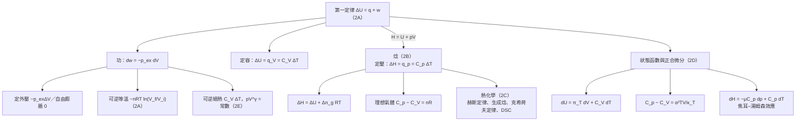

# Focus 2 熱力學第一定律（The First Law）
# 總整理與公式表

> **用途**：考前複習用。詳細觀念、推導與例題請回到 2A–2E 五份講義。
> **符號說明**：⭐ = 必會推導；⚠️ = 易錯；(2A.9) = 課本式號
> **符號慣例**：$q$、$w$ 一律指「**傳給系統**的熱、**對系統**作的功」，進入系統為正

---

## 一、單元主線：一張圖看懂 Focus 2

**一句話串起五節**：

- **2A**：能量守恆寫成 $\Delta U = q + w$。功由**外壓**決定，可逆時作最大功；定容時熱等於 $\Delta U$。
- **2B**：化學多在定壓下進行，所以定義 $H = U + pV$，使定壓時熱等於 $\Delta H$。
- **2C**：$H$ 是狀態函數，所以反應焓可以加減（赫斯定律）、可以由生成焓組合、可以換溫度（克希荷夫定律）。
- **2D**：把 $U$、$H$ 當成兩個變數的函數，用偏微分把難量的量（$\pi_T$、$C_p - C_V$、$\mu$）換成能量的量（$\alpha$、$\kappa_T$）。
- **2E**：絕熱時 $q = 0$，功全部來自內能，所以理想氣體降溫，得到 $pV^\gamma = $ 常數。

**貫穿全章的兩個核心觀念**：

| 觀念 | 用在哪裡 |
|---|---|
| **狀態函數與路徑無關** | 2A 選方便的路徑算 $\Delta U$；2C 赫斯定律；2D 正合微分；2E 兩步路徑推 $w_\text{ad}$ |
| **理想氣體的 $U$、$H$ 只與 $T$ 有關**（$\pi_T = 0$、$\mu = 0$） | 等溫 $\Delta U = 0$；$C_p - C_V = nR$；任何過程 $\Delta U = C_V\Delta T$；絕熱降溫 |

---

## 二、公式總表

### 2A 內能

| 名稱 | 公式 | 適用條件／備註 | 式號 |
|---|---|---|---|
| 內能變化 | $\Delta U = U_f - U_i$ | 狀態函數 | 2A.1 |
| ⭐ 第一定律 | $\Delta U = q + w$；$dU = đq + đw$ | 封閉系統 | 2A.2/3 |
| 功的定義 | $dw = -\lvert F\rvert\,dz$ | — | 2A.4 |
| ⭐ 膨脹功 | $dw = -p_\text{ex}\,dV$；$w = -\int p_\text{ex}\,dV$ | 由**外壓**決定 | 2A.5 |
| 定外壓 | $w = -p_\text{ex}\Delta V$ | — | 2A.6 |
| 自由膨脹 | $w = 0$ | $p_\text{ex} = 0$ | 2A.7 |
| 可逆膨脹 | $dw = -p\,dV$ | $p_\text{ex} = p$ | 2A.8 |
| ⭐ 等溫可逆 | $w = -nRT\ln(V_f/V_i) = -nRT\ln(p_i/p_f)$ | 理想氣體 | 2A.9 |
| 凡得瓦等溫可逆 | $w = -nRT\ln\dfrac{V_f - nb}{V_i - nb} + n^2a\left(\dfrac{1}{V_i} - \dfrac{1}{V_f}\right)$ | 2A 習題 8 | — |
| 維里等溫可逆 | $w = -nRT\left[\ln\dfrac{V_f}{V_i} + nB\left(\dfrac{1}{V_i} - \dfrac{1}{V_f}\right) + \dfrac{n^2C}{2}\left(\dfrac{1}{V_i^2} - \dfrac{1}{V_f^2}\right)\right]$ | 2A 習題 9 | — |
| 內能（兩類功） | $dU = đq + dw_\text{exp} + dw_\text{add}$ | — | 2A.10 |
| ⭐ 定容熱 | $\Delta U = q_V$ | 定容、無額外功 | 2A.11 |
| 卡計 | $q = C\Delta T$ | $C$：卡計常數 | 2A.12 |
| 電熱 | $q = It\Delta\phi$ | 1 A V s = 1 J | 2A.13 |
| ⭐ 定容熱容量 | $C_V = (\partial U/\partial T)_V$ | 定義 | 2A.14 |
| 內能與溫度 | $\Delta U = C_V\Delta T$；$q_V = C_V\Delta T$ | 定容；**理想氣體任何過程** | 2A.15/16 |
| 能量均分 | 每個平方項 $\frac{1}{2}kT$ | 移動、轉動 | — |
| 理想氣體 $U_\text{m} - U_\text{m}(0)$ | 單原子 $\frac{3}{2}RT$；線形 $\frac{5}{2}RT$；非線形 $3RT$ | 不計振動 | — |
| 歐拉連鎖關係 | $\left(\dfrac{\partial y}{\partial x}\right)_z\left(\dfrac{\partial x}{\partial z}\right)_y\left(\dfrac{\partial z}{\partial y}\right)_x = -1$ | — | — |

### 2B 焓

| 名稱 | 公式 | 適用條件／備註 | 式號 |
|---|---|---|---|
| ⭐ 焓 | $H = U + pV$ | 狀態函數 | 2B.1 |
| ⭐ 定壓熱 | $dH = dq_p$；$\Delta H = q_p$ | 定壓、只有膨脹功、力學平衡 | 2B.2 |
| 理想氣體 | $H = U + nRT$ | — | 2B.3 |
| 凝相 | $\Delta H - \Delta U = p\Delta V \approx 0$ | 只有固、液 | — |
| ⭐ 有氣體參與 | $\Delta H = \Delta U + \Delta n_gRT$ | 等溫、理想氣體 | 2B.4 |
| ⭐ 定壓熱容量 | $C_p = (\partial H/\partial T)_p$ | 定義 | 2B.5 |
| 焓與溫度 | $\Delta H = C_p\Delta T$；$q_p = C_p\Delta T$ | 定壓；$C_p$ 為常數 | 2B.6/7 |
| 經驗式 | $C_{p,\text{m}} = a + bT + c/T^2$ | 擬合，不可外插 | 2B.8 |
| ⭐ 經驗式積分 | $\Delta H_\text{m} = a(T_2 - T_1) + \frac{1}{2}b(T_2^2 - T_1^2) - c\left(\frac{1}{T_2} - \frac{1}{T_1}\right)$ | — | 2B.9 |
| ⭐ 熱容量差 | $C_p - C_V = nR$ | 理想氣體 | 2B.10 |
| 熱容比 | $\gamma = C_{p,\text{m}}/C_{V,\text{m}}$ | 5/3、7/5、4/3 | — |

### 2C 熱化學

| 名稱 | 公式 | 適用條件／備註 | 式號 |
|---|---|---|---|
| 標準狀態 | 指定溫度、1 bar 的純物質 | **不規定溫度** | — |
| ⭐ 昇華焓 | $\Delta_\text{sub}H^\ominus = \Delta_\text{fus}H^\ominus + \Delta_\text{vap}H^\ominus$ | 同一溫度 | 2C.1 |
| 逆過程 | $\Delta H^\ominus(\text{A} \to \text{B}) = -\Delta H^\ominus(\text{B} \to \text{A})$ | — | 2C.2 |
| 標準反應焓 | $\Delta_\text{r}H^\ominus = \sum_\text{產物}\nu H^\ominus_\text{m} - \sum_\text{反應物}\nu H^\ominus_\text{m}$ | 定義 | 2C.3 |
| 離子慣例 | $\Delta_\text{f}H^\ominus(\text{H}^+, \text{aq}) = 0$ | 任何溫度 | 2C.4 |
| ⭐ 由生成焓 | $\Delta_\text{r}H^\ominus = \sum_J\nu_J\Delta_\text{f}H^\ominus(\text{J})$ | $\nu_J$：產物正、反應物負 | 2C.5 |
| 由燃燒焓 | $\Delta_\text{r}H^\ominus = \sum_\text{反應物}\nu\Delta_\text{c}H^\ominus - \sum_\text{產物}\nu\Delta_\text{c}H^\ominus$ | **方向相反** | — |
| 物質焓與溫度 | $H(T_2) = H(T_1) + \int_{T_1}^{T_2}C_p\,dT$ | 無相變 | 2C.6 |
| ⭐ 克希荷夫定律 | $\Delta_\text{r}H^\ominus(T_2) = \Delta_\text{r}H^\ominus(T_1) + \int_{T_1}^{T_2}\Delta_\text{r}C^\ominus_p\,dT$ | 無相變 | 2C.7a |
| 反應熱容量 | $\Delta_\text{r}C^\ominus_p = \sum_J\nu_JC^\ominus_{p,\text{m}}(\text{J})$ | **元素也要算** | 2C.7b,c |
| 積分形式 | $\Delta_\text{r}H^\ominus(T_2) = \Delta_\text{r}H^\ominus(T_1) + \Delta_\text{r}C^\ominus_p\Delta T$ | $\Delta_\text{r}C_p$ 常數 | 2C.7d |
| 趨勢判斷 | $d\Delta_\text{r}H^\ominus/dT = \Delta_\text{r}C^\ominus_p$ | — | — |
| ⭐ DSC | $C_{p,\text{ex}} = q_{p,\text{ex}}/\Delta T = P_\text{ex}/\alpha$；$\Delta H = \int C_{p,\text{ex}}\,dT$ | $T = T_0 + \alpha t$ | 2C.8/9 |
| ITC | $q_i = P_i\Delta t = V\Delta_\text{r}H\,\Delta c_i$ | — | — |

### 2D 狀態函數與正合微分

| 名稱 | 公式 | 適用條件／備註 | 式號 |
|---|---|---|---|
| 正合／非正合 | $\Delta U = \int dU$；$q = \int_\text{path}đq$ | — | 2D.1/2 |
| 正合判別 | $M\,dx + N\,dy$ 正合 ⟺ $(\partial M/\partial y)_x = (\partial N/\partial x)_y$ | — | — |
| ⭐ $U$ 的全微分 | $dU = \pi_T\,dV + C_V\,dT$ | 封閉、組成固定 | 2D.3/5 |
| ⭐ 內壓 | $\pi_T = (\partial U/\partial V)_T$ | 理想氣體 0；凡得瓦 $a/V_\text{m}^2$ | 2D.4 |
| 膨脹係數 | $\alpha = \frac{1}{V}(\partial V/\partial T)_p$ | 理想氣體 $1/T$ | 2D.6 |
| 等溫壓縮係數 | $\kappa_T = -\frac{1}{V}(\partial V/\partial p)_T$ | 理想氣體 $1/p$ | 2D.7 |
| ⭐ 定壓 $U$ 對 $T$ | $(\partial U/\partial T)_p = \alpha\pi_TV + C_V$ | 一般 | 2D.8 |
| 理想氣體 | $(\partial U/\partial T)_p = C_V$ | — | 2D.9 |
| 中間結果 | $C_p - C_V = \alpha(p + \pi_T)V$ | 一般 | — |
| 熱力學狀態方程式 | $\pi_T = T(\partial p/\partial T)_V - p$ | 3D 證明 | — |
| 偏微分關係 | $(\partial p/\partial T)_V = \alpha/\kappa_T$ | 歐拉連鎖 | — |
| ⭐⭐ 熱容量差 | $C_p - C_V = \alpha^2TV/\kappa_T$ | **任何物質**，恆 $\geq 0$ | 2D.11 |
| ⭐ 焦耳–湯姆森係數 | $\mu = (\partial T/\partial p)_H$ | 理想氣體 0 | 2D.12 |
| ⭐ $H$ 的全微分 | $dH = -\mu C_p\,dp + C_p\,dT$ | — | 2D.13 |
| 等溫 JT 係數 | $\mu_T = (\partial H/\partial p)_T = -C_p\mu$ | 現代量測 | — |
| 凡得瓦 JT | $\mu C_{p,\text{m}} \approx 2a/RT - b$；$T_I = 2a/Rb = 2T_\text{B}$ | 低壓近似 | — |
| 只有排斥 | $\mu = -nb/C_p < 0$ | $p(V - nb) = nRT$ | — |

### 2E 絕熱變化（理想氣體）

| 名稱 | 公式 | 適用條件／備註 | 式號 |
|---|---|---|---|
| ⭐ 絕熱功 | $w_\text{ad} = \Delta U = C_V\Delta T$；$\Delta H = C_p\Delta T$ | **任何**絕熱過程 | 2E.1 |
| ⭐ 溫度–體積 | $T_f = T_i(V_i/V_f)^{1/c}$；$VT^c = $ 常數 | 可逆；$c = C_{V,\text{m}}/R$ | 2E.2 |
| ⭐ 壓力–體積 | $pV^\gamma = $ 常數 | 可逆 | 2E.3 |
| 溫度–壓力 | $T_f/T_i = (p_f/p_i)^{R/C_{p,\text{m}}}$ | 可逆 | — |
| 指數關係 | $1/c = \gamma - 1 = R/C_{V,\text{m}}$；$(\gamma - 1)/\gamma = R/C_{p,\text{m}}$ | — | — |
| 斜率比 | $(\partial p/\partial V)_\text{ad} = \gamma(\partial p/\partial V)_T$ | 同一點 | — |
| 不可逆絕熱 | $C_V(T_f - T_i) = -p_\text{ex}(V_f - V_i)$ | 定外壓 | — |
| 聲速 | $c_s = (\gamma RT/M)^{1/2} = (\gamma p/\rho)^{1/2}$ | — | — |

---

## 三、⭐ 必會推導清單（骨架版）

> 考試可能要求「推導」或「說明推導過程」。以下列出每個推導的**關鍵步驟**，自己能從頭寫出來才算熟練。

### 2A

**① 膨脹功通式**
$dw = -|F|\,dz$ → 活塞 $|F| = p_\text{ex}A$ → $A\,dz = dV$ → $dw = -p_\text{ex}\,dV$ → 積分

**② 等溫可逆功**
可逆 $p_\text{ex} = p$ → $p = nRT/V$ → $T$ 固定移出積分 → $\int dV/V = \ln(V_f/V_i)$

**③ 定容 $\Delta U = q_V$**
$dU = đq + dw_\text{exp} + dw_\text{add}$ → 定容 $dw_\text{exp} = 0$、無額外功 → $dU = đq_V$ → 積分（寫 $q_V$ 不寫 $\Delta q$）

### 2B

**④ $\Delta H = q_p$（4 步）**
(1) $H + dH = (U + dU) + (p + dp)(V + dV)$，忽略 $dp\,dV$ → $dH = dU + p\,dV + V\,dp$ → (2) 代 $dU = đq + đw$ → (3) 只有膨脹功、力學平衡 $đw = -p\,dV$，消去得 $dH = đq + V\,dp$；定壓 $dp = 0$ → (4) 積分

**⑤ $\Delta H = \Delta U + \Delta n_gRT$**
$\Delta H = \Delta U + \Delta(pV)$ → 凝相 $pV$ 忽略 → 氣體 $pV = n_gRT$，等溫 → $\Delta(pV) = \Delta n_gRT$

**⑥ 理想氣體 $C_p - C_V = nR$（兩種方法）**
- 方法一：定壓 $dU = C_p\,dT - nR\,dT$；**理想氣體 $U$ 只與 $T$ 有關** → $dU = C_V\,dT$ → 比較
- 方法二：$H = U + nRT$ → 定壓對 $T$ 微分 → $(\partial U/\partial T)_p = C_V$

### 2C

**⑦ 由生成焓求反應焓**
反應物「拆解」成元素（$-\sum\nu\Delta_\text{f}H$）→ 元素生成產物（$+\sum\nu\Delta_\text{f}H$）→ 赫斯定律相加

**⑧ 克希荷夫定律**
$H(T_2) = H(T_1) + \int C_p\,dT$ 對每個物質寫一次 → 乘 $\nu_J$ 相加 → $\Delta_\text{r}H^\ominus(T_2) = \Delta_\text{r}H^\ominus(T_1) + \int\Delta_\text{r}C_p\,dT$

**⑨ DSC**
無變化 $q_p = C_p\Delta T$、$\Delta T = \alpha t$ → 有變化多給 $q_{p,\text{ex}}$ → $C_{p,\text{ex}} = q_{p,\text{ex}}/\alpha t = P_\text{ex}/\alpha$ → $\Delta H = \int C_{p,\text{ex}}\,dT$

### 2D

**⑩ $dU = \pi_T\,dV + C_V\,dT$**
$U(V, T)$ 全微分 → 定容 $dV = 0$ 時 $đq = (\partial U/\partial T)_V dT$ → 第一個係數是 $C_V$ → 定義 $\pi_T$

**⑪ 焦耳實驗**
自由膨脹 $w = 0$ → 水浴溫度不變 $q = 0$ → $\Delta U = 0$，但 $dV \neq 0$ → $\pi_T = 0$

**⑫ $(\partial U/\partial T)_p = \alpha\pi_TV + C_V$**
$dU = \pi_T\,dV + C_V\,dT$ 除以 $dT$ → 定壓 → $(\partial V/\partial T)_p = \alpha V$

**⑬ ⭐⭐ $C_p - C_V = \alpha^2TV/\kappa_T$（4 步）**
(1) $C_p - C_V = (\partial U/\partial T)_p + (\partial(pV)/\partial T)_p - C_V = \alpha(p + \pi_T)V$ → (2) 代 $\pi_T = T(\partial p/\partial T)_V - p$ → $\alpha TV(\partial p/\partial T)_V$ → (3) $V(p, T)$ 全微分、令 $dV = 0$ → $(\partial p/\partial T)_V = \alpha/\kappa_T$ → (4) 代回

**⑭ $dH = -\mu C_p\,dp + C_p\,dT$**
$H(p, T)$ 全微分 → 第二係數 $C_p$ → 令 $dH = 0$ 除以 $dp$ → $(\partial H/\partial p)_T = -C_p(\partial T/\partial p)_H = -C_p\mu$

**⑮ 焦耳–湯姆森膨脹是等焓（5 步）**
絕熱 $\Delta U = w$ → 上游 $w_1 = +p_iV_i$ → 下游 $w_2 = -p_fV_f$ → $U_f - U_i = p_iV_i - p_fV_f$ → $H_f = H_i$

### 2E

**⑯ $w_\text{ad} = C_V\Delta T$**
兩步路徑：等溫改體積（理想氣體 $\Delta U = 0$）＋定容改溫度（$C_V\Delta T$）→ 絕熱 $q = 0$ → $\Delta U = w$

**⑰ $VT^c = $ 常數**
$C_V\,dT = -p\,dV$ → 代 $p = nRT/V$、分離變數 → 積分 $C_V\ln(T_f/T_i) = -nR\ln(V_f/V_i)$ → $c = C_{V,\text{m}}/R$

**⑱ $pV^\gamma = $ 常數（兩種方法）**
- 方法一：$p_iV_i/p_fV_f = T_i/T_f$ → 代 ⑰ → 指數 $1 + 1/c = \gamma$
- 方法二：$C_V\,dT = -p\,dV$ 與 $p\,dV + V\,dp = nR\,dT$ 消去 $dT$ → $dp/p + \gamma\,dV/V = 0$

---

## 四、重要比較表

### 1. ⭐ 理想氣體各種過程的 $q$、$w$、$\Delta U$、$\Delta H$（最常考）

| 過程 | $w$ | $q$ | $\Delta U$ | $\Delta H$ |
|---|---|---|---|---|
| **自由膨脹**（向真空） | 0 | 0 | 0 | 0 |
| **等溫可逆** | $-nRT\ln(V_f/V_i)$ | $+nRT\ln(V_f/V_i)$ | 0 | 0 |
| **等溫、對抗定外壓** | $-p_\text{ex}\Delta V$ | $+p_\text{ex}\Delta V$ | 0 | 0 |
| **定容加熱** | 0 | $C_V\Delta T$ | $C_V\Delta T$ | $C_p\Delta T$ |
| **定壓加熱** | $-nR\Delta T$ | $C_p\Delta T$ | $C_V\Delta T$ | $C_p\Delta T$ |
| **可逆絕熱** | $C_V\Delta T$ | 0 | $C_V\Delta T$ | $C_p\Delta T$ |
| **不可逆絕熱**（定外壓） | $C_V\Delta T = -p_\text{ex}\Delta V$ | 0 | $C_V\Delta T$ | $C_p\Delta T$ |

> **規律**：理想氣體的 $\Delta U = C_V\Delta T$、$\Delta H = C_p\Delta T$ 在**所有**過程都成立（只看溫度）；**只有 $q$ 和 $w$ 隨路徑改變**。

### 2. 狀態函數 vs 路徑函數

| | 狀態函數 | 路徑函數 |
|---|---|---|
| 例子 | $U$、$H$、$p$、$V$、$T$ | $q$、$w$ |
| 微分 | 正合微分 $dU$ | 非正合微分 $đq$、$đw$ |
| 積分 | $\Delta U = U_f - U_i$ | $q$（不寫 $\Delta q$），需指定路徑 |
| 交叉偏微分 | 相等 | 不相等 |

### 3. 定容 vs 定壓

| | 定容 | 定壓 |
|---|---|---|
| 狀態函數 | $U$ | $H = U + pV$ |
| 熱 | $q_V = \Delta U$ | $q_p = \Delta H$ |
| 熱容量 | $C_V = (\partial U/\partial T)_V$ | $C_p = (\partial H/\partial T)_p$ |
| 卡計 | 彈卡計 | 定壓卡計、火焰卡計、DSC |
| 膨脹功 | 0 | $-p\Delta V$ |
| 換算 | $\Delta H = \Delta U + \Delta n_gRT$ | |

### 4. 熱容比 $\gamma$ 與能量均分（不計振動）

| 氣體 | $C_{V,\text{m}}$ | $C_{p,\text{m}}$ | $\gamma$ | $c = C_{V,\text{m}}/R$ | 聲速式 |
|---|---|---|---|---|---|
| 單原子 | $\frac{3}{2}R$ | $\frac{5}{2}R$ | 5/3 | 3/2 | $(5RT/3M)^{1/2}$ |
| 線形 | $\frac{5}{2}R$ | $\frac{7}{2}R$ | 7/5 | 5/2 | $(7RT/5M)^{1/2}$ |
| 非線形 | $3R$ | $4R$ | 4/3 | 3 | $(4RT/3M)^{1/2}$ |

### 5. 焦耳實驗 vs 焦耳–湯姆森實驗

| | 焦耳實驗 | 焦耳–湯姆森實驗 |
|---|---|---|
| 過程 | 向真空自由膨脹 | 穿過多孔塞，高壓定壓 → 低壓定壓 |
| 守恆量 | $U$（$q = 0$、$w = 0$） | $H$（$q = 0$、$w = p_iV_i - p_fV_f$） |
| 量的係數 | $\pi_T = (\partial U/\partial V)_T$ | $\mu = (\partial T/\partial p)_H$ |
| 理想氣體 | $\pi_T = 0$ | $\mu = 0$ |
| 靈敏度 | 差（水浴熱容量太大） | 好（穩態流動） |

### 6. 分子間作用力與各種係數的正負號

| | 吸引力主導 | 排斥力主導 | 理想氣體 |
|---|---|---|---|
| 壓縮因子 $Z$（1C） | $< 1$ | $> 1$ | 1 |
| 第二維里係數 $B$（1C） | $< 0$ | $> 0$ | 0 |
| 內壓 $\pi_T$ | $> 0$ | $< 0$ | 0 |
| 定溫膨脹時 $U$ | 增加 | 減少 | 不變 |
| 焦耳–湯姆森係數 $\mu$ | $> 0$（膨脹冷卻） | $< 0$（膨脹加熱） | 0 |
| 等溫可逆膨脹作功 $|w|$ | 比理想氣體**少** | 比理想氣體**多** | — |
| 凡得瓦參數 | $a$ | $b$ | — |

### 7. 標準狀態 vs 參考狀態

| | 標準狀態 | 參考狀態 |
|---|---|---|
| 適用 | 任何物質 | 元素 |
| 定義 | 指定溫度、1 bar 的純物質 | 指定溫度、1 bar 下最穩定的形式 |
| 例外 | — | 磷取白磷 |
| 例子 | 鑽石、石墨各有標準狀態 | 碳只有石墨 |

### 8. 化學計量係數 vs 化學計量數

| | 化學計量係數 $\nu$ | 化學計量數 $\nu_J$ |
|---|---|---|
| 正負 | 都是正值 | 產物正、反應物負 |
| 用在 | $\sum_\text{產物} - \sum_\text{反應物}$ | $\sum_J\nu_J(\cdots)$ |

### 9. 可逆等溫 vs 可逆絕熱（理想氣體膨脹）

| | 等溫 | 絕熱 |
|---|---|---|
| $p$–$V$ | $pV = $ 常數 | $pV^\gamma = $ 常數 |
| 曲線 | 較平緩 | 較陡（斜率 $\gamma$ 倍） |
| 溫度 | 不變 | 下降 |
| 功的能量來源 | 流入的熱 | 系統自己的內能 |
| 同樣 $V_i \to V_f$ 的 $|w|$ | 較大 | 較小 |

---

## 五、常數與單位換算

| 常數 | 數值 |
|---|---|
| 氣體常數 $R$ | 8.3145 J K⁻¹ mol⁻¹ ＝ 0.082 057 dm³ atm K⁻¹ mol⁻¹ ＝ 0.083 145 dm³ bar K⁻¹ mol⁻¹ |
| 298.15 K 的 $RT$ | 2.479 kJ mol⁻¹ |
| 波茲曼常數 $k$ | $1.380\,649\times10^{-23}$ J K⁻¹ |
| 室溫 $kT/hc$ | 約 207 cm⁻¹ |

| 換算 | 數值 |
|---|---|
| 1 Pa m³ | 1 J |
| 1 dm³ atm | 101.325 J |
| 1 dm³ bar | 100 J |
| 1 A V s | 1 J |
| 1 W s | 1 J |
| 1 atm dm⁶ mol⁻² | 0.101 325 Pa m⁶ mol⁻² |
| 1 eV | 96.485 kJ mol⁻¹ ＝ 8065.73 cm⁻¹ |
| 1 kcal | 4.184 kJ |
| 標準壓力 $p^\ominus$ | 1 bar = 10⁵ Pa |

**常用熱化學數據（298 K）**：$\Delta_\text{f}H^\ominus$（kJ mol⁻¹）：CO₂(g) −393.51、H₂O(l) −285.83、H₂O(g) −241.82、CH₄(g) −74.81、NH₃(g) −46.11；$\Delta_\text{vap}H^\ominus(\text{H}_2\text{O})$：373 K 40.66、298 K 44.0

---

## 六、⚠️ 易錯清單（彙整）

1. **正負號慣例**：本課程 $\Delta U = q + w$，$w$ 是**對系統**作的功；高中物理與工程常用 $\Delta U = Q - W$。題目問「氣體**對外**作的功」時答案要取正值。
2. **功由外壓決定**：$w = -\int p_\text{ex}\,dV$；只有可逆時才能把 $p_\text{ex}$ 換成系統壓力 $p$。
3. **寫 $q_V$、$q_p$，不寫 $\Delta q$**：$q$ 不是狀態函數。
4. **理想氣體等溫 $\Delta U = 0$、$\Delta H = 0$，但 $q \neq 0$、$w \neq 0$**。
5. **$w_\text{ad} = C_V\Delta T$ 對任何絕熱過程成立**；但 $pV^\gamma = $ 常數**只限可逆**。不可逆絕熱要解 $C_V\Delta T = -p_\text{ex}\Delta V$。
6. **$\Delta n_g$ 只算氣體**；物態寫錯（H₂O(l) vs (g)）會差很多，例如甲烷燃燒 −890 vs −802 kJ mol⁻¹。
7. **彈卡計量到的是 $\Delta U$**，要用 $\Delta H = \Delta U + \Delta n_gRT$ 換算；醣類、C₆₀ 燃燒 $\Delta n_g = 0$。
8. **赫斯定律**：反應反向，$\Delta H$ 變號；乘係數，$\Delta H$ 也乘。
9. **生成焓 vs 燃燒焓求反應焓，加減方向相反**。
10. **參考狀態元素的 $\Delta_\text{f}H^\ominus = 0$，但 $C_p \neq 0$**：克希荷夫定律中不能漏掉。
11. **標準狀態不規定溫度**；298 K 只是慣例。
12. **$C_p - C_V = nR$ 只對理想氣體**；凝相要用 $\alpha^2TV/\kappa_T$，不一定小（苯差 32%）。
13. **$\kappa_T$ 定義有負號**，才使它為正值。
14. **$\mu$ 與 $\mu_T$ 不同**：$\mu = (\partial T/\partial p)_H$，$\mu_T = (\partial H/\partial p)_T = -C_p\mu$。
15. **焦耳–湯姆森膨脹不是「不交換能量」**：$q = 0$ 但有功；守恆的是 $H$。
16. **$\mu > 0$ 才是膨脹冷卻**（$dp < 0 \Rightarrow dT < 0$）；He、H₂ 室溫下 $\mu < 0$，需預冷。
17. **能量均分不計振動**：室溫下振動多半未激發；線形分子只有 2 個轉動自由度。
18. **$\alpha$ 有兩個意思**：2D 的膨脹係數、2C 的 DSC 掃描速率。$T_\text{c}$ 在 DSC 是結晶溫度，不是臨界溫度。
19. **可逆過程作最大功**：同樣初末態，$|w_\text{rev}| > |w_\text{irr}|$。
20. **凝相 $\Delta H - \Delta U$ 是 J 等級，氣體反應是 kJ 等級**，相差三個數量級。

---

## 七、勘誤彙整

### 簡報

| 頁 | 原文 | 更正 | 重要性 |
|---|---|---|---|
| **p.23、34、150 路線圖** | 絕熱：$w = -C_V\Delta T$ | **$w = +C_V\Delta T$** | **高** |
| p.23、34、150 路線圖 | $w = -RT\ln(V_f/V_i)$ | 每莫耳的值；一般為 $-nRT\ln(V_f/V_i)$ | 中 |
| **p.44** | $\partial(3ax^2y)/\partial y = 3ax^3$ | **$3ax^2$** | **高** |
| **p.44** | 關係 1 最後一個因子 $(\partial f/\partial x)_z$ | **$(\partial y/\partial x)_z$**（p.45 已更正） | **高** |
| p.26 | 自由膨脹頁放了 CO₂ 等溫線 | 用意是說明凝結段定壓下體積改變 | 低 |
| p.30、39、47、52 | BI 2A.3–2A.6 | 新版為 BI 2A.4–2A.7 | 低 |
| p.63 | 第二行 $\{U_\text{m} + PV_\text{m}(a)\} = \{U_\text{m} + PV_\text{m}(a)\}$ | $\{U_\text{m}(\text{a}) + pV_\text{m}(\text{a})\} - \{U_\text{m}(\text{c}) + pV_\text{m}(\text{c})\}$ | 中 |
| **p.63** | $= 0.28$ Pa m³ mol⁻¹ | **−0.28 J mol⁻¹** | **高** |
| **p.64** | $H = U + \Delta n_gRT$ | **$\Delta H = \Delta U + \Delta n_gRT$** | **高** |
| p.64 | (with an addition work) | 條件是等溫、理想氣體，與額外功無關 | 中 |
| p.65 | $\Delta V_g = -3$；−7.5 kJ | 刪除 $\Delta V_g$；$-3RT = -7.4$ kJ mol⁻¹ | 低 |
| p.66 | $C_V = (\partial U/\partial T)_V\Delta T$ | 多了 $\Delta T$ | 中 |
| p.72 | 直接得 $C_p - C_V = nR$ | 漏了「理想氣體 $U$ 只與 $T$ 有關」這一步 | 中 |
| **p.79** | CH₄ 燃燒產物 2 H₂O(g)，−890 kJ | **H₂O(l)**；若為 (g) 是 −802 kJ | **高** |
| p.86 | H₂O₂(g) | **H₂O₂(l)** | 中 |
| p.89 | $\Delta_\text{r}C_p = C_p(\text{H}_2\text{O}) - \{C_p(\text{H}_2) + C_p(\text{O}_2)\}$ | 漏了 **½**（數值答案正確） | 中 |
| p.95–96 | $T_\text{c}$；才料；玻璃轉化溫度 | 結晶溫度；材料；玻璃轉移溫度 | 低 |
| p.109–111 | $dU = C_V\,dT + p\,dV$ | **$\pi_T\,dV$** | 中 |
| p.109–111 | $dq + p\,dV = \cdots$ | **$đq - p_\text{ex}\,dV$** | 中 |
| p.122 | $(\partial U/\partial T)_V = (\partial U/\partial T)_p$ | 只對理想氣體成立 | 中 |
| p.132 | 焦耳–湯姆森標題下用焦耳實驗圖 | 兩個實驗不同 | 中 |
| p.134 | 「不與外界交換任何能量」 | $q = 0$ 但有功；守恆的是 $H$ | 中 |
| **p.140** | isothermal JT coefficient $\mu = (\partial T/\partial p)_H$ | **$\mu_T = (\partial H/\partial p)_T$** | **高** |
| p.148 | 12.48；eqn 2.27 | 12.47；式 2E.1 | 低 |
| p.149 | Pressure change (2E.2a) | 式 2E.3 | 低 |
| 其他拼字 | dose、KJ、divide、Reatants、become、Kirchoff | does、kJ、divided、Reactants、because、Kirchhoff | 低 |

### 課本

| 位置 | 問題 | 說明 |
|---|---|---|
| E2B.8 | 沒給物質的量 | 比照解答手冊假設 $n = 1.0$ mol |
| E2C.4 | H₂O(l) 生成焓 −285.3 | 表 2C.4 為 −285.83 |
| P2C.9 | 「CO₂」的 α、β、γ | 實為 **CO** 的數據（298 K 算出 28.9 而非 37.1） |
| BI 2D.1 | $\kappa_T = 49.0\times10^{-6}$ bar⁻¹ | 表 2D.1 為 49.6，影響很小 |
| P2E.2 | 數據 | 不完全符合理想氣體（$pV/T$ 差 3%），兩種算法的 $C_{p,\text{m}}$ 差 4% |

---

## 八、跨節綜合題（含詳解）

> 這幾題把 2A–2E 的觀念串在一起，適合最後衝刺。數值已用程式驗算。

### 綜合題 1｜理想氣體循環（2A × 2B × 2D × 2E）

**題目**：1.00 mol Ar（理想氣體，$C_{V,\text{m}} = \frac{3}{2}R$）進行下列循環：
- **A → B**：300 K、1.00 bar 可逆**等溫**壓縮到 10.0 bar
- **B → C**：可逆**絕熱**膨脹回到 1.00 bar
- **C → A**：1.00 bar 下**定壓**加熱回到 300 K

計算每一步與整個循環的 $q$、$w$、$\Delta U$、$\Delta H$。

**詳解**：

**A → B（等溫可逆壓縮）**

$$
w_1 = -nRT\ln\frac{p_A}{p_B} = -(8.3145)(300)\ln\frac{1}{10}\ \text{J} = +5.74\ \text{kJ}, \qquad q_1 = -w_1 = -5.74\ \text{kJ}, \qquad \Delta U_1 = \Delta H_1 = 0
$$

**B → C（可逆絕熱膨脹）**：$T$–$p$ 形式，$R/C_{p,\text{m}} = 2/5$

$$
T_C = (300\ \text{K})(1/10)^{2/5} = 119.4\ \text{K}
$$

$$
q_2 = 0, \qquad w_2 = \Delta U_2 = C_V\Delta T = \tfrac{3}{2}R(119.4 - 300) = -2.25\ \text{kJ}, \qquad \Delta H_2 = C_p\Delta T = -3.75\ \text{kJ}
$$

**C → A（定壓加熱）**

$$
q_3 = \Delta H_3 = C_p\Delta T = +3.75\ \text{kJ}, \qquad w_3 = -nR\Delta T = -1.50\ \text{kJ}, \qquad \Delta U_3 = +2.25\ \text{kJ}
$$

| 步驟 | $q$/kJ | $w$/kJ | $\Delta U$/kJ | $\Delta H$/kJ |
|---|---|---|---|---|
| A → B 等溫壓縮 | −5.74 | +5.74 | 0 | 0 |
| B → C 絕熱膨脹 | 0 | −2.25 | −2.25 | −3.75 |
| C → A 定壓加熱 | +3.75 | −1.50 | +2.25 | +3.75 |
| **循環總和** | **−1.99** | **+1.99** | **0** | **0** |

> **觀念**：
> - 回到原狀態，**狀態函數 $\Delta U$、$\Delta H$ 的總和為零**（2D），但 **$q$、$w$ 不為零**（路徑函數）。
> - 循環的 $q + w = 0$，第一定律 ✓。
> - 淨功 $w > 0$：外界對系統作了淨功 1.99 kJ，系統放出等量的熱。在 $p$–$V$ 圖上這個循環是**逆時針**的。若反向進行就是熱機，第 3 章的卡諾循環就是這種分析。

---

### 綜合題 2｜甲烷的絕熱火焰溫度（2B × 2C × 2D）

**題目**：甲烷在 298 K、1 bar 下與**恰好足量的空氣**（O₂ : N₂ = 1 : 3.76）完全燃燒，生成 CO₂(g) 與 H₂O(g)。若燃燒在絕熱、定壓下進行，所有熱都用來加熱產物，估計最高火焰溫度。$C_{p,\text{m}}$（J K⁻¹ mol⁻¹）：CO₂ 37.11、H₂O(g) 33.58、N₂ 29.125，視為常數。

**解題思路**：
- 定壓、絕熱 → $q_p = \Delta H = 0$。
- $H$ 是狀態函數，所以可以設計**兩步路徑**：(1) 在 298 K 燃燒；(2) 把產物從 298 K 加熱到 $T_f$。兩步的 $\Delta H$ 加總為零。

**詳解**：

**Step 1：反應與 298 K 的燃燒焓**

$$
\text{CH}_4 + 2\,\text{O}_2 + 7.52\,\text{N}_2 \rightarrow \text{CO}_2 + 2\,\text{H}_2\text{O(g)} + 7.52\,\text{N}_2
$$

$$
\Delta_\text{c}H^\ominus(298\ \text{K}) = -393.51 + 2(-241.82) - (-74.81) = -802.3\ \text{kJ mol}^{-1}
$$

**Step 2：產物的總熱容量**

$$
C_p(\text{產物}) = 37.11 + 2(33.58) + 7.52(29.125) = 323.3\ \text{J K}^{-1}
$$

**Step 3：絕熱條件**

$$
\Delta H = \Delta_\text{c}H^\ominus + C_p(\text{產物})(T_f - 298) = 0
$$

$$
T_f - 298 = \frac{802.3\times10^3}{323.3} = 2482\ \text{K} \;\Rightarrow\; T_f \approx \boxed{2780\ \text{K}}
$$

> **討論**：
> - 若改用隨溫度變化的熱容量（CO₂、N₂ 用表 2B.1 的 $a + bT + c/T^2$，H₂O(g) 用 P2C.9 的多項式），高溫下 $C_p$ 較大，得到約 **2320 K**。實際甲烷–空氣火焰約 2220 K，還要考慮高溫下 CO₂、H₂O 的**解離**（吸熱）。
> - **N₂ 雖然不參與反應，卻吸收了約 68% 的熱**，是火焰溫度大幅降低的主因。若用純氧燃燒，火焰溫度會高得多。
> - 這題同時用到：赫斯定律（2C）、$\Delta H = C_p\Delta T$（2B）、狀態函數設計路徑（2D）。

---

### 綜合題 3｜N₂ 膨脹降溫：可逆絕熱 vs 焦耳–湯姆森（1C × 2D × 2E）

**題目**：N₂ 在 298 K 由 10 bar 降壓到 1 bar，比較 (a) 可逆絕熱膨脹、(b) 焦耳–湯姆森節流膨脹（$\mu = 0.27$ K bar⁻¹）的溫度變化，並解釋差異。

**詳解**：

**(a) 可逆絕熱**（線形分子，$R/C_{p,\text{m}} = 2/7$）

$$
T_f = (298\ \text{K})(1/10)^{2/7} = 154\ \text{K}, \qquad \Delta T = \boxed{-144\ \text{K}}
$$

**(b) 焦耳–湯姆森**

$$
\Delta T \approx \mu\Delta p = (0.27\ \text{K bar}^{-1})(-9\ \text{bar}) = \boxed{-2.4\ \text{K}}
$$

> **為什麼差這麼多？**
> - **可逆絕熱**：氣體推動活塞**對外作功**，能量來自內能，**任何氣體（包括理想氣體）都會大幅降溫**。
> - **焦耳–湯姆森**：淨功 $p_iV_i - p_fV_f$，對接近理想的氣體幾乎為零。降溫**只來自分子間吸引力**：分子拉開時動能轉成位能。理想氣體完全不會降溫（$\mu = 0$）。
> - **實務**：節流閥沒有運動零件、可以連續運轉，所以林德冷凍機用焦耳–湯姆森效應，配合熱交換器逐步累積冷卻。膨脹渦輪（turboexpander）則利用絕熱膨脹作功，降溫效果更強。
> - 與 1C 的連結：$\mu > 0$ 表示 298 K、低壓下 N₂ 以吸引力為主（$Z < 1$）。

---

### 綜合題 4｜汽化過程的 $q$、$w$、$\Delta U$、$\Delta H$（2A × 2B × 2C）

**題目**（E2C.8）：For ethanol, $\Delta_\text{vap}H^\ominus = 43.5$ kJ mol⁻¹. Calculate $q$, $w$, $\Delta H$, and $\Delta U$ when 1.75 mol C₂H₅OH(l) is vaporized at 260 K and 1 bar.

（乙醇的 $\Delta_\text{vap}H^\ominus = 43.5$ kJ mol⁻¹。1.75 mol 液態乙醇在 260 K、1 bar 下汽化，計算 $q$、$w$、$\Delta H$、$\Delta U$。）

**詳解**：

**$\Delta H$ 與 $q$**（定壓）：

$$
q = \Delta H = n\Delta_\text{vap}H^\ominus = (1.75)(43.5)\ \text{kJ} = \boxed{+76.1\ \text{kJ}}
$$

**$w$**（推開大氣；液體體積可忽略，蒸氣視為理想氣體）：

$$
w = -p\Delta V \approx -pV_\text{g} = -nRT = -(1.75)(8.3145)(260)\ \text{J} = \boxed{-3.78\ \text{kJ}}
$$

**$\Delta U$**：

$$
\Delta U = q + w = 76.1 - 3.78 = \boxed{+72.3\ \text{kJ}}
$$

（或 $\Delta U = \Delta H - \Delta n_gRT$，$\Delta n_g = +1.75$ mol，結果相同。）

> **觀念**：
> - 供給的熱中，只有約 5% 用來推開大氣（膨脹功），約 **95% 用來把分子彼此拉開**（克服分子間吸引力，增加位能）。
> - 對照 2D：汽化相當於分子間距離變得極大，$\pi_T > 0$ 的極端情形。
> - 水在 373 K 的比例類似：$\Delta U/\Delta H = 37.56/40.66 = 92\%$。

---

## 九、考前十分鐘快問快答

| # | 問題 | 答案 |
|---|---|---|
| 1 | 第一定律的數學式與正負號？ | $\Delta U = q + w$；進入系統為正 |
| 2 | 自由膨脹的 $w$？理想氣體的 $q$、$\Delta U$？ | 都是 0 |
| 3 | 理想氣體等溫可逆膨脹的 $\Delta U$、$q$？ | $\Delta U = 0$；$q = +nRT\ln(V_f/V_i)$ |
| 4 | 為什麼可逆過程作最大功？ | 外壓隨時等於內壓，推力不浪費 |
| 5 | $\Delta U = q_V$ 與 $\Delta H = q_p$ 的條件？ | 定容無額外功；定壓、只有膨脹功、力學平衡 |
| 6 | 彈卡計量到什麼？怎麼換算？ | $\Delta U$；$\Delta H = \Delta U + \Delta n_gRT$ |
| 7 | 理想氣體 $C_p - C_V$？一般物質？ | $nR$；$\alpha^2TV/\kappa_T$ |
| 8 | 單原子、線形、非線形的 $\gamma$？ | 5/3、7/5、4/3 |
| 9 | 碳、磷的參考狀態？$\Delta_\text{f}H(\text{H}^+, \text{aq})$？ | 石墨、白磷；0 |
| 10 | 克希荷夫定律？ | $\Delta_\text{r}H(T_2) = \Delta_\text{r}H(T_1) + \int\Delta_\text{r}C_p\,dT$ |
| 11 | DSC 熱譜圖峰面積代表？ | 過程的 $\Delta H = \int C_{p,\text{ex}}\,dT$ |
| 12 | $\pi_T$ 的定義與理想氣體值？ | $(\partial U/\partial V)_T$；0 |
| 13 | $\mu$ 與 $\mu_T$？ | $\mu = (\partial T/\partial p)_H$；$\mu_T = (\partial H/\partial p)_T = -C_p\mu$ |
| 14 | 焦耳–湯姆森膨脹守恆什麼？ | 焓 |
| 15 | 為什麼 He 室溫節流會變熱？ | 室溫高於其轉化溫度（約 40 K），$\mu < 0$ |
| 16 | $w_\text{ad} = C_V\Delta T$ 只限可逆嗎？ | 否，理想氣體任何絕熱過程都成立 |
| 17 | 可逆絕熱的三種形式？ | $TV^{\gamma-1}$、$pV^\gamma$、$Tp^{(1-\gamma)/\gamma}$ 皆為常數 |
| 18 | 絕熱線為什麼比等溫線陡？ | 絕熱膨脹溫度也下降；斜率比為 $\gamma$ |
| 19 | 為什麼能量均分通常不計振動？ | 室溫 $kT/hc \approx 207$ cm⁻¹，振動多半未激發 |
| 20 | 哪些是狀態函數？哪些是路徑函數？ | $U$、$H$、$p$、$V$、$T$；$q$、$w$ |

---

## 十、Focus 2 總檢核

- [ ] 能說明系統的分類，從巨觀與分子角度區分熱與功
- [ ] ⭐ 推導膨脹功通式與等溫可逆功，計算定外壓、自由膨脹、可逆三種情況
- [ ] ⭐ 推導 $\Delta U = q_V$ 與 $\Delta H = q_p$，列出條件
- [ ] 用能量均分定理寫出 $U_\text{m}$、$C_{V,\text{m}}$、$\gamma$
- [ ] ⭐ 推導 $\Delta H = \Delta U + \Delta n_gRT$ 與理想氣體 $C_p - C_V = nR$
- [ ] 用 $a + bT + c/T^2$ 計算 $\Delta H$，並能擬合數據
- [ ] 用赫斯定律、生成焓、燃燒焓計算反應焓
- [ ] ⭐ 推導並使用克希荷夫定律，判斷反應焓隨溫度的趨勢
- [ ] 把彈卡計數據換算成生成焓（$\Delta U \to \Delta H \to \Delta_\text{f}H$）
- [ ] ⭐ 推導 DSC 的 $C_{p,\text{ex}}$ 與 $\Delta H$
- [ ] 區分正合與非正合微分，並用交叉偏微分判斷
- [ ] ⭐ 推導 $dU = \pi_T\,dV + C_V\,dT$，說明焦耳實驗
- [ ] ⭐⭐ 推導 $C_p - C_V = \alpha^2TV/\kappa_T$
- [ ] ⭐ 推導 $dH = -\mu C_p\,dp + C_p\,dT$，證明焦耳–湯姆森膨脹等焓
- [ ] 用分子間作用力解釋 $\pi_T$、$\mu$ 的正負與轉化溫度
- [ ] ⭐ 推導 $w_\text{ad} = C_V\Delta T$、$VT^c = $ 常數、$pV^\gamma = $ 常數（兩種方法）
- [ ] 計算可逆與不可逆絕熱膨脹，並比較
- [ ] 能填出「理想氣體各種過程的 $q$、$w$、$\Delta U$、$\Delta H$」總表
